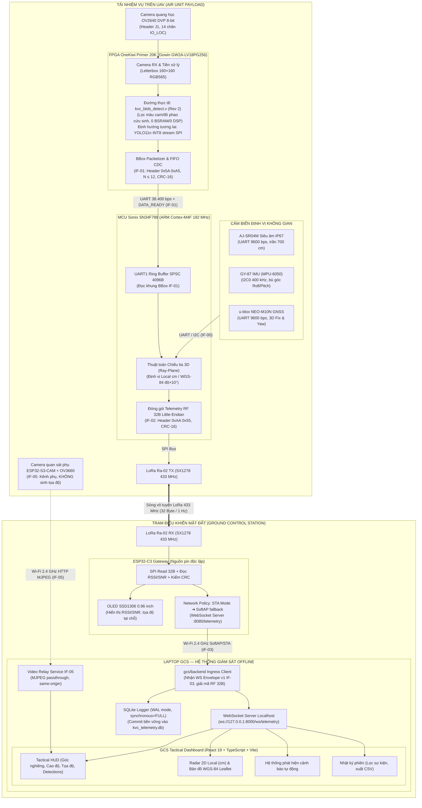

# KVC Product — Payload và GCS Tìm Kiếm Cứu Nạn UAV

Hệ thống tải nhiệm vụ (Payload) và Trạm điều khiển mặt đất (Ground Control Station - GCS) tích hợp cho máy bay không người lái (UAV) phục vụ công tác phát hiện, theo dõi và định vị cứu nạn người/phao trôi dạt trong bối cảnh thiên tai bão lũ.

> [!IMPORTANT]
> **Ranh giới phân hệ và phạm vi khí tài:**
> KVC là **tải nhiệm vụ trinh sát cứu nạn** (Payload), **KHÔNG PHẢI Flight Controller (FC)**. Hệ thống không can thiệp vào điều khiển cân bằng bay, động cơ, cánh lái, arm/disarm hay lập lộ trình bay (waypoint) của UAV.

---

## 1. Trạng Thái Bằng Chứng Kỹ Thuật

Mọi kết quả và tính năng trong dự án đều được phân định theo 5 cấp độ bằng chứng thực nghiệm:

| Nhãn mức | Định nghĩa chuẩn dự án |
|---|---|
| `DESIGN` | Đề xuất kiến trúc, giải pháp lý thuyết, chưa đối chiếu mã nguồn hay chạy thực nghiệm. |
| `SOURCE-VERIFIED` | Đã đọc, đối chiếu cấu trúc mã nguồn, có căn cứ file/dòng cụ thể. |
| `SIMULATED` | Đã kiểm chứng qua testbench RTL, host test phần mềm hoặc bộ dữ liệu mô phỏng. |
| `BUILT / SYNTHESIZED` | Đã build firmware thành công hoặc tổng hợp bitstream FPGA đạt timing closure (TNS=0). |
| `HARDWARE-VERIFIED` | Đã nạp và đo đạc kiểm chứng thực tế trên bo mạch phần cứng thật kèm log/capture. |

---

## 2. Sơ Đồ Kiến Trúc Toàn Hệ Thống

Toàn bộ hệ thống vận hành theo kiến trúc xử lý tại biên (Edge AI) và trạm đất ngoại tuyến (100% Offline), triệt để tuân thủ nguyên tắc **"Zero-Video over LoRa"** — chỉ truyền siêu dữ liệu (Metadata) qua sóng vô tuyến LoRa tầm xa.



---

## 3. Các Luồng Chi Tiết Chuẩn Dự Án

Hệ thống vận hành đồng bộ qua 6 luồng dữ liệu chuyên biệt:

### Luồng 1: Thị giác máy tính & Nhận diện BBox trên FPGA (`IF-CAM` ➔ `IF-01`)
1. **Thu nhận ảnh thô:** Camera OV2640 DVP xuất luồng pixel 8-bit (PCLK, VSYNC, HREF, D[7:0]) qua Header J1 bo OneKiwi Primer 20K.
2. **Tiền xử lý tại phần cứng:** Khối Camera RX nhận ảnh, letterbox/resize về kích thước chuẩn **160×160 RGB565**.
3. **Phát hiện đối tượng:**
   - **Đường phần cứng hiện hành (`HARDWARE-VERIFIED`):** Module `kvc_blob_detect.v` quét trực tiếp dòng pixel RGB565 theo tỷ lệ sắc độ và độ bão hòa, lọc hình học (run-length ≥ 3, rows ≥ 6, aspect ≤ 4) để phát hiện phao cứu sinh phản quang (`class_id = 2`). Tiêu tốn cực ít tài nguyên (0 BSRAM, 0 DSP, Fmax ~113–116 MHz).
   - **Đường tương lai (`DESIGN`):** Mô hình mạng nơ-ron YOLO11n INT8 stream weights từng lớp từ SPI Flash W25Q128 (16 MiB) vào Block RAM nội.
4. **Đóng gói và truyền dẫn:** Khối `bbox_packetizer.v` chuyển khung qua bộ đệm FIFO CDC sang bộ phát `uart_tx.v` tốc độ **38.400 bps** (8N1) kèm xung báo `DATA_READY` sang MCU Sonix (Định dạng khung: Sync `0x5A 0xA5`, Version `0x01`, Count $N \le 12$, Timestamp ms, $N \times 8$ byte BBox, CRC-16/CCITT-FALSE).

### Luồng 2: Thu thập cảm biến & Định vị mục tiêu 3D trên MCU Sonix (`IF-00` ➔ Thuật toán Georef)
1. **Thu nhận BBox:** Ngắt `UART1_IRQHandler` đẩy byte vào Ring buffer SPSC 4096 byte, module `kvc_fpga_bbox.c` xác thực khung và giải mã tọa độ pixel tâm box.
2. **Đo đạc cảm biến định vị:**
   - **Độ cao:** Cảm biến siêu âm chống nước AJ-SR04M đo cự ly mặt nước qua UART2 9600 bps (Dải tin cậy **20–700 cm** sau phê duyệt B-7, phân loại chất lượng `alt_quality`).
   - **Tư thế:** IMU GY-87 (MPU-6050 qua I2C0 400 kHz) ước lượng góc nghiêng Roll/Pitch để bù trừ chuyển động lắc của UAV.
   - **Tọa độ & Phương vị:** GNSS u-blox NEO-M10N cung cấp tọa độ vị trí toàn cầu WGS-84 qua UART3 9600 bps và cung cấp góc hướng Yaw từ tốc độ di chuyển mặt đất (`track_made_good`).
3. **Thuật toán giao tia chiếu (Ray-Plane Intersection):** Module `kvc_georef.c` kết hợp tâm BBox, ma trận quay tư thế $\mathbf{R}_{\text{camera}}$ và cự ly siêu âm để giải phương trình giao điểm tia quang học với mặt phẳng nước:
   $$\mathbf{p}_{\text{local}} = \mathbf{t}_{\text{camera}} + \lambda \cdot \mathbf{R}_{\text{camera}} \cdot \mathbf{v}_{\text{pixel}}$$
   Tính toán xuất tọa độ cục bộ Local (cm, mốc bể bơi/sa bàn) hoặc WGS-84 toàn cầu (độ $\times 10^7$). Cập nhật cờ trạng thái `Sensor Status Flags` (GNSS_VALID, ALT_VALID, IMU_VALID, AI_DETECTED).

### Luồng 3: Đóng gói vô tuyến LoRa 433 MHz & Gateway Trạm Đất (`IF-02` ➔ `IF-03`)
1. **Đóng gói nhị phân:** MCU đóng gói đúng **32 byte** Little-Endian (`KvcTelemetryPacket32`, ABI IF-02 được HUMAN duyệt 29/10/2026), tính CRC-16/CCITT-FALSE trên byte 0–29. Byte 25 là `status_reserved` (luôn `0`, đã bỏ đo pin).
2. **Phát vô tuyến tầm xa:** Module Ra-02 (SX1278) phát gói 433 MHz (SF7, BW 125 kHz, CR 4/5, HW CRC) ở tần suất 1 Hz (chuẩn) / 2–5 Hz (khi có mục tiêu).
3. **Thu và hiển thị tại chỗ:** Ra-02 trạm đất nhận sóng, kích hoạt ngắt DIO0. ESP32-C3 đọc gói qua SPI, đọc thanh ghi RSSI và SNR, kiểm tra CRC-16 (loại bỏ gói hỏng) và hiển thị tức thời lên màn hình OLED SSD1306 (128×64) độc lập với máy tính.
4. **Cầu nối mạng (Network Policy):** ESP32 kết nối Wi-Fi 2.4 GHz (ưu tiên STA; tự động chuyển sang SoftAP `KVC_GROUND_STATION` 192.168.4.1 nếu mất mạng) và mở WebSocket Server tại cổng 8080 (`ws://<IP>:8080/telemetry`).
5. **Chuyển tiếp JSON v1:** Phát message JSON UTF-8 chứa envelope: `transport_version: 1`, `gateway_session_id`, `gateway_sequence`, `rx_monotonic_ms`, `rf_payload_hex` (64 ký tự hex), `rssi_dbm`, `snr_db`, `rx_drop_count`.

### Luồng 4: Tiếp nhận Ingress, Lưu trữ SQLite WAL & Hiển thị GCS Dashboard (`IF-03` ➔ `IF-04` ➔ UI)
1. **Thu nhận Ingress:** Dịch vụ Python FastAPI trên Laptop (`gcs/backend/esp32_ingress.py`) đóng vai trò WebSocket Client kết nối vào ESP32, nhận gói JSON, thẩm định 64 hex và giải mã 32 byte wire.
2. **Lưu trữ dữ liệu bền vững:** Dữ liệu hợp lệ được ghi tuần tự vào SQLite database (`kvc_telemetry.db`) ở chế độ WAL (`PRAGMA synchronous=FULL`), bảo vệ dữ liệu chống mất điện đột ngột.
3. **Phát tán nội bộ:** Backend mở WebSocket Server local (`ws://127.0.0.1:8000/ws/telemetry`) phát trạng thái thời gian thực cho giao diện.
4. **Trực quan hóa GCS Tactical Dashboard (React 19 + TypeScript + Vite):**
   - **Tactical HUD:** Cụm đồng hồ đo góc nghiêng OrientationCluster, thanh đo độ cao WaterClearanceGauge, thanh trạng thái cảm biến SensorFlagsInspector và danh sách nhận diện RecentDetectionsTable.
   - **Bản đồ đa chế độ:** Radar quét 2D cục bộ (cm) và bản đồ địa lý OSM Leaflet WGS-84 (100% tài nguyên offline).
   - **Hệ thống cảnh báo tự động (`alertDetector.ts`):** Nhận diện mất kết nối LoRa, UAV nghiêng nguy hiểm (>25°), độ cao quá thấp (<1,5 m), mất GNSS 3D fix.
   - **Nhật ký phiên (`EventLogPage`):** Xem lại toàn bộ dữ liệu phiên đã commit, lọc theo mức độ cảnh báo/nguồn phát và xuất báo cáo CSV.
   - **2 chế độ hoạt động:** Chỉ hỗ trợ `MOCK` và `REAL`. Chế độ Replay đã loại bỏ hoàn toàn khỏi UI.

### Luồng 5: Kênh quan sát phụ Video Relay IF-05 (ESP32-S3-CAM + OV3660)
1. **Phân định ranh giới:** Đây là kênh video quang học hỗ trợ người vận hành quan sát hiện trường, **hoàn toàn độc lập với kênh LoRa 32 byte**, **không sinh tọa độ** và **không thay thế camera OV2640/FPGA**.
2. **Thu và nén ảnh:** ESP32-S3-CAM chụp ảnh bằng cảm biến OV3660 (độ phân giải HVGA 480×320, chất lượng JPEG q22/q26), phát luồng HTTP MJPEG `multipart/x-mixed-replace` trên cổng 81.
3. **Relay trung gian same-origin:** Backend GCS (`video_relay.py`) duy trì duy nhất **1** kết nối tới camera và phân phối lại cùng nguồn (same-origin) cho trình duyệt web tại `http://localhost:8000/video/stream` (`has_overlay = false`). Trình duyệt web không bao giờ gọi trực tiếp camera.

### Luồng 6: Kênh tham chiếu mô hình AI trên máy tính (`PC_REFERENCE`)
1. **Mục đích:** Đánh giá đối chứng mô hình YOLO11n phát hiện 2 lớp (`person`, `lifebuoy`) trên video lũ lụt thực tế hoặc webcam bàn thí nghiệm trước khi triển khai phần cứng.
2. **Thực thi:** Sử dụng script `scripts/manual/run_stream.py` với Ultralytics YOLO11n checkpoint, suy luận trực tiếp trên CPU/GPU laptop, vẽ khung bao và phát lại luồng MJPEG tại cổng 8090.
3. **Quy chuẩn nguồn:** Mọi kết quả từ luồng này đều mang nhãn nguồn `PC_REFERENCE`, không đại diện cho việc AI đã chạy trên chip FPGA.

---

## 4. Cây Thư Mục Dự Án Chuẩn Hóa

```text
fpgaODUCT/
├── README.md                      # Tài liệu tổng quan và hướng dẫn dự án
├── AGENTS.md                      # Quy tắc AI, phân quyền và chuẩn báo cáo
├── pytest.ini                     # Cấu hình test: gcs/backend/tests và tests
├── .agents/rules/kvc.md           # Adapter quy tắc Antigravity
├── scripts/
│   ├── test_firmware.ps1          # Script kiểm thử firmware + gateway + pytest
│   ├── run_fpga_tb.ps1            # Script chạy 22+ testbench FPGA Gowin
│   ├── kvc-review.ps1             # Script hỗ trợ review mã nguồn Codex
│   └── manual/                    # Các công cụ kiểm thử tích hợp, chẩn đoán pixel/vsync
├── firmware/
│   ├── mcu_payload/               # Mã nguồn MCU Sonix SN34F788 (Keil MDK)
│   │   ├── inc/                   # Header công khai, kvc_telemetry.h, DFP hãng
│   │   ├── src/                   # kvc_timebase.c, kvc_georef.c, sensors/
│   │   ├── project_keil/          # Project Keil uVision + RTE
│   │   └── tests/                 # Bộ host test C (gcc) cho cảm biến & định vị
│   ├── gateway_esp32/             # Gateway ESP32-C3 trạm đất (PlatformIO)
│   │   ├── src/                   # main.cpp, rf_decode, net_policy, ws_route
│   │   └── host_tests/            # Bộ host test C++ (g++) cho decode & network policy
│   └── esp32_s3_cam/              # Camera quan sát phụ ESP32-S3-CAM + OV3660 (IF-05)
├── fpga/                        # Mã nguồn RTL FPGA Gowin Primer 20K
│   ├── src/                       # kvc_top_demo.v, comm/uart_tx.v, comm/bbox_packetizer.v
│   ├── src/processing/            # kvc_blob_detect.v, pixel_stats.v, vsync_monitor.v
│   ├── constraints/               # Ràng buộc chân và timing (.cst, .sdc)
│   └── verification/tb/           # 22+ Testbench mô phỏng kiểm thử RTL
├── gcs/
│   ├── backend/                   # FastAPI + Ingress WebSocket + SQLite WAL + Video relay
│   │   ├── main.py, esp32_ingress.py, video_relay.py, sqlite_logger.py, state.py
│   │   └── tests/                 # Bộ test tự động pytest cho backend & IF-05
│   └── frontend/                  # React 19 + TypeScript + Vite + Tailwind CSS
│       ├── src/app/               # AppShell, TopBar, Navigation, Store
│       ├── src/features/          # mission/, alerts/, telemetry/, history/, map/, video/
│       └── tests/                 # Vitest tests cho frontend và contract verification
├── ai/                            # Ontology và manifest mô hình AI tham chiếu
├── tests/                         # Kiểm thử tích hợp hệ thống đa phân hệ
└── docs/                          # Hệ thống tài liệu kỹ thuật chuẩn dự án (xem docs/INDEX.md)
```

---

## 5. Hướng Dẫn Vận Hành Nhanh (Quick Start)

### 5.1. Khởi chạy Backend GCS (Port 8000)

```powershell
# Kích hoạt môi trường ảo Python
.venv\Scripts\Activate.ps1
# Cài đặt thư viện phụ thuộc
python -m pip install -r gcs/backend/requirements.txt
# Chạy backend server
python -m uvicorn gcs.backend.main:app --host 127.0.0.1 --port 8000
```
- Swagger API Docs: `http://127.0.0.1:8000/docs`
- Localhost WebSocket: `ws://127.0.0.1:8000/ws/telemetry`

### 5.2. Khởi chạy GCS Dashboard UI (Port 5173)

```powershell
cd gcs\frontend
npm ci
npm run dev
```
- Truy cập Dashboard tác chiến tại: `http://localhost:5173`

### 5.3. Chạy luồng AI tham chiếu PC (`PC_REFERENCE`)

```powershell
# Chạy nhận diện person/lifebuoy trên webcam hoặc video clip
python scripts\manual\run_stream.py --source 0 --port 8090
# Xem luồng hiển thị khung nhận diện tại: http://127.0.0.1:8090/
```

### 5.4. Thực thi toàn bộ bộ kiểm thử dự án

```powershell
# Chạy toàn bộ (Host test MCU + Host test Gateway + Pytest backend)
pwsh -File scripts/test_firmware.ps1

# Chạy riêng bộ 22+ Testbench FPGA Gowin
pwsh -File scripts/run_fpga_tb.ps1

# Chạy riêng bộ kiểm thử frontend UI
cd gcs\frontend
npm run test
```

---

## 6. Các Ràng Buộc Bất Biến (Project Invariants)

1. **Khóa ABI RF 32-byte (IF-02):** Chiều dài cố định đúng 32 byte Little-Endian, CRC-16/CCITT-FALSE trên byte 0–29, Golden Vector GV-02 (`0xE260`). Byte 25 là `status_reserved` (luôn `0`). Tuyệt đối không thay đổi bố cục byte nếu chưa có phê duyệt HUMAN.
2. **Baudrate FPGA ↔ MCU (IF-01):** Khóa cố định ở **38.400 bps** (8N1), số lượng BBox tối đa $N \le 12$.
3. **Phân định camera:** OV2640 DVP trên FPGA là **nguồn tọa độ quang học duy nhất**. ESP32-S3-CAM là kênh hình ảnh phụ quan sát cho người vận hành, không tham gia tính toán tọa độ.
4. **Không kết nối trực tiếp ESP32 từ trình duyệt:** Trình duyệt web Dashboard chỉ kết nối vào Backend Python trên Laptop, bảo đảm 100% dữ liệu được ghi vào SQLite và không gây quá tải cho ESP32.
5. **Giao diện người dùng:** Chỉ hỗ trợ 2 chế độ **MOCK** và **REAL**. Chế độ Replay đã loại bỏ hoàn toàn khỏi UI, thay thế bằng trang **Nhật ký phiên** (`EventLogPage`).

Xem chi tiết danh mục tài liệu tại [docs/INDEX.md](docs/INDEX.md).
