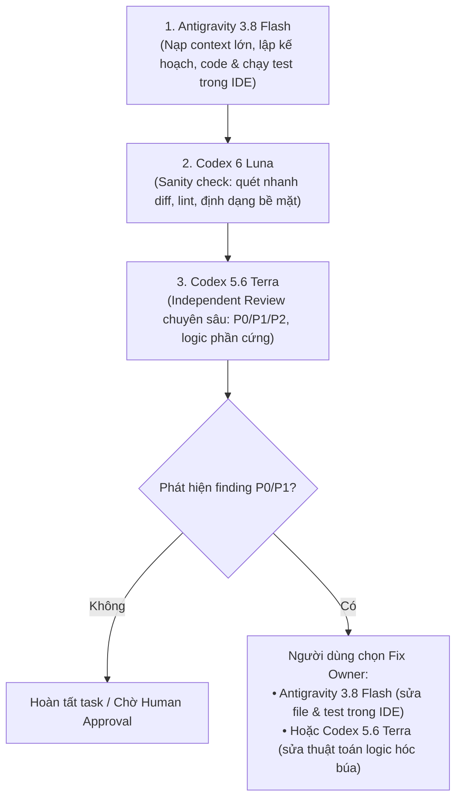

# KVC — Ghi chú tham khảo: So sánh & Phối hợp các Model AI (Codex & Antigravity)

**Trạng thái:** Reference / User Note  
**Mục đích:** Tài liệu tham khảo cá nhân cho người dùng để lựa chọn và tối ưu hóa việc phân bổ các model AI (Codex và Antigravity) trong quá trình phát triển dự án.  
**Lưu ý phạm vi:** Tài liệu này mang tính chất thông tin tham khảo, **không** bắt buộc các AI Agent phải tự động nạp vào context hay đưa vào rules hệ thống.

---

## 1. So sánh các Model trong Codex (5.6 Luna, 6 Luna, 5.6 Terra)

Trong hệ thống model OpenAI (sử dụng qua Codex CLI, IDE integration và API), các model được phân cấp theo 3 tier chính:
- **Sol:** Flagship / High-end (năng lực suy luận cao nhất, chi phí lớn nhất).
- **Terra:** Mid-tier / Workhorse (cân bằng giữa suy luận chuyên sâu và chi phí).
- **Luna:** Lightweight / High-speed (tối ưu hóa độ trễ, tốc độ và chi phí cực thấp).

### Bảng đối chiếu thông số & đặc tính

| Tiêu chí | GPT-5.6 Luna | GPT-6 Luna | GPT-5.6 Terra |
| :--- | :--- | :--- | :--- |
| **Phân khúc (Tier)** | Lightweight (Gen 5.6) | Lightweight (Gen 6) | **Mid-tier / Workhorse (Gen 5.6)** |
| **Mục đích thiết kế** | Tác vụ phụ trợ, latency thấp | Thay thế 5.6 Luna: rẻ hơn, nhanh hơn, giảm ảo giác | Lập trình logic, suy luận đa bước, phân tích hệ thống |
| **Năng lực suy luận (Intelligence)** | Cơ bản (~37 điểm Index) | Nâng cao (~39–40 điểm Index) | **Mạnh nhất nhóm (~42–43 điểm Index)** |
| **Tỷ lệ ảo giác (Hallucination)** | Trung bình | Thấp (thừa hưởng alignment thế hệ 6) | Rất thấp trong bài toán logic / code |
| **Tốc độ sinh token (Throughput)** | Nhanh (~120–125 tps) | **Nhanh nhất (~135+ tps)** | Nhanh (~130 tps) |
| **Chi phí API / 1M tokens** | Rẻ (~$0.20 In / $1.20 Out) | **Rẻ nhất (~$0.10 In / $0.50 Out)** | Cao hơn (~50–60% mức giá của dòng Sol) |
| **Khả năng suy luận đa file** | Hạn chế | Khá ở mức cục bộ | **Tốt (xử lý logic kiến trúc và module lớn)** |

### Đánh giá nhanh:
1. **GPT-5.6 Terra:** Thích hợp nhất cho vai trò **Coder chính** hoặc **Deep Reviewer** khi cần giải quyết bài toán phức tạp (thuật toán định vị không gian giao điểm tia quang học với mặt nước dựa trên cự ly cảm biến siêu âm AJ-SR04M và góc nghiêng IMU, xử lý ngắt/ring buffer SPSC, phân tích state machine).
2. **GPT-6 Luna:** Vượt trội hoàn toàn so với 5.6 Luna. Rẻ hơn 50%, tốc độ cao hơn và ít lỗi bịa mã hơn. Thích hợp cho các vòng lặp tự động (CI/CD, auto-review sơ bộ, format code, sinh docstring).
3. **GPT-5.6 Luna:** Phiên bản tiền nhiệm; nên thay thế dần bằng 6 Luna để tiết kiệm chi phí và tăng độ chính xác.

---

## 2. Phối hợp khi có thêm Antigravity (Gemini 3.8 Flash)

### Đặc tính nổi bật của Antigravity (3.8 Flash):
- **Context Window siêu lớn:** Có khả năng đọc toàn bộ tài liệu đặc tả (`docs/KVC_ThietKeHeThong.md`, `docs/KVC_AI_WORKFLOW.md`), mã nguồn và log dài mà không sợ tràn ngữ cảnh hay suy giảm khả năng chú ý.
- **Tốc độ phản hồi cực nhanh (Flash tier):** Độ trễ thấp, lý tưởng cho việc tương tác trực tiếp (pair-programming).
- **Tích hợp sâu môi trường IDE:** Thao tác trực tiếp với workspace (đọc/sửa file, chạy lệnh terminal `pwsh`, thực thi test và biên dịch).

---

## 3. Ma trận phân vai tối ưu (Role Assignment Matrix)

Tuân thủ nguyên tắc cốt lõi của dự án: *Mỗi task chỉ có 1 writer sửa code, Codex review code của Antigravity là Đánh giá độc lập (INDEPENDENT REVIEW)*.

| Model | Vai trò tối ưu trong dự án | Nhiệm vụ cụ thể |
| :--- | :--- | :--- |
| **Antigravity (3.8 Flash)** | **Primary Coder & Workspace Integrator** | • Đọc hiểu toàn bộ tài liệu specs và cấu trúc thư mục. • Viết và chỉnh sửa code trực tiếp trong IDE. • Chạy compiler, linter, testbench tại terminal và báo cáo kết quả thực thi. |
| **Codex (6 Luna)** | **Fast Triage & Sanity Checker** | • Quét nhanh diff (`git diff --check`, style, naming convention). • Tự động sinh boilerplate, docstring, unit test khung. • Tiết kiệm tối đa chi phí token cho các bước kiểm tra lặp đi lặp lại. |
| **Codex (5.6 Terra)** | **Independent Reviewer & Deep Fixer** | • Review độc lập (Independent Review) bắt lỗi P0/P1/P2 theo quy chuẩn `AGENTS.md`. • Kiểm tra chuyên sâu: logic phần cứng, timing, race condition, vi phạm giao thức UART/LoRa. • Đảm nhận vai trò Fix Owner khi gặp bài toán toán học/thuật toán phức tạp. |

---

## 4. Quy trình phối hợp 4 bước (Standard Workflow)

1. **Bước 1 — Implement (Antigravity 3.8 Flash):**  
   Nạp toàn bộ context dự án, viết code trong phạm vi `allowed files`, chạy build/test tại terminal cục bộ.
2. **Bước 2 — Sơ duyệt tiết kiệm (Codex 6 Luna):**  
   Dùng 6 Luna quét qua diff để loại bỏ ngay các lỗi format hoặc thiếu sót hiển nhiên trước khi kích hoạt quy trình review tốn kém.
3. **Bước 3 — Thẩm định độc lập (Codex 5.6 Terra):**  
   Dùng 5.6 Terra chạy `scripts/kvc-review.ps1 -DryRun` để rà soát rủi ro hệ thống, vi phạm giao thức, xuất finding kèm bằng chứng và đưa task về trạng thái `WAITING_FIX_OWNER`.
4. **Bước 4 — Sửa lỗi (Fix Owner):**  
   Người dùng chỉ định:
   - Chọn **Antigravity 3.8 Flash** nếu cần sửa nhanh nhiều file trong workspace và chạy lại test suite.
   - Chọn **Codex 5.6 Terra** nếu lỗi nằm ở tầng suy luận toán học trừu tượng hoặc thuật toán lõi.

---

## 5. Bảng tra cứu nhanh tình huống (Cheat Sheet)

| Tình huống / Nhu cầu | Lựa chọn model khuyến nghị | Lý do |
| :--- | :--- | :--- |
| Đọc tài liệu dài + code tính năng mới trong IDE | **Antigravity 3.8 Flash** | Context rộng, thao tác file và terminal trực tiếp. |
| Quét format, linter, sinh docstring hàng loạt | **Codex 6 Luna** | Siêu nhanh, chi phí rẻ nhất, hạn chế hao phí token. |
| Đánh giá độc lập (Independent Review) diff quan trọng | **Codex 5.6 Terra** | Suy luận sâu, phát hiện điểm mù và race condition. |
| Giải toán giao điểm tia quang học, tối ưu thuật toán WGS-84 | **Codex 5.6 Terra** | Khả năng tư duy logic và toán học chính xác cao. |
| Chạy các script tự động / CI checks lặp lại nhiều lần | **Codex 6 Luna** | Tối ưu hóa ngân sách và throughput. |

---

## 6. Ghi chú mở rộng: Tích hợp Kilo CLI

Theo cập nhật tại [AGENTS.md](file:///d:/Project_UAV_KVC/AGENTS.md):
- **Codex, Antigravity và Kilo** đều có thể đảm nhận vai trò **CODER**: lập kế hoạch, viết mã/test, biên dịch và sửa lỗi trong phạm vi task được giao.
- Khi người dùng làm việc trong phiên **Kilo**, Kilo mặc định là owner cho task phát sinh trong phiên đó, bất kể model backend mà phiên Kilo đang dùng. Nếu người dùng chỉ định công cụ khác, công cụ đang chat sẽ chuẩn bị prompt handoff thay vì tự ý chỉnh sửa.
