# KVC — ĐẶC TẢ TỔNG QUAN CHỨC NĂNG & HƯỚNG DẪN CODE GATEWAY ESP32
## PHÂN HỆ TRẠM THU MẶT ĐẤT (GROUND STATION GATEWAY & TELEMETRY INGRESS)

> **Người phụ trách:** Đoàn Thanh Trường Thịnh  
> **Dự án:** UAV Search and Rescue Target Geolocation (KVC)  
> **Phần cứng mục tiêu:** Bo mạch **ESP32-C3 DevKit** (hoặc ESP32 Classic) + Module **LoRa Ra-02 (SX1278 433MHz)**  
> **Môi trường phát triển:** VS Code + PlatformIO (`framework = arduino`)  
> **Hợp đồng giao diện tuân thủ:**
> - Đầu vào (RF Ingress): 👉 [docs/interfaces/IF_MCU_LORA_RF.md](../interfaces/IF_MCU_LORA_RF.md) (Gói tin 32 byte)
> - Đầu ra (WebSocket Ingress): 👉 [docs/interfaces/IF_ESP32_GCS_WS.md](../interfaces/IF_ESP32_GCS_WS.md) (Envelope JSON v1)

---

## 1. TỔNG QUAN NHIỆM VỤ CỦA THỊNH TRONG DỰ ÁN

Phân hệ **Gateway ESP32** đóng vai trò là "cầu nối biên vô tuyến" (Edge Wireless Gateway) nằm tại trạm mặt đất:
1. **Thu sóng LoRa độc lập:** Sử dụng nguồn pin riêng, liên tục thu các bản tin cứu nạn (32 byte) do MCU Sonix SN34F788 trên UAV bắn xuống ở tần số **433.0 MHz**.
2. **Đo đạc chất lượng kết nối:** Trích xuất chỉ số cường độ sóng **`RSSI (dBm)`** và tỷ số tín hiệu trên nhiễu **`SNR (dB)`** từ chip SX1278.
3. **Kiểm tra tính toàn vẹn:** Xác minh mã **`CRC-16/CCITT-FALSE`** của gói tin trước khi cho phép dữ liệu đi tiếp.
4. **Thiết lập mạng theo thứ tự ưu tiên:** (1) kết nối Wi-Fi 2.4 GHz đã cấu hình sẵn (tối đa 4 mạng; "4G" của dự án là hotspot do điện thoại phát, không cần module 4G); (2) nếu không có credential hoặc hết ngân sách khởi động mà chưa nối được thì tự phát SoftAP `KVC_GROUND_STATION` (IP `192.168.4.1`, mật khẩu `kvc123456`). Khi ưu tiên 1 nối lại được, firmware tự đóng SoftAP. ESP32-C3 chỉ hỗ trợ 2.4 GHz.
5. **Mở WebSocket Server (:8080):** Đóng gói payload kèm metadata sóng vô tuyến thành bản tin JSON **Transport Envelope v1** để bắn sang Backend GCS chạy trên laptop qua đường truyền WebSocket.
6. **Bộ đệm chống mất dữ liệu (Offline FIFO - Mục tiêu mở rộng):** Đề xuất lưu tạm tối đa 64 gói vào RAM khi laptop ngắt kết nối Wi-Fi; bản firmware v1 hiện hành trong `src/main.cpp` thực hiện phát trực tiếp (broadcast) tới các client đang kết nối.

```mermaid
flowchart LR
    subgraph AIR_UNIT ["TẢI TRÊN UAV"]
        SONIX["MCU Sonix SN34F788<br/>(Duy Phong)"] -- "Gói RF 32-Byte<br/>(433 MHz LoRa)" --> LORA_TX["LoRa Ra-02 TX"]
    end

    subgraph GROUND_GATEWAY ["GATEWAY TRẠM ĐẤT (THỊNH)"]
        LORA_RX["LoRa Ra-02 RX"] -- "SPI Bus" --> ESP32["ESP32-C3 Core<br/>(Nguồn Pin Độc Lập)"]
        ESP32 -- "1. Kiểm tra CRC16<br/>2. Đọc RSSI & SNR<br/>3. Đóng JSON v1" --> WS_SRV["WebSocket Server<br/>(:8080/telemetry)"]
    end

    subgraph LAPTOP_GCS ["TRẠM ĐIỀU HÀNH LAPTOP"]
        WS_CLIENT["Backend Python GCS<br/>(Ingress Client)"] --> SQLITE["Ghi SQLite WAL<br/>& Replay Engine"]
        SQLITE --> DASHBOARD["Web Dashboard GCS<br/>(Bản đồ OSM, Radar)"]
    end

    LORA_TX -. "Sóng RF 433 MHz" .-> LORA_RX
    WS_SRV -- "Wi-Fi SoftAP<br/>(192.168.4.1)" --> WS_CLIENT
```



---

## 2. BẢNG PHÂN RÃ CÁC CHỨC NĂNG CỐT LÕI (MODULE BREAKDOWN)

Firmware của bạn được chia thành 4 khối chức năng độc lập:

| Module Code | Tên chức năng | Mô tả công việc cụ thể |
| :--- | :--- | :--- |
| **`lora_receiver`** | Thu sóng LoRa SX1278 | • Khởi tạo chip SX1278 qua SPI (433MHz, BW 125kHz, SF7, CR 4/5, Sync 0x12).<br>• Bắt ngắt nhận gói `DIO0 (RxDone)`.<br>• Đọc 32 byte dữ liệu thô, đọc RSSI và SNR. |
| **`crc16`** | Kiểm tra lỗi gói tin | • Thuật toán `CRC-16/CCITT-FALSE` (Poly `0x1021`, Init `0xFFFF`).<br>• Tính trên 30 byte đầu tiên, so khớp với 2 byte CRC ở cuối gói tin. |
| **`wifi_softap`** | Trạm phát Wi-Fi | • Cấu hình Access Point: SSID `KVC_GROUND_STATION`, bảo mật WPA2.<br>• Cấu hình IP tĩnh: `192.168.4.1`, Subnet: `255.255.255.0`. |
| **`ws_server`** | WebSocket Server | • Mở cổng TCP `8080`, endpoint `/telemetry`.<br>• Lắng nghe kết nối từ Backend Python trên laptop.<br>• Chuyển đổi 32 byte thành chuỗi Hex 64 ký tự và broadcast JSON Envelope v1. |

---

## 3. SƠ ĐỒ ĐẤU NỐI CHÂN PHẦN CỨNG (WIRING PINOUT)

### Kết nối ESP32-C3 với Module LoRa Ra-02 (SX1278):

> ⚠️ **CẢNH BÁO:** Module Ra-02 chỉ hoạt động ở điện áp **3.3V**. Cắm vào 5V sẽ làm cháy chip SX1278 ngay lập tức! Bắt buộc cắm ăng-ten 433MHz vào module trước khi cấp nguồn.

| Chân Module LoRa Ra-02 | Chân ESP32-C3 | Chân ESP32 DevKit V1 (Classic) | Chức năng kỹ thuật |
| :---: | :---: | :---: | :--- |
| **`VCC`** | **`3V3`** | **`3V3`** | Nguồn nuôi 3.3V ổn định |
| **`GND`** | **`GND`** | **`GND`** | Nối đất chung |
| **`NSS` (CS)** | **`GPIO 7`** | **`GPIO 5`** | SPI Chip Select (Software NSS) |
| **`SCK`** | **`GPIO 4`** | **`GPIO 18`** | SPI Clock |
| **`MOSI`** | **`GPIO 6`** | **`GPIO 23`** | SPI Master Out Slave In |
| **`MISO`** | **`GPIO 5`** | **`GPIO 19`** | SPI Master In Slave Out |
| **`RST`** | **`GPIO 1`** | **`GPIO 14`** | Chân Reset phần cứng cho SX1278 |
| **`DIO0`** | **`GPIO 3`** | **`GPIO 2`** | Ngắt ngoài báo nhận xong gói (RxDone) |

---

## 4. ĐẶC TẢ GIAO DIỆN DỮ LIỆU BẮT BUỘC TUÂN THỦ

### 4.1. Cấu trúc gói tin LoRa 32-Byte (IF-02 từ MCU Sonix)
MCU Sonix trên UAV đóng gói 32 byte theo thứ tự Little-Endian:
* **Byte 0–1:** Sync Header cố định `0xAA 0x55` (Big-Endian: `0xAA`, `0x55`).
* **Byte 2:** Message ID (`0x01`: Telemetry mục tiêu, `0x02`: Heartbeat).
* **Byte 3:** Sequence Number (0–255, xoay vòng).
* **Byte 4–7:** Timestamp MCU UAV (uint32_t, mili-giây).
* **Byte 8–11:** Target Latitude (int32_t, $\times 10^7$ độ).
* **Byte 12–15:** Target Longitude (int32_t, $\times 10^7$ độ).
* **Byte 16–17:** Target X Local cm (int16_t).
* **Byte 18–19:** Target Y Local cm (int16_t).
* **Byte 20–21:** Altitude Distance cm (uint16_t, siêu âm AJ-SR04M).
* **Byte 22:** Class ID (`1`: `person`, `2`: `lifebuoy`).
* **Byte 23:** Confidence (0–100%).
* **Byte 24:** Sensor Status Flags (Bit 0: GPS Fix, Bit 1: Siêu âm ALT_VALID, Bit 2: IMU, Bit 3: Target Valid).
* **Byte 25:** Status Reserved (dự phòng, luôn `0`; trước đây là điện áp pin 0.1V/bit — KVC đã bỏ phép đo pin).
* **Byte 26–29:** Reserved (4 bytes dự phòng).
* **Byte 30–31:** **CRC-16/CCITT-FALSE** (Tính từ Byte 0 đến Byte 29).

### 4.2. Định dạng JSON Envelope WebSocket v1 (IF-03 gửi sang Laptop)
Khi nhận gói 32 byte hợp lệ từ LoRa, ESP32 **không cần giải mã tọa độ**, mà chỉ cần đổi 32 byte thành **chuỗi Hex 64 ký tự** (`rf_payload_hex`) và gửi nguyên vẹn sang Backend Python qua WebSocket:

```json
{
  "transport_version": 1,
  "gateway_session_id": 3821045771,
  "gateway_sequence": 42,
  "rx_monotonic_ms": 125430,
  "rf_payload_hex": "aa55012ae8030000baba6b06d4b3923f96004001f000015c0f000000000060e2",
  "rssi_dbm": -76,
  "snr_db": 8.5,
  "rx_drop_count": 0
}
```

> **Vector trong ví dụ là GV-02** của [IF-02](../interfaces/IF_MCU_LORA_RF.md) mục 3 (CRC-16 = `0xE260`, lưu LE `60 e2`). GV-02 thay GV-01 sau khi KVC bỏ phép đo pin: byte 25 (`status_reserved`) luôn `0`, layout vẫn 32 byte. `gateway_session_id` chỉ là giá trị minh hoạ: firmware sinh mỗi lần boot từ `esp_random()` trộn MAC eFuse và bảo đảm `>= 2` (xem `session_id.h`), in ra Serial dòng `[SESSION] gateway_session_id = ...`. Vector `aa55012a78e10100...a1b2` từng có trong tài liệu này là fixture lịch sử **có CRC sai**, không dùng làm kỳ vọng.

*Lợi ích kiến trúc:* Thiết kế này giúp firmware ESP32 của bạn cực kỳ nhẹ, không tốn RAM tính toán số thực, không bao giờ bị nghẽn (latency $< 5\text{ms}$), mọi việc giải mã sâu sẽ do Backend Python trên máy tính đảm nhận!

---

## 5. CẤU TRÚC THƯ MỤC SOURCE CODE ĐỀ XUẤT CHO THỊNH

Trong thư mục `firmware/gateway_esp32/`, bạn sẽ tạo các file mã nguồn sau:

```text
firmware/gateway_esp32/
├── platformio.ini         # Cấu hình nạp (đã có sẵn thư viện LoRa, WebSockets, ArduinoJson)
├── include/
│   ├── config.h           # Định nghĩa chân GPIO, thông số LoRa, cấu hình Wi-Fi
│   ├── crc16.h            # Khai báo hàm tính toán CRC-16/CCITT-FALSE
│   ├── lora_receiver.h    # Khai báo hàm quản lý chip SX1278
│   ├── wifi_softap.h      # Khai báo hàm quản lý Wi-Fi AP
│   └── ws_server.h        # Khai báo WebSocket Server
└── src/
    ├── crc16.cpp          # Triển khai thuật toán CRC-16
    ├── lora_receiver.cpp  # Đọc gói LoRa, bắt ngắt DIO0, lấy RSSI/SNR
    ├── wifi_softap.cpp    # Khởi tạo Wi-Fi SoftAP
    ├── ws_server.cpp      # Xử lý WebSocket, đóng gói JSON và broadcast
    └── main.cpp           # Vòng lặp chính (Setup & Loop)
```

---

## 6. KHUNG CODE CHI TIẾT TỪNG MODULE (READY-TO-USE CODE)

Dưới đây là mã nguồn chuẩn chỉnh từng file bạn có thể lưu thẳng vào dự án:

### File 1: `include/config.h`
```cpp
#pragma once
#include <Arduino.h>

// =================== CẤU HÌNH CHÂN SPI CHO ESP32-C3 ===================
// (Nếu dùng ESP32 Classic: SCK=18, MISO=19, MOSI=23, SS=5, RST=14, DIO0=2)
#define LORA_SCK     4
#define LORA_MISO    5
#define LORA_MOSI    6
#define LORA_SS      7
#define LORA_RST     1
#define LORA_DIO0    3

// =================== THÔNG SỐ VÔ TUYẾN LORA ===================
#define LORA_BAND        433E6    // Tần số 433.0 MHz
#define LORA_BW          125E3    // Băng thông 125 kHz
#define LORA_SF          7        // Spreading Factor 7 (hoặc 8)
#define LORA_CR          5        // Coding Rate 4/5
#define LORA_SYNC_WORD   0x12     // Mạng KVC nội bộ
#define LORA_PREAMBLE    8        // Độ dài Preamble 8 symbols
#define RF_PAYLOAD_SIZE  32       // Kích thước chuẩn 32 bytes

// =================== CẤU HÌNH WI-FI & WEBSOCKET ===================
// Ưu tiên 1: STA (Wi-Fi 2.4 GHz có sẵn) qua build flag, không hardcode.
// Ưu tiên 2: SoftAP dự phòng dưới đây, bật khi STA thất bại sau 15 s
// (KVC_STA_BOOT_BUDGET_MS = 15000 trong src/main.cpp).
#define WIFI_SSID        ""                // Nạp bằng -D KVC_WIFI_SSID=\"...\"
#define WIFI_PASS        ""                // Nạp bằng -D KVC_WIFI_PASS=\"...\"
#define AP_SSID          "KVC_GROUND_STATION"
#define AP_PASS          "kvc123456"       // Mật khẩu SoftAP dự phòng
#define WS_PORT          8080              // Cổng WebSocket
```

---

### File 2: `include/crc16.h` & `src/crc16.cpp`
```cpp
// include/crc16.h
#pragma once
#include <stdint.h>
#include <stddef.h>

uint16_t crc16_ccitt_false(const uint8_t *data, size_t length);
```

```cpp
// src/crc16.cpp
#include "crc16.h"

// Đa thức 0x1021, Giá trị khởi tạo 0xFFFF
uint16_t crc16_ccitt_false(const uint8_t *data, size_t length) {
    uint16_t crc = 0xFFFF;
    for (size_t i = 0; i < length; i++) {
        crc ^= ((uint16_t)data[i] << 8);
        for (uint8_t bit = 0; bit < 8; bit++) {
            if (crc & 0x8000) {
                crc = (crc << 1) ^ 0x1021;
            } else {
                crc = crc << 1;
            }
        }
    }
    return crc;
}
```

---

### File 3: `include/lora_receiver.h` & `src/lora_receiver.cpp`
```cpp
// include/lora_receiver.h
#pragma once
#include <Arduino.h>

struct LoRaRxData_t {
    uint8_t  payload[32];
    int      rssi;
    float    snr;
    bool     crc_valid;
};

bool lora_init(void);
bool lora_receive_packet(LoRaRxData_t &rx_data);
```

```cpp
// src/lora_receiver.cpp
#include "lora_receiver.h"
#include "config.h"
#include "crc16.h"
#include <SPI.h>
#include <LoRa.h>

bool lora_init(void) {
    SPI.begin(LORA_SCK, LORA_MISO, LORA_MOSI, LORA_SS);
    LoRa.setPins(LORA_SS, LORA_RST, LORA_DIO0);
    LoRa.setSPI(SPI);

    if (!LoRa.begin(LORA_BAND)) {
        return false;
    }

    LoRa.setSignalBandwidth(LORA_BW);
    LoRa.setSpreadingFactor(LORA_SF);
    LoRa.setCodingRate4(LORA_CR);
    LoRa.setSyncWord(LORA_SYNC_WORD);
    LoRa.setPreambleLength(LORA_PREAMBLE);
    LoRa.enableCrc(); // Bật CRC phần cứng SX1278

    return true;
}

bool lora_receive_packet(LoRaRxData_t &rx_data) {
    int packetSize = LoRa.parsePacket();
    if (packetSize == 0) return false;

    // Chỉ nhận đúng gói tin chuẩn 32 byte
    if (packetSize != RF_PAYLOAD_SIZE) {
        while (LoRa.available()) LoRa.read(); // Xả sạch gói rác
        return false;
    }

    for (int i = 0; i < RF_PAYLOAD_SIZE; i++) {
        rx_data.payload[i] = (uint8_t)LoRa.read();
    }

    rx_data.rssi = LoRa.packetRssi();
    rx_data.snr  = LoRa.packetSnr();

    // Kiểm tra Header 0xAA 0x55
    if (rx_data.payload[0] != 0xAA || rx_data.payload[1] != 0x55) {
        return false;
    }

    // Kiểm tra CRC-16/CCITT-FALSE
    uint16_t calc_crc = crc16_ccitt_false(rx_data.payload, 30);
    uint16_t recv_crc = (uint16_t)rx_data.payload[30] | ((uint16_t)rx_data.payload[31] << 8);

    rx_data.crc_valid = (calc_crc == recv_crc);
    return rx_data.crc_valid;
}
```

---

### File 4: `include/wifi_softap.h` & `src/wifi_softap.cpp`
```cpp
// include/wifi_softap.h
#pragma once
#include <WiFi.h>

void wifi_softap_init(void);
```

```cpp
// src/wifi_softap.cpp
#include "wifi_softap.h"
#include "config.h"

void wifi_softap_init(void) {
    IPAddress local_ip(192, 168, 4, 1);
    IPAddress gateway(192, 168, 4, 1);
    IPAddress subnet(255, 255, 255, 0);

    WiFi.mode(WIFI_AP);
    WiFi.softAPConfig(local_ip, gateway, subnet);
    WiFi.softAP(WIFI_SSID, WIFI_PASS);
}
```

---

### File 5: `include/ws_server.h` & `src/ws_server.cpp`
```cpp
// include/ws_server.h
#pragma once
#include <WebSocketsServer.h>
#include "lora_receiver.h"

void ws_server_init(void);
void ws_server_loop(void);
void ws_server_broadcast_telemetry(const LoRaRxData_t &rx_data);
```

```cpp
// src/ws_server.cpp
#include "ws_server.h"
#include "config.h"
#include <ArduinoJson.h>

static WebSocketsServer wsServer(WS_PORT);
static uint32_t session_id = 0;
static uint32_t sequence_num = 0;
static uint32_t drop_count = 0;

static void wsEvent(uint8_t num, WStype_t type, uint8_t * payload, size_t length) {
    if (type == WStype_CONNECTED) {
        IPAddress ip = wsServer.remoteIP(num);
        Serial.printf("[WS] Laptop GCS Connected: %s (Client #%u)\n", ip.toString().c_str(), num);
    } else if (type == WStype_DISCONNECTED) {
        Serial.printf("[WS] Laptop GCS Disconnected (Client #%u)\n", num);
    }
}

void ws_server_init(void) {
    // Session id phải đổi mỗi lần boot (IF-03 mục 3). Firmware thực tế dùng
    // kvc::deriveGatewaySessionId() trộn esp_random() với MAC eFuse và bảo đảm
    // giá trị >= 2; đoạn dưới chỉ là mô tả tối thiểu.
    session_id = (uint32_t)esp_random();
    wsServer.begin();
    wsServer.onEvent(wsEvent);
}

void ws_server_loop(void) {
    wsServer.loop();
}

void ws_server_broadcast_telemetry(const LoRaRxData_t &rx_data) {
    // 1. Chuyển đổi 32 byte nhị phân thành chuỗi 64 ký tự Hex
    char hex_str[65];
    for (int i = 0; i < 32; i++) {
        sprintf(&hex_str[i * 2], "%02x", rx_data.payload[i]);
    }
    hex_str[64] = '\0';

    // 2. Đóng gói Envelope JSON v1 theo chuẩn IF-03
    JsonDocument doc;
    doc["transport_version"]  = 1;
    doc["gateway_session_id"] = session_id;
    doc["gateway_sequence"]   = ++sequence_num;
    doc["rx_monotonic_ms"]    = millis();
    doc["rf_payload_hex"]     = hex_str;
    doc["rssi_dbm"]           = rx_data.rssi;
    doc["snr_db"]             = rx_data.snr;
    doc["rx_drop_count"]      = drop_count;

    String json_out;
    serializeJson(doc, json_out);

    // 3. Bắn sang Laptop Backend
    wsServer.broadcastTXT(json_out);
}
```

---

### File 6: `src/main.cpp`
```cpp
#include <Arduino.h>
#include "config.h"
#include "lora_receiver.h"
#include "wifi_softap.h"
#include "ws_server.h"

void setup() {
    Serial.begin(115200);
    delay(1000);

    Serial.println("\n=============================================");
    Serial.println("   KVC UAV RESCUE - ESP32 GROUND GATEWAY     ");
    Serial.println("=============================================");

    // 1. Thiết lập mạng theo thứ tự ưu tiên (STA 2.4 GHz trước, SoftAP dự phòng)
    Serial.print("[INIT] Starting network (priority 1: STA 2.4 GHz)... ");
    wifi_begin();
    Serial.println("OK!");

    // 2. Khởi tạo WebSocket Server
    Serial.print("[INIT] Starting WebSocket Server on port 8080... ");
    ws_server_init();
    Serial.println("OK!");

    // 3. Khởi tạo LoRa Ra-02
    Serial.print("[INIT] Starting LoRa SX1278 (433MHz)... ");
    if (!lora_init()) {
        Serial.println("FAILED! Check wiring & 3.3V power!");
        while (1) { delay(1000); }
    }
    Serial.println("OK! Ready to receive RF packets.");
}

void loop() {
    // Duy trì dịch vụ WebSocket
    ws_server_loop();

    // Thu gói LoRa từ UAV
    LoRaRxData_t rx_data;
    if (lora_receive_packet(rx_data)) {
        Serial.printf("[LORA] Valid Packet! RSSI: %d dBm | SNR: %.1f dB\n", rx_data.rssi, rx_data.snr);
        
        // Chuyển tiếp ngay lập tức sang Laptop Dashboard
        ws_server_broadcast_telemetry(rx_data);
    }
}
```

---

## 7. HƯỚNG DẪN BIÊN DỊCH & NẠP CODE BẰNG PLATFORMIO

1. Mở thư mục `firmware/gateway_esp32/` trên VS Code.
2. Nhìn xuống thanh công cụ dưới đáy cửa sổ VS Code:
   * Bấm biểu tượng dấu tích **`✓` (Build)**: PlatformIO sẽ tự động tải các thư viện `LoRa`, `WebSockets`, `ArduinoJson` và biên dịch mã nguồn.
   * Cắm cáp USB nối bo ESP32 vào máy tính.
   * Bấm biểu tượng mũi tên **`→` (Upload)**: Nạp firmware vào chip.
   * Bấm biểu tượng phích cắm **Serial Monitor**: Mở cửa sổ xem thông báo ở tốc độ `115200`.

---

## 8. KỊCH BẢN KIỂM THỬ ĐẦU-CUỐI (END-TO-END TEST)

1. Cấp nguồn cho ESP32 $\to$ Serial in ra `[WIFI-STA] Ket noi STA THANH CONG` (đã nối Wi-Fi 2.4 GHz) hoặc `[WIFI-AP] Phat SoftAP du phong THANH CONG` với IP `192.168.4.1` (khi không nối được STA sau 15 s, theo `KVC_STA_BOOT_BUDGET_MS = 15000`).
2. Dùng laptop quét Wi-Fi $\to$ Nếu ở chế độ dự phòng, thấy mạng **`KVC_GROUND_STATION`** $\to$ Kết nối với mật khẩu `kvc123456`.
3. Bật mạch phát LoRa của Phong (hoặc bấm Mock Target trên Kit MCU Sonix) $\to$ Serial Monitor của ESP32 báo `[LORA] Valid Packet!`.
4. Mở trình duyệt trên máy tính kết nối vào Dashboard GCS $\to$ Bản đồ và Radar hiển thị tức thời tọa độ mục tiêu cứu nạn!
