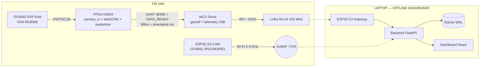

# KVC — Đề xuất vai trò hai camera (OV2640/FPGA + ESP32-S3-CAM)

- **Mã:** `SYS-007`
- **Trạng thái:** `DRAFT` — kiến trúc đã được HUMAN duyệt 02/11/2026 cho **demo phân tầng**; xem §10.
- **Mức bằng chứng:** `DESIGN` — đây là **đề xuất**, không phải kết quả đo và chưa được
  chứng minh trên phần cứng. Không mục nào dưới đây chứng minh phần cứng đã chạy.
- **Task:** `KVC-CAM-ARCH-20261101-001`, review `KVC-CAM-ARCH-20261102-REVIEW-001`
- **Owner:** Kilo
- **Ngày lập:** 01/11/2026 (cập nhật 02/11/2026)
- **Liên quan:** [IF-05](../interfaces/IF_ESP32_CAM_GCS.md),
  [IF-CAM](../interfaces/IF_CAMERA_FPGA.md),
  [IF-01](../interfaces/IF_FPGA_MCU_UART.md),
  [IF-02](../interfaces/IF_MCU_LORA_RF.md),
  [IF-03](../interfaces/IF_ESP32_GCS_WS.md),
  [Review dual-camera](../../review/Deepseek/KVC-DUAL-CAMERA-REVIEW-20261102-DEEPSEEK.md)

---

## 0. Vì sao tài liệu này tồn tại

Nhóm dự kiến mua thêm module **ESP32-S3 N16R8 tích hợp camera 3 MP OV3660**
(board dev ESP32-S3-WROOM-1, 16 MB flash + 8 MB PSRAM) để có luồng video
quay về Dashboard. Tài liệu này trả lời hai câu:

1. Khi thêm camera đó, **FPGA + OV2640 còn làm gì** và nên được giao thêm gì.
2. Những gì **không được** làm để không phá các hợp đồng đã duyệt.

Tài liệu **không** thay thế IF-05. IF-05 vẫn là đặc tả kênh video; đây là tài liệu
phân vai và giới hạn.

---

## 1. Nguyên tắc gốc

### 1.1 Hai camera hai nhiệm vụ, không phải hai camera cùng nhiệm vụ

| Vai trò | Thiết bị | Sinh ra | Đi qua | Nhãn bằng chứng |
| :--- | :--- | :--- | :--- | :--- |
| **Camera trinh sát** | OV2640 DVP + FPGA GW2A | **Toạ độ mục tiêu** (BBox → georef) | IF-01 → IF-02 → IF-03 | `FPGA_GW2A` khi có capture thật |
| **Camera quan sát** | ESP32-S3-CAM / OV3660 | **Hình ảnh cho người vận hành** | IF-05 (Wi-Fi, MJPEG) | `RELAY`, không sinh toạ độ |

**Camera thứ hai không được trở thành nguồn toạ độ.** Lý do ở §1.2 và §1.3.

### 1.2 BBox của OV2640 không đúng hình học cho ảnh OV3660

Hai module khác cảm biến, khác ống kính, khác FOV, khác độ phân giải. Hằng số
`fx_px = 554` trong `firmware/mcu_payload/inc/kvc_georef.h:80-82` là giả định
HFOV ~60° cho OV2640 và **chưa hiệu chuẩn** (`KVC_WORK_BACKLOG_20261031.md`
P1-04). Dùng nó cho pixel của OV3660 là sai ngay ở bước đầu.

Hệ quả: box do FPGA sinh ra chỉ có nghĩa trên **khung OV2640**, không có nghĩa
trên khung S3-CAM.

### 1.3 Hai camera không có đồng hồ chung

`IF_ESP32_CAM_GCS.md:48-55` đã ghi: không có sync marker, chênh thực tế
100–500 ms. Vì vậy:

- `VideoStatus.has_overlay` mặc định `false`;
- `gcs/frontend/src/state/missionReducer.ts:629` ép `has_overlay: false` mỗi
  lần nhận `VIDEO_STATUS`;
- `gcs/frontend/src/features/video/VideoPanel.tsx:61-67` chỉ vẽ overlay khi cờ
  này `true`.

Đây là **hành vi đúng**, không phải thiếu sót cần vá gấp.

### 1.4 Không đụng ABI

Adding a camera does **not** change:

- IF-01 (`0x5A 0xA5`, N ≤ 12, 8 byte/BBox, CRC-16/CCITT-FALSE, 38.400 8N1);
- IF-02 (32 byte, offset, Little-Endian, GV-02);
- IF-03 (envelope WebSocket v1).

Mọi thay đổi layout/CRC/baud/pinout phải có HUMAN approval riêng.

---

## 2. Sơ đồ luồng sau khi thêm S3-CAM

Hai nhánh **độc lập vật lý**. Mất nhánh video không được làm mất nhánh telemetry
(`test_video_relay.py::test_video_failure_does_not_block_telemetry`).

---

## 3. FPGA + OV2640 — phân loại chức năng

### 3.1 P0 — Đang có code, giữ nguyên

| # | Chức năng | Module / bằng chứng hiện tại |
| :---: | :--- | :--- |
| 1 | Thu ảnh DVP + cấu hình SCCB | `KVC_PR/src/camera/camera_rx.v`, `ov2640_config.v` (224 thanh ghi) |
| 2 | XCLK 24 MHz từ B13 (module MINI-200W không có oscillator) | `KVC_PR/src/KVC_FPGA.cst:58-98` |
| 3 | Gate theo VSYNC, timestamp ms | `kvc_top_demo.v`, `IF_FPGA_MCU_UART.md` §2 |
| 4 | Blob detect từ pixel thật | `KVC_PR/src/processing/kvc_blob_detect.v`, `BBOX_SOURCE=1`, 0 BSRAM / 0 DSP |
| 5 | Packetizer + UART TX | `KVC_PR/src/comm/`, `uart_tx.v` |

Trạng thái: IF-01 `HARDWARE-VERIFIED` **trên đường mock** (G2.2/G2.4 PASS);
đường blob `SIMULATED + BUILT`, **chưa nạp bo**.

**Không sửa các mục này khi thêm S3-CAM.**

### 3.2 P1 — Giá trị cốt lõi còn thiếu, phải làm trước

| # | Chức năng | Vì sao ưu tiên | Trạng thái chặn |
| :---: | :--- | :--- | :--- |
| 6 | **Ảnh thật từ OV2640 (Gate G6.1)** | Không có ảnh thật thì mọi kết luận AI/georef là giả định | VSYNC/PCLK chưa đo; ảnh vật đỏ chưa chụp |
| 7 | **YOLO11n INT8 (`BBOX_SOURCE=2`)** | Biến "phát hiện màu" thành "nhận diện người/phao" | `kvc_yolo_top.v` chưa từng compile; ước 4–6 tuần |
| 8 | **NMS top-12 trên RTL** | Cần cho đường CNN | Module có, thiếu đường dẫn hoàn chỉnh |
| 9 | **Hiệu chuẩn `fx_px` (G6.3)** | `fx_px=554` là giả định; sai 6–7 % ở mọi khoảng cách | Chưa chụp bàn cờ |

**Thứ tự đúng là P1 trước, không phải thêm tính năng cho S3-CAM.** Camera phụ
không cứu được pipeline AI nếu camera chính chưa chứng minh.

### 3.3 P2 — Tận dụng camera thứ hai (đề xuất mới)

| # | Chức năng | Giá trị | Chi phí | Rủi ro |
| :---: | :--- | :--- | :--- | :--- |
| 10 | **Ghép bằng chứng theo mốc thời gian** — backend ghi `t_nhận_bbox` và `last_frame_age_ms` tại cùng thời điểm để biết khung JPEG nào gần nhất lúc phát hiện | Truy vết trung thực, sai số ±1 chu kỳ khung | Thấp (dùng timestamp IF-01 sẵn có) | Ghi sai nhãn "đồng bộ" nếu không nêu rõ sai số |
| 11 | **Snapshot bằng chứng SAR** — khi có detection, lưu JPEG gần nhất + BBox + toạ độ + độ lệch thời gian vào `evidence/` | Báo cáo, QA, tái lập | Thấp, nhưng **phải lấy frame ở backend** | Canvas trong browser bị taint → `toDataURL` ném `SecurityError` (`ASSESSMENT.md:158-166`) |
| 12 | **Đo FOV/tiêu cự camera S3** | Biết camera nào rộng/hẹp để bố trí quan sát | Thấp (`cv2.calibrateCamera`) | Không |
| 13 | **QA chéo OV2640 ↔ PC_REFERENCE trên cùng cảnh** | Đo recall thực địa, phát hiện domain shift — đúng loại bằng chứng locked-test đang thiếu | Trung bình | Không được dùng để tuyên bố accuracy của FPGA |
| 14 | **Homography OV2640 → OV3660** | Chỉ để vẽ box FPGA lên video S3 | Cao | Vô nghĩa nếu gá rung; cần calibrate 2 camera + sync thật |
| 15 | **Strobe đồng bộ phần cứng** | FPGA nháy mã trong vùng nhìn chung; backend phát hiện → đo offset thật | Trung bình | **Cần HUMAN duyệt chân** (đụng pinout) |

### 3.4 Không nên làm

| Ý tưởng | Lý do loại |
| :--- | :--- |
| Truyền video qua LoRa | Cấm tuyệt đối — IF-02 cố định 32 byte (`KVC_ThietKeHeThong.md` §II.3.2 mục 4, §II.5.2, §V.3) |
| Vẽ BBox FPGA lên khung S3 rồi gọi "đã đồng bộ" | Sai hình học (§1.2) + sai thời gian (§1.3) |
| Dùng stream S3 làm nguồn toạ độ | Phải calibrate lại toàn bộ georef; mất cơ sở `fx_px` |
| Bỏ OV2640, chuyển hết sang S3 + ESP-DL | Xoá giá trị "AI trên FPGA", mất georef; `inference_device` không có giá trị `ESP32_S3` |
| Thêm trường `frame_id` vào IF-01 | Đổi layout cần HUMAN duyệt; timestamp 4 byte đã đủ |
| Cho trình duyệt gọi thẳng `http://<ip-s3>/stream` | Vi phạm IF-03 (`IF_ESP32_GCS_WS.md:44`); canvas taint, mixed content, `fetch()` không resolve |

---

## 4. Ba phương án hiển thị nhận diện — chọn có ý thức

| Tiêu chí | **A. Không overlay** (khuyến nghị) | **B. PC_REFERENCE trên khung S3** | **C. Homography FPGA→S3** |
| :--- | :--- | :--- | :--- |
| Cách làm | Video + bảng detection riêng, ghi rõ "không overlay" | Backend decode MJPEG → YOLO11n → box + `is_synced=true` | Calibrate 2 camera + đồng bộ thời gian |
| Box khớp khung? | Không áp dụng | **Có** (tính trên chính khung đó) | Có, nếu gá cứng + sync tốt |
| Nguồn toạ độ | FPGA (giữ nguyên) | FPGA (giữ nguyên) | FPGA |
| Nhãn UI | `RELAY` + "box từ OV2640, không overlay" | `PC_REFERENCE` | `FPGA_GW2A` chỉ khi sync đã đo |
| Chi phí | ~0 | Trung bình: OpenCV/Ultralytics, thread riêng, drop frame | Cao |
| Rủi ro chính | Người xem tưởng box thuộc video | Hai nguồn box nếu không tách domain | Rung gimbal → tệ hơn không vẽ |
| Khi nào dùng | Cần đúng đắn, demo trung thực | Cần hình ảnh trực quan cho hội đồng | Khi có yêu cầu học thuật rõ |

**Khuyến nghị: A ở mốc hiện tại; mở B sau khi G6.1 PASS.** Phương án A không
đụng code đang chạy. Phương án C chỉ có nghĩa sau khi camera chính chạy thật.

### 4.1 Nếu chọn B, ba điều bắt buộc

1. Inference chạy trong `run_in_executor`/process riêng, **có drop frame**,
   không được block event loop telemetry.
2. Box mang `inference_device = PC_REFERENCE` và `is_synced = true`; **không**
   merge vào `bounding_boxes` của FPGA — cần domain riêng hoặc cờ `source`
   (`gcs/backend/schemas.py:81-90,145`).
3. UI ghi rõ "nhận diện tham chiếu trên laptop", **không** ghi "AI FPGA".

---

## 5. Khoảng trống kỹ thuật đã xác định trong code hiện tại

| # | Vị trí | Vấn đề | Trạng thái 02/11/2026 |
| :---: | :--- | :--- | :--- |
| 1 | `gcs/backend/schemas.py` (`VideoStatus`) | **Không có** trường `has_overlay` | **MỞ** — là quyết định kiến trúc, không phải bug. Muốn có overlay phải có cơ chế ghép cặp khung trước |
| 2 | `missionReducer.ts:629` | Ép `has_overlay: false` mỗi `VIDEO_STATUS` | **GIỮ NGUYÊN CÓ Ý** — không có đường nào bật overlay, kể cả khi backend có box |
| 3 | `gcs/backend/main.py:240-270` | `/video/stream` mở **kết nối riêng cho mỗi người xem** tới camera, song song với `VideoRelay._consume` | **ĐÃ SỬA TÀI LIỆU.** Comment sai "kết nối duy nhất" đã xóa. Camera chịu `1 + viewers` client; **chưa đo tải** (A5) |
| 4 | `gcs/backend/video_relay.py` `status()` | `last_frame_age_ms` luôn `None` ở `relay.status()` trong khi `state.py` tính tuổi riêng | **ĐÃ SỬA**: relay đo tuổi, store neo lại theo `now_ms() - reported_age`. Một nguồn duy nhất; có test |
| 5 | `gcs/backend/main.py` `video_stream` | Biến `hub` khai báo nhưng không dùng | **ĐÃ XÓA** |
| 6 | `gcs/backend/requirements.txt` | **Không có** `opencv-python`/`ultralytics` | **ĐÃ DUYỆT thêm 02/11/2026** cho worker YOLO (T-17); chưa cài/không pin version |

Các mục còn `MỞ` ở trên là **quan sát source**, chưa phải finding đã review.
Không mục nào là P0/P1 vì kênh video đang tắt mặc định.

---

## 6. Phải chốt trước khi đấu dây

| # | Việc | Vì sao chặn | Ai quyết |
| :---: | :--- | :--- | :--- |
| 1 | **Xác nhận cảm biến thực nhận hàng** | Listing bán nhiều biến thể (OV2640 2MP / OV5640 5MP / OV3660 3MP); driver và hiệu chuẩn khác nhau | HUMAN + người mua |
| 2 | **Dải mạng** | ESP32-C3 SoftAP giữ `192.168.4.1/24`. S3 phải **STA vào AP đó** (IP qua DHCP) hoặc dùng subnet khác; hai SoftAP cùng `192.168.4.1` sẽ đụng | HUMAN |
| 3 | **Nguồn** | S3-CAM + Wi-Fi cần 5 V ≥ 500 mA riêng; không lấy từ rail FPGA/MCU | HUMAN |
| 4 | **Gá cơ khí** | Camera FPC 24-pin cần gá in 3D; rung làm mọi phương án overlay vô nghĩa | Kiên/Vững |
| 5 | **Firmware S3** | Chưa có. Dùng `esp32-camera`/`CameraWebServer` để khớp `FrameExtractor` (boundary `--123456789000000000000987654321`, marker SOI/EOI) | Chưa chọn owner |
| 6 | **Schema video** | `VideoStatus` thiếu `has_overlay`/nguồn box; muốn overlay phải thêm field + cập nhật IF-05 **cùng commit** (INDEX quy tắc 4) | Kilo |
| 7 | **Duyệt kiến trúc** | "Có camera thứ hai" là thay đổi kiến trúc; `review/KVC-GCS-TACTICAL-UI-20261101-001/ASSESSMENT.md:117-138` yêu cầu HUMAN duyệt. `docs/` **chưa có văn bản phê duyệt** | HUMAN |
| 8 | **Mức bằng chứng** | Trước khi có capture thật: video vẫn `SOURCE-VERIFIED + SIMULATED`, **không** ghi FPS/độ trễ | — |

---

## 7. Điều không được tuyên bố

- Không được ghi "video `HARDWARE-VERIFIED`" khi chưa có module thật và log.
- Không được ghi "AI FPGA qua camera ESP32" — hai đường độc lập.
- Không được ghi "hai camera đồng bộ".
- Không được công bố bất kỳ con số FPS/độ trễ nào cho tới khi có phép đo
  (`IF_ESP32_CAM_GCS.md` §6).
- Không được hiển thị `frame_count` như FPS.

---

## 8. Tóm lại

FPGA + OV2640 giữ nguyên vai trò **cảm biến trinh sát và nguồn toạ độ duy nhất**.
Việc cần làm trên nó là **ảnh thật (G6.1) rồi YOLO11n (P6)** — không phải thêm
tính năng để phục vụ stream.

ESP32-S3-CAM nhận vai trò **mắt cho người vận hành**, đi qua IF-05 đã có, mang
nhãn `RELAY` và **không được** trộn với BBox của FPGA.

Giá trị gia tăng thực tế của camera thứ hai là **bằng chứng trực quan, snapshot
SAR, và QA chéo** — không phải overlay.

---

## 9. Việc tiếp theo (chưa làm)

| # | Việc | Phụ thuộc | Trạng thái |
| :---: | :--- | :--- | :--- |
| 1 | HUMAN duyệt kiến trúc hai camera (§6 mục 7) | — | **CHƯA** |
| 2 | Xác nhận cảm biến thực + chốt dải mạng + nguồn | §6 mục 1–3 | **CHƯA** |
| 3 | Viết firmware S3-CAM phát MJPEG | §6 mục 5 | **NOT WRITTEN** |
| 4 | Thêm `has_overlay`/nguồn box vào `VideoStatus` + IF-05 | §6 mục 6 | **CHƯA** |
| 5 | Nạp bitstream blob + G6.1 (ảnh thật OV2640) | Không phụ thuộc S3 | **NOT RUN** |
| 6 | Đo FPS/độ trễ và ghi `HARDWARE-VERIFIED` | §6 mục 8 | **NOT RUN** |

Không mục nào ở bảng trên được coi là đã xong cho tới khi có log/hash/evidence
tương ứng.

---

## 10. Kiến trúc đã chốt 02/11/2026 — phân tầng năng lực

HUMAN duyệt kiến trúc hai camera theo hướng **phân tầng trách nhiệm** thay vì buộc
hai kênh cùng làm một việc. Nguồn: quyết định chủ dự án 02/11/2026 (mục 1–6).

| Kênh | Thiết bị | Phạm vi đã chốt | Ghi chú |
| :--- | :--- | :--- | :--- |
| **Toạ độ** | OV2640 → FPGA → MCU → LoRa IF-02 | **KHOÁ 1 nạn nhân ưu tiên**. Toạ độ GPS phục vụ điều hướng cứu nạn. | Tránh F-03 (không CCL) và F-05 (marker nhảy) cho tới Phase 2 |
| **Video** | ESP32-CAM/S3-CAM → Wi-Fi → GCS relay | **Hỗ trợ nhiều nạn nhân** trên luồng video, do YOLO11n chạy trên laptop (`inference_device = PC_REFERENCE`). | Kênh này **không** sinh toạ độ; box là bằng chứng hình ảnh |

### 10.1 Giới hạn phải công bố khi demo (đã đo bằng mô hình hình học, `SIMULATED`)

Bảng dưới suy ra từ `fx_px = 554`, frame 640×480, `MIN_PIXELS = 400`, `MAX_SPAN = 255`
và một vest cam 0,5 × 0,6 m. **Chưa đo trên ảnh thật** — dùng làm giới hạn thiết kế,
không dùng làm thông số quảng cáo.

| Độ cao AGL | GSD (m/px) | Vest (px) | Diện tích (px) | Kết quả blob |
| ---: | ---: | ---: | ---: | :--- |
| 1,0 m | 0,0018 | 277 × 332 | 92 075 | LOẠI (> 255 px span) |
| 1,5 m | 0,0027 | 185 × 222 | 40 922 | Nhận |
| 3,0 m | 0,0054 | 92 × 111 | 10 231 | Nhận |
| 5,0 m | 0,0090 | 55 × 67 | 3 683 | Nhận |
| 7,0 m | 0,0126 | 40 × 48 | 1 885 | Nhận |
| 15 m | 0,0271 | 18 × 22 | 409 | Nhận (biên) |
| 20 m | 0,0361 | 14 × 17 | 230 | LOẠI (< 400 px) |

Kết luận bắt buộc ghi trong kịch bản demo:

1. **Dải phát hiện thực tế 1,5–15 m AGL**, không phải "2–5 km". Con số 2–5 km là
   **khoảng cách truyền LoRa**, không phải khoảng cách phát hiện mục tiêu.
2. **Một nạn nhân mặc cam** cho kênh FPGA. Nhiều nạn nhân chỉ đến từ kênh video.
3. Bộ lọc màu hiện tại là **2 tầng tự động** (ngưỡng màu + `MIN_PIXELS`) cộng một
   bộ **loại** (`MAX_SPAN`), không phải "3 tầng lọc" và **không** nhận diện hình dạng.
4. FPGA luôn phát `class_id = 2` (lifebuoy). Không được tuyên bố FPGA nhận diện
   "người" hay "phao" — đó là **vùng màu cam**.
5. Khi hover, yaw (COG) không hợp lệ → georef từ chối và gói tin mang toạ độ 0.
   Người trình diễn phải biết trước.
6. `fx_px = 554` là **giả định chưa hiệu chuẩn**; sai số hệ thống 6–7 % (P1-04).

### 10.2 Bảo vệ đã bật trong Phase 0 (02/11/2026)

| Bảo vệ | Vị trí | Hành vi |
| :--- | :--- | :--- |
| `geo_in` zero-init + `alt_quality` xác định | `firmware/mcu_payload/project_keil/main.c` | Không còn đọc rác stack |
| Chỉ công bố toạ độ khi `KVC_GEO_POS_COMPUTED` | `main.c` + `gcs/backend/esp32_ingress.py` | UAV_ONLY → lat/lon = 0 → `pos_valid = false` |
| Tuổi BBox ≤ 300 ms trước georef | `main.c` (`KVC_GEO_BBOX_MAX_AGE_MS`) | Frame cũ → không georef, hạ cờ AI |
| GCS từ chối frame sai CRC/sync | `gcs/backend/esp32_ingress.py` | `ValueError` + `rf_reject_count` |
| `source_mode` có `REAL`, không ghi đè ở client | `schemas.py`, `telemetryClient.ts` | SQLite/UI cùng một nhãn thật |

Các mục **chưa** làm (vẫn là rủi ro đã biết): không CCL đa mục tiêu, class
hard-code, một target trong schema, TTL/bán kính track, YOLO worker, hiệu chuẩn
`fx_px`, bù roll/pitch. Xem `review/Deepseek/KVC-DUAL-CAMERA-REVIEW-20261102-DEEPSEEK.md`
§B (T-08 → T-23).

### 10.3 Phần cứng camera quan sát — lộ trình 02–03/11/2026

| Ngày | Module | Ghi chú |
| :--- | :--- | :--- |
| 02/11/2026 | ESP32-CAM AI-Thinker + OV3660 | Kiểm luồng MJPEG cổng 81 và YOLO trên laptop. **Không** dùng để sinh toạ độ |
| 03/11/2026 | ESP32-S3-CAM chính thức | Cùng IF-05; backend GCS giữ nguyên, không đổi code |

Đổi module **không** đổi giao thức IF-05. Nếu module tạm phát boundary hoặc đường
dẫn khác `--123456789000000000000987654321` và `/stream`, đặt lại trong cấu hình
firmware của module đó, **không** sửa `FrameExtractor` để chiều theo thiết bị.

