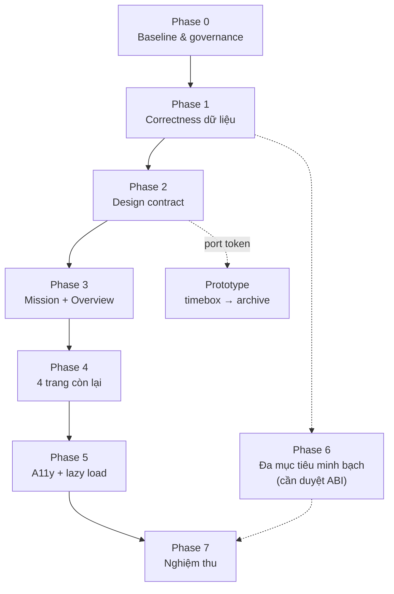

# KVC — Kế hoạch triển khai GCS Dashboard (toàn phần)

| Trường | Giá trị |
|---|---|
| Mã kế hoạch | `PLAN-002` |
| Loại | Kế hoạch triển khai nhiều giai đoạn (PLANNED) |
| Ngày lập | 2026-10-29 |
| Phạm vi chính | `gcs/frontend`, `gcs/backend` (đọc/sửa giới hạn), `docs/` |
| Phương án | **Cải tiến `gcs/frontend` là app production duy nhất; `gcs-redesign` chỉ là prototype có thời hạn** |
| Trạng thái | `PLANNED` — chưa thực thi |
| Mức bằng chứng | DESIGN (chưa có log thực thi của kế hoạch này) |
| Tiền nhiệm | `KVC_GCS_P0_Hotfix_Plan_20261029.md` (P0 trong ngày 29/10 — là Phase 1 của kế hoạch này) |
| Tài liệu liên quan | `KVC_GCS_DESIGN_SPEC.md`, `../interfaces/KVC_GCS_DATA_CONTRACT.md`, `../interfaces/IF_FPGA_MCU_UART.md`, `../interfaces/IF_MCU_LORA_RF.md`, `KVC_PROJECT_STATUS.md` |

---

## 1. Giả định cần thiết

Kế hoạch này dựa trên các giả định sau. Nếu bất kỳ giả định nào sai, phải dừng và hiệu chỉnh trước khi thực thi giai đoạn liên quan.

| # | Giả định | Cơ sở | Nếu sai thì sao |
|---|---|---|---|
| A1 | Người dùng chấp nhận **không dựng app thứ hai**; `gcs/frontend` là production duy nhất | Kết luận phiên tư vấn: rewrite không tự giảm "AI look" mà tăng rủi ro lệch contract | Nếu muốn app mới, phải có task riêng với parity suite và ngày cắt app cũ |
| A2 | **ABI RF 32 byte (IF-02) đã duyệt, không đổi** trong toàn bộ kế hoạch trừ Phase 6 | `AGENTS.md`; `KVC_PROJECT_STATUS.md` mục "Những điểm chặn" số 3 | Nếu cần đổi sớm, Phase 6 kéo lên và phải chờ HUMAN approval |
| A3 | **IF-01 (FPGA ↔ MCU) sẽ bổ sung `track_id`** ở một thời điểm trong tương lai, không phải bây giờ | `kvc_fpga_bbox.h:88-95` không có trường ID | Không có ID thì tracking đa mục tiêu bị chặn vĩnh viễn |
| A4 | Hiện **chưa có FPGA RTL/top-level**; `KVC_FPGA_ENABLE=0` trên bo bench | `main.c:351-367`, `KVC_PROJECT_STATUS.md:13` | Nếu có RTL đột ngột, Phase 1 vẫn hợp lệ nhưng Phase 6 cấp bách hơn |
| A5 | Backend và frontend chạy được trên máy dev (`node_modules`, `.venv` có sẵn) | Đã kiểm: `gcs/frontend/node_modules` = True, `.venv/Scripts/python.exe` = True | Nếu thiếu, Phase 0 ghi `BLOCKED`, không ghi PASS |
| A6 | Chỉ **một writer** tại một thời điểm; FE và BE chạy song song được nếu không chạm cùng file | `AGENTS.md` quy tắc owner duy nhất | Nếu vi phạm, diff trộn và không rollback được từng phần |
| A7 | MOCK/REPLAY giữ nguyên hành vi; thay đổi chỉ nhắm REAL + hiển thị | `KVC_GCS_DATA_CONTRACT.md:606-621` | Nếu sửa MOCK, phải cập nhật 12 kịch bản và test demo |
| A8 | Tiêu chí "giảm cảm giác AI" đo được bằng **danh sách cấm** (emoji, palette trực tiếp, radius/shadow), không bằng cảm nhận | Đề xuất từ phiên tư vấn | Nếu không chốt deny-list, lỗi sẽ tái phát |

---

## 2. Mục tiêu và phạm vi

### 2.1. Mục tiêu đo được

Kết thúc kế hoạch, hệ thống phải đạt **8 điều kiện**:

| # | Mục tiêu | Thước đo |
|---|---|---|
| M1 | UI không hiển thị dữ liệu không có thật | 0 chuỗi toạ độ/confidence/khoảng cách sinh từ fallback; 0 chỉ số pin trong 6 trang |
| M2 | Một nguồn ngưỡng stale duy nhất | `grep` không còn literal `3000`/`>3s` ngoài danh sách ngoại lệ đã ghi |
| M3 | Hệ quy chiếu minh bạch | Mọi nút copy/nhãn toạ độ nêu rõ `WGS-84` hoặc `LOCAL (cm)`; clipboard chứa đúng hệ |
| M4 | Điều hướng và cài đặt không "nói dối" | WS URL nhập vào được áp dụng thật; nút diễn tập dùng ID tồn tại |
| M5 | Bố cục cũ được giữ | 6 route, sidebar, header, mission full-bleed, dock dưới trái, 3 chế độ MAP/RADAR/SPLIT đều còn |
| M6 | Bớt "AI look" theo deny-list | 0 emoji trong label/aria; 0 lớp palette trực tiếp trong feature components; ≤2 bán kính; ≤1 lớp kính |
| M7 | Track nhiều mục tiêu minh bạch | UI hiển thị "Mục tiêu k/N" thay vì 1 marker nhảy; marker không nhân bản |
| M8 | Nghiệm thu có bằng chứng | typecheck/lint/test/build exit 0; ảnh 6 trang × 2 độ phân giải; báo cáo có lệnh + log + giới hạn |

### 2.2. Trong phạm vi

| Nhóm | Đường dẫn |
|---|---|
| Frontend app | `gcs/frontend/src/app/**`, `src/features/**`, `src/state/**`, `src/lib/**`, `src/config/**`, `src/types/**` |
| Frontend style | `src/index.css`, `src/styles/**` (nếu tạo) |
| Backend (giới hạn) | `gcs/backend/esp32_ingress.py`, `gcs/backend/state.py`, `gcs/backend/tests/test_esp32_ingress.py` |
| Docs | `docs/architecture/KVC_GCS_DESIGN_SPEC.md`, `docs/architecture/KVC_PROJECT_STATUS.md`, `docs/INDEX.md` (chỉ thêm dòng) |
| Prototype | `gcs-redesign/README.md` (banner PROTOTYPE) |

### 2.3. Ngoài phạm vi

- Đổi IF-02 (layout/CRC 32 byte) — trừ khi Phase 6 được HUMAN duyệt riêng.
- Đổi IF-01 (thêm `track_id`) — đề xuất, không tự làm.
- Firmware MCU, RTL FPGA, pinout, baud, IRQ.
- Replay engine logic.
- Marker API / migration SQLite.
- Commit/push/merge/flash.
- Toàn bộ nội dung trong `gcs-redesign/` ngoài README.

---

## 3. Nguyên tắc thực thi (bất biến)

1. **Một writer mỗi task.** FE và BE chỉ song song khi danh sách file không giao nhau.
2. **Không commit.** Kết thúc mỗi phase chỉ tạo evidence; người dùng quyết định commit.
3. **Không báo PASS khi thiếu log.** `BLOCKED` / `NOT RUN` / `DEFERRED` phải có lý do.
4. **Không sửa ngoài allowed files.** Ghi rõ danh sách file ở đầu mỗi task.
5. **Số thiếu = `N/A`.** Không nội suy toạ độ, confidence, khoảng cách, thời gian, pin.
6. **`LOCAL_GRID` giữ `x/y` cm.** Không copy sang `latitude/longitude`.
7. **Không xoá công việc đang dirty.** Working tree hiện có 28 file sửa dở + 5 mục untracked; rollback chỉ theo từng file thuộc task.
8. **Prototype không import.** `gcs/frontend` không được import từ `gcs-redesign`.

---

## 4. Các giai đoạn

### Tổng quan



---

### Phase 0 — Baseline và quản trị

**Mục tiêu:** tạo mốc so sánh trước khi sửa bất cứ dòng code nào.

| Bước | Việc | File / lệnh | Đầu ra |
|---:|---|---|---|
| 0.1 | Chốt danh sách dirty hiện tại | `git status --short`, `git diff --stat` | `00-baseline/git-status.txt`, `git-diff-stat.txt` |
| 0.2 | Đo bundle trước | `cd gcs/frontend; npm run build` | `00-baseline/build-before.log` (kB từng chunk) |
| 0.3 | Chụp 6 route × 2 độ phân giải | `#/mission`, `#/overview`, `#/alerts`, `#/history`, `#/devices`, `#/settings` tại 1366×768 và 1920×1080 | `30-screens/before/*.png` |
| 0.4 | Chụp theme sáng cho Mission | 1 ảnh | `30-screens/before/mission-light.png` |
| 0.5 | Đánh dấu prototype | Tạo `gcs-redesign/README.md` | Banner `PROTOTYPE — NOT PRODUCTION` |
| 0.6 | Đăng ký tài liệu | Thêm dòng `PLAN-002` vào `docs/INDEX.md` | INDEX cập nhật |

**Cổng qua:** có đủ 4 artefact baseline; không sửa source.

**Ước lượng:** 0,5 ngày.

---

### Phase 1 — Correctness dữ liệu (ưu tiên cao nhất)

**Mục tiêu:** loại bỏ mọi dữ liệu bịa và mọi ngưỡng trùng lặp. Đây là phần "P0 hotfix" đã lập, mở rộng thêm 3 finding mới.

**Task 1A — Bỏ pin khỏi UI**

| Bước | File:dòng | Sửa |
|---:|---|---|
| 1A.1 | `features/alerts/AlertsPage.tsx:74` | Bỏ "mức pin tải" khỏi `infoTip` |
| 1A.2 | `features/alerts/AlertFilters.tsx:85` | `Cảm biến / Pin` → `Cảm biến` |
| 1A.3 | `features/mission/ActiveAlertsQuickPanel.tsx:25` | Bỏ "pin yếu" |
| 1A.4 | `features/overview/OverviewPage.tsx:75,163` | Bỏ "tới pin tải"; comment `Nguồn/pin` → `Liên kết và thiết bị` |
| 1A.5 | `state/missionReducer.ts:161-166` | Giữ keyword `BATTERY\|LIDAR\|IMU\|PIN`, chỉ đổi câu chữ |

**Giữ nguyên:** `battery_pct` trong `types/telemetry.ts`, `telemetryAdapter.ts`, `telemetryClient.ts`, `mocks/scenarios.ts`.

**Task 1B — Một nguồn ngưỡng stale**

| Bước | Việc |
|---:|---|
| 1B.1 | Tạo `src/lib/stale.ts`: `STALE_MS`, `AMBER_AGE_MS`, `isAgeStale()`, `staleLabel()`, `staleSecondsText()` |
| 1B.2 | Thay literal trong `ModeContextBar.tsx:32,146`, `AppHeader.tsx:58`, `UavHardwareGaugeCard.tsx:15`, `TargetDetailsPanel.tsx:78,185`, `PositionSummary.tsx:158,165`, `CurrentPositionPanel.tsx:56,60,220,224,233,240`, `LocalRadarPanel.tsx:117,132,384,552`, `DevicesPage.tsx:181` |
| 1B.3 | Giữ nguyên `src/lib/connectionStatus.ts` (hành vi ESP32, có test riêng) và `Map2DView.test.tsx:5-9` (test biên) |

**Ràng buộc:** `staleLabel(3000)` phải trả đúng `DỮ LIỆU CŨ (>3s)` để không phá test hiện có.

**Task 1C — Copy toạ độ minh bạch**

| Bước | File:dòng | Sửa |
|---:|---|---|
| 1C.1 | `TargetDetailsPanel.tsx:46-88` | Toast nêu hệ: `LOCAL (cm)` hoặc `WGS-84` |
| 1C.2 | `TargetDetailsPanel.tsx:224-236` | Nhãn động `Sao chép Local (cm)` / `Sao chép WGS-84`; `title` ghi rõ không phải WGS-84 khi LOCAL |
| 1C.3 | `BottomTacticalDock.tsx:113,312,419` | Nhãn/toast/title theo cùng quy tắc |
| 1C.4 | `MissionPage.test.tsx:190` | Đổi regex sang `/Sao chép WGS-84/i`, dùng `findByRole` |

**Task 1D — Scenario ID và WS URL**

| Bước | File:dòng | Sửa |
|---:|---|---|
| 1D.1 | `OverviewPage.tsx:50`, `ModeContextBar.tsx:168` | `NORMAL_GPS_DETECT` → `NORMAL_GPS_TARGET` |
| 1D.2 | `MissionProvider.tsx:78-82` | Guard: chỉ ghi localStorage khi ID tồn tại |
| 1D.3 | `config/appConfig.ts` | Thêm `STORAGE_KEYS.WS_URL` |
| 1D.4 | `MissionProvider.tsx` | Thêm `wsUrl` + `setWsUrl()` có validate `ws:`/`wss:`; effect mount áp URL trước khi connect |
| 1D.5 | `SettingsPage.tsx:50-59,326-364` | Chỉ toast thành công khi `ok`; hiển thị URL hiệu lực; nút khôi phục mặc định |
| 1D.6 | `DevicesPage.tsx:110` | Hiển thị `wsUrl` từ context |
| 1D.7 | `LocalRadarPanel.test.tsx:49-56`, `RealityVerification.test.tsx:20-27` | Bổ sung `wsUrl`/`setWsUrl` vào context literal |

**Task 1E — Xoá toạ độ bịa trong bảng detection** *(finding mới, ưu tiên cao)*

| Bước | File:dòng | Sửa |
|---:|---|---|
| 1E.1 | `RecentDetectionsTable.tsx:78` | Bỏ fallback `82.4` m; hiển thị `N/A` |
| 1E.2 | `RecentDetectionsTable.tsx:75` | Bỏ fallback confidence `94.2` |
| 1E.3 | `RecentDetectionsTable.tsx:91-92` | Bỏ toạ độ Hà Nội `21.028420/105.854090`; BBox không có toạ độ → không đưa vào bảng như mục tiêu |
| 1E.4 | `RecentDetectionsTable.tsx:97,100` | Bỏ fallback confidence/khoảng cách |
| 1E.5 | Toàn file | Chỉ hiển thị dòng khi `pos_valid === true` |

**Lý do ưu tiên cao:** đây là dữ liệu cứu nạn bịa, nguy hiểm hơn mọi lỗi thẩm mỹ.

**Task 1F — `track_id` ổn định và last-known**

| Bước | File | Sửa |
|---:|---|---|
| 1F.1 | `gcs/backend/esp32_ingress.py:117,134` | Thay `track_id = seq_num` bằng ghép không gian–thời gian: tìm track gần nhất trong bán kính `TRACK_MATCH_RADIUS_CM` (mặc định 200) và tuổi `< TRACK_TTL_MS` (mặc định 5000) |
| 1F.2 | `gcs/backend/state.py` | Thêm registry `tracks: dict[int, TrackState]` nội bộ; không đưa vào snapshot công khai ở phase này |
| 1F.3 | `Map2DView.tsx:441-446` | Khi `has_target=false`: giữ marker ở dạng mờ + nhãn "lần cuối Ns trước", xoá sau `LAST_KNOWN_TTL_MS` (60 s) |
| 1F.4 | `missionReducer.ts:424-435` | `target_history` tách theo `track_id`; giữ map `track_id → points[]` |
| 1F.5 | `esp32_ingress.py:162-163` | Ghi chú hằng số vĩ độ 16°N là giới hạn đã biết; không sửa trong phase này |

**Ghi chú 1F:** đây là thay đổi backend duy nhất trong Phase 1. Cần test riêng.

**Task 1G — Test Phase 1**

| Test mới | Nội dung |
|---|---|
| `src/app/NoPinContent.test.tsx` | 6 trang không render chỉ số pin; `queryByLabelText(/Mức pin tải/i) === null`; không có `aria-label` khớp `/Chú thích:.*(mức pin tải\|pin yếu)/i` |
| `src/lib/stale.test.ts` | `staleLabel(3000)`, `staleLabel(5000)`, biên 3000/3001 |
| `src/features/settings/SettingsPage.ws.test.tsx` | URL hợp lệ → `setUrl` được gọi + localStorage ghi; `http://x` → bị từ chối |
| `src/features/mission/TargetDetailsPanel.copy.test.tsx` | LOCAL → clipboard có `LOCAL_GRID` + `cm`, không có `WGS-84`; ngược lại |
| `src/features/telemetry/RecentDetectionsTable.test.tsx` | Không có toạ độ/confidence/khoảng cách khi input thiếu |
| `gcs/backend/tests/test_track_registry.py` | Cùng toạ độ trong 5 s → cùng `track_id`; nhảy >200 cm → ID mới; quá TTL → ID mới |

**Cổng qua Phase 1:**
1. `npm run typecheck`, `npm run lint`, `npm test` exit 0.
2. `pytest gcs/backend/tests` exit 0.
3. `git diff` không còn thêm dòng chứa `21.028420`, `105.854090`, `94.2`, `82.4`, `76.1`.
4. Ảnh 6 trang sau sửa không có marker Hà Nội.

**Ước lượng:** 2 ngày.

---

### Phase 2 — Design contract

**Mục tiêu:** chốt luật thiết kế đo được **trước khi** sửa giao diện, để "AI look" không tái phát.

| Bước | Việc | Đầu ra |
|---:|---|---|
| 2.1 | Wireframe 6 trang (giữ bố cục hiện tại, chỉ rõ vùng nào đổi) | `docs/architecture/` hoặc sketch ngoài repo |
| 2.2 | Bảng token: màu nền/panel/line/text/muted/accent/ok/warn/crit | Bảng trong `KVC_GCS_DESIGN_SPEC.md` |
| 2.3 | Type scale: 10 / 11 / 12.5 / 15 / 17 px | Bảng |
| 2.4 | Radius: 6 (control) / 10 (panel); chip dùng 6 | Bảng |
| 2.5 | Deny-list | Danh sách cấm |
| 2.6 | Sửa `KVC_GCS_DESIGN_SPEC.md` mục 2.1 (đang khuyến khích glassmorphism) | Spec cập nhật |

**Deny-list (đo được):**

| # | Cấm | Kiểm bằng |
|---:|---|---|
| 1 | Emoji trong label, `aria-label`, toast | `grep -P "[\x{1F300}-\x{1FAFF}]"` trên `src/features/**` |
| 2 | Palette trực tiếp (`slate-`, `cyan-`, `rose-`, `emerald-`) trong feature components | `grep -E "(bg\|text\|border\|from\|to)-(slate\|cyan\|rose\|emerald\|indigo)-"` |
| 3 | `rounded-2xl`, `rounded-3xl` ngoài modal | `grep` |
| 4 | `shadow-xl`, `shadow-2xl` | `grep` |
| 5 | Nhiều hơn 1 lớp `backdrop-blur` đồng thời | đếm trong 1 màn hình |
| 6 | `animate-pulse` trên dữ liệu tĩnh | review mắt |
| 7 | `z-[<số lớn>]` tuỳ tiện | thay bằng scale: 10/20/30/40/50 |

**Cổng qua:** deny-list được duyệt; có bảng token thay thế cho từng màu đang dùng.

**Ước lượng:** 1,5 ngày.

---

### Phase 3 — Mission và Overview

**Mục tiêu:** áp token + deny-list vào 2 màn hình quan trọng nhất, **giữ nguyên bố cục và hành vi**.

| Bước | File | Việc |
|---:|---|---|
| 3.1 | `src/styles/tokens.css` (mới) | Định nghĩa token ngữ nghĩa; import trong `index.css` |
| 3.2 | `app/AppShell.tsx`, `AppSidebar.tsx`, `AppHeader.tsx` | Thay palette trực tiếp bằng token; giữ kích thước 220/56 px |
| 3.3 | `features/mission/MissionPage.tsx:120-432` | Bỏ emoji; gom overlay; z-index scale; giữ 3 chế độ MAP/RADAR/SPLIT |
| 3.4 | `features/mission/BottomTacticalDock.tsx` | Token hoá; giữ vị trí dưới trái |
| 3.5 | `features/mission/FloatingMapControls.tsx` | Token hoá; giữ vị trí dưới phải |
| 3.6 | `features/mission/TargetDetailsPanel.tsx` | Panel mở theo nhu cầu; không chiếm chỗ mặc định |
| 3.7 | `features/overview/OverviewPage.tsx` | Ưu tiên tình trạng nhiệm vụ; không banner chồng |
| 3.8 | `features/radar/LocalRadarPanel.tsx:311` | `+Y (BẮC SA BÀN)` → `+Y (BẮC LOCAL)` + InfoTip nêu "hệ đã hiệu chuẩn, không phải Bắc địa lý" |

**Ràng buộc hành vi phải giữ:**
- Phím `T` đổi theme; `M`/`R`/`S` đổi chế độ xem (kiểm lại trong test hiện có).
- PiP video, radar local, dock SAR, nút diễn tập đều còn.
- Route hash không đổi.

**Cổng qua:**
1. 3 chế độ xem hoạt động; PiP hoạt động.
2. Deny-list mục 1–5 không còn vi phạm trong `features/mission/**` và `features/overview/**`.
3. Ảnh 1366×768 không tràn/cắt.
4. Toàn bộ test cũ của mission pass.

**Ước lượng:** 3 ngày.

---

### Phase 4 — Bốn trang còn lại

| Bước | Trang | Việc |
|---:|---|---|
| 4.1 | Alerts | Cùng phân cấp; trạng thái rỗng/lỗi rõ; ACK giữ hành vi hiện có |
| 4.2 | History | Danh sách + bộ lọc; **Replay giữ nguyên**, chỉ smoke test |
| 4.3 | Devices | N/A đúng; URL WS hiệu lực; không gắn ONLINE cho phần cứng chưa kiểm |
| 4.4 | Settings | Token hoá; validate WS; không hứa tính năng chưa có (video RTSP) |

**Cổng qua:** deny-list không vi phạm trong 4 thư mục; replay smoke test pass; ảnh 4 trang.

**Ước lượng:** 2,5 ngày.

---

### Phase 5 — A11y và chia tải

| Bước | Việc | Đo |
|---:|---|---|
| 5.1 | `AppShell.tsx:7-14` → `React.lazy` + `Suspense` cho 6 trang | Chunk tách rời trong `build` output |
| 5.2 | Keyboard: tab order, focus visible, Esc đóng panel | Kiểm thủ công + `axe` nếu có |
| 5.3 | Landmark, `aria-current`, label input | Kiểm thủ công |
| 5.4 | Tương phản ≥ 4.5:1 cho text thường | Đo bằng DevTools |
| 5.5 | Đo bundle sau | So baseline Phase 0 |

**Cổng qua:**
1. Bundle ban đầu (route Overview) giảm ≥ 20 % so baseline; nếu không, ghi số đo + nguyên nhân, không hạ cổng khác.
2. Không có focus trap; Esc đóng được mọi overlay.

**Ước lượng:** 1,5 ngày.

---

### Phase 6 — Đa mục tiêu minh bạch *(cần phê duyệt)*

**Mục tiêu:** GCS biết có bao nhiêu nạn nhân, thay vì thấy 1 marker nhảy.

**Điều kiện tiên quyết:** HUMAN approval cho thay đổi nghĩa bit trong IF-02, HOẶC chấp nhận chỉ làm phần frontend giả lập.

**Phương án A — Không đổi ABI (khuyến nghị làm trước)**

| Bước | Việc | Rủi ro |
|---:|---|---|
| 6A.1 | Đề xuất dùng 4 bit dự phòng `sensor_flags` (byte 24, bits 4–7) hoặc byte 25 cho `candidate_count` (1–15) và `target_index` (1–15) | Cần duyệt vì đụng nghĩa bit |
| 6A.2 | MCU: ghi 2 trường trên khi `candidate_count > 0` | Firmware — cần owner Phong |
| 6A.3 | Backend: parse, publish `target_count` + `target_index` | Không đổi schema hiện có |
| 6A.4 | UI: hiển thị `Mục tiêu 2/4`; cảnh báo khi `target_count ≥ 4` rằng chu kỳ làm mới > ngưỡng stale | Frontend |
| 6A.5 | Ngưỡng stale động: `max(STALE_THRESHOLD_MS, target_count × 1000 + 500)` | Frontend |

**Phương án B — Đổi IF-02 sang gói biến độ dài** *(chỉ khi cần > 4 mục tiêu thật)*

| Bước | Việc |
|---:|---|
| 6B.1 | Đặc tả gói mới: header + N × target + CRC; tính lại airtime |
| 6B.2 | HUMAN approval 3 đầu |
| 6B.3 | Triển khai MCU → Gateway → Backend → UI |
| 6B.4 | Test vector chéo 3 tầng |

**Không chọn:** phát nhiều gói mỗi chu kỳ (vượt duty-cycle LoRa).

**Cổng qua (A):** với `target_count=4`, UI hiển thị "2/4" và không báo stale sai; test với `mock_fpga_bbox.py --scenario 5`.

**Ước lượng:** 3 ngày (phương án A) + thời gian chờ duyệt.

---

### Phase 7 — Nghiệm thu

| Bước | Việc | Đầu ra |
|---:|---|---|
| 7.1 | `npm run typecheck` | log + exit code |
| 7.2 | `npm run lint` | log + exit code |
| 7.3 | `npm test` | log + số test |
| 7.4 | `npm run build` | log + kB so baseline |
| 7.5 | `pytest gcs/backend/tests` | log + exit code |
| 7.6 | `git diff --check` | sạch |
| 7.7 | Ảnh 6 trang × 2 độ phân giải + theme sáng | `30-screens/after/` |
| 7.8 | Cold-cache: tắt WAN, mở Mission | radar local chạy; tile báo không tải được |
| 7.9 | Báo cáo tổng | `40-report.md` |

**Cổng qua:** tất cả exit 0 + đủ ảnh + báo cáo có mục DEFERRED/NOT RUN.

**Ước lượng:** 2 ngày.

---

## 5. Phụ thuộc và mốc

| Mốc | Nội dung | Phụ thuộc | Điều kiện qua |
|---|---|---|---|
| **G0** | Baseline chốt | — | Có 4 artefact baseline |
| **G1** | Dữ liệu đúng | G0 | Phase 1 cổng qua |
| **G2** | Design contract duyệt | G1 | Deny-list + token được chấp nhận |
| **G3** | Mission + Overview xong | G2 | Không vi phạm deny-list; test cũ pass |
| **G4** | 4 trang còn lại xong | G3 | Replay smoke pass |
| **G5** | A11y + bundle | G4 | Bundle giảm ≥ 20 % hoặc có giải trình |
| **G6** | Đa mục tiêu (nếu duyệt) | G1 + HUMAN approval | `scenario 5` hiển thị đúng |
| **G7** | Nghiệm thu | G5 (+G6) | 7.1–7.8 pass |

**Đường găng:** G0 → G1 → G2 → G3 → G4 → G5 → G7. Phase 6 là nhánh phụ, không chặn G7.

**Blocker tiềm ẩn:** duyệt ABI ở Phase 6 có thể mất nhiều ngày; không được để nó chặn G7.

---

## 6. Nguồn lực

| Loại | Cần | Có sẵn | Ghi chú |
|---|---|---|---|
| Frontend coder | 1 writer | Kilo / Codex / Antigravity (chọn 1) | Không mở 2 writer cùng vùng |
| Backend coder | 1 writer (Phase 1F, 6A.3) | Cùng người hoặc người khác | Chỉ song song nếu file không giao nhau |
| Firmware owner | Phase 6A.2 | Phong | Không tự sửa firmware |
| HUMAN approval | Phase 6 | Chủ dự án | Bắt buộc cho thay đổi nghĩa bit IF-02 |
| Môi trường | Node + npm + Python venv | Có (`node_modules`, `.venv`) | Nếu thiếu → `BLOCKED` |
| Browser | Ảnh + a11y | Chrome/Edge | Không dùng 7 script Playwright cũ |
| Thời gian | Xem §7 | — | Không chia giờ công tuyệt đối; đo theo cổng |

---

## 7. Tiến độ dự kiến

Đơn vị: ngày công. Giả định 1 writer FE toàn thời gian + 1 BE bán thời gian.

| Phase | Nội dung | Ngày | Cộng dồn |
|---|---|---:|---:|
| 0 | Baseline | 0,5 | 0,5 |
| 1 | Correctness dữ liệu | 2,0 | 2,5 |
| 2 | Design contract | 1,5 | 4,0 |
| 3 | Mission + Overview | 3,0 | 7,0 |
| 4 | 4 trang | 2,5 | 9,5 |
| 5 | A11y + lazy | 1,5 | 11,0 |
| 7 | Nghiệm thu | 2,0 | **13,0** |
| 6 | Đa mục tiêu (nhánh phụ) | 3,0 | 16,0 |

**Lịch thực tế:**

| Kịch bản | Điều kiện | Thời gian lịch |
|---|---|---|
| Track chính | Không có Phase 6 | **3 tuần** (13 ngày công + buffer duyệt/tích hợp) |
| Track đầy đủ | Có Phase 6 + duyệt nhanh | **4 tuần** |
| Track demo | Cắt Phase 3–5 phần thẩm mỹ, giữ Phase 1 | **1 tuần** |

**Mốc dự kiến:**
- Tuần 1: G0, G1.
- Tuần 2: G2, G3.
- Tuần 3: G4, G5, G7.
- Tuần 4 (nếu có): G6.

---

## 8. Rủi ro và giảm thiểu

| ID | Rủi ro | Mức | Dấu hiệu sớm | Giảm thiểu |
|---|---|---|---|---|
| R1 | Working tree 28 file dirty + 5 untracked; sửa thêm dễ lẫn | **Cao** | `git status` dài thêm mỗi phase | Chỉ chạm allowed files; ghi diff từng phase; không `git add`; không `reset --hard` |
| R2 | Sửa `track_id` backend làm hỏng replay cũ | **Cao** | Test replay fail | Track registry chỉ áp cho REAL ingress; REPLAY giữ nguyên |
| R3 | Test phụ thuộc chuỗi tiếng Việt | **Cao** | Test fail khi đổi label | `staleLabel(3000)` giữ chuỗi cũ; chạy test sau từng task |
| R4 | Deny-list bị "linh hoạt" dần khi làm | Trung bình | `grep` còn vi phạm ở phase sau | Kiểm deny-list ở mỗi cổng phase, không chỉ cuối |
| R5 | `gcs-redesign` bị import ngầm | Trung bình | `grep "gcs-redesign"` trong `gcs/frontend` | Banner PROTOTYPE + grep ở Phase 7 |
| R6 | Phase 6 chờ duyệt ABI kéo dài | **Cao** | Không có phản hồi sau 3 ngày | Tách khỏi đường găng; ghi `DEFERRED` và hoàn tất G7 |
| R7 | Sửa nhiều file làm regression ẩn | Trung bình | Ảnh khác baseline | Ảnh + test ở mỗi phase, không gộp |
| R8 | Bundle không giảm 20 % | Thấp | Đo thấy giảm < 20 % | Ghi số đo + nguyên nhân; không hạ cổng khác |
| R9 | Thêm `wsUrl` vào context làm typecheck fail 2 test | Trung bình | `tsc` báo lỗi | Sửa 2 test ngay trong task 1D, không để sang cuối |
| R10 | Toạ độ BBox phụ bị dùng lại ở nơi khác | Trung bình | `grep bounding_boxes` | Kiểm toàn bộ consumer trước khi xoá |
| R11 | Ngưỡng stale động (Phase 6) che lỗi mất sóng thật | Trung bình | Mất gói không cảnh báo | Tách 2 khái niệm: `stale` (tuổi gói) và `refresh_sla` (N × chu kỳ); chỉ nới `refresh_sla` |
| R12 | Không có môi trường chạy test | Thấp | `npm` fail | Ghi `BLOCKED`, không ghi PASS |

---

## 9. Tiêu chí đánh giá (đo được)

### 9.1. Cổng kỹ thuật

| # | Tiêu chí | Lệnh / cách đo | Ngưỡng |
|---|---|---|---|
| T1 | Typecheck sạch | `npm run typecheck` | exit 0 |
| T2 | Lint sạch | `npm run lint` | exit 0 |
| T3 | Test FE | `npm test` | 100 % pass, ≥ 20 test mới ở Phase 1 |
| T4 | Test BE | `pytest gcs/backend/tests` | 100 % pass |
| T5 | Build | `npm run build` | exit 0 |
| T6 | Whitespace | `git diff --check` | không output |
| T7 | Bundle | so `build-before.log` với `build-after.log` | giảm ≥ 20 % chunk Overview |
| T8 | Deny-list | `grep` theo bảng §4 Phase 2 | 0 vi phạm ở 6 thư mục feature |

### 9.2. Cổng dữ liệu

| # | Tiêu chí | Cách đo | Ngưỡng |
|---|---|---|---|
| D1 | Không có toạ độ bịa | `grep "21.028420\|105.854090"` trong `src/` | 0 |
| D2 | Không có confidence/khoảng cách fallback | `grep "94.2\|82.4\|76.1\|0.885"` | 0 |
| D3 | Một nguồn stale | `grep -E "\b3000\b\|>3s"` ngoài `stale.ts`, `connectionStatus.ts`, test biên | 0 |
| D4 | Pin không render | `NoPinContent.test.tsx` | pass |
| D5 | Copy đúng hệ | `TargetDetailsPanel.copy.test.tsx` | pass |
| D6 | WS URL áp dụng thật | `SettingsPage.ws.test.tsx` | pass |
| D7 | `track_id` ổn định | `test_track_registry.py` | 5 s cùng vị trí → cùng ID |
| D8 | Không marker nhân bản | Đếm marker trên 1 người di chuyển 20 s trong MOCK | ≤ 1 marker active |

### 9.3. Cổng UX

| # | Tiêu chí | Cách đo | Ngưỡng |
|---|---|---|---|
| U1 | Bố cục giữ nguyên | So ảnh before/after | 6 route, sidebar 220 px, header 56 px, dock dưới trái, controls dưới phải |
| U2 | Không tràn/cắt | Ảnh 1366×768 | 0 phần tử bị cắt |
| U3 | 3 chế độ xem | Thủ công + test | MAP/RADAR/SPLIT đều chạy |
| U4 | Replay | Smoke test | Luồng phát lại không đổi |
| U5 | Tương phản | DevTools | text thường ≥ 4.5:1 |
| U6 | Keyboard | Thủ công | Tab tới mọi control; Esc đóng overlay |
| U7 | Offline | Tắt WAN | Radar local chạy; tile báo lỗi rõ |

### 9.4. Cổng minh bạch dữ liệu (Phase 6)

| # | Tiêu chí | Ngưỡng |
|---|---|---|
| B1 | UI hiển thị tổng số mục tiêu | `Mục tiêu k/N` khi N > 1 |
| B2 | Không báo stale sai khi N = 4 | Không hiện cảnh báo cũ nếu chu kỳ 4 s |
| B3 | Test với `mock_fpga_bbox.py --scenario 5` | 4 mục tiêu, hiển thị đúng index |

### 9.5. Báo cáo nghiệm thu

`40-report.md` phải có đủ:

1. Mã plan + ngày + owner.
2. Bảng phase → trạng thái (`DONE` / `DEFERRED` / `BLOCKED`).
3. Mỗi lệnh: thời điểm, exit code, số test, đường dẫn log.
4. Ảnh before/after.
5. Số đo bundle.
6. Danh sách finding đã đóng, kèm file:dòng.
7. Mục `DEFERRED` / `NOT RUN` + lý do.
8. Giới hạn: "PASS không thay thế nghiệm thu người dùng; không có kiểm thử phần cứng; không tuyên bố FPS/độ chính xác georef".

---

## 10. Cách theo dõi thực thi

### 10.1. Bảng trạng thái (một bảng duy nhất)

| Phase | Task | Trạng thái | Bằng chứng | Ghi chú |
|---|---|---|---|---|
| 0 | 0.1–0.6 | TODO | | |
| 1 | 1A–1G | TODO | | |
| 2 | 2.1–2.6 | TODO | | |
| 3 | 3.1–3.8 | TODO | | |
| 4 | 4.1–4.4 | TODO | | |
| 5 | 5.1–5.5 | TODO | | |
| 6 | 6A/6B | BLOCKED (chờ duyệt) | | |
| 7 | 7.1–7.9 | TODO | | |

Quy ước: `TODO` → `DOING` → `DONE` / `BLOCKED` / `DEFERRED` / `CANCELLED`.

`DONE` chỉ khi có log/lệnh chạy được. Không dùng `PASS` cho mục chưa chạy.

### 10.2. Nhịp cập nhật

- Cập nhật bảng ngay sau mỗi task, không gộp.
- Cuối mỗi phase: ghi `git diff --stat` vào evidence.
- Chỉ báo trạng thái cho người dùng ở cuối phase hoặc khi gặp blocker.

### 10.3. Cấu trúc evidence

```
review/KVC-GCS-PLAN-002/
 00-baseline/     git-status.txt, git-diff-stat.txt, build-before.log
 10-phase-1/      diff/, tests/, screens/
 20-phase-2/      design-contract.md
 30-phase-3/      diff/, tests/, screens/
 40-phase-4/      diff/, tests/, screens/
 50-phase-5/      build-after.log, bundle-delta.md, a11y.md
 60-phase-6/      approval.md, diff/, tests/
 70-verify/       logs/, screens/
 40-report.md
```

### 10.4. Rollback

- Chỉ rollback file thuộc phase hiện tại: `git checkout -- <file>`.
- **Không** `git checkout -- .`, `git reset --hard`, `git stash` — sẽ xoá công việc ABI 29/10 đang dirty.
- 4 file `AppHeader`, `TopStatCards`, `UavHardwareGaugeCard`, `BottomTacticalDock` đã dirty từ trước: không rollback toàn file.
- Sau rollback: chạy lại typecheck + test.

---

## 11. Quyết định mở (không chặn Phase 0–1)

| # | Câu hỏi | Ai quyết | Ảnh hưởng |
|---|---|---|---|
| Q1 | Trần mục tiêu thật của hệ thống: 1 / 3 / 20? | Chủ dự án | Quyết định Phase 6 A hay B |
| Q2 | Có duyệt thay đổi nghĩa bit IF-02 cho `candidate_count`? | HUMAN | Phase 6 có làm được không |
| Q3 | Có thêm `track_id` vào IF-01? | HUMAN + Phong + Vững | Tracking đa mục tiêu thật |
| Q4 | Video RTSP có thuộc sản phẩm không? | Chủ dự án | Xoá hay giữ dòng trong Settings |
| Q5 | `gcs-redesign` xoá hay archive sau Phase 2? | Chủ dự án | Dọn nợ kỹ thuật |
| Q6 | Commit theo phase hay một lần cuối? | Chủ dự án | Khả năng rollback |

---

## 12. Việc đầu tiên cần làm

Nếu chỉ có một ngày, làm đúng ba việc sau — đây là phần rủi ro cao nhất và độc lập nhất:

1. **Task 1E** — xoá toạ độ Hà Nội và mọi fallback trong `RecentDetectionsTable.tsx`. Đây là dữ liệu cứu nạn bịa.
2. **Task 1A** — bỏ pin khỏi UI (4 file + reducer).
3. **Task 1B** — một nguồn ngưỡng stale.

Ba việc này không phụ thuộc thiết kế, không đổi ABI, không đụng backend, và có test riêng để chứng minh.

---

## 13. Addendum — Thứ bậc thông số và đề xuất SortiX (2026-10-30)

Addendum này làm rõ mục tiêu readability cho các Phase 2–5 của `PLAN-002`. Nếu có khác biệt về thứ bậc hiển thị, dùng quyết định tại đây. Phase 1 về tính đúng dữ liệu, Phase 6 về đa mục tiêu/phần cứng và các ranh giới giao thức giữ nguyên.

### 13.1. Mục tiêu và thứ bậc thông tin

Nâng khả năng quan sát cho người vận hành hiện trường trên cả sáu trang: Mission, Overview, Alerts, History, Devices và Settings. Dùng `gcs/frontend` làm ứng dụng production duy nhất và tuân theo [Design Contract](KVC_GCS_DESIGN_CONTRACT.md).

Thứ tự đọc trên Mission và Overview:

1. Nguồn dữ liệu `REAL` / `MOCK` / `REPLAY`, trạng thái liên kết hiện hành và tuổi dữ liệu.
2. Cảnh báo `CRITICAL` đang hoạt động, nếu có.
3. Trạng thái UAV/GNSS và vị trí mục tiêu chỉ khi dữ liệu vị trí hợp lệ; ghi rõ `WGS-84` hoặc `LOCAL_GRID (cm)`.
4. Cự ly siêu âm, RSSI/SNR và trạng thái hợp lệ của cảm biến.
5. Diagnostics và dữ liệu chi tiết ở các panel/bảng phụ.

Các trang Alerts, History, Devices và Settings dùng cùng quy tắc chữ, màu trạng thái, đơn vị và xử lý thiếu dữ liệu; không thêm KPI hoặc biểu đồ trang trí. Mục tiêu chưa có trong contract không được đếm hoặc suy ra từ detections.

### 13.2. Quy tắc hiển thị và mật độ

- Giá trị thiếu hiển thị `N/A`; trạng thái chưa biết hiển thị `UNKNOWN`. Không thay null bằng 0, không tạo `last_seen` mới và không suy diễn tọa độ, độ tin cậy, khoảng cách hay số mục tiêu.
- Dùng `TargetInfo.class_name`, `target_confirmed`, `pos_valid` và `coordinate_frame` hiện có. Không dùng `target.type` hoặc chỉ cho phép vị trí WGS-84.
- Thời điểm/tuổi gói dùng `last_rx_iso` và `rx_age_ms`; tuổi dữ liệu mục tiêu dùng `target.age_ms`. Thay đổi chỉ ở UI, không thêm trường API/schema.
- Ngưỡng stale lấy từ `isAgeStale()` / `APP_CONFIG.STALE_THRESHOLD_MS`; không thêm literal ngưỡng trong component.
- Mật độ là lựa chọn thủ công `comfortable` / `compact`; mặc định `comfortable`, lưu bằng `APP_CONFIG.STORAGE_KEYS.DISPLAY_DENSITY` (`kvc_gcs_density`). Không tự đổi theo chiều rộng màn hình.
- Gắn `data-density` ở app shell và định nghĩa token CSS `--kvc-density-panel-padding`, `--kvc-density-card-gap`, `--kvc-density-table-cell-padding`; component liên quan phải tiêu thụ các token này. Compact dùng 10 px, 8 px và 6×8 px tương ứng. Không đổi trực tiếp chiều cao header theo mật độ.
- Giữ sidebar 220 px, header 56 px, Mission full-bleed, dock dưới trái, controls dưới phải, điều hướng, theme và Replay hiện có. Compact phải làm lộ thêm nội dung bảng ở 1366×768 mà không cắt nhãn hoặc đơn vị; không đặt mục tiêu tăng 30% khi chưa có phép đo baseline.

### 13.3. Phạm vi triển khai và đề xuất được hoãn

- Frontend readability chạy tuần tự: Mission + Overview, bốn trang còn lại, rồi accessibility và nghiệm thu.
- Allowed files cho coder frontend: `gcs/frontend/src/app/**`; `gcs/frontend/src/features/{mission,overview,alerts,history,devices,settings,map,radar,telemetry}/**`; `gcs/frontend/src/components/shared/**`; `gcs/frontend/src/styles/**`, `gcs/frontend/src/index.css`, `gcs/frontend/src/config/appConfig.ts`, test frontend liên quan và hai browser verification script trong `gcs/frontend/tests/`.
- Không sửa backend, `src/types/**`, state/data contract, WebSocket, ABI RF, firmware, FPGA hoặc nội dung `gcs-redesign/**` cho readability task này.
- Âm báo tác chiến và nút fullscreen toàn trang được hoãn khỏi scope hiện tại vì không cần để đạt mục tiêu đọc thông số. Giữ nguyên fullscreen video đang có. Nếu đề xuất âm thanh được giao thành task riêng, trước khi code phải chốt nguồn được phép phát, kích hoạt theo sự kiện một lần, chống trùng và dùng trạng thái/tuổi dữ liệu chuẩn; nếu task fullscreen được mở riêng, phải xử lý `fullscreenchange`, Escape và lỗi API.

### 13.4. Owner, trạng thái và nghiệm thu

| Trường | Giá trị |
|---|---|
| ID bản đề xuất được review | `PLAN-KVC-SORTIX-001` (giữ lịch sử review trong `PLAN-002`, không tạo plan ID thứ hai) |
| Owner cập nhật tài liệu này | Codex — FIX OWNER theo lựa chọn của người dùng; allowed file là `docs/architecture/KVC_GCS_IMPLEMENTATION_PLAN_20261029.md` |
| Owner triển khai frontend | Chưa giao; trước khi code phải chọn một coder/phiên có workspace. DeepSeek chỉ là model/provider tham khảo, không phải owner. |
| Trạng thái triển khai | `PLANNED` |
| Mức bằng chứng | `DESIGN`; không xác nhận runtime hoặc hardware |

Nghiệm thu frontend readability khi:

1. Trên Mission/Overview, nguồn, liên kết và tuổi dữ liệu là nhóm đầu tiên người vận hành đọc được; cảnh báo CRITICAL hiện hành vẫn nổi bật.
2. Sáu trang giữ đúng trạng thái `REAL`/`MOCK`/`REPLAY`, frame tọa độ, đơn vị và `N/A`/`UNKNOWN`; không có nội dung pin.
3. Chuyển mật độ thủ công và tải lại ứng dụng giữ lựa chọn; header luôn 56 px; không tràn/cắt thông tin chính ở 1366×768 hoặc 1920×1080.
4. `npm run typecheck`, `npm run lint`, `npm test`, `npm run build` và `git diff --check` có log/exit code. Ghi số test thực tế của lần chạy; không cố định baseline là 119.
5. Browser verification kiểm tra cả sáu route với comfortable/compact ở 1366×768 và 1920×1080; kiểm tra dark/light trên sáu route ở 1366×768. Mở rộng `capture_plan002.mjs` để chọn density/theme; `verify_plan002.mjs` phải làm lộ failure rõ trong kết quả/exit status. Phép đo tương phản tự động là sàng lọc; vẫn kiểm tra thủ công theo contract.

### 13.5. Xử lý findings của `PLAN-KVC-SORTIX-001`

| Finding | Trạng thái | Xử lý trong addendum |
|---|---|---|
| F-01 | FIXED | Bỏ điều kiện `target.type` / WGS-84 khỏi phạm vi hiện hành; nêu đúng các trường typed và cả hai frame. |
| F-02 | ACCEPTED | Âm thanh tác chiến hoãn sang task riêng; không phát âm báo trong readability task. |
| F-03 | FIXED | Mật độ thủ công, mặc định comfortable; giữ header 56 px và yêu cầu token được component sử dụng. |
| F-04 | FIXED | Dùng timestamp/age đã có; không bổ sung `last_seen` vào contract. |
| F-05 | FIXED | Xác minh các trạng thái density/theme rõ ràng; ghi số test từ lần chạy và không coi script scan là chứng nhận WCAG. |
| F-06 | ACCEPTED | Hoãn fullscreen toàn trang; giữ chức năng fullscreen video hiện tại. |
| F-07 | FIXED | Ghi đủ sáu trang, link/data-age-first, owner frontend chưa giao và giữ `PLAN-002` làm nguồn kế hoạch chính thức. |

**Kiểm tra tài liệu:** `git diff --check` cần chạy sau cập nhật. Chưa chạy application tests hoặc browser verification trong task chỉnh kế hoạch này.
