# TÀI LIỆU TOÀN TẬP SƠ ĐỒ LUỒNG HOẠT ĐỘNG HỆ THỐNG KVC
## (KVC System Operational Data Flows — From High-Level to Detailed Architecture)

> **Dự án:** Tải Trinh Sát & Cứu Nạn UAV Tìm Kiếm Mục Tiêu Trôi Dạt Vùng Bão Lũ (KVC Payload & GCS)  
> **Cơ quan chủ quản:** Nhóm Nghiên Cứu KVC — Đại học Bách Khoa, Đại học Đà Nẵng  
> **Phiên bản tài liệu:** v2.0 (Chuẩn hóa toàn diện tháng 11/2026)  
> **Phân loại:** Tài liệu Kiến trúc & Luồng dữ liệu kỹ thuật cốt lõi  

---

## MỤC LỤC TỔNG QUAN

1. [Bản Đồ Kiến Trúc Hệ Sinh Thái KVC (System Architecture Overview)](#1-bản-đồ-kiến-trúc-hệ-sinh-thái-kvc)
2. [Sơ Đồ Phân Định Ranh Giới 2 Kênh Độc Lập (Dual-Stream Isolation Topology)](#2-sơ-đồ-phân-định-ranh-giới-2-kênh-độc-lập)
3. [Sơ Đồ Chi Tiết 6 Luồng Hoạt Động (Detailed 6 Operational Flows)](#3-sơ-đồ-chi-tiết-6-luồng-hoạt-động)
   * [Luồng 1: Xử lý Quang học & Thị giác Máy tính trên FPGA](#luồng-1-xử-lý-quang-học--thị-giác-máy-tính-trên-fpga)
   * [Luồng 2: Cảm biến & Định vị Cục bộ trên MCU Payload](#luồng-2-cảm-biến--định-vị-cục-bộ-trên-mcu-payload)
   * [Luồng 3: Viễn thám Vô tuyến Xuyên Mưa Lũ LoRa RF (IF-02)](#luồng-3-viễn-thám-vô-tuyến-xuyên-mưa-lũ-lora-rf-if-02)
   * [Luồng 4: Gateway Trạm Mặt Đất — Chuyển Tiếp Wi-Fi & WebSocket (IF-03)](#luồng-4-gateway-trạm-mặt-đất--chuyển-tiếp-wi-fi--websocket-if-03)
   * [Luồng 5: Trạm Mặt Đất GCS — Ingress, Giám Sát, Cảnh Báo & Hiển Thị (IF-04)](#luồng-5-trạm-mặt-đất-gcs--ingress-giám-sát-cảnh-báo--hiển-thị-if-04)
   * [Luồng 6: Kênh Video Quan Sát Phụ Độc Lập (IF-05 Aux Video)](#luồng-6-kênh-video-quan-sát-phụ-độc-lập-if-05-aux-video)
4. [Sơ Đồ Tuần Tự End-to-End Chu Kỳ 1.000 ms (Sequence Diagram)](#4-sơ-đồ-tuần-tự-end-to-end-chu-kỳ-1000-ms)
5. [Sơ Đồ Máy Trạng Thái Toàn Hệ Thống (Finite State Machines)](#5-sơ-đồ-máy-trạng-thái-toàn-hệ-thống)
6. [Sơ Đồ Xử Lý Sự Cố & Phòng Vệ Fail-Safe (Fault Handling & Redundancy)](#6-sơ-đồ-xử-lý-sự-cố--phòng-vệ-fail-safe)

---

## 1. Bản Đồ Kiến Trúc Hệ Sinh Thái KVC

Hệ sinh thái KVC bao gồm 2 phân hệ độc lập về mặt vật lý: **Cụm Khí tài trên UAV (KVC Airborne Payload)** và **Trạm Điều Khiển Mặt Đất (KVC Ground Station)**.

> [!IMPORTANT]
> **Ranh giới cốt lõi:** Cụm Payload KVC là tải nhiệm vụ quang học và viễn thám cứu nạn chuyên dụng, **hoàn toàn độc lập** với Flight Controller (Pixhawk/ArduPilot) của máy bay. KVC không can thiệp vào mạch điều khiển động cơ hay hành trình bay của UAV.

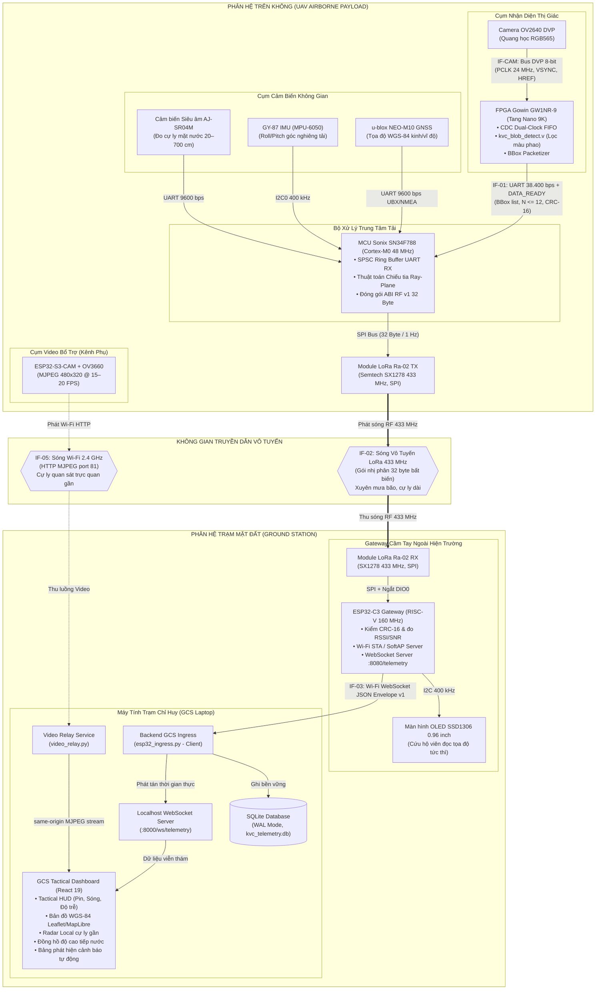

---

## 2. Sơ Đồ Phân Định Ranh Giới 2 Kênh Độc Lập

Nhằm đảm bảo an toàn tuyệt đối cho công tác cứu nạn trong điều kiện mưa bão khắc nghiệt, hệ thống KVC áp dụng nguyên tắc **Dual-Stream Isolation Topology**:

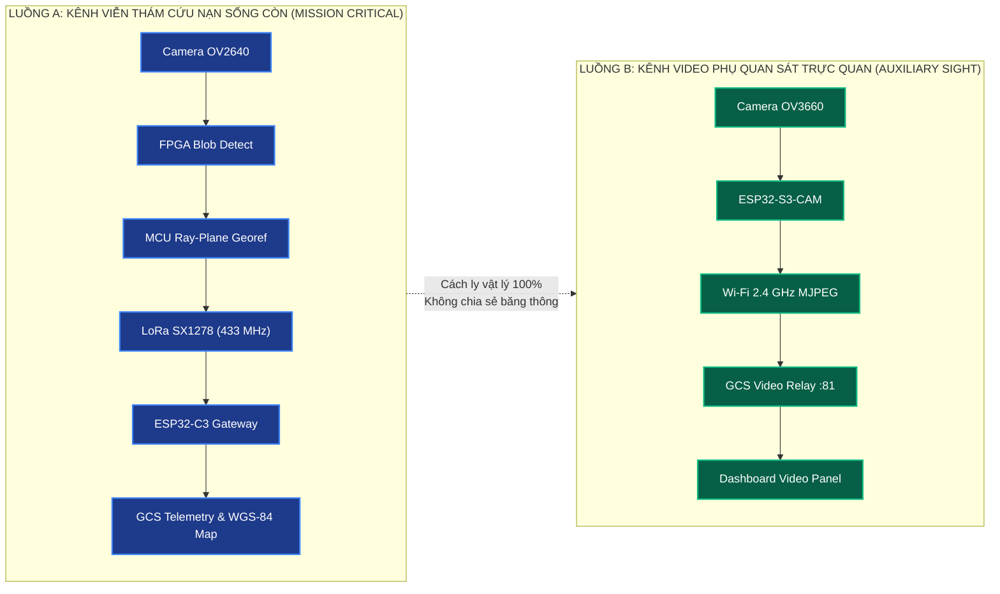

> [!CAUTION]
> **4 Nguyên Tắc "Bất Khả Xâm Phạm":**
> 1. **Zero-Video over LoRa:** Băng thông LoRa 125 kHz không thể truyền tải video. Toàn bộ thông tin qua LoRa chỉ là **Metadata nhị phân 32 byte** cố định.
> 2. **Không vẽ đè BBox lên Video phụ (No Overlay):** Cụm camera FPGA (OV2640) và cụm camera phụ (OV3660) khác nhau về vị trí lắp đặt, trục quang học (FOV) và lệch thời gian (latency 100–500 ms). Do đó video phụ tuyệt đối không overlay khung nhận diện từ FPGA để tránh định hướng sai lệch cho cứu hộ viên.
> 3. **Độc lập khi hỏng hóc:** Nếu kênh video phụ mất sóng Wi-Fi do khoảng cách xa hoặc mưa gió, **kênh viễn thám LoRa vẫn hoạt động 100% bình thường**, bảo đảm vị trí nạn nhân luôn được cập nhật liên tục trên bản đồ GCS.
> 4. **Trình duyệt không nối thẳng vào ESP32 Gateway:** Dashboard GCS kết nối qua Backend Python để bảo vệ CPU đơn nhân của ESP32-C3 không bị treo do ngắt mạng WebSocket.

---

## 3. Sơ Đồ Chi Tiết 6 Luồng Hoạt Động

---

### Luồng 1: Xử lý Quang học & Thị giác Máy tính trên FPGA

* **Nhiệm vụ:** Thu nhận luồng pixel tốc độ cao, khử nhiễu bề mặt nước, lọc màu tìm phao cứu sinh/vật thể nổi và đóng gói danh sách Bounding Box gửi sang MCU.

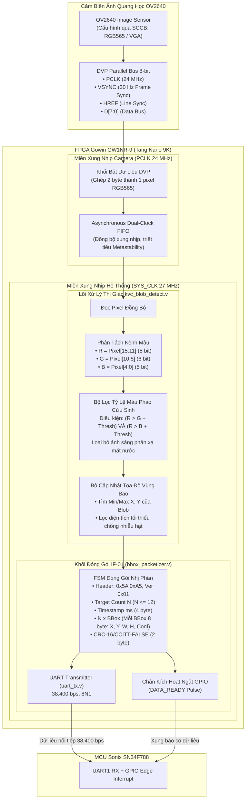

---

### Luồng 2: Cảm biến & Định vị Cục bộ trên MCU Payload

* **Nhiệm vụ:** Nhận ngắt UART từ FPGA, kết hợp dữ liệu độ cao siêu âm, góc nghiêng IMU và tọa độ GPS để giải bài toán hình học chiếu tia Ray-Plane, xác định tọa độ WGS-84 của mục tiêu và đóng gói khung ABI 32 byte.

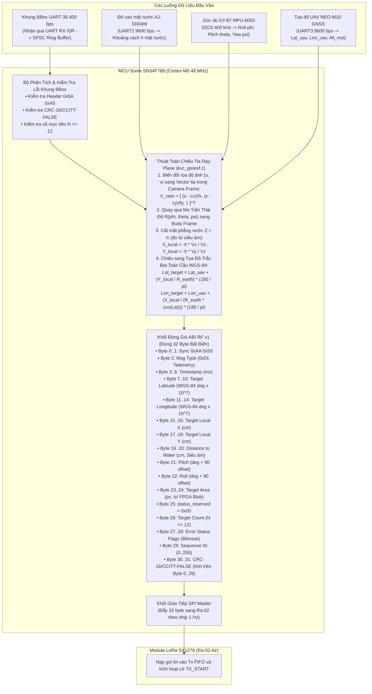

---

### Luồng 3: Viễn thám Vô tuyến Xuyên Mưa Lũ LoRa RF (IF-02)

* **Nhiệm vụ:** Truyền phát gói tin 32 byte qua tầng vật lý vô tuyến 433 MHz, đảm bảo khả năng xuyên qua mưa lũ bão lốc và cự ly xa mà mạng Wi-Fi/4G không thể đáp ứng.

```mermaid
flowchart LR
    subgraph TX_SIDE["Đầu Phát Trên UAV (Airborne TX)"]
        MCU_SPI["MCU SN34F788<br/>SPI Master"]
        RA02_TX["LoRa Ra-02 (SX1278)<br/>• Tần số: 433.00 MHz<br/>• Spreading Factor: SF7<br/>• Băng thông: BW 125 kHz<br/>• Mã sửa lỗi: CR 4/5<br/>• Công suất phát: +18 dBm<br/>• Preamble: 8 symbol"]
        ANT_TX["Anten LoRa 433 MHz<br/>(Monopole / Dipole phân cực đứng)"]

        MCU_SPI -->|"SPI Write (32 Byte)"| RA02_TX
        RA02_TX --> ANT_TX
    end

    subgraph RF_MEDIUM["Môi Trường Không Gian Truyền Sóng"]
        PROPAGATION{{"Sóng Vô Tuyến 433 MHz (Băng UHF)<br/>• Khả năng nhiễu xạ qua địa hình tốt<br/>• Độ suy hao trong mưa bão thấp<br/>• Airtime gói 32 byte: ~62 ms / 1.000 ms (Duty cycle ~6.2%)"}}
        ANT_TX ==> PROPAGATION
    end

    subgraph RX_SIDE["Đầu Thu Trạm Đất (Ground RX)"]
        ANT_RX["Anten Thu 433 MHz"]
        RA02_RX["LoRa Ra-02 (SX1278 RX)<br/>• Nhận khung vô tuyến<br/>• Tự động tính RSSI & SNR<br/>• Kích hoạt xung ngắt DIO0"]
        ESP32_SPI["ESP32-C3 Gateway<br/>SPI Master (Đọc 32 byte + RSSI/SNR)"]

        PROPAGATION ==> ANT_RX
        ANT_RX --> RA02_RX
        RA02_RX -->|"Ngắt chân DIO0 (Packet Ready)"| ESP32_SPI
        RA02_RX -->|"SPI Read Register"| ESP32_SPI
    end
```

---

### Luồng 4: Gateway Trạm Mặt Đất — Chuyển Tiếp Wi-Fi & WebSocket (IF-03)

* **Nhiệm vụ:** ESP32-C3 tiếp nhận khung LoRa, xác thực toàn vẹn CRC-16, hiển thị ngay lên OLED tại hiện trường, đóng gói JSON Transport Envelope v1 và phát tán qua mạng Wi-Fi/WebSocket.

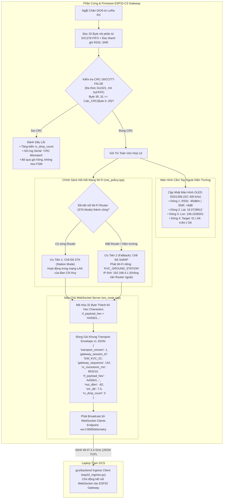

---

### Luồng 5: Trạm Mặt Đất GCS — Ingress, Giám Sát, Cảnh Báo & Hiển Thị (IF-04)

* **Nhiệm vụ:** Backend Laptop tiếp nhận luồng WebSocket từ Gateway, xác minh schema, ghi cơ sở dữ liệu SQLite chống mất mát dữ liệu, và phát tán thời gian thực sang giao diện Frontend React Dashboard với đầy đủ công cụ cứu hộ chuyên nghiệp.

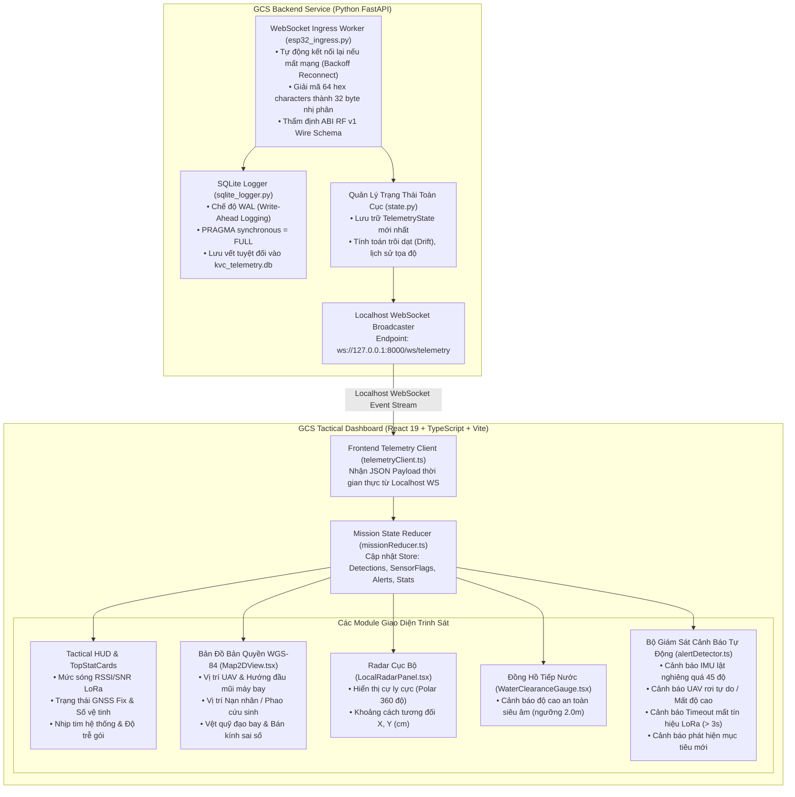

---

### Luồng 6: Kênh Video Quan Sát Phụ Độc Lập (IF-05 Aux Video)

* **Nhiệm vụ:** Truyền phát hình ảnh trực quan góc nhìn người cứu hộ (FPV) từ camera phụ OV3660 qua Wi-Fi trực tiếp về laptop, phục vụ cứu hộ viên quan sát bối cảnh dòng nước cuốn mà không ảnh hưởng tới kênh viễn thám LoRa.

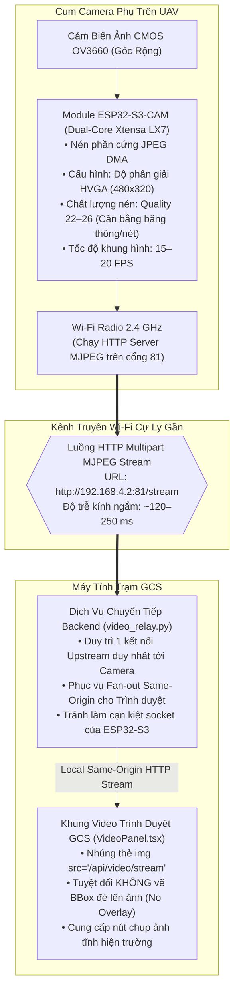

---

## 4. Sơ Đồ Tuần Tự End-to-End Chu Kỳ 1.000 ms

Biểu đồ tuần tự thời gian thực mô tả trọn vẹn hành trình của một gói tin từ khi phao cứu sinh lọt vào tầm nhìn của camera trên máy bay cho tới khi hiển thị trên màn hình GCS:

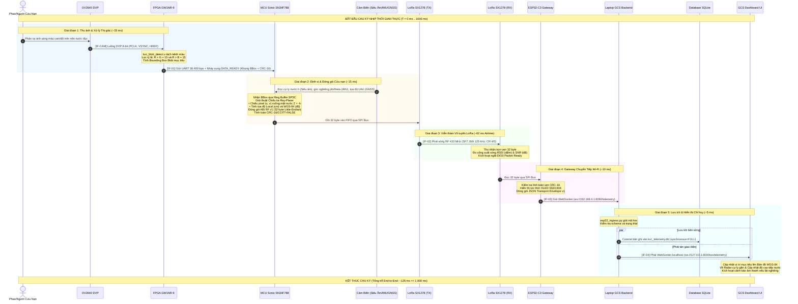

---

## 5. Sơ Đồ Máy Trạng Thái Toàn Hệ Thống

Để đảm bảo hệ thống không bao giờ bị rơi vào trạng thái "treo" (Deadlock) ngoài hiện trường, các bộ điều khiển đều tuân thủ máy trạng thái hữu hạn (FSM) chặt chẽ:

### A. Máy Trạng Thái MCU Payload (kvc_timebase.c)

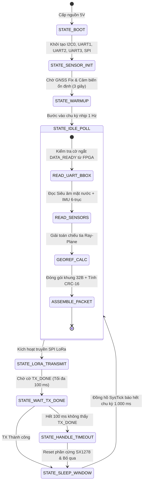

---

### B. Máy Trạng Thái Gateway ESP32-C3 (main.cpp & net_policy.cpp)

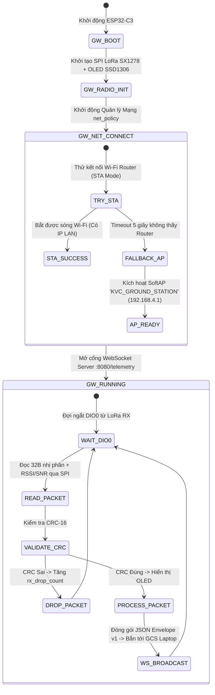

---

## 6. Sơ Đồ Xử Lý Sự Cố & Phòng Vệ Fail-Safe

Hệ thống được thiết kế theo tư duy phòng thủ (Defensive Engineering) để đối phó với mọi tình huống bất trắc ngoài hiện trường thiên tai:

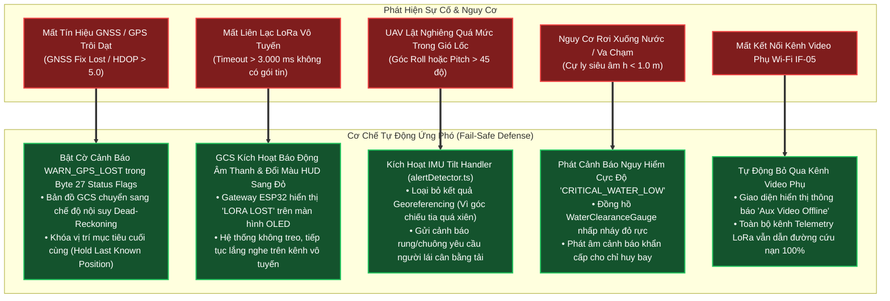

---

## 7. Bảng Tổng Hợp Thông Số Kỹ Thuật 6 Giao Diện

| Ký Hiệu | Tên Giao Diện | Giao Thức Vật Lý | Băng Thông / Tần Suất | Dữ Liệu Trao Đổi | Trạng Thái Kiểm Thử |
| :---: | :--- | :--- | :---: | :--- | :---: |
| **IF-CAM** | Camera Quang Học ➔ FPGA | Song song DVP 8-bit | 24 MHz / 30 FPS | Pixel thô RGB565 / VGA 640×480 | `SIMULATED` |
| **IF-00** | Cảm Biến ➔ MCU Payload | I2C0 400kHz, UART 9600 | 1–10 Hz | Độ cao siêu âm, Góc IMU, Tọa độ GPS | `SIMULATED` (65/65 PASS) |
| **IF-01** | FPGA ➔ MCU Payload | UART 38.400 bps + GPIO ngắt | 5–30 FPS | Khung danh sách BBox ($N \le 12$) + CRC-16 | **`HARDWARE-VERIFIED`** |
| **IF-02** | MCU Payload ➔ Gateway Trạm Đất | Sóng vô tuyến LoRa 433 MHz | 1 Hz (32 Byte cố định) | ABI RF v1 Little-Endian + CRC-16 | **`HARDWARE-VERIFIED`** |
| **IF-03** | Gateway Trạm Đất ➔ Laptop GCS | Wi-Fi 2.4 GHz + WebSocket | 1 Hz | JSON Transport Envelope v1 (64 hex chars) | `SOURCE-VERIFIED` (Host tests PASS) |
| **IF-04** | Backend GCS ➔ Frontend Dashboard | Localhost HTTP REST + WS | 1 Hz | JSON TelemetryState, Events & Alerts | `SOURCE-VERIFIED` (209 vitests + 99 pytests PASS) |
| **IF-05** | ESP32-S3-CAM ➔ GCS Video Panel | Wi-Fi 2.4 GHz HTTP MJPEG | 15–20 FPS (port 81) | Video phụ HVGA 480×320 (Không BBox overlay) | `SOURCE-VERIFIED` (Firmware built exit 0) |

---
*Tài liệu được biên soạn và bảo chứng kỹ thuật bởi Nhóm Kỹ sư Nghiên cứu Hệ thống KVC (Đại học Bách Khoa, Đại học Đà Nẵng) — Tháng 11/2026.*
