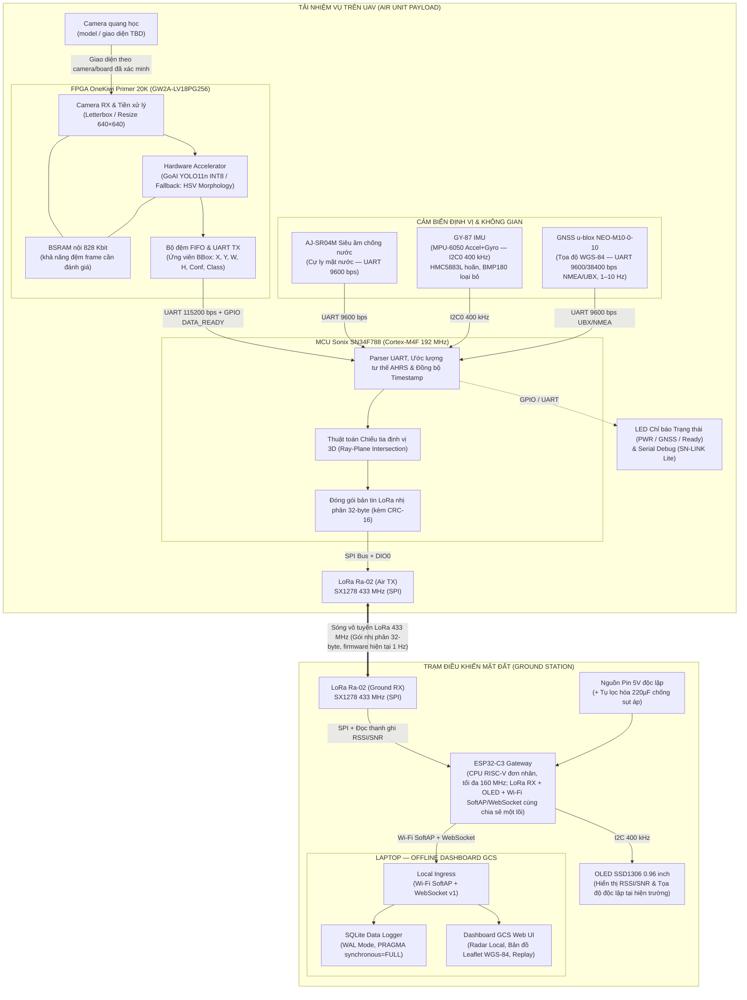

# TÀI LIỆU THIẾT KẾ HỆ THỐNG CHI TIẾT
## CUỘC THI THIẾT KẾ FPGA VÀ MCU MỞ RỘNG KHU VỰC MIỀN TRUNG 2026

*Dự án:* **Hệ thống tích hợp cho UAV hỗ trợ phát hiện, theo dõi và định vị người bị cuốn trôi trong bão lũ sử dụng FPGA và MCU (KVC)** 
---

> Cập nhật nội dung: **15/10/2026**. Bo đã có: **OneKiwi Primer 20K V1.1** theo xác nhận của nhóm. Tài liệu mô tả **thiết kế mục tiêu**, không xác nhận các khối phần cứng đã chạy. Gateway trạm đất chọn họ SoC **ESP32-C3** để chạy Wi-Fi SoftAP/WebSocket và dùng nguồn riêng; mã kit/board, module, flash và pinout cụ thể còn chờ xác minh phần cứng. Hiện trạng xem [báo cáo tiến độ](KVC_PROJECT_STATUS.md); công việc xem phân công (không có trong bản sản phẩm) và checklist (không có trong bản sản phẩm).
>
> Cách đọc: mục III là linh kiện/cấu hình cần xác minh; mục IV gồm nhiệm vụ và **giao thức** — ABI RF 32 byte (IF-02) đã được HUMAN duyệt ngày 29/10/2026, các giao thức khác còn dự thảo; mục VII là nghiệm thu; mục VIII là nguồn tham chiếu. Bản này không chứa lịch 21 ngày; ngày/gate trong kế hoạch cũ là tham chiếu lịch sử.

### I. THÔNG TIN CHUNG

* **Tên đề tài:** Thiết kế hệ thống tích hợp cho UAV hỗ trợ phát hiện, theo dõi và định vị người bị cuốn trôi trong bão lũ sử dụng FPGA và MCU.
* **Đơn vị dự thi:** Đội KVC — Trường Đại học Bách Khoa – Đại học Đà Nẵng.
* **Trưởng nhóm:** Nguyễn Tất Vững (SĐT: 0325393717 – Email: tatvung1234@gmail.com).
* **Thành viên nhóm:**
  1. Nguyễn Tất Vững
  2. Trương Trung Kiên
  3. Đàm Nguyễn Mạnh Cường
  4. Nguyễn Tá Duy Phong
  5. Đoàn Thanh Trường Thịnh

---

### II. TỔNG QUAN GIẢI PHÁP VÀ KIẾN TRÚC HỆ THỐNG

#### 1. Bối cảnh và mục tiêu cốt lõi
KVC hướng tới tình huống cứu nạn bão lũ khi kết nối Internet hoặc kênh truyền video không ổn định. Mục tiêu là xử lý ảnh tại tải UAV và gửi thông tin mục tiêu dung lượng nhỏ về trạm đất; khả năng hoạt động trong điều kiện thực tế phải được đo.

Kiến trúc mục tiêu sử dụng **xử lý tại biên**. Các khối dưới đây cần triển khai và kiểm thử:
- **Phát hiện tại chỗ trên UAV:** Camera quang học thu hình ảnh mặt nước → FPGA OneKiwi Primer 20K tiền xử lý và chạy mạng nơ-ron tích chập (CNN) tăng tốc phần cứng để phát hiện người trôi dạt (`person`) và phao cứu sinh (`lifebuoy`).
- **Định vị không gian:** MCU Sonix SN34F788 nhận kết quả Bounding Box từ FPGA qua UART, đọc đồng bộ các cảm biến đo đạc (cảm biến siêu âm chống nước AJ-SR04M, GY-87 IMU 10-DOF, GNSS NEO-M10-0-10) và giải bài toán giao điểm tia quang học với mặt phẳng nước để xác định tọa độ thực tế.
- **Truyền tin vô tuyến tầm xa:** Thay vì truyền video, hệ thống chỉ đóng gói các thông tin cứu nạn quan trọng thành các gói tin nhị phân siêu nhỏ (**32 byte/gói**) và truyền metadata qua **LoRa 433 MHz**. ABI RF 32 byte đã được duyệt (IF-02, 29/10/2026); cự ly, tỷ lệ nhận và độ trễ vẫn chưa được xác nhận bằng phép đo.
- **Trạm giám sát mặt đất (GCS):** ESP32-C3 trạm đất giải mã gói LoRa, đọc RSSI/SNR và gửi dữ liệu sang laptop qua **Wi-Fi SoftAP/WebSocket**. ESP32 có nguồn riêng và hoạt động độc lập với laptop. Laptop chạy Dashboard web và dịch vụ GCS để nhận dữ liệu, hiển thị, lưu log và replay; không tham gia xử lý nhiệm vụ trên UAV hay điều khiển ESP32.

#### 2. Ranh giới kỹ thuật và phạm vi nghiệm thu PoC
- **Bản chất hệ thống:** KVC là **tải nhiệm vụ (payload)** gắn trên UAV, độc lập với bộ điều khiển bay an toàn (flight controller). MCU không can thiệp điều khiển cân bằng bay hay cánh lái.
- **Phạm vi ưu tiên trong PoC:** Nhận diện người/phao trên video lũ lụt có sẵn; thử nghiệm và quay video tổng quan tại bể bơi để chứng minh luồng hệ thống–Dashboard; test trực tiếp thiết bị tại cuộc thi không dùng sa bàn. Khi đo định vị ở bể bơi, ưu tiên 1 mục tiêu, camera có pose và hệ local đã hiệu chuẩn (cm). WGS-84 ngoài trời là phép kiểm riêng khi có GNSS 3D fix; tại gian thi thiếu điều kiện định vị phải hiển thị INVALID/N/A.
- **Phân định 3 chế độ nguồn dữ liệu ở mức thiết kế:**
  - `REAL`: Dữ liệu thu nhận và suy luận thực tế từ phần cứng trên UAV.
  - `MOCK`: Dữ liệu giả lập. Source hiện có sinh MOCK trong trình duyệt hoặc backend PC; MOCK từ FPGA/MCU là bước tích hợp dự kiến.
  - `REPLAY`: Dữ liệu phát lại từ log SQLite trên máy tính phục vụ phân tích sau chuyến bay.
- **Ngoài phạm vi PoC:** Chế tạo khung bay UAV, chứng nhận hàng không DO-254/DO-178C, chứng nhận chống nước IP67.
- **Kết nối GCS:** Thiết kế chọn họ SoC ESP32-C3 làm gateway trạm đất. Kit phát triển/module cụ thể cần được xác minh trước khi khóa board ID, nguồn, flash và pinout. ESP32 tạo Wi-Fi SoftAP nội bộ, backend GCS trên laptop chạy WebSocket client qua mạng này, browser Dashboard chỉ kết nối backend local. Transport v1, reconnect và buffer mục IV.4 là baseline để triển khai; chúng chưa phải bằng chứng phần mềm hoặc phần cứng đã chạy. Bluetooth và USB chỉ dùng cho nạp/debug khi cần, không là đường telemetry mục tiêu.

#### 3. Hình thức trình diễn tại cuộc thi: hai video và một phần test trực tiếp

Nhóm trình bày **ba hoạt động theo thứ tự**: (1) video lũ lụt có sẵn kèm kết quả nhận diện AI; (2) video tổng quan thử nghiệm tại bể bơi và kết nối Dashboard; (3) vận hành/test hệ thống ngay tại địa điểm thi, **không dùng sa bàn**. Video bể bơi được quay trước cuộc thi; không yêu cầu mang bể bơi, bể nước hoặc bố trí các mốc sa bàn tại nơi thi.

| Hoạt động | Mục đích trước giám khảo | Đầu vào và nội dung trình bày | Bằng chứng cần chuẩn bị |
| :--- | :--- | :--- | :--- |
| **1. Video lũ lụt có sẵn — nhận diện AI** | Cho thấy AI phát hiện đối tượng trong bối cảnh lũ lụt | Video nguồn đã có; hiển thị khung nhận diện, tên lớp và confidence của person/lifebuoy khi xuất hiện. Có đoạn không mục tiêu để quan sát báo động giả. Có thể chạy inference trên file hoặc chiếu bản kết quả đã ghi, phải giới thiệu đúng cách thực hiện. | Video gốc/nguồn sử dụng, file kết quả, model/config/hash và log chạy; ghi PC_REFERENCE nếu suy luận trên laptop. Video chọn để trình diễn không thay đánh giá locked-test. |
| **2. Video bể bơi — tổng quan hệ thống và Dashboard** | Cho thấy cách lắp đặt và luồng dữ liệu từ quan sát tới màn hình giám sát | Quay toàn cảnh bể bơi, vị trí camera/tải, phần cứng thực dùng, trạm đất ESP32 có nguồn riêng, laptop hiển thị Dashboard web; xen màn hình nhận diện, trạng thái link/cảm biến, thông tin mục tiêu và log/replay trên Dashboard. | Video toàn cảnh + screen recording + session/capture cùng phiên; sơ đồ chỉ rõ phần đã chạy thật, phần MOCK hoặc PC_REFERENCE. Tọa độ chỉ trình bày khi có calibration và dữ liệu hợp lệ. |
| **3. Test trực tiếp tại cuộc thi — không sa bàn** | Chứng minh hệ thống đang vận hành và có thể thao tác trước giám khảo | Khởi động bộ thiết bị mang tới, kết nối Dashboard, đưa đầu vào thử, quan sát cập nhật/cảnh báo, kiểm ngắt–khôi phục link và lưu/phát lại phiên. Cấu hình đầu vào cụ thể được chốt khi tổng duyệt. | Checklist live, cấu hình/candidate cố định, log phiên mới tại cuộc thi và kết quả từng bước. Nếu dùng MOCK hoặc log cũ dự phòng phải ghi đúng nhãn, không ghi đã kiểm chuỗi REAL. |

##### 3.1. Video lũ lụt có sẵn

1. Chọn các đoạn nguồn hợp lệ, có đối tượng và điều kiện quan sát phù hợp; lưu nguồn/license hoặc quyền sử dụng, hash và đoạn thời gian đã chọn.
2. Chạy model candidate trên video, giữ đúng preprocessing/class mapping; trình bày hình gốc cùng overlay hoặc đối chiếu cạnh nhau. Nêu rõ thiết bị thực hiện inference.
3. Giới thiệu các lớp nhận diện, trường hợp đúng/bỏ sót/nhầm đáng chú ý; chỉ công bố số đo từ báo cáo evaluation có input và log tương ứng. Không suy vị trí địa lý hay khoảng cách người trong video khi thiếu thông tin camera/cảm biến của video gốc.
4. Chuẩn bị file nguồn và file kết quả offline. Nếu chạy inference ngay trên file tại cuộc thi, nêu rõ **đầu vào là video đã ghi, inference đang chạy**; nếu chiếu kết quả đã dựng, nêu rõ **kết quả đã ghi trước**.

##### 3.2. Video tổng quan tại bể bơi

1. Quay cảnh bố trí thử nghiệm và giải thích camera → nơi suy luận thực tế → MCU tải → LoRa → ESP32 trạm đất → Wi-Fi SoftAP/WebSocket → laptop/Dashboard web theo cấu hình đã hoàn thiện. Mỗi đoạn chỉ thể hiện thành phần thực sự có trong lần thử.
2. Quay mục tiêu trong bể bơi và màn hình Dashboard cùng phiên, có mốc thời gian/sự kiện chung để đối chiếu. Chỉ số link, trạng thái cảm biến, lớp/confidence và tọa độ được giải thích theo dữ liệu thật của phiên.
3. Thể hiện lúc có/không có mục tiêu, thay đổi quan sát, mất dữ liệu hoặc mất link và khôi phục nếu đã kiểm; kết thúc bằng mở log/replay của đúng phiên thử.
4. **LoRa chỉ truyền metadata, không truyền video.** Dashboard web trên laptop nhận telemetry từ ESP32 qua Wi-Fi SoftAP/WebSocket v1. Hình video/camera (nếu có) dùng kênh riêng như file cục bộ hoặc screen recording; không vẽ luồng video đi qua LoRa.
5. Nếu cần chứng minh định vị, đo/hiệu chuẩn hệ local của khu vực bể bơi trước khi ghi hình, lưu origin/pose/ground truth và log. Không mang các mốc này tới nơi thi; thiếu điều kiện định vị thì để INVALID/N/A và chỉ trình bày nhận diện/truyền dữ liệu.

##### 3.3. Checklist test trực tiếp tại địa điểm thi

- **Chuẩn bị:** bộ phần cứng đã được kiểm, nguồn/cáp/anten theo cấu hình, laptop có ứng dụng và assets offline, hai video đã quay và bản sao log/cấu hình. Không cần sa bàn hoặc bể nước tại gian thi.
- **Bước 1 — Khởi động:** cấp nguồn riêng cho ESP32 và LoRa trạm đất, mở Dashboard web trên laptop, kết nối qua Wi-Fi SoftAP/WebSocket v1; kiểm session mới và trạng thái từng thành phần có thật. ESP32 không cần laptop để khởi động hoặc tiếp tục thu LoRa. Kiểm hoạt động local khi không có Internet.
- **Bước 2 — Đầu vào thử:** phương án ưu tiên để tổng duyệt là camera đang chạy với người/phao trong không gian thử phù hợp tại gian thi; nếu không phù hợp với camera/cấu hình đã chọn, chốt phương án chạy video file làm đầu vào trước ngày thi. Phải thử được đường đưa đầu vào tới nơi inference thực tế, không mặc định laptop có thể nạp file thẳng vào FPGA.
- **Bước 3 — Quan sát chuỗi:** đối chiếu sự kiện đầu vào với nhận diện, dữ liệu truyền, trạng thái link và Dashboard. Nếu chỉ kiểm một đoạn (ví dụ ESP32→Dashboard hoặc FPGA mock→MCU tải→GCS), ghi rõ phạm vi và nhãn MOCK/PC_REFERENCE; không suy ra toàn chuỗi đã hoạt động.
- **Bước 4 — Phục hồi:** thực hiện thao tác ngắt/kết nối lại Wi-Fi SoftAP/WebSocket hoặc link đã được thử trong tổng duyệt; Dashboard báo mất link/stale rồi khôi phục đúng session/state, không tiếp tục hiển thị dữ liệu cũ như dữ liệu mới.
- **Bước 5 — Lưu và phát lại:** kết thúc phiên test, mở log/replay của phiên vừa tạo và chỉ rõ nhãn REPLAY. Nếu live thất bại, có thể mở log bể bơi làm dự phòng nhưng phải công bố đó là phiên đã ghi trước.
- **Tọa độ tại nơi thi:** không giả định có GNSS 3D fix, mặt phẳng nước hoặc pose/origin đã hiệu chuẩn. Khi thiếu điều kiện, hiển thị INVALID/N/A; nhận diện và kiểm link vẫn tiếp tục. BBox trên ảnh không tự chứng minh tọa độ cứu nạn ngoài thực địa.

Ba hoạt động này là kịch bản **PLANNED**. Việc đổi cách trình diễn không xác nhận hardware đã chạy và không tự thay baud, ABI, CRC, IRQ, pinout hoặc mô hình. Nhãn nguồn REAL/MOCK/REPLAY của telemetry và provenance inference được giữ độc lập với việc **chiếu một video**; chiếu file MP4 không tự trở thành chế độ REPLAY của log SQLite.

#### 4. Sơ đồ kiến trúc hệ thống chi tiết

Sơ đồ mô tả luồng tín hiệu, bus vật lý và sự phân định ranh giới giữa các phân hệ: Tải UAV (Edge AI FPGA + Sonix MCU + Cảm biến) và Trạm mặt đất (ESP32 Gateway + Offline GCS Dashboard). Toàn bộ hệ thống được thiết kế để vận hành **độc lập và hoàn toàn ngoại tuyến (100% Offline)**, không phụ thuộc vào Internet hay dịch vụ đám mây (Cloud).

#### 5. Cơ chế và phương thức hoạt động của LoRa trong dự án KVC

Kênh truyền LoRa (Long Range) đóng vai trò là xương sống thông tin liên lạc giữa UAV và trạm mặt đất trong bối cảnh thiên tai bão lũ. Dưới đây là phương thức sử dụng chi tiết:

1. **Phần cứng và băng tần:**
   - Baseline PoC dùng một cặp **Ai-Thinker Ra-02** tích hợp **Semtech SX1278**, cùng tần số và cấu hình ở hai đầu. Đổi sang Ebyte E22 hoặc module khác yêu cầu chốt lại model, cập nhật BOM/driver/cấu hình RF ở cả hai đầu và đo lại link; không trộn hai họ module trong một link.
   - Băng tần thiết kế: **433 MHz** trong dải hoạt động 410–525 MHz của Ra-02. Trước khi phát ngoài thực địa phải xác nhận yêu cầu tần số, công suất và duty cycle áp dụng tại địa điểm vận hành.
   - Datasheet Ra-02 V1.1 công bố công suất phát cực đại **18 ± 1 dBm** tại 433 MHz; dùng giá trị này làm mốc thiết kế. Trang sản phẩm hiện hành của Ai-Thinker ghi +20 dBm, nên cấu hình công suất thực tế phải được đọc lại từ module/driver và đo nguồn trước khi công bố.
   - Tham số điều chế RF đề xuất: Băng thông $BW = 125\text{ kHz}$, Spreading Factor $SF = 7\text{ hoặc }8$, Coding Rate $CR = 4/5$, Preamble Length = 8 symbol.

2. **Nguyên tắc "Zero-Video" — Chỉ truyền Metadata:**
   - Trong bối cảnh cứu nạn mưa lũ, việc truyền luồng video số trực tiếp (RTSP/H.264) qua sóng vô tuyến đòi hỏi băng thông hàng Megabit/giây (Mbps), rất dễ bị mất tín hiệu hoặc nhiễu trắng khi bay xa hoặc thời tiết xấu.
   - KVC triệt để loại bỏ việc truyền video qua LoRa: toàn bộ dữ liệu ảnh thô từ camera được thu nhận và chạy suy luận AI ngay trên FPGA tại UAV.
   - LoRa chỉ đảm nhiệm truyền tải các gói tin **Metadata nhị phân siêu nhỏ (32 byte/gói)** chứa thông tin cứu nạn quan trọng: ID mục tiêu, tọa độ địa lý nạn nhân (WGS-84 / Local), mức độ tin cậy AI, cự ly siêu âm, mức pin và các cờ trạng thái hệ thống.

3. **Cấu trúc gói tin nhị phân và kiểm tra toàn vẹn:**
   - Chiều dài gói tin cố định đúng **32 byte** (đặc tả wire v1 tại mục IV.3):
     - Byte 0–1: Sync Header (`0xAA 0x55`).
     - Byte 2: Protocol Version (`1`).
     - Byte 3: Packet Type (`0x01` Telemetry tải, `0x02` Target phát hiện, `0x03` Boot/Status chẩn đoán).
     - Byte 4–5: Sequence Number (tăng đơn điệu chống trùng lặp/mất gói).
     - Byte 6–29: Tải dữ liệu hữu ích (Track ID, Timestamp, Tọa độ X/Y hoặc Lat/Lon, cự ly siêu âm, Confidence, Mức pin, System Flags 16-bit, Session ID).
     - Byte 30–31: **CRC-16/CCITT-FALSE** (Poly `0x1021`, Init `0xFFFF`) tính trên 30 byte đầu.
   - Gói tin chỉ được phía nhận chấp nhận nếu vượt qua kiểm tra CRC-16; gói sai CRC lập tức bị drop để bảo vệ dữ liệu Dashboard không bị nhảy tọa độ rác.

4. **Chiến lược chu kỳ và tần suất phát (Duty Cycle & Time-on-Air):**
   - Với payload 32 byte, explicit header, CRC LoRa bật, preamble 8 symbol, $BW = 125\text{ kHz}$, $CR = 4/5$ và không bật LDRO ở SF7/SF8, công thức airtime LoRa cho kết quả xấp xỉ **71,9 ms tại SF7** và **133,6 ms tại SF8**. Đây là phép tính theo tham số nêu trên, cần đối chiếu với cấu hình thanh ghi thực tế và [Semtech LoRa Calculator](https://calculator.semtech.com/).
   - **Tần suất phát quy định:**
     - **Chế độ phát hiện mục tiêu (Target Event) — DESIGN, chưa có trong firmware:** Khi AI xác nhận có người hoặc phao (`TARGET_CONFIRMED = 1`), thiết kế dự kiến phát ở tốc độ **2 – 5 Hz** (200 – 500 ms/gói) để cập nhật liên tục đường đi của nạn nhân bị trôi dạt. Firmware hiện tại chỉ có một chu kỳ cố định `KVC_TELEMETRY_PERIOD_MS = 1000` (1 Hz) cho mọi trạng thái, nên đây là mục tiêu chưa triển khai; bật 2–5 Hz cần tính lại duty-cycle và được giao thay đổi cụ thể.
     - **Chế độ tuần tra thông thường (Telemetry Heartbeat):** Khi chưa phát hiện mục tiêu, hệ thống phát telemetry định kỳ **1 Hz** (1000 ms/gói) để báo cáo trạng thái UAV và chất lượng cảm biến.
     - **Chế độ chẩn đoán hệ thống (Status) — DESIGN, chưa có trong firmware:** thiết kế dự kiến phát định kỳ **5 giây/lần** (Type `0x03`); `kvc_telemetry.h` hiện chỉ định nghĩa `0x01` telemetry và `0x02` heartbeat, chưa có `0x03`.
    - *Lưu ý kỹ thuật:* Không phát liên tục 10 Hz. Với các giả định trên, 10 Hz tương ứng khoảng 71,9% airtime tại SF7 và vượt 100% tại SF8, trước cả retransmission hay thời gian xử lý. Chỉ số duty cycle hợp lệ phải được tính lại từ cấu hình đã nạp và quy định vận hành.

5. **Luồng xử lý tại Trạm đất (Ground Station) và GCS:**
    - Module Ra-02 trạm đất nhận sóng RF, kiểm CRC LoRa PHY nếu bật và kích hoạt chân ngắt DIO0; ESP32 tiếp tục kiểm CRC-16 của payload v1 trước khi chuyển tiếp.
   - ESP32 nhận ngắt, đọc 32 byte gói tin qua bus SPI, đồng thời đọc ngay hai thanh ghi phần cứng của SX1278:
     - `RegPktRssiValue` (Offset 0x1A): Cường độ tín hiệu nhận được (tính ra dBm).
     - `RegPktSnrValue` (Offset 0x19): Tỷ số tín hiệu trên tạp âm (tính ra dB).
   - ESP32 đẩy thông số nhanh lên màn hình OLED 0.96 inch tại chỗ (phục vụ cứu hộ viên quan sát độc lập ngoài trời).
    - ESP32 đóng vai trò gateway mạng theo thứ tự ưu tiên: (1) STA vào Wi-Fi 2.4 GHz có sẵn; (2) nếu không nối được thì phát SoftAP `KVC_GROUND_STATION` (IP `192.168.4.1`, mật khẩu `kvc123456`) và tự đóng SoftAP khi STA nối lại. ESP32 mở WebSocket Server `ws://192.168.4.1:8080/telemetry`. Backend GCS trên laptop là client nhận telemetry; browser Dashboard chỉ kết nối với backend local.

---

### III. CẤU HÌNH PHẦN CỨNG, NGOẠI VI VÀ DANH MỤC LINH KIỆN HỆ THỐNG

#### 1. Cấu hình làm việc chuẩn hóa cho từng phân hệ

Để đảm bảo tính khả thi và đồng bộ trong quá trình chế tạo, hệ thống KVC **chọn cố định đúng 1 loại linh kiện duy nhất cho từng vị trí chức năng**, tuyệt đối không dùng linh kiện dự phòng hoặc biến thể chưa rõ thông số.

| Phân hệ / Khối chức năng | Linh kiện chuẩn hóa được chọn | Thông số kỹ thuật cốt lõi | Vai trò cụ thể trong dự án |
| :--- | :--- | :--- | :--- |
| **Tải UAV — Khối Xử lý Ảnh & AI** | **OneKiwi Primer 20K V1.1** | Gowin GW2A-LV18PG256, 20.736 LUTs, 828 Kbit BSRAM, chip nạp GWU2X; hardware notes cho biết không có DDR3 ngoài trên board | Candidate nhận ảnh qua giao diện sẽ xác minh; đánh giá khả năng đệm bằng tài nguyên có thật, khả thi AI và xuất BBox qua UART. |
| **Tải UAV — Camera Quang học** | **Camera quang học — model TBD** | Sensor, giao diện, connector/cáp và rail cấp nguồn chưa chốt; không mặc định OV2640/OV5640, DVP/MIPI hay FPC trên OneKiwi | Thu nhận hình ảnh mặt nước sau khi xác minh camera, board, cáp, nguồn và pin map thực tế. |
| **Tải UAV — MCU Điều khiển & Dung hợp** | **Sonix STK SN34F788** | ARM Cortex-M4F 192 MHz, Flash 512 KB, SRAM 160 KB, FPU phần cứng, tích hợp SN-LINK Lite | Giải mã BBox từ UART, đọc và lọc cảm biến AHRS/Siêu âm/GNSS, giải bài toán giao điểm chiếu tia 3D, đóng gói LoRa 32-byte. |
| **Tải UAV — Cảm biến cự ly siêu âm** | **AJ-SR04M (JSN-SR04T)** | Siêu âm chống nước IP67, 40 kHz, dải 0,2–6 m, UART 9600 bps / Trig-Echo, nguồn 5V logic 3,3V/5V | Đo khoảng cách thẳng đứng từ UAV xuống mặt nước để xác định độ cao mặt phẳng phục vụ chiếu tia, phản xạ tốt trên bề mặt nước. |
| **Tải UAV — IMU 10-DOF** | **GY-87** | MPU-6050 (Accel 3 trục + Gyro 3 trục), I2C 400 kHz. Module còn có HMC5883L (la bàn) và BMP180 (áp suất) nhưng **firmware không dùng**: HMC5883L hoãn tới khi có kit để hiệu chuẩn, BMP180 đã loại khỏi thiết kế (xem [IF_MCU_SENSORS.md](../interfaces/IF_MCU_SENSORS.md) §3.2 B–C). | Cung cấp gia tốc để ước lượng Roll/Pitch. **Chưa có Yaw tuyệt đối**, nên $\mathbf{R}_{\text{camera}}$ hiện chỉ đủ khi camera hướng Bắc; muốn đủ 3 góc phải bổ sung Yaw (dự kiến từ GNSS `track_made_good`). |
| **Tải UAV — GNSS Định vị** | **u-blox NEO-M10-0-10** | Thu đồng thời GPS + GLONASS + Galileo + BeiDou + QZSS + SBAS (theo datasheet module), cập nhật 1–10 Hz (mặc định 1 Hz), UART TTL 8N1 — firmware chạy 9600 sau khi gửi UBX CFG-PRT đổi từ 38400 mặc định, anten SMA ngoài trời | Xác định tọa độ vị trí toàn cầu WGS-84 của UAV ngoài trời khi đạt 3D fix (`GPS_VALID = 1`). |
| **Tải UAV — Module phát LoRa (TX)** | **Ai-Thinker Ra-02 (SX1278)** | Dải 410–525 MHz, SPI, nguồn 3,3V; datasheet V1.1: công suất tối đa 18 ± 1 dBm tại 433 MHz | Phát metadata 32 byte theo ABI IF-02 đã duyệt (29/10/2026) xuống trạm đất theo chu kỳ được đo/duyệt. |
| **Tải UAV — Chỉ báo & Debug tại chỗ** | **LED Trạng thái & UART Debug (SN-LINK Lite)** | LED GPIO (Power, GNSS Fix, Ready/Error) + Cổng UART Debug ảo (VCOM) tích hợp | Chỉ báo trực quan trạng thái tải trước bay; in log chẩn đoán chi tiết qua terminal PC khi debug bàn lab (lược bỏ OLED trên tải để tối ưu khối lượng và chống rung lắc). |
| **Trạm Mặt Đất — Gateway MCU** | **ESP32-C3 DevKit (mã kit TBD)** | CPU RISC-V đơn nhân tối đa 160 MHz, 400 KB SRAM (16 KB cache), Wi-Fi 2.4 GHz 802.11 b/g/n, Bluetooth LE 5; flash/GPIO khả dụng theo module và kit | Thu gói LoRa qua SPI, đọc RSSI/SNR, phát Wi-Fi SoftAP và WebSocket telemetry tới dịch vụ GCS trên laptop. Đây là cấu hình mục tiêu; cần xác minh tài nguyên, nguồn và GPIO trên đúng kit trước khi tích hợp. |
| **Trạm Mặt Đất — Module thu LoRa (RX)** | **Ai-Thinker Ra-02 (SX1278)** | Dải 410–525 MHz, SPI, nguồn 3,3V; datasheet V1.1: độ nhạy tới -141 dBm tại 433 MHz, SF12, BW 125 kHz | Thu payload RF 32 byte theo ABI IF-02 đã duyệt (29/10/2026), kiểm CRC và đo chất lượng liên kết RF. |
| **Trạm Mặt Đất — Màn hình hiện trường** | **OLED SSD1306 0.96 inch I2C** | Độ phân giải 128×64 pixel, giao tiếp I2C 400 kHz, nguồn 3,3V | Hiển thị tức thời RSSI/SNR, số gói nhận được và tọa độ nạn nhân độc lập ngoài trời không cần laptop. |
| **Trạm Mặt Đất — Khối nguồn độc lập** | **Pin Li-ion 18650 2S (7.4V) + Buck MP1584** | Mạch hạ áp Buck DC-DC MP1584 hạ về rail 5V ổn định + Tụ hóa 220 µF chống sụt áp tức thời | Cung cấp nguồn riêng biệt cho trạm đất, đảm bảo vận hành liên tục khi laptop tắt hoặc mất kết nối. |
| **Trạm Giám Sát — Laptop GCS Offline** | **Laptop Windows/Linux** | Web Dashboard (React/TypeScript/Vite) + Backend Python FastAPI + SQLite Logger (WAL mode) | Nhận dữ liệu qua WebSocket nội bộ, hiển thị radar local, vẽ vị trí nạn nhân trên bản đồ WGS-84, lưu và phát lại log. |

---

#### 2. Danh mục linh kiện chi tiết (BOM) phân theo các trạm và phân hệ

Danh mục dưới đây phân loại chính xác linh kiện theo 5 phân hệ phần cứng. Mỗi vị trí chỉ sử dụng **đúng 1 mã linh kiện duy nhất** đã chốt.

##### A. Phân hệ 1: Trạm Tải trên UAV (Air Unit) — Khối Xử lý Ảnh & AI trên FPGA
| STT | Tên linh kiện cụ thể | Số lượng | Điện áp / Bus | Chức năng trong KVC | In — Đầu vào | Out — Đầu ra | Yêu cầu kỹ thuật thực tế |
| :---: | :--- | :---: | :---: | :--- | :--- | :--- | :--- |
| **A1** | **OneKiwi Primer 20K V1.1** | 1 bo | Nguồn/IO theo schematic và board thực tế | Bo FPGA hiện có; khả năng pipeline camera/AI cần kiểm tra. | Nguồn và cấu hình theo board; đầu vào camera chưa chốt. | Ứng viên BBox qua UART và `DATA_READY` sau khi duyệt IF-01. | Không có DDR3 ngoài theo hardware notes; đánh giá BSRAM nội 828 Kbit. Dung lượng SPI Flash cần xác minh vì tài liệu nguồn khác nhau. |
| **A2** | **Camera quang học (model TBD)** | 1 module | Rail và logic theo camera thực tế | Thu nhận hình ảnh quang học bề mặt nước. | Ánh sáng; nguồn và clock theo candidate đã chọn. | Giao diện/pixel bus theo camera và board đã xác minh. | Chưa chốt sensor, FOV, connector, cáp, voltage hoặc pin map; xác minh trước đặt mua/đấu nối. |
| **A3** | **Cáp/adapter Camera–OneKiwi (TBD)** | 1 bộ | Theo camera/board đã chốt | Nối camera đã chọn với board FPGA sau khi xác nhận interface. | Connector phía camera và board thực tế. | Tín hiệu theo pin map được duyệt. | Không mặc định FPC 24-pin hay header 2.54 mm; xác minh chiều dài và signal integrity theo candidate. |

##### B. Phân hệ 2: Trạm Tải trên UAV (Air Unit) — Khối Điều khiển Sonix MCU, Cảm biến & LoRa TX
| STT | Tên linh kiện cụ thể | Số lượng | Điện áp / Bus | Chức năng trong KVC | In — Đầu vào | Out — Đầu ra | Yêu cầu kỹ thuật thực tế |
| :---: | :--- | :---: | :---: | :--- | :--- | :--- | :--- |
| **B1** | **Sonix STK SN34F788** | 1 kit | 5V vào kit / 3.3V VDD | MCU tải chính: Dung hợp cảm biến, tính toán chiếu tia định vị và đóng gói LoRa. | Nguồn 5V qua ổn áp; UART từ FPGA; UART từ Siêu âm/GNSS; I2C từ IMU. | Bus SPI điều khiển LoRa Ra-02; GPIO điều khiển LED trạng thái; UART Debug qua SN-LINK Lite. | Cortex-M4F 192 MHz có FPU; nạp qua SN-LINK Lite tích hợp; kiểm tra đúng sơ đồ nguồn VDD 3.3V. |
| **B2** | **AJ-SR04M (JSN-SR04T)** | 1 bộ | 5V nguồn / 3.3V UART | Đo cự ly thẳng đứng từ UAV xuống mặt nước (hỗ trợ giải mặt phẳng $Z=0$). | Nguồn 5V DC; Sóng siêu âm 40 kHz phản xạ từ mặt nước; UART 9600 bps. | Dữ liệu cự ly (cm) qua khung UART 4 byte hoặc xung Echo. | Hoạt động dải 0.2–6 m, chuẩn chống nước IP67; kiểm tra vùng mù < 20 cm và góc mở chùm sóng 75°; tránh đọc giá trị rác khi mặt nước xao động. |
| **B3** | **Module IMU 10-DOF GY-87** | 1 module | 3.3V / I2C0 400 kHz | Đo gia tốc 3 trục, vận tốc góc và từ trường để ước lượng góc nghiêng Roll/Pitch/Yaw. | Nguồn 3.3V; Chuyển động cơ học và từ trường Trái Đất. | Dữ liệu thô Accel, Gyro, Mag qua I2C0 (P0.10 Pin 38 SCL0, P0.11 Pin 39 SDA0; địa chỉ 0x68 và 0x1E). | Gắn cố định trên gá 3D cùng camera; kit đã có trở kéo R3/R4 = 1 kΩ trên I2C0; xem [KVC_MASTER_PINOUT_WIRING.md](../hardware/wiring/KVC_MASTER_PINOUT_WIRING.md). |
| **B4** | **GNSS u-blox NEO-M10-0-10** | 1 bộ | 5V DC (LDO 3.3V on-board) / UART 9600 (mặc định) | Cung cấp tọa độ WGS-84 toàn cầu ngoài trời và đồng bộ thời gian vệ tinh. | Nguồn 5V DC; Tín hiệu vệ tinh RF từ anten ngoài trời chuẩn SMA. | Tọa độ Lat, Lon, Alt, Fix status qua UART (mặc định 1 Hz, cấu hình tối đa 10 Hz, NMEA/UBX). | Sử dụng anten ngoài trời cổng SMA hướng lên trời; chỉ dùng dữ liệu khi đạt 3D Fix (`GPS_VALID=1`). |
| **B5** | **Module LoRa Ai-Thinker Ra-02** | 1 module | 3.3V / SPI Bus | Phát gói tin nhị phân 32-byte chứa metadata cứu nạn từ tải xuống trạm đất. | Nguồn 3.3V; Lệnh cấu hình và dữ liệu gói qua SPI; Chân Reset. | Sóng vô tuyến RF 433 MHz qua cổng anten U.FL/IPEX; Chân ngắt DIO0. | Sử dụng chip Semtech SX1278; gắn tụ hóa 220 µF sát chân VCC/GND; hàn bo chuyển breakout 2.54mm. |
| **B6** | **Anten râu LoRa 433 MHz + Cáp IPEX** | 1 bộ | RF 433 MHz | Bức xạ sóng vô tuyến 433 MHz từ module Ra-02 ra không gian. | Tín hiệu RF từ module Ra-02 qua đầu cắm IPEX. | Sóng điện từ bức xạ trong không gian (Polarization dọc). | Anten râu omni 433 MHz chuẩn SMA đực, gain 3 dBi; cáp chuyển IPEX sang SMA cái dài 10–15 cm. |
| **B7** | **LED Chỉ báo Trạng thái (Air)** | 2–3 chiếc | 3.3V GPIO (kèm trở 1 kΩ) | Chỉ báo trực quan trạng thái trước khi bay (Nguồn, GNSS 3D-Fix, Sẵn sàng / Lỗi). | Mức logic điều khiển từ chân GPIO Sonix MCU. | Đèn LED phát sáng (Đỏ / Vàng / Xanh). | Thay thế màn hình OLED trên tải UAV để giảm trọng lượng, tránh nứt vỡ do rung chấn và loại bỏ nguy cơ treo bus I2C. Debug chi tiết sử dụng Serial Console qua SN-LINK Lite. |

##### C. Phân hệ 3: Trạm Mặt Đất (Ground Station Gateway)
| STT | Tên linh kiện cụ thể | Số lượng | Điện áp / Bus | Chức năng trong KVC | In — Đầu vào | Out — Đầu ra | Yêu cầu kỹ thuật thực tế |
| :---: | :--- | :---: | :---: | :--- | :--- | :--- | :--- |
| **C1** | **ESP32-C3 DevKit (mã bo TBD)** | 1 bo | Nguồn theo kit được chọn / logic 3.3V | MCU trạm đất: Thu LoRa, đọc RSSI/SNR, hiển thị OLED và làm Wi-Fi SoftAP Server. | Nguồn riêng đã xác minh; dữ liệu gói qua SPI từ Ra-02; chân ngắt DIO0 theo pinout được duyệt. | Dữ liệu hiển thị I2C tới OLED; luồng WebSocket Wi-Fi SoftAP tới Laptop GCS. | CPU đơn nhân; xác minh flash, GPIO được đưa ra, nguồn và khả năng chạy đồng thời LoRa/OLED/Wi-Fi trên đúng kit. Không giả định phân công hai core hoặc tự khóa pinout. |
| **C2** | **Module LoRa Ai-Thinker Ra-02** | 1 module | 3.3V / SPI Bus | Thu sóng LoRa 433 MHz từ tải UAV và cung cấp thanh ghi chất lượng liên kết RSSI/SNR. | Sóng vô tuyến 433 MHz từ anten; Lệnh điều khiển SPI từ ESP32. | Gói tin nhị phân 32-byte; Thanh ghi Packet RSSI & SNR qua bus SPI. | Cấu hình trùng khớp tham số RF với module phát (433 MHz, BW 125 kHz, SF7/8, CR 4/5); có tụ lọc sát chân. |
| **C3** | **Anten râu LoRa 433 MHz + Cáp IPEX** | 1 bộ | RF 433 MHz | Thu nhận tín hiệu sóng điện từ 433 MHz tại trạm mặt đất. | Sóng điện từ từ tải UAV truyền tới. | Tín hiệu RF dẫn vào chân anten module Ra-02 qua cáp IPEX. | Anten râu 433 MHz gain 3 dBi, đặt thẳng đứng ở vị trí thoáng, không bị che chắn bởi kim loại. |
| **C4** | **OLED SSD1306 0.96" I2C (Ground)**| 1 module | 3.3V / I2C 400 kHz | Hiển thị tức thời RSSI, SNR, tần số gói nhận và tọa độ mục tiêu ngay ngoài hiện trường. | Nguồn 3.3V; Dữ liệu hiển thị từ ESP32 qua I2C. | Màn hình hiển thị 128×64 pixel. | Giúp đội cứu nạn theo dõi được kết quả ngay cả khi laptop bị hết pin hoặc chưa kịp mở ứng dụng. |
| **C5** | **Khối Pin 18650 2S (7.4V) / Sạc dự phòng** | 1 bộ | 7.4V DC / 5V USB | Cung cấp nguồn điện độc lập cho trạm đất ngoài thực địa. | Năng lượng hóa học từ 2 cell pin 18650 mắc nối tiếp (hoặc pin sạc dự phòng 5V). | Điện áp DC cấp cho mạch hạ áp Buck MP1584. | Đảm bảo trạm đất hoạt động độc lập ≥ 4 giờ; không lấy nguồn từ cổng USB laptop khi vận hành. |

##### D. Phân hệ 4: Trạm Giám Sát Mặt Đất (Laptop GCS Offline)
| STT | Tên thành phần | Số lượng | Giao tiếp | Chức năng trong KVC | In — Đầu vào | Out — Đầu ra | Yêu cầu kỹ thuật thực tế |
| :---: | :--- | :---: | :---: | :--- | :--- | :--- | :--- |
| **D1** | **Laptop cá nhân (GCS)** | 1 máy | Wi-Fi 802.11 | Thiết bị giám sát, hiển thị bản đồ trực quan, quản lý cảnh báo và ghi log dữ liệu. | Wi-Fi SoftAP/WebSocket từ ESP32. | Dashboard web và file cơ sở dữ liệu SQLite. | Chạy hệ điều hành Windows/Linux; cài sẵn trình duyệt Chrome/Edge và môi trường Python 3.10+. |
| **D2** | **Web Dashboard KVC (Offline App)**| 1 bản | WebSocket Local | Giao diện trực quan hóa: Radar BBox, Bản đồ Leaflet WGS-84, đồ thị cự ly độ cao, bảng mục tiêu. | Backend GCS local (`ws://127.0.0.1:8000/ws/telemetry`); route chuẩn tại IF-04. | Trực quan hóa dữ liệu cứu nạn trên màn hình; phát âm thanh cảnh báo. | Đóng gói toàn bộ assets thư viện offline (Leaflet JS/CSS, fonts local); không gọi API từ CDN Internet. |
| **D3** | **Backend Python & SQLite Logger** | 1 gói | Localhost / WAL | Dịch vụ tiếp nhận luồng dữ liệu, lưu trữ bền vững vào SQLite và phát lại phiên (Replay). | Luồng dữ liệu telemetry từ Ingress. | File log `kvc_telemetry.db` chế độ WAL (`PRAGMA synchronous=FULL`). | Chạy ngầm trên laptop; đảm bảo commit dữ liệu tức thời, chống hỏng file khi mất nguồn đột ngột. |

##### E. Phân hệ 5: Khối Nguồn, Gá Cơ Khí & Linh Kiện Kết Nối Phụ Trợ Dùng Chung
| STT | Tên linh kiện cụ thể | Số lượng | Thông số kỹ thuật | Chức năng trong KVC | Lưu ý lắp đặt và thi công |
| :---: | :--- | :---: | :--- | :--- | :--- |
| **E1** | **Mạch hạ áp Buck DC-DC MP1584** | 3 mạch | Vin 4.5–28V, Vout chỉnh được, dòng liên tục 2A (đỉnh 3A) | Hạ áp từ pin chính (UAV 3S/4S hoặc pin trạm đất 2S) xuống rail 5V (AJ-SR04M, Vin bo) và rail 3.3V (LoRa, cảm biến). | Hiệu chỉnh biến trở đo chuẩn điện áp bằng đồng hồ vạn năng trước khi gắn tải; cố định keo biến trở. |
| **E2** | **Tụ hóa nhôm 220 µF / 16V** | 4 chiếc | 220 µF, chịu áp 16V, Low ESR | Lọc nguồn và đệm năng lượng tức thời chống sụt áp khi module LoRa Ra-02 phát. | Bắt buộc hàn trực tiếp sát chân VCC và GND của module Ra-02 (cả trên tải và dưới trạm đất). |
| **E3** | **Tụ gốm 100 nF (0.1 µF)** | 8 chiếc | 100 nF, chịu áp 50V | Lọc nhiễu xung cao tần trên các đường nguồn 3.3V và 5V gần chân IC. | Mắc song song với tụ hóa, đặt càng gần chân nguồn của MCU và module RF càng tốt. |
| **E4** | **Điện trở kéo 4.7 kΩ** | 2–4 chiếc | 4.7 kΩ, công suất 1/4W, sai số 1% | Trở kéo Pull-up cho đường truyền bus I2C (SDA, SCL) về mức logic 3.3V. | Dùng cho bus I2C (OLED trên trạm đất) nếu module chưa có sẵn trở kéo; trên tải UAV, bus I2C0 cho GY-87 đã có trở kéo R3/R4 = 1 kΩ tích hợp sẵn trên Starter-Kit V1.1; xem [KVC_MASTER_PINOUT_WIRING.md](../hardware/wiring/KVC_MASTER_PINOUT_WIRING.md). |
| **E5** | **Gá in 3D cụm Camera – Cảm biến siêu âm – IMU** | 1 bộ | Nhựa PLA/PETG chịu lực, in 3D chính xác | Giữ cố định mối quan hệ hình học (Extrinsic Calibration) giữa camera được chọn, AJ-SR04M và GY-87. | Kích thước/góc gá chốt sau khi camera và pose thực tế được xác minh. |
| **E6** | **Cáp USB Type-C & Micro-USB** | 3 sợi | Cáp đồng có đủ 4 lõi nguồn và data | Nối nạp code/debug cho OneKiwi (Type-C), Sonix (Mini/Type-C) và ESP32 (Micro-USB). | Dùng cáp truyền dữ liệu chất lượng tốt; không dùng cáp sạc 2 lõi chỉ cấp nguồn. |
| **E7** | **Dây nối Dupont & Header 2.54mm** | 2 tép | Dupont cái-cái, đực-cái dài 10–20 cm; header chân mạ thiếc | Đấu nối tín hiệu thử nghiệm trên bàn test giữa các module và kit phát triển. | Khi đóng gói bay thật, thay thế các mối cắm lỏng bằng cách hàn cố định lên protoboard để chống rung. |
| **E8** | **Protoboard & Bộ trụ ốc M2/M3** | 1 bộ | Bo đồng lỗ 2.54mm; ốc trụ đồng M2/M3 cách điện | Làm đế hàn module Ra-02 + tụ lọc; cố định chắc chắn các bo mạch vào khung tải bay UAV. | Dùng đệm cao su hoặc silicon chống rung cơ học từ cánh quạt UAV tác động lên IMU và mối hàn. |

---

### IV. PHẦN MỀM, RTL VÀ GIAO THỨC TRUYỀN THÔNG

#### 1. Phân chia nhiệm vụ xử lý giữa các phân hệ

**Hiện có trong workspace:** frontend React/TypeScript, backend FastAPI MOCK, SQLite logger/replay, AI tham chiếu PC và module WebSocket Ingress client (`gcs/backend/esp32_ingress.py`) tiếp nhận và giải mã khung nhị phân 32-byte Little-Endian từ ESP32. Bảng sau là nhiệm vụ cần hoàn thiện; SDK mẫu không tính là KVC đã chạy.

**Trạng thái giao thức:** Giao thức vô tuyến RF 32-byte chuẩn hóa đã được đồng bộ thống nhất giữa Firmware MCU Sonix (`kvc_telemetry.h`), Gateway ESP32 (`main.cpp`), Backend Ingress (`esp32_ingress.py`) và hợp đồng [IF-02](../interfaces/IF_MCU_LORA_RF.md). Giao thức telemetry 20 byte là lịch sử trước đây. Transport ESP32–laptop qua Wi-Fi SoftAP/WebSocket v1 tuân thủ [IF-03](../interfaces/IF_ESP32_GCS_WS.md).

**Điểm phải giải quyết trước khi nghiệm thu phần cứng:** Chốt ma trận baudrate thực tế trên kit phần cứng; đo đạc kiểm chứng tín hiệu `DATA_READY` từ FPGA; bổ sung xử lý ngắt/bù trừ góc nghiêng IMU và hiệu chuẩn extrinsic camera.

| Phân hệ | Nhiệm vụ bắt buộc (Bắt buộc hoàn thành) | Nhiệm vụ mở rộng (Làm khi còn thời gian) |
| :--- | :--- | :--- |
| **FPGA** | Camera RX, bộ đệm theo bộ nhớ đã xác minh, tiền xử lý ảnh (Resize/Letterbox), accelerator AI sau kiểm khả thi, bộ đệm FIFO và UART TX đóng gói ứng viên BBox; có chế độ BBox giả (Mock) phục vụ kiểm thử. | Tối ưu xung nhịp FPS, chuyển toàn bộ thuật toán NMS sang RTL, thiết kế pipeline song song kép. |
| **MCU Tải (Sonix)**| Bộ giải mã UART từ FPGA, thu thập cảm biến có timestamp (Cảm biến siêu âm, IMU, GNSS), thuật toán chiếu tia định vị mục tiêu, theo dõi (tracking) 1 mục tiêu ở mức thiết kế, đóng gói và điều khiển phát LoRa 32 byte, watchdog an toàn. | Lọc Kalman nâng cao, theo dõi đa mục tiêu đồng thời, lưu trữ flash bền vững khi mất sóng dài ngày. |
| **MCU Trạm đất** | Driver SPI điều khiển Ra-02 ở chế độ nhận, kiểm CRC, đọc RSSI/SNR và xuất telemetry qua Wi-Fi SoftAP/WebSocket v1. ESP32-C3 có nguồn riêng; kiểm thử tài nguyên khi các tác vụ chạy đồng thời. | Bổ sung cơ chế phát gói ACK phản hồi khi đường truyền rảnh. |
| **Dashboard GCS** | Ingress nhận dữ liệu từ ESP32 qua transport được chốt, kiểm tra session và giải mã RF v1, bộ quản lý trạng thái (Reducer), giao diện Radar local và Bản đồ WGS-84, SQLite logger (WAL), Replay phiên. | Hiển thị lớp bản đồ vệ tinh ngoại tuyến (Tile map), thống kê nâng cao. |

Ghi chú về thuật ngữ: “sa bàn” trong các mô tả field local/origin ở đặc tả wire IF-02 dưới đây là tên gọi lịch sử của hệ tọa độ local đã hiệu chuẩn, không phải yêu cầu có mô hình sa bàn tại nơi thi. Có thể áp dụng tại khu vực bể bơi khi origin/pose/đơn vị được xác lập.

#### 2. Giao tiếp nội bộ FPGA ↔ MCU Sonix
- **Đặc tả vật lý:** UART 8N1 (8 bit dữ liệu, không parity, 1 stop bit), mức điện áp logic 3,3V CMOS. Tốc độ danh định trong mã nguồn firmware MCU hiện tại là **38.400 bps** (cấu hình tối ưu với clock ngoại vi UCLK 12 MHz từ nguồn dao động nội IHRC; nếu chạy 115.200 bps ở UCLK 12 MHz thì sai số baud tối thiểu là 6,99% gây lỗi khung framing error; muốn chạy 115.200 bps hoặc cao hơn cần cấu hình PLL nâng UCLK lên ≥ 24 MHz). Nối chung GND chặt chẽ.
- **Cấu trúc khung truyền kết quả AI:**
  `[Sync: 0x5A 0xA5 (2B)]` + `[Version: 1B]` + `[Candidate Count: 1B (tối đa 20)]` + `[Timestamp: 4B]` + `[Danh sách BBox: N × 8B]` + `[CRC-16: 2B]`.
  Mỗi BBox 8 byte gồm: `X_center (2B)` + `Y_center (2B)` + `Width (1B)` + `Height (1B)` + `Class_ID (1B: 1=person, 2=lifebuoy)` + `Confidence (1B: 0–100)`.
- **Cơ chế ngắt và Flow Control:** Chân `DATA_READY` từ FPGA chuyển lên mức cao để báo hiệu khi có frame mới. Phía MCU tải Sonix sử dụng cơ chế ngắt `UART1_IRQHandler` kết hợp bộ đệm vòng Ring Buffer SPSC 4096 byte (Task M2) để không bị mất byte khi MCU bận phát LoRa.

#### 3. Đặc tả giao thức vô tuyến LoRa v1 (RF Payload 32 byte chuẩn hóa - Khớp IF-02)
- **Quy tắc chung:** Toàn bộ số nguyên nhiều byte lưu theo thứ tự **Little-Endian**. Số nguyên có dấu dùng dạng bù hai. Chiều dài gói RF cố định đúng **32 byte**. Thuật toán kiểm tra lỗi là **CRC-16/CCITT-FALSE** (Poly `0x1021`, Init `0xFFFF`, RefIn/RefOut `false`, XorOut `0x0000`) tính toán trên 30 byte đầu (offset 0–29), lưu low-byte trước tại offset 30–31.

##### a. Bảng cấu trúc gói tin đo xa Telemetry 32 byte (`KvcTelemetryPacket32` / IF-02)

| Offset | Kích thước | Tên trường | Kiểu dữ liệu | Ý nghĩa bắt buộc theo hợp đồng |
| :---: | :---: | :--- | :--- | :--- |
| **0–1** | 2 byte | Sync Header | `uint8[2]` | Luôn là `0xAA 0x55` (Byte đồng bộ bắt đầu gói) |
| **2** | 1 byte | Message ID | `uint8` | `0x01`: Telemetry mục tiêu cứu nạn; `0x02`: Heartbeat/Ping |
| **3** | 1 byte | Sequence Number | `uint8` | Số thứ tự gói tin (0..255, xoay vòng) phát hiện mất gói |
| **4–7** | 4 byte | Timestamp | `uint32` | Thời gian MCU tải (ms) tính từ lúc khởi động |
| **8–11** | 4 byte | Target Latitude | `int32` | Vĩ độ WGS-84 mục tiêu (độ × 10⁷); gán bằng vĩ độ UAV nếu mất ALT, gán `0` nếu mất GNSS |
| **12–15** | 4 byte | Target Longitude | `int32` | Kinh độ WGS-84 mục tiêu (độ × 10⁷); gán bằng kinh độ UAV nếu mất ALT, gán `0` nếu mất GNSS |
| **16–17** | 2 byte | Target X Local | `int16` | Tọa độ X mốc nội bộ / sa bàn / bể bơi (cm); gán `0` khi target invalid |
| **18–19** | 2 byte | Target Y Local | `int16` | Tọa độ Y mốc nội bộ / sa bàn / bể bơi (cm); gán `0` khi target invalid |
| **20–21** | 2 byte | Altitude Distance | `uint16` | Cự ly đo mặt nước từ cảm biến siêu âm AJ-SR04M (cm) |
| **22** | 1 byte | Class ID | `uint8` | Phân loại mục tiêu: `1` = `person` (người); `2` = `lifebuoy` (phao cứu sinh) |
| **23** | 1 byte | Confidence | `uint8` | Độ tin cậy AI nhận diện (0–100%) |
| **24** | 1 byte | Sensor Status Flags | `uint8` | Cờ trạng thái 8-bit (chi tiết bảng bit bên dưới) |
| **25** | 1 byte | Status Reserved | `uint8` | **Dự phòng**, luôn `0`. Trước đây là `battery_raw` (0,1 V/bit); KVC đã bỏ phép đo pin nên byte này không còn mang nghĩa điện áp và phía nhận bỏ qua. Giữ offset để không đổi layout/CRC. |
| **26–29** | 4 byte | Reserved / IMU Angle | `uint8[4]` | 4 byte dự phòng; hoặc góc Roll/Pitch IMU khi Bit 2 hợp lệ |
| **30–31** | 2 byte | CRC-16 Checksum | `uint16` | CRC-16 tính trên bytes 0–29, lưu low-byte trước |

##### b. Chi tiết định dạng 8-bit trường Sensor Status Flags (Byte 24)
- **Bit 0 (`GNSS_VALID`):** `1` = GNSS đạt Fix hợp lệ (tọa độ UAV đáng tin cậy); `0` = Chưa có Fix / mất định vị vệ tinh.
- **Bit 1 (`ALT_VALID`):** `1` = Cự ly siêu âm hợp lệ trong dải tin cậy 20–500 cm (hoặc 20–800 cm); `0` = Ngoài dải hoặc lỗi đo.
- **Bit 2 (`IMU_VALID`):** `1` = Dữ liệu góc nghiêng IMU GY-87 hợp lệ và đã qua hiệu chuẩn.
- **Bit 3 (`AI_DETECTED`):** `1` = Có BBox mục tiêu cứu nạn từ FPGA.
- **Bits 4–7:** Dự phòng cho mở rộng hệ thống (mặc định gán `0`).

##### c. Bảng gói tin Type=0x03 (Boot / Status chẩn đoán) — DESIGN, chưa triển khai
Thân gói dưới đây là thiết kế đề xuất, **không** thuộc ABI 32 byte đã duyệt và **chưa có trong firmware**: `kvc_telemetry.h` mới định nghĩa `0x01` telemetry và `0x02` heartbeat, không có `0x03`. Bố cục nêu dưới đây cũng khác khung IF-02 (dùng Version/Type/Sequence 2 byte), nên muốn dùng phải có human approval cho một ABI mới.
Gói Status dự kiến dùng chung Sync (0–1), Version (2), Type `0x03` (3), Sequence (4–5), Session (26–29) và CRC (30–31). Thân gói tin (offset 6–25) dự kiến phát định kỳ 5 giây/lần:
- `Boot count (Offset 6–7, uint16)`: Số lần khởi động lại của MCU.
- `Status time (Offset 8–11, uint32)`: Thời gian uptime của MCU (ms).
- `TxDone count (Offset 12–15, uint32)`: Tổng số gói đã phát thành công trong phiên.
- `TxFail count (Offset 16–19, uint32)`: Tổng số lần thử phát lỗi/timeout.
- `TX drops (Offset 20–21, uint16)`: Số gói bị bỏ do hàng đợi phát bị đầy.
- `Origin ID (Offset 22, uint8)`: Mã định danh gốc sa bàn (0: Không dùng; 1–255: Ánh xạ tới manifest sa bàn).
- `Battery (Offset 23, uint8)` & `Flags (Offset 24–25, uint16)`: Trạng thái nguồn và cờ `SOURCE_MODE`.

#### 4. Giao diện dữ liệu ESP32 trạm đất → laptop (Wi-Fi SoftAP/WebSocket v1)

Dự thảo USB Ground Envelope 48 byte trước đây thuộc kiến trúc STM32F103 + CP2102 và **không còn là giao diện mục tiêu**. V1 dùng ESP32-C3 làm gateway Wi-Fi theo thứ tự ưu tiên: (1) STA vào Wi-Fi 2.4 GHz đã cấu hình sẵn qua build flag (tối đa 4 mạng; "4G" của dự án là hotspot do điện thoại phát — điện thoại lo sóng di động, gateway không cần module 4G); (2) nếu không nối được trong ngân sách khởi động thì phát SoftAP `KVC_GROUND_STATION` (WPA2-PSK, mật khẩu `kvc123456`). Khi ưu tiên 1 nối lại được, firmware tự đóng SoftAP. Credential STA không ghi vào source/log. ESP32 mở endpoint `ws://192.168.4.1:8080/telemetry` (SoftAP) hoặc `ws://<IP_STA>:8080/telemetry`; backend GCS trên laptop kết nối như WebSocket client. Dashboard trong browser chỉ nhận dữ liệu từ backend local, không kết nối trực tiếp ESP32. ESP32-C3 chỉ hỗ trợ 2.4 GHz. Mã kit/board và pinout cần xác minh theo phần cứng thực tế; thay SoC không tự thay đổi schema transport v1.

Mỗi message WebSocket là một JSON UTF-8 có đủ các trường sau:

| Trường | Kiểu | Quy tắc |
| --- | --- | --- |
| `transport_version` | `uint8` | Luôn `1`. |
| `gateway_session_id` | `uint32` | Sinh mới khi ESP32 khởi động bằng `esp_random()` trộn MAC eFuse, bảo đảm `>= 2`; laptop dùng để nhận ra gateway restart. Giá trị in ra Serial lúc boot: `[SESSION] gateway_session_id = ...`. |
| `gateway_sequence` | `uint32` | Tăng một đơn vị cho mỗi message chuyển tiếp; wrap modulo $2^{32}$. |
| `rx_monotonic_ms` | `uint32` | Millisecond từ lúc ESP32 khởi động, chỉ dùng sắp thứ tự trong session; không là UTC. |
| `rf_payload_hex` | string | Chính xác 64 ký tự hex, chứa nguyên 32 byte RF v1 đã vượt CRC-16; không chuyển endian hay sửa field RF. |
| `rssi_dbm` | number | RSSI gói nhận do driver SX1278 quy đổi, đơn vị dBm. |
| `snr_db` | number | SNR gói nhận do driver SX1278 quy đổi, đơn vị dB. |
| `rx_drop_count` | `uint32` | Tổng message **hợp lệ** bị loại ở ESP32 vì buffer đầy kể từ lúc boot. Firmware hiện hành phát trực tiếp, **chưa có FIFO 64**, nên giá trị luôn `0`; frame sai độ dài/CRC-16 không cộng vào trường này mà đếm riêng ở `rx_invalid_count` (chỉ in Serial). |

ESP32 loại gói RF sai CRC-16 trước khi tạo message. Không có lệnh điều khiển UAV, ACK RF hoặc dữ liệu video trên endpoint này. **Thiết kế mục tiêu (chưa triển khai):** khi laptop mất kết nối, ESP32 giữ tối đa 64 message hợp lệ theo FIFO; nếu đầy thì loại message cũ nhất và tăng `rx_drop_count`. Laptop reconnect với backoff 1–5 giây, xóa trạng thái sequence khi `gateway_session_id` đổi và báo stale khi không có message hợp lệ trong 3 giây. Các giá trị buffer/timeout là mục tiêu v1 phải được kiểm bằng test mất kết nối; chưa là chức năng đã chạy.

---

### V. ĐỊNH VỊ KHÔNG GIAN, THEO DÕI VÀ TRẠM MẶT ĐẤT (GCS)

#### 1. Mô hình chiếu tia định vị mục tiêu (Ray-Plane Intersection)
1. **Thiết lập hình học:** Chọn điểm ảnh đại diện mục tiêu và giao tia với mặt phẳng nước đã xác định. Dùng tâm Bounding Box là xấp xỉ cần đo sai số; tâm box người đứng/phao không mặc định nằm đúng trên mặt nước:

$$
\mathbf{p}_{\text{local}} = \mathbf{t}_{\text{camera}} + \lambda \cdot \mathbf{R}_{\text{camera}} \cdot \mathbf{v}_{\text{pixel}}
$$

Trong đó:
- $\mathbf{t}_{\text{camera}} = [X_c, Y_c, Z_c]^\top$: Tọa độ tâm camera trong hệ local của khu vực thử nghiệm bể bơi (đo đạc chính xác khi gá đặt).
- $\mathbf{R}_{\text{camera}}$: Ma trận xoay camera sang hệ local, kết hợp attitude do firmware ước lượng từ IMU đã hiệu chuẩn với phép quay extrinsic IMU–camera; không dùng trực tiếp dữ liệu thô GY-87 như góc Euler.
- $\mathbf{v}_{\text{pixel}}$: Vector hướng tia xuất phát từ tiêu cự camera xuyên qua điểm pixel tâm Bounding Box $(u, v)$ sau khi đã khử méo ống kính (undistortion).
- $\lambda$: Hệ số tỷ lệ độ dài tia, được xác định bằng cách giải phương trình giao điểm của tia với mặt phẳng nước $Z = 0$ (hoặc mặt phẳng độ cao xác định bởi cảm biến siêu âm AJ-SR04M và góc nghiêng).
2. **Quy tắc tính toán và điều kiện hợp lệ:**
- Cần camera intrinsics/distortion, phép đổi tọa độ sau resize/letterbox, extrinsics camera–IMU–cảm biến siêu âm–GNSS và mẫu cảm biến đồng bộ theo thời điểm ảnh. GNSS 3D fix một mình chưa đủ xác nhận tọa độ mục tiêu.
- AJ-SR04M đo khoảng cách bằng sóng siêu âm (góc mở chùm sóng ~75°); chỉ suy ra mặt phẳng nước khi biết hướng/điểm đặt cảm biến và xác nhận sóng phản xạ từ đúng bề mặt. Kiểm timeout, góc nghiêng và khoảng cách tin cậy 20–500 cm; lưu ý mép bờ bể bơi; IMU bù nghiêng không chữa được phép đo mặt nước sai.
- Hệ local không cần GNSS khi camera được gá cố định và pose đã đo. Nếu tải di chuyển, cần cập nhật vị trí camera theo hệ local; IMU đơn lẻ không cung cấp vị trí tịnh tiến ổn định.
- Chỉ tính tọa độ khi các điều kiện trên hợp lệ. Thiếu dữ liệu thì báo INVALID/N/A; không tự chuyển sang local hợp lệ chỉ vì mất GNSS.
- Hệ thống chỉ xuất tọa độ hợp lệ (`POS_VALID = 1`) khi mẫu số tính $\lambda$ không gần 0 (tia không song song với mặt nước) và $\lambda > 0$ (mục tiêu nằm phía trước camera).
- Nếu UAV bị nghiêng vượt ngưỡng hoặc cảm biến siêu âm đo lỗi/ngoài dải → Gán `POS_VALID = 0`, tọa độ gán `INT32_MIN`.
3. **Phân biệt hai hệ quy chiếu tọa độ:**
- **Chế độ tọa độ cục bộ (Local frame - `LOCAL_FRAME_ACTIVE = 1`):** Đơn vị tính là **centimet (cm)** so với gốc O(0, 0) của khu vực thử nghiệm đã đo, ví dụ bể bơi. Chế độ này độc lập với GNSS nhưng cần origin và hiệu chuẩn camera/pose gắn với `Origin ID`. Tại nơi thi không có sa bàn và không có hiệu chuẩn local phù hợp thì để `POS_VALID = 0`, không tự gán tọa độ hợp lệ.
- **Chế độ Toàn cầu (WGS-84 frame - `LOCAL_FRAME_ACTIVE = 0`):** Đơn vị tính là **độ × 10⁷**. Chỉ kích hoạt khi GNSS NEO-M10-0-10 đạt `GPS_VALID = 1` (3D fix); kết hợp vị trí GNSS của UAV và vector khoảng cách để suy ra tọa độ Vĩ độ/Kinh độ của nạn nhân.

#### 2. Kiến trúc và cơ chế hoạt động của Dashboard GCS

| Nội dung | Source hiện có | Phần cần hoàn thiện |
| --- | --- | --- |
| Đầu vào | MOCK trong frontend hoặc backend; backend phát event MOCK/REPLAY | Ingress WebSocket từ ESP32 qua Wi-Fi SoftAP, parser RF, dữ liệu REAL và reconnect thiết bị |
| UI | React/TypeScript/Vite, radar local, bản đồ Leaflet 2D, cảnh báo, điều khiển replay | Browser E2E, hành vi mất link/dữ liệu thật và máy demo |
| Hàng đợi | Backend mặc định tối đa 64 event/client, logger queue 1024; xem config.py | Cơ chế buffer/queue cho ingress ESP32 cần thiết kế và kiểm thử; chưa phải chức năng đang chạy |
| SQLite | WAL/FULL, writer riêng, commit ticket và lưu event; raw fields có thể null khi MOCK | Capture thật và kiểm phục hồi đúng candidate; queue nhận event chưa có nghĩa đã commit |
| Replay | Đọc phiên đã commit, pause/seek/speed qua backend | Kiểm phiên dài và đồng thời nhiều thao tác; không mặc định có xuất/nhập JSONL |
| Offline | Assets ứng dụng đóng gói local; radar không cần tiles | Phải thử offline cold-cache; bản đồ nền không mặc định offline, cần nguồn tiles có quyền hoặc chấp nhận không có nền |

Luồng mục tiêu: LoRa → ESP32 (SPI/RSSI/SNR) → Wi-Fi SoftAP/WebSocket v1 → ingress laptop → state → logger/WebSocket local → Dashboard web. Ingress ESP32 chưa có trong backend; hiện tại MOCK PC vào state/logger/WebSocket. Laptop chỉ đảm nhiệm Dashboard web và dịch vụ nhận/lưu/phát lại dữ liệu của GCS; ESP32 dùng nguồn riêng và tiếp tục thu LoRa khi laptop tắt hoặc mất kết nối. Video trên laptop là kênh riêng, không đi qua LoRa.

WAL/FULL giúp bảo vệ giao dịch đã commit theo khả năng hệ điều hành/thiết bị lưu trữ, không bảo đảm cứu mọi event còn trong RAM khi mất điện. Phép thử kill process không thay phép thử mất nguồn. Khi sao lưu phiên cần thực hiện đúng quy trình SQLite. [S14][S15]

Nguồn hiện hành: [backend README](../configuration/DASHBOARD_BACKEND.md), [frontend README](../configuration/DASHBOARD_FRONTEND.md), [data contract](../interfaces/KVC_GCS_DATA_CONTRACT.md). Contract phân biệt schema ứng dụng đã có với wire ABI IF-02 (đã duyệt 29/10/2026, chưa capture thật); không dùng bảng ABI để suy ra endpoint REAL đã triển khai.

---

### VI. QUY CHUẨN DỮ LIỆU VÀ LƯỢNG TỬ HÓA AI (INT8)

#### 1. Bộ dữ liệu huấn luyện và giải quyết Domain Shift (Dataset Contract)
**Trạng thái:** workspace có dataset, weights và reports PC; chưa có evidence release đầy đủ hoặc phép đo INT8 trên FPGA. Mục tiêu 1.000 ảnh bên dưới là số ảnh có nguồn/QA cần đạt, không phải kiểm kê dataset hiện có. Xem chuẩn bị dữ liệu AI (không có trong bản sản phẩm).

**Người phụ trách:** Cường thu video/ảnh thực tế theo phiên; Kiên và Vững hỗ trợ camera/pose; Thịnh làm nhãn, QA, split và đánh giá; Phong điều phối, cùng nhóm quyết định có cần train lại từ kết quả đánh giá. Video demo không tự là dữ liệu test độc lập.

Dữ liệu cần phản ánh hai bối cảnh trình diễn: video lũ lụt có sẵn và cảnh thử nghiệm bể bơi. Các nguồn mở như SeaDronesSee chỉ là nguồn tham khảo/bổ sung khi có quyền sử dụng và mapping nhãn phù hợp; phải đánh giá riêng chênh lệch góc nhìn, nền nước, ánh sáng và đối tượng giữa nguồn lũ lụt với bể bơi. Không mặc định kết quả tốt ở bể bơi chứng minh hiệu năng cứu nạn ngoài thực địa.
- **Quy mô tập dữ liệu PoC (mục tiêu cần kiểm chứng):** Tối thiểu **1.000 ảnh có nguồn và QA**, từ các phiên bể bơi và nguồn lũ lụt hợp lệ; lưu nhãn miền dữ liệu và số lượng từng nguồn. Video lũ lụt có sẵn dùng để demo không mặc định được phép dùng để train. Dự kiến chia thành:
  - **Tập Train:** 700 ảnh (bao gồm 200 ảnh pilot ban đầu).
  - **Tập Validation:** 150 ảnh (dùng tinh chỉnh ngưỡng và đánh giá suy giảm INT8).
  - **Tập Locked-Test:** 150 ảnh (đóng băng độc lập, chỉ dùng đánh giá nghiệm thu cuối cùng).
- **Phân chia theo phiên/nguồn độc lập (Session Split):** Mục tiêu tối thiểu 12 phiên hoặc nhóm video nguồn độc lập (8 train, 2 val, 2 test); thay đổi góc camera, ánh sáng, phản chiếu, khoảng cách và độ che khuất trong điều kiện thử nghiệm cho phép. Toàn bộ frame gần nhau/cùng video nguồn nằm trong cùng split; không chia ngẫu nhiên frame để tạo test độc lập giả. Báo cáo kết quả riêng miền lũ lụt và bể bơi khi có đủ mẫu, không yêu cầu tạo nước lũ mô phỏng tại bể bơi.
- **Tập mẫu âm tính (Hard-Negative Samples):** Mục tiêu **20–30%** tổng số ảnh đã QA, không có người/phao; gồm mặt nước trống, phản chiếu, bọt nước và vật nền xuất hiện tự nhiên trong video/bối cảnh thử. Đo báo động giả trên các đoạn này; tỷ lệ mẫu âm tính không tự đảm bảo loại bỏ false alarm.
- **Bảng phân loại (Ontology):**
  - Lớp 0 (`person`): Người nhìn thấy trong nguồn lũ lụt hoặc phiên thử bể bơi; nếu dùng mannequin/mô hình thì ghi rõ loại đối tượng và đánh giá riêng theo ontology hiện hành → Mapping dự thảo `CLASS_ID = 1`.
  - Lớp 1 (`lifebuoy`): Phao cứu sinh các loại → Ánh xạ sang mã truyền thông `CLASS_ID = 2`.

- **Tách video demo và evaluation:** Video trình chiếu chọn để giải thích hệ thống; nếu đã dùng train/tuning phải công bố, không coi đó là locked-test. Các đoạn test độc lập được khóa trước chọn candidate cuối, kèm hash nguồn/model/config; không suy Precision/Recall định lượng chỉ từ overlay đẹp.

#### 2. Mô hình YOLO11n, tiền xử lý và lượng tử hóa INT8 (GoAI)

- **Mô hình thống nhất:** Ultralytics **YOLO11n** (biến thể nano của YOLO11), tác vụ detection, hai lớp person/lifebuoy. Tên kiến trúc trong cấu hình là `yolo11n`; model nền là `yolo11n.pt`; checkpoint sau train có thể mang tên `best.pt` hoặc `last.pt` trong run tương ứng. [Tài liệu YOLO11 chính thức](https://docs.ultralytics.com/models/yolo11/).
- **Trạng thái:** đây là lựa chọn mô hình của dự án, không xác nhận mọi file best.pt đã là YOLO11n. Trước sử dụng phải đối chiếu kiến trúc, mapping lớp và hash của checkpoint. Đổi nhãn không chuyển kiến trúc weights; hỗ trợ GoAI/INT8 và kết quả trên FPGA vẫn cần xác minh.
- **Hợp đồng tiền xử lý cần khóa theo candidate:** cấu hình tham chiếu PC dùng RGB, letterbox 640×640, màu đệm 114 và chuẩn hóa float [0,1]. Target FPGA cần chốt một kích thước và cách chuyển pixel về ảnh gốc; tensor INT8 phải theo scale/zero-point của model chuyển đổi, không áp dụng float normalization một cách máy móc.
- **Tập định chuẩn (Calibration Corpus):** Trích xuất **100 ảnh thực tế** đại diện từ tập `Train` để tính toán dynamic range cho các lớp mạng khi lượng tử hóa Post-Training Quantization (INT8). Tuyệt đối không dùng ảnh tập Test để calibration.
- **Quy trình đối chiếu 4 bước nghiêm ngặt:**
  1. Đánh giá mô hình Float gốc trên máy tính.
  2. Đánh giá mô hình Float sau khi chuyển đổi graph (ONNX/TFLite).
  3. Đánh giá mô hình INT8 trên runtime mô phỏng (LiteRT/TensorFlow).
  4. Đánh giá mô hình INT8 chạy thực tế trên bo FPGA OneKiwi Primer 20K.
- **Chỉ tiêu kỹ thuật lượng tử hóa:**
  - Độ suy giảm Recall và Precision của mô hình INT8 trên FPGA so với mô hình Float gốc ≤ 3 điểm phần trăm.
  - Độ lệch tâm Bounding Box trung bình giữa Float và INT8 < 5 pixel.

---

### VII. TIÊU CHÍ ĐO KIỂM, NGHIỆM THU VÀ QUẢN TRỊ RỦI RO

#### 1. Bảng tiêu chí đo kiểm nghiệm thu kỹ thuật (Acceptance Criteria)

| Hạng mục kiểm tra | Phương pháp đo kiểm và Bằng chứng | Tiêu chí nghiệm thu (Mục tiêu thiết kế) |
| :--- | :--- | :--- |
| **Độ chính xác AI** | Locked-test độc lập ≥ 150 ảnh có nguồn/QA, bao phủ và báo riêng miền lũ lụt/bể bơi; khóa trước khi tiến hành nghiệm thu tổng thể. Đo false alarms trên đoạn video âm tính có thời lượng ghi rõ. | Mục tiêu **Recall ≥ 90%**, **Precision ≥ 90%** (IoU 0.5), báo động giả ≤ 1 lần/phút; video demo chọn sẵn không thay phép đo này. |
| **Suy giảm INT8** | So sánh độ chính xác giữa mô hình Float gốc và mô hình INT8 trên FPGA. | Độ suy giảm Recall và Precision ≤ 3 điểm phần trăm. Sai lệch tâm BBox trung bình < 5 pixel trong cùng hệ tọa độ ảnh. |
| **Thông lượng AI** | Đo thời gian xử lý liên tục 100 ảnh trên bo OneKiwi Primer 20K. | Đo FPS và độ trễ thực tế; chốt KPI chính xác khi hoàn thành đo kiểm thực nghiệm trên bo. |
| **Truyền thông LoRa** | Thử ≥ 200 gói TxDone tại khu vực bể bơi/địa điểm đo có ghi khoảng cách và điều kiện; kiểm link tại gian thi là bài riêng. | Mục tiêu **PRR ≥ 95%**, tính gói hợp lệ duy nhất nhận được / gói TxDone trong cùng cửa sổ đo. Độ trễ đầu-cuối p95 ≤ 2 giây chỉ báo khi có clock đã đồng bộ hoặc mốc đo chung. |
| **Sai số định vị Local** | Kiểm 20 vị trí ground truth đã đo tại khu vực bể bơi, có origin/pose/calibration; thực hiện trước cuộc thi, không yêu cầu sa bàn tại gian thi. | Báo median, p95 và maximum riêng theo cm cùng các mẫu invalid. Thiếu pose/calibration tại nơi thi phải báo INVALID/N/A; không coi test trực tiếp là nghiệm thu sai số nếu không có ground truth. |
| **Công suất & Nhiệt độ**| Đo điện áp và dòng tiêu thụ ở nguồn cấp 12V trong 60 phút chạy toàn tải. | Ghi dòng trung bình/đỉnh, công suất, nhiệt và sụt áp từng rail với cấu hình thực. Chốt ngân sách nguồn từ số đo và giới hạn linh kiện; chưa có căn cứ dùng 3,36–4,20 W làm định mức. Yêu cầu không reset ngoài ý muốn và không vượt giới hạn điện/nhiệt. |
| **Độ tin cậy GCS** | Thử nghiệm ESP32 chạy độc lập bằng nguồn riêng; ngắt/kết nối lại Wi-Fi SoftAP/WebSocket; kill process Dashboard và ngắt Internet. | Giao diện/radar/log/replay chạy khi mất Internet; mô tả riêng trạng thái bản đồ nền. Kiểm khôi phục các giao dịch SQLite đã commit, báo phần event chưa commit bị mất. |

#### 1.1. Tiêu chí nghiệm thu ba hoạt động trình diễn

| Hoạt động | Điều kiện hoàn thành | Giới hạn cần trình bày |
| :--- | :--- | :--- |
| Video 1 — lũ lụt/AI | Video gốc và kết quả mở offline; lớp/BBox/confidence đọc được; model/config/source được ghi; đúng nhãn inference và chế độ chạy trực tiếp trên file hay kết quả ghi trước. | Không chứng minh georef/RF/FPGA chỉ bằng overlay; tách demo khỏi evaluation. |
| Video 2 — bể bơi/Dashboard | Thấy bố trí thực, luồng kết nối, mục tiêu và màn hình cùng phiên; có log/capture đối chiếu và mô tả kênh video riêng. | Chỉ nhận nghiệm thu thành phần đã chạy; cảnh quay dựng không thay log đo hoặc tự xác nhận toàn chuỗi REAL. |
| Test trực tiếp — không sa bàn | Khởi động/kết nối, đầu vào đã tổng duyệt, dữ liệu cập nhật, mất link–khôi phục, log/replay của phiên mới; lặp 5 lượt khi tổng duyệt và ghi từng kết quả. | Không bắt buộc tọa độ hợp lệ khi thiếu GNSS/local calibration; ghi rõ phần MOCK/PC_REFERENCE/dự phòng. |

**Danh sách đầu vào cần chốt trước tổng duyệt:** file video lũ lụt và nguồn sử dụng; lịch/phiên bể bơi; model/candidate và thiết bị inference của mỗi phần; camera trực tiếp hay video-file input cho live; danh sách phần cứng mang tới; thời lượng trình diễn ban tổ chức cho phép. Đây là quyết định vận hành còn cần xác nhận, không được ngầm suy ra từ tài liệu.

#### 2. Ma trận quản trị rủi ro và phương án ứng phó (Fallback Strategy)

| Rủi ro kỹ thuật | Mức độ | Dấu hiệu nhận biết | Phương án ứng phó dự phòng (Fallback) |
| :--- | :---: | :--- | :--- |
| **GoAI không hỗ trợ mạng hoặc thiếu tài nguyên FPGA** | **Rất cao** | Compiler báo lỗi toán tử không hỗ trợ; thiếu LUT/BRAM; timing không đạt. | **Phương án A:** Đánh giá detector nhẹ hơn; mọi candidate vẫn phải qua kiểm operator, tài nguyên và chạy trên bo, không tự đổi khỏi YOLO11n nếu chưa được nhóm chốt và kiểm chứng. **Phương án B:** PoC phần cứng (FPGA đảm nhiệm Camera RX + UART; MCU định vị; AI chạy trên laptop làm tham chiếu có nhãn `PC_REFERENCE`). |
| **Lệch phân bố dữ liệu AI (Domain Shift)** | **Cao** | Model tốt trên video lũ lụt nhưng sai ở bể bơi hoặc đầu vào live, hay ngược lại. | QA dữ liệu theo từng miền/phiên, mục tiêu tổng ≥ 1.000 ảnh và 20–30% negative; đánh giá riêng từng miền, bổ sung dữ liệu thật phù hợp, không tuning bằng locked-test. |
| **Sai lệch giao thức dữ liệu giữa FPGA, MCU và GCS** | **Cao** | Lệch byte offset, sai endian, lỗi checksum CRC khi giải mã. | ABI LoRa 32B (IF-02) đã duyệt ngày 29/10/2026 nên không đổi layout; dùng transport WebSocket v1 ở mục IV.4 làm baseline, tạo JSON schema validation và vector kiểm thử liên thiết bị, capture frame thật trước khi tích hợp. |
| **Cảm biến siêu âm bị sai lệch do góc nghiêng tải UAV** | **Cao** | Cự ly đo phản xạ thay đổi khi tải bị rung lắc/nghiêng. | Bắt buộc kết hợp góc Roll/Pitch từ IMU GY-87 để dựng ma trận bù góc trước khi chiếu tia; ngoài dải gán sentinel `65535`. |
| **Nhiễu nguồn / Sụt áp khi LoRa phát công suất lớn** | **Vừa** | MCU bị reset bất ngờ hoặc cảm biến bị treo khi module LoRa bắt đầu phát. | Bổ sung rail nguồn 3,3V riêng cho LoRa, hàn tụ lọc 100 µF + 100 nF sát chân nguồn, nối mass hình sao (Star Ground). |
| **Mất dữ liệu GCS khi ứng dụng bị tắt đột ngột** | **Vừa** | File cơ sở dữ liệu SQLite bị hỏng hoặc mất các bản ghi cảnh báo mới. | Cấu hình bắt buộc SQLite WAL mode (`PRAGMA synchronous=FULL`); commit tức thời các bản ghi có sự kiện mục tiêu. |
| **Video bể bơi không đối chiếu được với Dashboard** | **Cao** | Video và screen recording khác phiên; thiếu timestamp/log hoặc không rõ kênh truyền hình. | Ghi toàn cảnh, màn hình và session/capture cùng lần thử; lưu hash/candidate, đánh dấu đoạn cắt; chỉ mô tả luồng thực chạy và tách video khỏi LoRa metadata. |
| **Live không chạy tại gian thi** | **Cao** | Phụ thuộc Internet/GNSS/đầu vào chưa thử; thiếu cáp/nguồn; mất link không khôi phục. | Tổng duyệt đúng bộ mang đi, offline và không sa bàn; chuẩn bị hai video/log dự phòng có nhãn. Báo phần live thất bại riêng, không thay bằng replay rồi ghi PASS. |

---

### VIII. TÀI LIỆU THAM CHIẾU VÀ ĐỐI CHIẾU TIÊU CHUẨN

- **[S1]** [OneKiwi Technology — Kiwi Primer 20K FPGA User Guide & Schematic](../hardware/fpga/CHIP_ONEKIWI_20K_GOWIN_GW2A.md): Hồ sơ OneKiwi V1.1, liên kết tài liệu hãng và các điểm camera/bộ nhớ cần xác minh.
- **[S2]** [Gowin — GoAI 2.0 Platform Guide](https://www.gowinsemi.com/en/market/featured/11/): Nền tảng tăng tốc AI và quy trình chuyển đổi mô hình TensorFlow Lite lên FPGA Gowin.
- **[S3]** [Sonix — SN34F788 User Manual v1.7](https://www.sonix.com.tw/webapi/fl219471/SN34F788_V1.7_EN.pdf): Thông số Cortex-M4F 192 MHz, cấu hình ngắt, DMA, bộ nhớ và thanh ghi ngoại vi.
- **[S4]** [Ai-Thinker — Ra-02 Product Specification V1.1](https://aithinker-static.oss-cn-shenzhen.aliyuncs.com/docs/Public%20Document%20Center/LoRa/lora/Specification/Ra-02_V1.1%20Specification-20171219.pdf): SX1278, SPI, dải 410–525 MHz; thông số 433 MHz gồm công suất cực đại 18 ± 1 dBm và độ nhạy tới -141 dBm tại SF12/BW125. [Trang sản phẩm hiện hành](https://docs.ai-thinker.com/en/Ra-02/index.html) ghi +20 dBm và -140 dBm, nên không dùng lẫn hai bộ số liệu khi tính link budget.
- **[S5]** [Semtech LoRa Calculator](https://calculator.semtech.com/): Dùng đối chiếu Time-on-Air, duty cycle và link budget sau khi khóa cấu hình thanh ghi thực tế.

- **[S6]** [AJ-SR04M / JSN-SR04T Waterproof Ultrasonic Sensor Datasheet](https://www.makerfabs.com/desfile/files/JSN-SR04T-2.0.pdf): Cảm biến đo khoảng cách siêu âm chống nước IP67, dải đo 0,2–6 m, giao tiếp UART / xung Echo.
- **[S7]** [ARM — Cortex-M4 Floating Point Unit (FPU) Guidelines](https://developer.arm.com/community/arm-community-blogs/b/architectures-and-processors-blog/posts/10-useful-tips-to-using-the-floating-point-unit-on-the-arm-cortex--m4-processor): Tối ưu hóa tính toán dấu phẩy động và hàm lượng giác trên ARM Cortex-M4.
- **[S8]** [Datasheet module NEO-M10-0-10 (YXT-100-M10 v1.1)](../hardware/sensors/SENSOR_PACKAGES.md): Thông số kỹ thuật độ chính xác định vị, thu đồng thời nhiều chòm sao (GPS/GLONASS/Galileo/BeiDou + QZSS/SBAS) và giao thức NMEA/UBX.
- **[S9]** [Varga et al. — SeaDronesSee: A Maritime Benchmark for Detecting Humans in Open Water (WACV 2022)](https://openaccess.thecvf.com/content/WACV2022/papers/Varga_SeaDronesSee_A_Maritime_Benchmark_for_Detecting_Humans_in_Open_Water_WACV_2022_paper.pdf): Bộ dữ liệu chuẩn đánh giá phát hiện người trên mặt nước từ UAV.
- **[S10]** [Google — LiteRT / TensorFlow Post-Training Full-Integer Quantization](https://developers.google.com/edge/litert/conversion/tensorflow/quantization/post_training_quantization): Quy chuẩn kỹ thuật lượng tử hóa số nguyên đầy đủ INT8 và yêu cầu tập calibration.
- **[S11]** [Gowin — GoAI Open Source Repository](https://github.com/gowinsemi/GoAI): Kho mã nguồn mở và ví dụ mẫu của Gowin GoAI.
- **[S12]** [OpenStreetMap Foundation — Tile Usage Policy](https://operations.osmfoundation.org/policies/tiles/): Chính sách bản quyền sử dụng bản đồ và quy định cấm cào dữ liệu offline.
- **[S13]** [Semtech — LoRaMac-node SX1276/SX1278 Reference Driver](https://raw.githubusercontent.com/Lora-net/LoRaMac-node/master/src/radio/sx1276/sx1276.c): Mã nguồn driver chuẩn đọc và bù trừ offset thanh ghi Packet RSSI & SNR.
- **[S14]** [SQLite — PRAGMA synchronous Documentation](https://www.sqlite.org/pragma.html#pragma_synchronous): Cơ chế an toàn dữ liệu `FULL` vs `NORMAL` trong kiến trúc WAL.
- **[S15]** [SQLite — Write-Ahead Logging (WAL) Architecture](https://www.sqlite.org/wal.html): Cơ chế hoạt động của WAL và quy trình sao lưu an toàn cơ sở dữ liệu.
