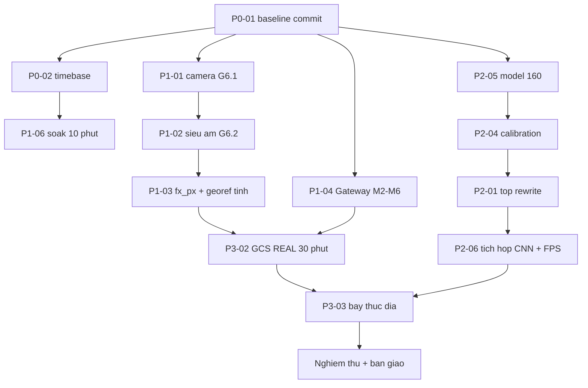

# KVC — Danh sách công việc còn lại để hoàn thiện dự án

- **Mã tài liệu:** `PLAN-004`
- **Ngày lập:** 31/10/2026 (Asia/Saigon)
- **Task ID đề xuất:** `KVC-WORK-BACKLOG-20261031-001`
- **Người lập:** Kilo — owner ghi tài liệu; model/provider: `deepseek-ai/deepseek-v4.1-flash-1017`
- **Loại tài liệu:** `PLAN` / `BACKLOG` — **không** phải approval, không phải kết quả đo
- **Mức bằng chứng của tài liệu:** `SOURCE-VERIFIED` — nội dung đối chiếu trực tiếp source, checklist, build record và báo cáo review hiện có trong workspace
- **Trạng thái:** `DRAFT` — thứ tự ưu tiên là đề xuất kỹ thuật; mỗi mục cần chuyển thành Task có ID, owner, allowed files, acceptance criteria theo `AGENTS.md` §Workflow trước khi thực hiện

## BẢN RÚT GỌN CHO HỘI THI (đọc mục này trước)

Nếu chỉ có **5–7 ngày** trước hội thi, bỏ toàn bộ P2 và P3, chỉ làm 6 việc sau.
Mục tiêu: **"camera + siêu âm + UART + GCS đã chạy thật"** — mức bằng chứng
thuyết phục nhất có thể đạt mà **không** cần AI chạy trên FPGA.

| Thứ tự | Việc | Mục đích trước giám khảo | Thời gian |
| :---: | :--- | :--- | ---: |
| **1** | P0-01 commit baseline | Bitstream/demo quy được về một SHA khi bị hỏi | 0,5 ngày |
| **2** | P1-01 nạp bitstream camera mới | **Có ảnh camera thật** thay vì chỉ LED | 1 ngày |
| **3** | P1-02 đo siêu âm 3 m | **Số `frame_ok` thật** cho cự ly | 1 ngày |
| **4** | P1-06 soak 10 phút | Chứng minh không rơi frame / không reset | 0,5 ngày |
| **5** | P3-02 GCS REAL 30 phút | Demo end-to-end có log SQLite + nhật ký phiên xuất CSV, không phải mock (chế độ phát lại đã bỏ khỏi UI 02/11/2026) | 1,5 ngày |
| **6** | P0-03 + P0-06 dọn tài liệu | Không mâu thuẫn khi giám khảo đọc docs | 1 ngày |

**Tổng: ~5,5 ngày.**

### Ba câu chốt để trình bày

| Nội dung | Câu được nói | Câu **không** được nói |
| :--- | :--- | :--- |
| UART FPGA↔MCU | "Đã chạy thật: 197.844 byte, 7.609 frame, 0 framing error" | — |
| Camera / siêu âm | "Đã có ảnh/`frame_ok` đo trên bo ngày ___" | "Camera đã hoàn chỉnh" nếu chưa nạp bitstream mới |
| AI | "Engine conv đã verify số học 1026/1026, **chưa tích hợp vào top**" | "AI chạy trên FPGA" hoặc "YOLO11n detect realtime" |

### Phần phải ghi rõ là CHƯA làm (nói trước khi bị hỏi)

- Bitstream hiện tại **không chứa YOLO11n** — chạy `camera → mock bbox → UART`.
- `kvc_yolo_top.v` chưa từng compile được (`EX3937`) — tích hợp AI cần 4–6 tuần.
- Chưa có buổi bay nào; chưa có ground truth toạ độ; `fx_px` vẫn là giả định 554.
- Gateway ESP32 M2–M6 chưa chạy trên bo.

Ghi đúng bốn dòng này **mạnh hơn** để giám khảo tự phát hiện.

---

## 0. Cách đọc và giới hạn

Tài liệu liệt kê **công việc còn thiếu**, xếp theo **mức chặn kỹ thuật**, không theo cảm giác "gần xong".

| Quy ước | Ý nghĩa |
| :--- | :--- |
| `P0` | Chặn tính đúng đắn hoặc tính tái lập. Không xong thì mọi phép đo sau không quy được về một revision |
| `P1` | Bring-up phần cứng — biến `BUILT`/`SIMULATED` thành `HARDWARE-VERIFIED` |
| `P2` | Chuỗi AI trên FPGA (đường găng dài nhất) |
| `P3` | Nghiệm thu, bay thực địa và bàn giao |

**Giới hạn của tài liệu này:**

1. Ước lượng thời gian là suy luận từ độ phức tạp đã ghi trong `FPGA_CNN_ENGINE.md`, `KVC_YOLO_TOP_REWRITE_SPEC.md`, `BRINGUP_CHECKLIST.md`. **Không phải cam kết tiến độ.**
2. Không có `HARDWARE-VERIFIED` nào trong tài liệu này.
3. Không có cơ sở quy toàn dự án thành một tỷ lệ phần trăm. Danh sách này là công việc còn thiếu, không phải điểm nghiệm thu.
4. Tài liệu không thay thế review độc lập sau mỗi gate.
5. Lượt lập tài liệu này chỉ đọc source/docs/checklist/build record. **Không chạy** compiler, testbench, pytest, npm, synthesis hay phần cứng.

---

## 1. Ảnh chụp trạng thái (điểm xuất phát)

| Phân hệ | Mức cao nhất hiện có | Nút chặn chính | Nguồn |
| :--- | :--- | :--- | :--- |
| IF-01 FPGA→MCU | **HARDWARE-VERIFIED** | soak ≥ 10 phút; timebase MCU sai | `../verification/evidence/G2.4_mcu_log_20261031.md` |
| FPGA BBox/blob | `BUILT` (Fmax 113,277 MHz, 22/22 TB) | **chưa nạp bo**; Gate G0 + A1–A10 NOT RUN; ngưỡng màu chưa đo ngoài trời | `../verification/FPGA_BUILD_RECORD.md`, `../verification/evidence/KVC-FPGA-BLOB-20261101-001_T1-T13.md` |
| Camera OV2640 | `SIMULATED` + `BUILT` (224 thanh ghi, TB 13/13) | **chưa nạp bo**, chưa có ảnh thật; `line_buffer ADDR_W=10` | `../verification/FPGA_BUILD_RECORD.md` §6.0 |
| Engine CNN | `SIMULATED` (conv0/conv1/depthwise PASS) | E-04 mở, E-07 calibration, top-level chưa compile được | `../hardware/fpga/FPGA_CNN_ENGINE.md` |
| MCU firmware | `SOURCE-VERIFIED` + `BUILT` | chưa nạp lại bản 31/10; timebase chậm 1,6–2,3× | `../interfaces/IF_FPGA_MCU_UART.md` §1.5 |
| Gateway ESP32 | `BUILT` (M1) | M2–M6 **NOT RUN** (không có bo/COM) | `review/KVC-GW-E2E-20261029/IMPLEMENTATION.md` |
| GCS | `BUILT` + `SIMULATED` (26 file FE; **157 test** ở mốc 31/10, tài liệu IF-05 ghi **164** sau khi thêm kênh video — **chưa chạy lại**, không chốt con số) | Phase 6 đa mục tiêu `BLOCKED`; chưa có phiên REAL | `review/KVC-GCS-UI/40-report.md`, `../interfaces/IF_ESP32_CAM_GCS.md` |
| Tài liệu | `SOURCE-VERIFIED` | 6 mâu thuẫn nội bộ + 1 link chết | xem §2.4–§2.6 |

**Working tree tại thời điểm lập:** 15 file đã sửa + 5 mục untracked trải trên 3 phân hệ (FPGA, MCU, GCS/docs). Bản đang đọc **không phải HEAD** (`2be0f05`).

---

## 2. P0 — Chặn tính đúng đắn và tính tái lập

Nhóm này phải xong trước, vì mọi phép đo sau đó không quy được về một revision nếu bỏ qua.

### P0-01 — Chốt baseline Git (đóng băng working tree)

| Trường | Nội dung |
| :--- | :--- |
| **Vấn đề** | `git status` có 15 file sửa + 5 untracked ở 3 phân hệ; `FPGA_BUILD_RECORD.md:18` ghi build từ **working tree chưa commit** ⇒ bitstream không tái lập được. `.fs` nằm ngoài Git (`.gitignore`) nên SHA file không định danh được nguồn |
| **Phạm vi** | Commit theo phân hệ: `KVC_PR/` + docs FPGA; `gcs/frontend`; firmware MCU; script/evidence |
| **Tiêu chí hoàn thành** | (1) `git status --short` sạch; (2) mỗi commit có SHA ghi vào `../verification/FPGA_BUILD_RECORD.md` và `../verification/evidence/README.md`; (3) `git diff --check` exit 0; (4) không commit `KVC_PR/impl/`, `node_modules/`, `gcs-redesign/dist/` |
| **Bằng chứng** | SHA + log `git status` trước/sau, lưu trong `review/` |
| **Ước lượng** | 0,5 ngày |
| **Ràng buộc** | `AGENTS.md` cấm tự commit — task này phải được người dùng giao quyền rõ ràng |

### P0-02 — Sửa timebase MCU (ảnh hưởng `timestamp_ms` của IF-02)

| Trường | Nội dung |
| :--- | :--- |
| **Vấn đề** | `byt` tăng 48.293 B trong 8.000 ms "timebase" ⇒ 6.037 B/s, vượt trần vật lý 3.840 B/s của 38.400 8N1. `[M3] t=` không phải mili-giây thật. Nguyên nhân đã ghi tại `project_keil/main.c:128`: bit-bang I2C của IMU không báo giờ vào `kvc_timebase` |
| **Phạm vi** | `src/kvc_timebase.c`, `inc/kvc_timebase.h`, `project_keil/main.c`, `tests/test_kvc_timebase.c` |
| **Tiêu chí hoàn thành** | (1) Đối chiếu PC: 10 phút liên tục, `[M3]` cách nhau **1,000 s ± 1 %**; (2) `byt/s` tính trên timebase **≤ 3.840** (kiểm bằng chính log `[RING]`); (3) offset `timestamp_ms` IF-02 so với PC **< 50 ms / 10 phút**; (4) host test mới PASS; Keil build **0 Error** |
| **Bằng chứng** | Log 10 phút + bảng `timebase_ms` vs thời gian thực |
| **Ước lượng** | 1–2 ngày |
| **Ràng buộc** | **Không** đổi layout/CRC IF-02. Chỉ sửa nguồn thời gian |

### P0-03 — Đồng bộ tài liệu hợp đồng IF-02 (không đổi layout)

> **Trạng thái: `DONE` (01/11/2026).** Owner: Kilo. Allowed files đúng phạm vi
> (`docs/interfaces/IF_MCU_LORA_RF.md`, chỉ mô tả + sơ đồ). Sơ đồ ASCII nay vẽ đủ
> 32 byte với byte 25 = `Status_Reserved` và 4 byte `Reserved_Ext[26:29]` (bản cũ
> chỉ vẽ 28 byte, thiếu hẳn 26–29). Grep `UAV_Battery` chỉ còn ở câu ghi chú lịch
> sử và hàng offset 25 — **không còn ở vị trí trường**. Không chạm layout/CRC trong
> code. Verification: `git diff --check` exit 0 (chỉ cảnh báo LF/CRLF).

| Trường | Nội dung |
| :--- | :--- |
| **Vấn đề** | `../interfaces/IF_MCU_LORA_RF.md` mâu thuẫn nội bộ: sơ đồ ASCII dòng 53 vẫn ghi `UAV_Battery`, trong khi bảng offset 25 (dòng 73) đã là `Status_Reserved` và golden vector là GV-02 `0xE260`. Code cả ba đầu (MCU header, gateway struct, parser Python) đã là GV-02 |
| **Phạm vi** | `docs/interfaces/IF_MCU_LORA_RF.md` (chỉ phần mô tả và sơ đồ) |
| **Tiêu chí hoàn thành** | (1) `grep "UAV_Battery\|battery_raw"` trong IF-02 = 0; (2) sơ đồ ASCII khớp bảng offset 25; (3) golden vector duy nhất là GV-02 `0xE260`; (4) `git diff` không chạm layout/CRC trong code |
| **Bằng chứng** | `git diff` + kết quả grep |
| **Ước lượng** | 0,5 ngày |
| **Ràng buộc** | Đây là tài liệu hợp đồng đã HUMAN duyệt — sửa **mô tả** cho khớp code đã duyệt, không sửa nghĩa byte |

### P0-04 — Khôi phục `docs/planning/KVC_PHAN_CONG_2_NGUOI.md`

> **Trạng thái: `DONE` (01/11/2026).** Owner: Kilo. Truy được nguồn: file **bị xoá**
> ở commit `6cce988` (516 dòng), không phải di chuyển — `git log --diff-filter=R`
> không có kết quả. Khôi phục nguyên văn từ `6cce988^` (25.881 byte), **không bịa
> nội dung**. Thêm cảnh báo đầu file đối chiếu 7 điểm đã lệch code hiện hành, và
> đổi `PLAN-001` sang **`ARCHIVED` / `HISTORICAL`** trong `INDEX.md`. 4 link trước
> đây broken nay resolve. Verification: `Test-Path` = True trên cả 4 đường dẫn.

| Trường | Nội dung |
| :--- | :--- |
| **Vấn đề** | `docs/INDEX.md` khai `PLAN-001` trỏ file này, nhưng thư mục `docs/planning/` **không tồn tại**. Bốn tài liệu đang link vào file mất: `MCU_BENCH_TEST_PLAN.md`, `KVC_MASTER_PINOUT_WIRING.md`, `IF_FPGA_MCU_UART.md`, `KVC_PROJECT_STATUS.md`. Vi phạm quy tắc 2 của INDEX |
| **Phạm vi** | Khôi phục file, **hoặc** đổi `PLAN-001` sang `ARCHIVED` và sửa 4 link |
| **Tiêu chí hoàn thành** | Link check toàn `docs/`: **0 broken link**; INDEX không còn ID trỏ file không tồn tại |
| **Ước lượng** | 0,5 ngày |

### P0-05 — Thống nhất mức bằng chứng G2.7 (soak)

> **Trạng thái: `DONE` (01/11/2026).** Owner: Kilo. Chọn phương án **(b)** — hạ cả
> ba về `NOT RUN` kèm lý do, vì `evidence/` **không có** file log `[RING]` soak nào
> và quy ước của chính thư mục đó cấm ghi PASS khi thiếu số liệu trong log. Đã sửa
> `BRINGUP_CHECKLIST.md` §G2.7 (3 dòng PASS → `NOT RUN` + giải thích), thêm ghi chú
> đồng bộ vào `evidence/README.md`. `docs/INDEX.md` vốn đã đúng `NOT RUN`, giữ nguyên.

| Trường | Nội dung |
| :--- | :--- |
| **Vấn đề** | `../verification/BRINGUP_CHECKLIST.md:162-164` ghi G2.7 **PASS** "theo người dùng xác nhận", nhưng `docs/INDEX.md:107` ghi "G2.7 soak **NOT RUN**", và `../verification/evidence/README.md:14` ghi "chưa có soak". Ba tài liệu nói ba khác nhau |
| **Tiêu chí hoàn thành** | Hoặc (a) có log `[RING]` 10–30 phút trong `evidence/` → giữ PASS; hoặc (b) hạ cả ba về `NOT RUN` kèm lý do. Không để tồn tại trạng thái mâu thuẫn |
| **Ước lượng** | 0,25 ngày (nếu chọn b) |

### P0-06 — Sửa các mâu thuẫn tài liệu còn lại (gói nhỏ, cùng lúc)

> **Trạng thái: `DONE` (01/11/2026).** Đã sửa cả 6 dòng:
> - `IF_FPGA_MCU_UART.md` — `fe` "chưa đo" → đã đo `fe=0` trên 197.844 B.
> - `IF_MCU_SENSORS.md` — trần 500→700 cm (3 vị trí), thêm cảnh báo G6.2 `BLOCKED`
>   vì đầu dò hỏng, ghi rõ sentinel `NO_ECHO_MM = 6000` không phải phép đo 6 m.
> - `IF_CAMERA_FPGA.md` + `INDEX.md` RTL-001/RTL-002 — đã sửa trước đó, xác nhận lại.
> - FIFO 64 message — cả `GATEWAY_DESIGN.md:22`, `KVC_ThietKeHeThong.md:350` và
>   `IF_ESP32_GCS_WS.md:119` đều đã ghi "mục tiêu mở rộng / chưa triển khai"; không
>   cần sửa.
> - `GATEWAY_TEST_PLAN.md` G1–G3 — hạ `[x] HOÀN TẤT` → `CHƯA CÓ LOG TRÊN CHIP`,
>   kèm giải thích vì sao host test không thay được log trên thiết bị.
>
> Kiểm chứng: `git diff --check` exit 0; quét link tương đối toàn `docs/` = **0 broken**.

| Vị trí | Sai hiện tại | Đúng |
| :--- | :--- | :--- |
| `../interfaces/IF_FPGA_MCU_UART.md:67` | "`fe` **chưa đo** (dòng `[RING]` bị bug...)" | Đã đo `fe=0` trên 197.844 B — §1.5 cùng file |
| `../interfaces/IF_MCU_SENSORS.md:43` | "`MAX_RANGE_CM = 500` — **đang được nâng lên** 700" | Code đã là `700U` (`inc/kvc_usound_decode.h:56`) |
| `../interfaces/IF_CAMERA_FPGA.md:19` | "`ov2640_config` ⏸ CHƯA KIỂM CHỨNG… 38 thanh ghi" | **ĐÃ SỬA** → 224 thanh ghi, `tb_ov2640_config` 16/16, **chưa nạp bo**. Dòng 19 nay ghi "⏸ CHƯA KIỂM CHỨNG" cho phần **màu thật** (khác nghĩa cũ) |
| `docs/INDEX.md:127` | RTL-001 "Fmax 100 MHz, 7 TB PASS" | **ĐÃ SỬA 01/11/2026** → RTL-001 ghi `SIMULATED + BUILT`, Fmax **113,277 MHz**, **22/22 TB** (blob thật). RTL-002 cùng cập nhật |
| `GATEWAY_DESIGN.md:33`, `KVC_ThietKeHeThong.md` | Mô tả FIFO 64 message như đã có | Ghi rõ "mục tiêu mở rộng, chưa triển khai" như `IF_ESP32_GCS_WS.md:114` |
| `GATEWAY_TEST_PLAN.md:402-404` | G1–G3 đánh `[x] HOÀN TẤT` | **ĐÃ SỬA 01/11/2026** → hạ về `[ ]` **CHƯA CÓ LOG TRÊN CHIP** kèm giải thích: repo không có log Serial + SHA firmware cho ping/WebSocket/self-mock; host test `test_rf_decode`/`test_net_policy` không thay được log trên thiết bị |

**Tiêu chí hoàn thành chung P0:** (1) grep các chuỗi trên trả 0 kết quả sai ngữ cảnh; (2) mọi dòng INDEX có "Kiểm tra gần nhất" = ngày sửa thật; (3) `git diff --check` sạch.

---

## 3. P1 — Bring-up phần cứng

Nhóm tạo ra giá trị lớn nhất trên mỗi giờ công, vì mọi thứ phía sau (AI, bay) chỉ có nghĩa khi chuỗi này đã chạy thật.

### P1-01 — Nạp lại bitstream camera mới + G6.1

| Trường | Nội dung |
| :--- | :--- |
| **Vấn đề** | Bitstream `A1047050...` (224 thanh ghi camera) **chưa nạp bo**. Bitstream đã nạp (`70460C92...`) dùng bảng 38 thanh ghi — đã chứng minh không hoạt động: VSYNC = 0 V cố định, xác suất ngẫu nhiên 0,68^1574 ≈ 10⁻²⁶³ |
| **Phạm vi** | `KVC_PR/impl/pnr/KVC_FPGA.fs`, checklist 6.1.1–6.1.4 |
| **Tiêu chí hoàn thành** | (1) Nạp `.fs`, ghi SHA + Git HEAD; (2) `VSYNC` có xung **≈ 30 Hz** đo bằng scope; (3) `led_camera_ok` sáng đều; (4) `cap_pixel_valid` có xung theo `cam_pclk`; (5) ảnh vật đỏ thuần: **R > 0xF000, G/B < 0x2000**; (6) ảnh chụp marking module xác nhận OV2640 |
| **Bằng chứng** | Log nạp + ảnh scope + capture màu, vào `docs/verification/evidence/` |
| **Ước lượng** | 1 ngày (+ 0,5 ngày nếu màu sai phải chỉnh `ov2640_config.v`) |
| **Nếu fail** | Ghi rõ mã lỗi và dừng. **Không** đánh dấu PASS dựa trên `led_camera_ok` — LED chỉ chứng minh có frame, không chứng minh đúng màu |

### P1-02 — G6.2 Hiệu chuẩn siêu âm (envelope vận hành)

| Trường | Nội dung |
| :--- | :--- |
| **Vấn đề** | Trần 700 cm mới chỉ `SIMULATED` (`test_kvc_usound_decode` 65/65). Chưa có `frame_ok` thật ở 2/3/4/5 m, chưa có `alt_quality` từ dữ liệu thật |
| **Tiêu chí hoàn thành** | `frame_ok ≥ 98 %` @ 2,0 m và 3,0 m; `≥ 95 %` @ 4,0 m; `≥ 90 %` @ 5,0 m; `≥ 80 %` @ 3,0 m nước gợn; sai số **< 2 cm** so với thước trong 0,5–5,0 m; **0** `OUT_OF_RANGE` giả ở 5,0 m |
| **Đầu ra** | `docs/verification/USOUND_CALIBRATION_5M.md` (bảng ≥ 50 mẫu mỗi điểm) |
| **Ước lượng** | 2 ngày |
| **Điều kiện dừng** | Nếu fail ở 3 m → cân nhắc barometer/LiDAR **trước khi** làm georef, vì đây là đường găng |

### P1-03 — G6.3 Hiệu chuẩn `fx_px` và nghiệm thu georef tĩnh

| Trường | Nội dung |
| :--- | :--- |
| **Vấn đề** | `inc/kvc_georef.h:80` dùng `fx_px = 554.0f` suy từ HFOV ~60°. Sai 2–4° ⇒ sai toạ độ hệ thống 3–5 % ở **mọi** khoảng cách, không test nào trong repo phát hiện được |
| **Tiêu chí hoàn thành** | (1) `cv2.calibrateCamera` reproj error **< 0,5 px** trên ≥ 15 ảnh bàn cờ 9×6 ô 25 mm; (2) ghi `fx/cx/cy` thật + độ lệch so với 554 rõ ràng; (3) cập nhật `kvc_georef.h:80-82`; (4) nạp lại firmware MCU; (5) georef tĩnh sai số **< 0,5 m @ 3 m** |
| **Bằng chứng** | File calibration + bảng đo georef vs thước |
| **Ước lượng** | 1,5 ngày |

### P1-04 — Gateway ESP32: M2 → M6

| Trường | Nội dung |
| :--- | :--- |
| **Vấn đề** | Toàn bộ M2–M6 `NOT RUN`: không có bo ESP32 trên COM (chỉ còn phantom `CM_PROB_PHANTOM`). IF-02 và IF-03 chưa có capture thật |
| **Tiêu chí hoàn thành** | **M2**: nạp được firmware, SoftAP `KVC_GROUND_STATION` ping ≤ 2 ms / 0 % loss, `gateway_session_id` khác nhau sau 2 lần reset. **M3**: `RegVersion (0x42) = 0x12`. **M4**: 60 gói RF, log `[RX-LORA #...]` có RSSI/SNR thật, `InvalidFrames = 0`. **M5**: backend Python + Dashboard hiển thị đúng toạ độ, cùng session. **M6**: tắt/bật Wi-Fi 15 s → tự phục hồi; gói sai CRC bị loại và đếm ở `rx_invalid_count` |
| **Bằng chứng** | Log Serial + capture backend + ảnh dashboard, có SHA firmware |
| **Ước lượng** | 2–3 ngày (khi có 2 bo Ra-02 + 2 anten) |
| **Ràng buộc** | **Không phát LoRa khi chưa gắn anten** — PA +14 dBm vào hở có thể hỏng SX1278 |

### P1-05 — Chốt `DATA_READY`/EXTI và chân `mcu_ack`

| Trường | Nội dung |
| :--- | :--- |
| **Vấn đề** | `IF_FPGA_MCU_UART.md` §4 hứa ngắt EXTI trên `P0.12`, nhưng firmware chỉ poll ring 1 ms. RTL có `mcu_ack` (J2 pin 15, ball T12) nhưng `inc/kvc_pinout.h` **không định nghĩa chân này** ⇒ `data_ready_ctrl` chạy bằng timeout 100 ms |
| **Hai lựa chọn** | (a) Implement EXTI + thêm chân ACK vào firmware — **đụng pinout, cần HUMAN duyệt**; (b) Sửa IF-01 mô tả đúng hiện trạng polling và đóng hạng mục ACK |
| **Tiêu chí hoàn thành** | Có văn bản chọn (a) hoặc (b). Nếu (a): độ trễ frame→xử lý **< 5 ms** đo bằng timestamp. Nếu (b): IF-01 §4 không còn hứa EXTI |
| **Ước lượng** | 0,5 ngày (b) / 1,5 ngày (a) |

### P1-06 — Soak ≥ 10 phút để đóng trôi IHRC

| Trường | Nội dung |
| :--- | :--- |
| **Vấn đề** | `IF_FPGA_MCU_UART.md` §1.5 để mở: sai số baud 37.500 vs 38.400 (−2,34 %) cộng IHRC ±2 % mới chỉ đo trên cửa sổ ngắn. Trôi nhiệt sau 10–20 phút chưa kiểm |
| **Tiêu chí hoàn thành** | 10 phút liên tục: `fe = 0`, `oe = 0`, `drop = 0`, FPS không giảm > 5 %, nhiệt FPGA < 60 °C. Nếu `fe` tăng → HUMAN quyết định giữa nâng UCLK 24 MHz và hạ IF-01 xuống 19.200 |
| **Bằng chứng** | Log `[RING]` 10 phút trong `docs/verification/evidence/` |
| **Ước lượng** | 0,5 ngày |

---

## 4. P2 — Chuỗi AI trên FPGA (đường găng dài nhất)

Khối lượng này **không thể nén** dưới 4–6 tuần theo `../hardware/fpga/FPGA_CNN_ENGINE.md` §"Việc thực sự cần cho P6". Chỉ nên bắt đầu sau khi P1 xong, vì nếu camera/UART chưa chứng minh thì không có cách nào đánh giá AI đúng hay sai.

### P2-01 — Viết lại `kvc_yolo_top`

| Trường | Nội dung |
| :--- | :--- |
| **Vấn đề** | `KVC_PR/rtl/gen/kvc_yolo_top.v` **chưa bao giờ compile được**: instantiation truyền `.p_in_w`, `.win_00..22`, `.fifo_rd_en`, `.bias_data` — không port nào tồn tại. Gowin báo `EX3937`. Ngoài ra module chỉ có conv + activation, thiếu maxpool/concat/add/split/resize/head |
| **Phạm vi** | Theo spec `../hardware/fpga/KVC_YOLO_TOP_REWRITE_SPEC.md` |
| **Tiêu chí hoàn thành** | (1) Top mới build không lỗi; (2) `tb_kvc_yolo_top_smoke` + `tb_kvc_yolo_top_conv0` **0 mismatch**; (3) `tb_kvc_yolo_top_full` so ONNX Runtime: sai khác **< 1 LSB** sau clamp; (4) Fmax **≥ 100 MHz**, TNS = 0; (5) bảng `op_type[0..87]` sinh tự động từ graph ONNX, verify 0 mismatch với `conv_layer_map.csv` |
| **Ước lượng** | 5–6 ngày (spec §4) + 1–3 ngày nếu timing không hội tụ |

### P2-02 — Sửa `line_buffer` cho đường CNN

| Trường | Nội dung |
| :--- | :--- |
| **Vấn đề** | `KVC_PR/src/kvc_top_demo.v:186` vẫn `line_buffer_3x3 #(.ADDR_W(10))` trong khi mặt phẳng tới 76.800 địa chỉ ⇒ ghi đè mỗi 1024 byte. `line_buffer_mc` (đa kênh, packed 27 byte) đã có TB PASS nhưng **chưa nối vào top** |
| **Tiêu chí hoàn thành** | `ADDR_W ≥ 17` (hoặc thiết kế lại theo plane); window packed khớp engine; TB địa chỉ biên W=160, C=256 không alias; synthesis báo BSRAM **≤ 60 KiB** (không vượt 103,5 KiB) |
| **Ước lượng** | 1 ngày |

### P2-03 — Mô hình SPI flash slave + `tb_spi_flash_if`

| Trường | Nội dung |
| :--- | :--- |
| **Vấn đề** | E-05 (`rdata <= {rx_data, word_buf[23:0]}`) đã sửa nhưng **chưa verify bằng simulation** — khoảng trống duy nhất trong 18 TB. `FPGA_CNN_ENGINE.md` §"Việc chưa làm được" ghi nhận: viết `kvc_yolo_top_v2` thất bại vì stub SPI không tái hiện được 4 lần `spi_int`/word |
| **Tiêu chí hoàn thành** | Đọc 1.024 word tại `0x400000` và `0x410000`, khớp **100 %**; TB có `$fatal` khi fail; chạy được trong `scripts/run_fpga_tb.ps1` |
| **Ước lượng** | 1 ngày |

### P2-04 — E-07: calibration thật (bias/mult/quant)

| Trường | Nội dung |
| :--- | :--- |
| **Vấn đề** | `bias_mem`/`mult_mem` vẫn zero-hoá sau khi tách `shift`; `output_scale` trong `tb_conv0_real` là **giả định** `input_scale × 128.5`, chưa calibration |
| **Tiêu chí hoàn thành** | `quant.hex ≠ 0`, entropy **> 6 bit/byte**; `bias.hex` sinh từ ONNX với `bias_q = bias_fp / out_scale`; BN fold `eps = 1e-3`; `tb_conv0_engine` + `tb_conv1_engine` so golden thật **0 mismatch** trên ≥ 1.638.400 phần tử |
| **Ước lượng** | 2 ngày (sau khi có calibration set) |

### P2-05 — Model 160×160 từ crop 4K

| Trường | Nội dung |
| :--- | :--- |
| **Vấn đề** | `ai/model_manifest/model_release_template.json` ghi `[160,160]` nhưng RTL/ONNX vẫn 640; chưa có run dir, chưa export ONNX. Kịch bản `train_160` cũ dùng `mosaic=1.0 + mixup=0.15` ở 160 — với vật thể 1–4 px sẽ **giảm** mAP |
| **Tiêu chí hoàn thành** | (1) Crop patch 160×160 từ 4K, split **theo `source_image_id`**, `train_ids ∩ val_ids = ∅` (có script chứng minh); (2) `imgsz=160, mosaic=0, mixup=0`; (3) mAP50 trên val đạt **ngưỡng đã chốt bằng văn bản** (thiết kế ghi 0,60; đề xuất khác ghi 0,55 — phải chọn một); (4) PTQ INT8, `ΔmAP < 2` điểm; (5) export ONNX + sinh 4 artifact (`weights.bin`, `bias.hex`, `quant.hex`, `silu_lut.hex`); (6) cập nhật manifest với hash + metric thật |
| **Ước lượng** | 3–4 ngày GPU (nếu dataset đã có) |
| **Lưu ý** | Tập 4K gốc là ảnh flycam 15–25 m; ở 3 m OV2640 cho 20–45 px — tương đương, nên **crop** hợp lý hơn resize toàn phần |

### P2-06 — Tích hợp CNN vào top + timing + FPS

| Trường | Nội dung |
| :--- | :--- |
| **Tiêu chí hoàn thành** | (1) `BBOX_SOURCE = 2` build được; (2) Fmax **≥ 100 MHz có CNN**, TNS = 0; (3) conv0 golden **0 mismatch** sau khi nạp weights vào flash `0x400000`; (4) FPS đo được **≥ 2** (trần lý thuyết 9,7 do stream 2,57 MB qua SPI); (5) 0 box giả trên 10 phút ảnh nước trống |
| **Bằng chứng** | Report PnR + ảnh capture + log đếm frame |
| **Ước lượng** | 2–3 ngày (sau P2-01…P2-05) |

---

## 5. P3 — Nghiệm thu và bàn giao

### P3-01 — GCS Phase 6: đa mục tiêu minh bạch

| Trường | Nội dung |
| :--- | :--- |
| **Trạng thái** | `BLOCKED` — cần HUMAN duyệt thay đổi nghĩa bit IF-02 (dùng 4 bit dự phòng `sensor_flags` cho `candidate_count` / `target_index`) |
| **Tiêu chí hoàn thành** | Với `target_count = 4`: UI hiển thị "Mục tiêu 2/4", không báo stale sai, marker không nhân bản; test bằng `scripts/manual/mock_fpga_bbox.py --scenario 5`; golden vector 3 đầu cập nhật cùng commit |
| **Nếu không duyệt** | Ghi `DEFERRED` + lý do; UI giữ 1 marker như hiện tại |

### P3-02 — GCS REAL end-to-end (30 phút) + soak + offline

| Trường | Nội dung |
| :--- | :--- |
| **Vấn đề** | Toàn bộ bằng chứng UI hiện là MOCK + browser dev server; backend FastAPI chưa chạy cùng lúc trong lượt nghiệm thu (ghi rõ trong `review/KVC-GCS-UI/40-report.md` §5.4) |
| **Tiêu chí hoàn thành** | (1) Phiên 30 phút REAL: log SQLite WAL, trang Nhật ký phiên đọc/lọc/xuất CSV đúng; (2) kill process backend giữa phiên → khôi phục giao dịch đã commit, báo rõ event mất; (3) tắt WAN: radar local chạy, tile báo lỗi rõ, **không** tuyên bố "bản đồ offline"; (4) `npm run typecheck && npm run lint && npm test && npm run build` exit 0, ghi số test thực |
| **Ước lượng** | 1–2 ngày |

### P3-03 — Tài liệu và chiến dịch bay thực địa

| Trường | Nội dung |
| :--- | :--- |
| **Vấn đề** | Chưa có `docs/verification/FPGA_FIELD_TEST.md`; chưa có buổi bay nào. `KVC_ThietKeHeThong.md` §VII chỉ đặt mục tiêu, không phải kết quả |
| **Tiêu chí hoàn thành** | (1) Checklist trước bay (nguồn, GND chung, anten, che nước); (2) ≥ 3 buổi bay theo kịch bản: hover 3 m, di chuyển 1–2 m/s, 4,5/5,0/5,5 m, nước gợn, ngược sáng; (3) Đạt: phát hiện người **≥ 70 %**, phao **≥ 75 %**, false positive **< 2/phút**, sai số toạ độ **< 1,5 m (p95)**, latency end-to-end **< 2 s**, FPS **≥ 2**, uptime 30 phút **100 %** |
| **Bằng chứng** | Log bay + ảnh + bảng toạ độ vs GNSS cầm tay |
| **Ước lượng** | 5–7 ngày |
| **Ràng buộc** | Mọi con số phải có timestamp + SHA. Không dùng video dựng thay log đo |

### P3-04 — Đóng nợ AI evidence

| Trường | Nội dung |
| :--- | :--- |
| **Vấn đề** | `scripts/data/validate_ai_evidence.py` từng exit 1 với **335 issues** (`AI_EVIDENCE_BLOCKED`); manifest còn `PENDING_CHECKPOINT_HASH`, `split_leak_check: PENDING`, `locked_test_status: NOT_VERIFIED`, `calibration_status: NOT_VERIFIED` |
| **Tiêu chí hoàn thành** | (1) Validator exit 0; (2) có provenance/license/consent cho dataset; (3) locked-test **≥ 150 ảnh** độc lập, có nguồn + QA, khóa **trước** nghiệm thu; (4) ≥ 100 ảnh thật ở 2–5 m; (5) `evidence_level` ghi đúng (`SYNTHETIC_ONLY` hoặc `MIXED_...`) |
| **Ước lượng** | 3–5 ngày |

### P3-05 — Dọn nợ kỹ thuật và bàn giao

| Việc | Tiêu chí hoàn thành |
| :--- | :--- |
| `gcs-redesign/`, `frontend_new/` | Archive hoặc xoá; `grep -r "gcs-redesign"` trong `gcs/frontend/src` = 0 |
| `.gitignore` | `KVC_PR/impl/**` được loại, nhưng **commit** `tools/build_kvc_fpga.tcl`, `src/KVC_FPGA.cst`, `rtl/gen/layer_table.vh`, script sinh weights |
| Dead code | Xác nhận `line_buffer_3x3` và `conv_engine_dynamic` (bản chưa hoàn chỉnh, E-04) không còn được instantiate; nếu còn → mở task xoá riêng |
| Test runner FPGA | `scripts/run_fpga_tb.ps1` chạy toàn bộ TB, exit ≠ 0 khi fail — giữ nguyên hành vi |
| Bàn giao | 1 trang `docs/HANDOVER.md`: thiết bị, phiên bản tool, SHA, cách chạy, danh sách phần **chưa đo** |

### P3-06 — Nợ kỹ thuật Gateway ESP32-C3 (từ `KVC-GW-20261103-001`)

Sinh ra khi đồng bộ Wi-Fi IF-03 / khoá path WebSocket ngày 03/11/2026. Toàn bộ mục dưới
**chưa sửa** — không nằm trong phạm vi task đã đóng. Quyền writer phân hệ Gateway đã dừng;
mở task mới và chỉ định owner trước khi sửa.

| ID | Mức | Vấn đề | Sửa tối thiểu | Phép xác minh |
| :--- | :--- | :--- | :--- | :--- |
| GW-N1 | P2 | `validatePacketCrc()` không kiểm `msg_id`. IF-02 định nghĩa `0x01` telemetry và `0x02` heartbeat, nhưng mọi `msg_id` đều được đóng gói thành envelope telemetry | Từ chối `msg_id` ngoài tập đã biết, hoặc phân nhánh heartbeat | Host test thêm ca `msg_id = 0x02` và `msg_id = 0xFF` |
| GW-N2 | P2 | Watchdog LoRa chỉ chạy khi `lastRxPacketMs > 0` → bo cắm sai dây từ lúc boot không bao giờ tự phục hồi | Khởi tạo `lastRxPacketMs = millis()` lúc `initLoRaHardware()` thành công, hoặc thêm mốc "lần thử init gần nhất" | Host test cho nhánh chưa-từng-nhận-gói |
| GW-N3 | P3 | Chưa có FIFO 64 message → `rx_drop_count` luôn `0` (IF-03 mục 3 đã ghi đúng là chưa triển khai) | Triển khai FIFO hoặc giữ nguyên và không suy diễn `rx_drop_count = 0` là "đường buffer khoẻ" | Backend test khi FIFO đầy |
| GW-N4 | P3 | `docs/verification/GATEWAY_TEST_PLAN.md` còn đường dẫn chết `Project_UAV\...` (hai chỗ, mục lệnh kiểm tra nhanh) | Đổi sang đường dẫn trong repo (`scripts/manual/check_esp32_ws.py`, `.venv`) | `grep -c "Project_UAV" docs/verification/GATEWAY_TEST_PLAN.md` = 0 |
| GW-N5 | P3 | `docs/INDEX.md` dòng IF-03 (`2026-10-29`) và CFG-GW-002 (`2026-10-25`, `DESIGN`) chưa cập nhật theo trạng thái 03/11/2026 | Cập nhật ngày + mức bằng chứng; CFG-GW-002 nên là `SOURCE-VERIFIED` | Đọc lại dòng INDEX khớp `KVC-GW-20261103-001.md` |
| GW-N6 | P3 | `ENABLE_SELF_MOCK = false`; G3 cần dữ liệu tự sinh | Build riêng có bật cờ và **ghi rõ trong biên bản** rằng dữ liệu tự sinh không phải sóng thật | Không được dùng log self-mock để đóng G3/G5 |

> **Không** dùng `EVIDENCE` của đợt này để đóng G1–G6: `KVC-GW-20261103-001.md` chỉ là
> host/build (`SOURCE-VERIFIED` + `BUILT`), **không** phải log Serial từ chip.

---

## 6. Quyết định cần HUMAN chốt (đang chặn nhiều việc)

| # | Câu hỏi | Chặn mục |
| :---: | :--- | :--- |
| Q1 | Duyệt `candidate_count`/`target_index` trong 4 bit dự phòng của IF-02? | P3-01 |
| Q2 | Implement EXTI `DATA_READY` + chân `mcu_ack` (đụng pinout), hay sửa spec theo polling? | P1-05 |
| Q3 | Chấp nhận `timestamp_ms` chỉ cần đúng sau khi sửa timebase, hay chuyển sang SysTick interrupt ngay? | P0-02 |
| Q4 | Ngưỡng mAP50 nghiệm thu: **0,60** (thiết kế) hay **0,55** (đề xuất thực dụng)? | P2-05 |
| Q5 | Nếu `fe > 0` sau soak: nâng UCLK 24 MHz hay hạ IF-01 xuống 19.200? (cả hai đều phải sửa 3 chỗ đồng thời) | P1-06 |
| Q6 | Ai là FIX OWNER cho P2 (viết lại FPGA top)? | P2-01…P2-06 |
| Q7 | Cho phép commit/push không, và gộp theo phân hệ hay một lần? | P0-01 |
| Q8 | Giữ OV9782 ngoài phạm vi? (đã loại 31/10, xác nhận lại trước khi bay) | P3-03 |

---

## 7. Đường găng

**Hai nhánh chạy song song được:**

1. `P2-05 model` trên GPU ngay từ đầu — không phụ thuộc bo.
2. `P1-04 Gateway` nếu có bo ESP32 + Ra-02.

Các nhánh còn lại tuần tự vì đều cần cùng một bộ thiết bị trên bàn.

**Nếu chỉ còn 1 tuần:** `P0-01 → P0-03 → P1-01 → P1-02 → P1-06`. Đây là chuỗi tạo ra "camera + siêu âm + UART đã chạy thật" — mức bằng chứng thuyết phục nhất có thể đạt mà không cần AI.

---

## 8. Definition of Done cấp dự án

Lấy từ `KVC_ThietKeHeThong.md` §VII. Đây là **mục tiêu thiết kế**, không phải kết quả đo.

| # | Tiêu chí | Ngưỡng |
| :---: | :--- | :--- |
| A1 | Độ chính xác AI (locked-test ≥ 150 ảnh) | Recall ≥ 90 %, Precision ≥ 90 % (IoU 0.5), false alarm ≤ 1/phút |
| A2 | Suy giảm INT8 | ≤ 3 điểm % Recall/Precision; lệch tâm BBox < 5 px |
| A3 | Thông lượng | FPS 2–4, ghi kèm cấu hình; trần lý thuyết 9,7 |
| A4 | Envelope độ cao | 2,0–5,0 m; `frame_ok ≥ 98 %` @ 3 m nước tĩnh |
| A5 | LoRa | PRR ≥ 95 % trên ≥ 200 gói; latency p95 ≤ 2 s |
| A6 | Định vị local | Báo median/p95/max cm; thiếu pose → `INVALID`/`N/A`, không suy diễn |
| A7 | Công suất & nhiệt | 60 phút toàn tải, không reset, không vượt giới hạn điện/nhiệt |
| A8 | Độ tin cậy GCS | Offline chạy; khôi phục SQLite đã commit; báo rõ event mất |
| A9 | Tài liệu | 0 mâu thuẫn baud/camera/N/RTL trong `docs/` (grep audit) |

---

## 9. Điều không được làm khi thực hiện danh sách này

| Việc | Lý do |
| :--- | :--- |
| Đổi baud, packet layout, CRC, IRQ, pinout khi chưa có approval mới | `AGENTS.md`; B-1/B-2/B-7 đã duyệt theo giá trị cụ thể, không duyệt thay đổi khác |
| Ghi `HARDWARE-VERIFIED` khi chỉ có log mô phỏng | Vi phạm thang bằng chứng của `docs/INDEX.md` |
| Dùng `led_camera_ok` làm bằng chứng ảnh đúng màu | LED chỉ chứng minh có frame |
| Báo FPS, độ chính xác georef hay mAP từ tính toán | Chưa có phép đo tương ứng |
| Bật `BBOX_SOURCE = 2` (CNN) trước khi `kvc_yolo_top` compile được | Top hiện fail `EX3937` |
| Bật `BBOX_SOURCE = 1` cùng `DIAG_MODE = 1` rồi kết luận chẩn đoán đã chạy | Ở chế độ blob `mock_first_bbox` = 0 nên chẩn đoán không bao giờ ghi đè |
| Ghi "AI phát hiện người trên FPGA" cho `kvc_blob_detect` | Đây là phát hiện **vùng màu**, không phân loại hình dạng |
| Phát LoRa khi chưa gắn anten | PA +14 dBm vào hở có thể hỏng SX1278 |
| Dùng `fx_px = 554` mà không hiệu chuẩn | Sai toạ độ hệ thống 3–5 %, không test nào phát hiện |
| Commit/push/merge/flash khi chưa được giao | `AGENTS.md` |

---

## 10. Kiểm chứng của lượt lập tài liệu này

| Việc | Trạng thái |
| :--- | :--- |
| Đọc source/docs/checklist/build record | **DONE** |
| Đối chiếu chéo 6 mâu thuẫn tài liệu | **DONE** — liệt kê ở §2.6 |
| Kiểm sự tồn tại của `docs/planning/` | **DONE** — không tồn tại |
| Chạy compiler / Keil / Gowin | **NOT RUN** |
| Chạy testbench / pytest / npm | **NOT RUN** |
| Chạy phần cứng (FPGA, MCU, ESP32, camera, siêu âm) | **NOT RUN** |
| Commit / push | **NOT RUN** — theo `AGENTS.md` |

**Không được kết luận từ tài liệu này:**

- Không phải approval để bắt đầu sửa code hay nạp bo.
- Không phải cam kết tiến độ.
- Không khẳng định hệ thống sẽ đạt các ngưỡng ở §8 — chỉ khẳng định đây là tập công việc còn thiếu dựa trên bằng chứng hiện có.
- Không thay thế review độc lập sau mỗi gate.
- Không có `HARDWARE-VERIFIED` nào trong tài liệu này.
