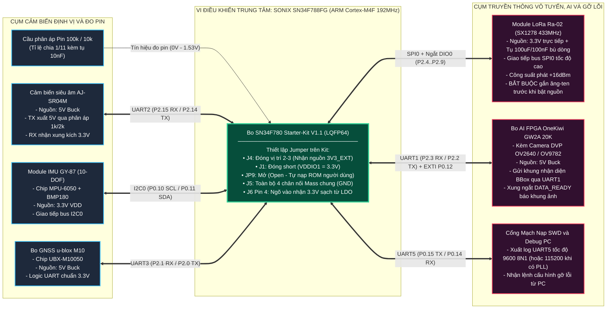
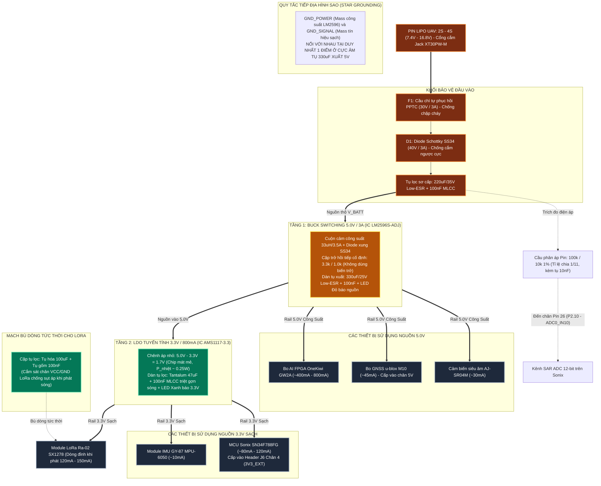
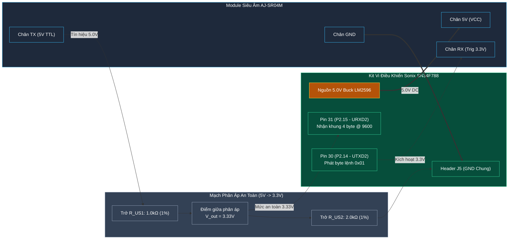
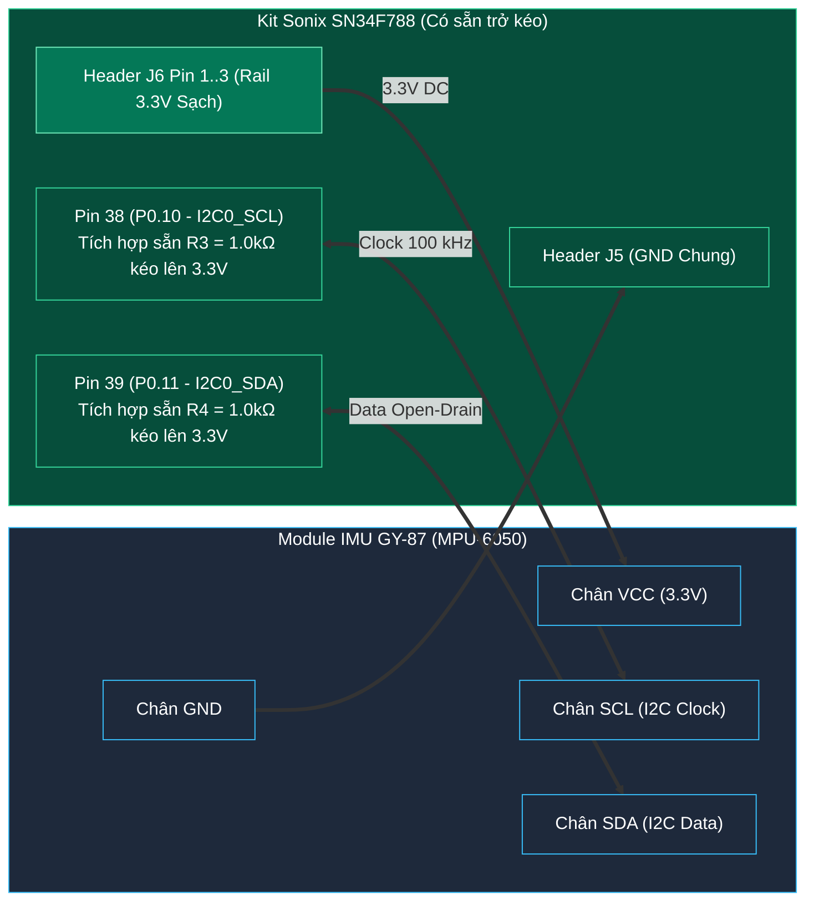
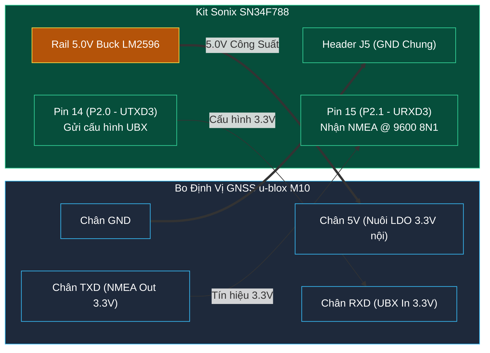
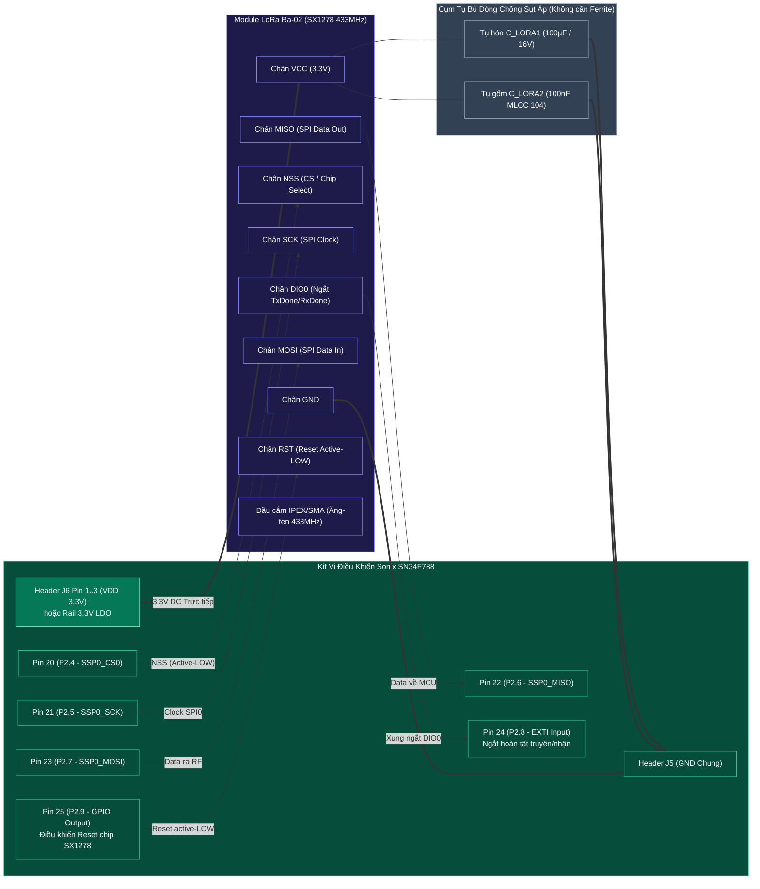
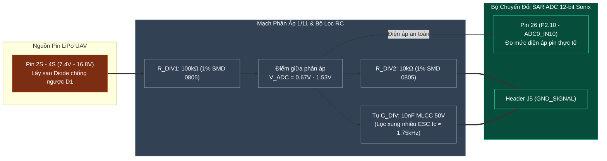
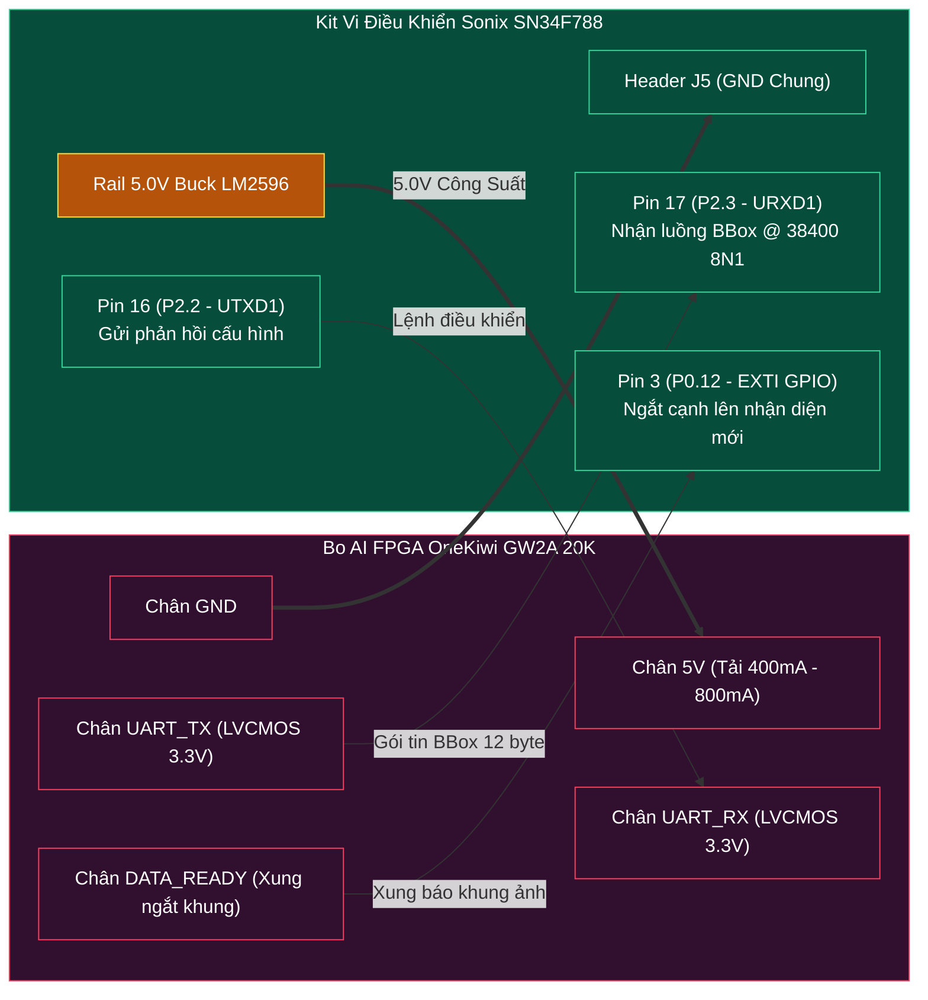

# KVC — Hướng Dẫn Thiết Kế Sơ Đồ Mạch Chuẩn & Đấu Nối Toàn Hệ Thống (Master Circuit Schematic & Wiring Guide)

- **Mã tài liệu:** `KVC-HW-SCHEMATIC-GUIDE-01`
- **Phiên bản:** `1.2.0 (HIGH-CONTRAST DARK/LIGHT & ZERO-CROSSING WIRING)`
- **Dự án:** KVC — Tải nhiệm vụ UAV tìm kiếm cứu nạn bão lũ
- **Tài liệu tham chiếu chuẩn:**
  - [`docs/hardware/wiring/KVC_MASTER_PINOUT_WIRING.md`](./KVC_MASTER_PINOUT_WIRING.md)
  - [`docs/hardware/mcu/CHIP_SONIX_SN34F788_MCU.md`](../mcu/CHIP_SONIX_SN34F788_MCU.md)
  - [`docs/interfaces/IF_MCU_SENSORS.md`](../../interfaces/IF_MCU_SENSORS.md)
  - [`docs/interfaces/IF_MCU_LORA_RF.md`](../../interfaces/IF_MCU_LORA_RF.md)
  - [`docs/interfaces/IF_FPGA_MCU_UART.md`](../../interfaces/IF_FPGA_MCU_UART.md)

> ### 📌 MỤC LỤC ĐIỀU HƯỚNG NHANH
> 1. [Sơ Đồ Khối Tổng Thể Hệ Thống (Signal Map & Power Flow)](#1-sơ-đồ-khối-tổng-thể-hệ-thống-system-master-architecture)
> 2. [Bảng Tra Cứu Nhanh Đấu Nối Đầu Cắm (Quick Wiring Cheat Sheet)](#2-bảng-tra-cứu-nhanh-đấu-nối-đầu-cắm-quick-wiring-cheat-sheet)
> 3. [Chi Tiết Đấu Nối Từng Cảm Biến & Thiết Bị Ngoại Vi](#3-chi-tiết-đấu-nối-và-nguyên-lý-từng-phần-cảm-biến-detailed-sensor-wiring--interface-guide)
>    - [3.1. Cảm biến Siêu âm Chống nước AJ-SR04M](#31-cảm-biến-siêu-âm-chống-nước-aj-sr04m-đo-độ-cao-tương-đối--cự-ly-nước)
>    - [3.2. Cụm Cảm biến Tư thế IMU GY-87 (MPU-6050)](#32-cụm-cảm-biến-tư-thế-imu-gy-87-10-dof--mpu-6050)
>    - [3.3. Module Định vị Vệ tinh GNSS u-blox M10](#33-module-định-vị-vệ-tinh-gnss-u-blox-m10-chip-ubx-m10050)
>    - [3.4. Module Truyền Thông Vô Tuyến Tầm Xa LoRa Ra-02 (SX1278 433MHz)](#34-module-truyền-thông-vô-tuyến-tầm-xa-lora-ra-02-sx1278-433mhz)
>    - [3.5. Mạch Cầu Phân Áp Đo Điện Áp Pin LiPo (ADC)](#35-mạch-cầu-phân-áp-đo-điện-áp-pin-lipo-sar-adc-12-bit)
>    - [3.6. Cụm Giao tiếp AI FPGA OneKiwi GW2A](#36-cụm-giao-tiếp-ai-fpga-onekiwi-gw2a-thị-giác-bounding-box)
> 4. [Danh Mục Linh Kiện (BOM) & Hướng Dẫn Cắm Nối Từng Chân](#4-danh-mục-linh-kiện-bom--hướng-dẫn-cắm-nối-từng-chân)
>    - [4.1. Bảng Danh Mục Vật Tư Linh Kiện (BOM)](#41-bảng-danh-mục-vật-tư-linh-kiện-bill-of-materials---bom)
>    - [4.2. Bảng Hướng Dẫn Nối Chân Chi Tiết Từng Linh Kiện (Pin-to-Pin Netlist)](#42-bảng-hướng-dẫn-nối-chân-chi-tiết-từng-linh-kiện-bom-pin-to-pin-wiring-netlist)
>    - [4.3. Quy Trình Cắm Mạch & Đo Kiểm An Toàn Theo 5 Bước](#43-quy-trình-cắm-mạch--đo-kiểm-an-toàn-theo-5-bước-step-by-step-bring-up)
> 5. [Hướng Dẫn Layout PCB & Tiếp Địa Trên UAV](#5-hướng-dẫn-layout-pcb--tiếp-địa-trên-uav)

---

## 1. SƠ ĐỒ KHỐI TỔNG THỂ HỆ THỐNG (SYSTEM MASTER ARCHITECTURE)

Để giải quyết triệt để vấn đề **màu sắc khó nhìn trên nền tối (Dark Theme)** và **đường dây chạy lòng vòng chồng chéo**, hệ thống được thể hiện bằng 2 sơ đồ phân tách rõ ràng:
* **Sơ đồ 1.1:** Bản đồ kết nối tín hiệu trung tâm (MCU ở giữa, không có dây chạy vòng).
* **Sơ đồ 1.2:** Cây phân phối điện năng từ trên xuống dưới (Power Distribution Flow).

Tất cả các khối đều được thiết lập màu tương phản cao (High-Contrast), chữ luôn màu trắng/sáng rõ nét trên cả nền Dark Mode lẫn Light Mode.

---

### 1.1. Bản Đồ Kết Nối Tín Hiệu Trung Tâm (Central MCU Signal Map)

Bố cục đặt **MCU Sonix ở trung tâm**, cụm cảm biến ở bên trái và cụm truyền thông/AI ở bên phải. Toàn bộ các đường tín hiệu đi thẳng trực tiếp, không đan chéo:



---

### 1.2. Sơ Đồ Cây Phân Phối Điện Năng (Power Distribution Flow)

Sơ đồ chạy theo chiều dọc từ trên xuống dưới, thể hiện đầy đủ các mức điện áp, dòng tiêu thụ và linh kiện bảo vệ:



---

## 2. BẢNG TRA CỨU NHANH ĐẤU NỐI ĐẦU CẮM (QUICK WIRING CHEAT SHEET)

Bảng dưới đây tổng hợp cô đọng toàn bộ các chân kết nối để kỹ thuật viên nhìn vào là thao tác cắm dây / hàn mạch chính xác 100%:

| Thứ tự | Tên Module / Ngoại vi | Chân Module | Nối sang Chân Kit Sonix SN34F788 | Vị trí Header trên Kit | Linh kiện trung gian bảo vệ | Mức điện áp hoạt động |
| :---: | :--- | :---: | :---: | :---: | :--- | :---: |
| **1** | **Nguồn Pin LiPo** | `BAT (+)` | Ngõ vào Vin của LM2596S | Jack cắm pin XT30 | Cầu chì PPTC 3A + Diode SS34 | Pin 2S - 4S (7.4V - 16.8V) |
| | | `BAT (-)` | Mass công suất (GND_POWER) | Jack cắm pin XT30 | Nối vào cực âm tụ 220uF sơ cấp | 0 V (Mass) |
| **2** | **Đo mức Pin (ADC)** | `Sau Diode D1` | **Pin 26 (`P2.10`)** | `JP3` Pin 21 hoặc 22 | Cầu phân áp 100k ohm / 10k ohm // 10nF | 0V - 1.53V (ADC 12-bit) |
| **3** | **Cấp Nguồn Sonix** | `Rail 3.3V LDO` | **`3V3_EXT`** | `J6` Chân 4 (Ngõ vào) | Tụ hóa 47uF + Jumper `J4` đóng 2-3 | 3.3 V (+-0.05V) Chuẩn |
| | | `GND LDO` | **`GND (VSS)`** | `J5` Toàn bộ 4 chân GND | Nối mass tín hiệu sạch | 0 V (Mass) |
| **4** | **LoRa Ra-02 (SX1278)**| `VCC` | **`VDD` (3.3V)** trên Header `J6` Pin 1..3 *(hoặc Rail 3.3V LDO)* | Header nối LoRa / Testboard | Cặp tụ 100µF + 100nF cắm song song VCC-GND (Không cần hạt Ferrite) | 3.3 V (Chống sụt áp) |
| | | `GND` | Header `J5` (Mass chung) | `J5` Chân 1..4 | Nối mass chung | 0 V |
| | | `NSS` (CS) | **Pin 20 (`P2.4`)** | `JP3` Pin 9 hoặc 10 | Nối trực tiếp | 3.3 V Logic |
| | | `SCK` | **Pin 21 (`P2.5`)** | `JP3` Pin 11 hoặc 12 | Nối trực tiếp | 3.3 V Logic |
| | | `MISO` | **Pin 22 (`P2.6`)** | `JP3` Pin 13 hoặc 14 | Nối trực tiếp | 3.3 V Logic |
| | | `MOSI` | **Pin 23 (`P2.7`)** | `JP3` Pin 15 hoặc 16 | Nối trực tiếp | 3.3 V Logic |
| | | `DIO0` | **Pin 24 (`P2.8`)** | `JP3` Pin 17 hoặc 18 | Nối trực tiếp | 3.3 V Logic (Ngắt EXTI) |
| | | `RST` | **Pin 25 (`P2.9`)** | `JP3` Pin 19 hoặc 20 | Nối trực tiếp | 3.3 V Logic |
| **5** | **Siêu âm AJ-SR04M** | `5V` (VCC) | Rail 5.0V Buck LM2596 | Ngõ ra 5V Buck | Cấp nguồn công suất 5V | 5.0 V DC |
| | | `GND` | Header `J5` (Mass chung) | `J5` Chân 1..4 | Nối mass chung | 0 V |
| | | `TX` (Echo) | **Pin 31 (`P2.15`)** | `JP3` Pin 31 hoặc 32 | **Cầu phân áp 1k nối tiếp 2k xuống GND** | **Hạ 5V xuống 3.3V (BẮT BUỘC)** |
| | | `RX` (Trig) | **Pin 30 (`P2.14`)** | `JP3` Pin 29 hoặc 30 | Nối trực tiếp | 3.3 V Logic |
| **6** | **IMU GY-87 (10-DOF)** | `VCC` | Header `J6` (Chân 1..3: VDD) | `J6` Chân 1, 2 hoặc 3 | Lấy nguồn 3.3V từ bo | 3.3 V DC |
| | | `GND` | Header `J5` (Mass chung) | `J5` Chân 1..4 | Nối mass chung | 0 V |
| | | `SCL` | **Pin 38 (`P0.10`)** | `JP1` Pin 7 hoặc 8 | **Kit có sẵn R3 = 1k, KHÔNG thêm trở ngoài** | 3.3 V Logic (I2C0) |
| | | `SDA` | **Pin 39 (`P0.11`)** | `JP1` Pin 9 hoặc 10 | **Kit có sẵn R4 = 1k, KHÔNG thêm trở ngoài** | 3.3 V Logic (I2C0) |
| **7** | **GNSS u-blox M10** | `5V` (VCC) | Rail 5.0V Buck LM2596 | Ngõ ra 5V Buck | Cấp vào chân nhãn 5V của bo M10 | 5.0 V DC (LDO bo tự hạ 3.3V) |
| | | `GND` | Header `J5` (Mass chung) | `J5` Chân 1..4 | Nối mass chung | 0 V |
| | | `TX` | **Pin 15 (`P2.1`)** | `JP3` Pin 3 hoặc 4 | Nối trực tiếp (Bo xuất logic 3.3V) | 3.3 V Logic (UART3_RX) |
| | | `RX` | **Pin 14 (`P2.0`)** | `JP3` Pin 1 hoặc 2 | Nối trực tiếp | 3.3 V Logic (UART3_TX) |
| **8** | **FPGA OneKiwi GW2A** | `5V` (VCC) | Rail 5.0V Buck LM2596 | Ngõ ra 5V Buck | Cấp nguồn công suất 5V cho FPGA | 5.0 V DC |
| | | `GND` | Header `J5` (Mass chung) | `J5` Chân 1..4 | Nối mass chung | 0 V |
| | | `UART_TX` | **Pin 17 (`P2.3`)** | `JP3` Pin 7 hoặc 8 | Nối trực tiếp (Gửi khung BBox) | 3.3 V Logic (UART1_RX) |
| | | `UART_RX` | **Pin 16 (`P2.2`)** | `JP3` Pin 5 hoặc 6 | Nối trực tiếp | 3.3 V Logic (UART1_TX) |
| | | `DATA_READY` | **Pin 3 (`P0.12`)** | `JP1` Pin 11 hoặc 12 | Nối trực tiếp (Xung ngắt khung hình) | 3.3 V Logic (EXTI) |
| **9** | **Debug Console PC** | `TX` | Cáp USB-UART chân RX | Đầu cắm Debug | Nối trực tiếp | 3.3 V Logic (UART5_TX - Pin 6) |
| | | `RX` | Cáp USB-UART chân TX | Đầu cắm Debug | Nối trực tiếp | 3.3 V Logic (UART5_RX - Pin 5) |

---

## 3. CHI TIẾT ĐẤU NỐI VÀ NGUYÊN LÝ TỪNG PHẦN CẢM BIẾN (DETAILED SENSOR WIRING & INTERFACE GUIDE)

Phần này hướng dẫn chi tiết từng cảm biến và thiết bị ngoại vi trong hệ thống, bao gồm sơ đồ nguyên lý mạch trực quan, phân tích mức điện áp, cấu hình phần cứng, bảng chân nối và các lưu ý kỹ thuật thực địa.

---

### 3.1. Cảm Biến Siêu Âm Chống Nước AJ-SR04M (Đo Độ Cao Tương Đối & Cự Ly Nước)

Cảm biến AJ-SR04M đóng vai trò cung cấp cự ly thực tế từ UAV xuống bề mặt nước/vật cản cho thuật toán định vị tọa độ mục tiêu (georef).



#### 3.1.1. Cầu phân áp thích ứng mức logic (5V -> 3.3V)
> [!CAUTION]
> **CẢNH BÁO CHÁY CHÂN GPIO:** Module AJ-SR04M chạy nguồn 5V, chân `TX` phát ra tín hiệu điện áp cao `5.0V TTL`. Vi điều khiển Sonix SN34F788 **không có chân 5V-tolerant**, cắm trực tiếp 5V sẽ gây đánh thủng cổng GPIO làm hỏng vi điều khiển vĩnh viễn.

* **Nguyên lý tính toán:**
  $$V_{OUT} = V_{TX} \times \frac{R_2}{R_1 + R_2} = 5.0\text{ V} \times \frac{2.0\text{ k}\Omega}{1.0\text{ k}\Omega + 2.0\text{ k}\Omega} = 3.33\text{ V}$$
  Mức áp 3.33V nằm hoàn toàn trong ngưỡng logic cao an toàn của Sonix (VDDIO1 = 3.3V).
* **Đường kích hoạt `RX`:** Chân `P2.14` (UTXD2) của Sonix phát ra mức 3.3V TTL, module AJ-SR04M nhận diện mức cao từ 2.8V trở lên nên nối trực tiếp, không cần mạch đệm.

#### 3.1.2. Cấu hình chế độ phần cứng (Pad R19 = 47 kΩ cho Mode 4 Serial Trigger)
> [!IMPORTANT]
> **BẮT BUỘC HÀN ĐIỆN TRỞ 47 kΩ VÀO PAD `R19`** (mặt sau bo mạch AJ-SR04M):
> * Khi ở Mode 4: Module ở trạng thái ngủ (tiêu thụ dòng cực thấp ~20 µA).
> * Khi MCU gửi đúng 1 byte `0x01` vào chân `RX`: Module thức dậy, phát xung siêu âm 40 kHz, đo thời gian hồi tiếp, xuất đúng 1 khung 4 byte `0xFF Data_H Data_L Checksum` @ 9600 8N1 ra chân `TX` rồi tự động quay lại ngủ.
> * *Không nhầm với JSN-SR04T-2.0* (dùng pad R27 và lệnh kích `0x55`).

#### 3.1.3. Củ loa đầu dò (Transducer), thông số điện dung & chống vi âm cơ học
* **Đấu nối giắc cắm 2-pin:** Củ loa nối với bo qua cáp đồng trục 2.5m:
  * Lõi dây trung tâm: Cực dương tín hiệu cao áp kích phát (~50V–80V xung).
  * Lớp lưới giáp bọc ngoài: Cực âm nối đất (GND).
* **Thông số điện dung chuẩn để kiểm tra:**
  * **Củ loa tốt:** Điện dung đo được giữa 2 chân giắc cắm phải đạt **1.5 nF đến 2.5 nF** (1500 pF – 2500 pF).
  * **Dấu hiệu đứt ngầm:** Nếu đo chỉ ra khoảng **0.25 nF (250 pF)**, đây chỉ là điện dung ký sinh của 2.5m dây cáp; phiến gốm bên trong củ loa đã bị đứt rời, module sẽ luôn báo mất phản xạ `raw=6000` (`err/5`).
* **Lắp đặt chống rung cơ học (Microphonic Decoupling):**
  * Gốm áp điện biến đổi rung động cơ học thành điện áp. Nếu bắt củ loa cứng vào khung UAV, độ rung từ động cơ 4 cánh quạt sẽ sinh ra các cự ly giả (như va chạm tạo ra 227 cm).
  * **Giải pháp:** Luôn lồng củ loa qua **vòng đệm cao su mềm (rubber grommet)** hoặc bọc ống silicon xốp, không để vỏ nhôm củ loa tiếp xúc kim loại trực tiếp với khung máy bay. Cáp đồng trục phải dùng dây thít cố định sát cổ củ loa để chống giật dây.

#### 3.1.4. Bảng tra cứu chân nối AJ-SR04M
| Chân AJ-SR04M | Chân Kit Sonix | Header Kit | Mức điện áp | Chức năng |
| :--- | :--- | :---: | :---: | :--- |
| **5V / VCC** | Rail 5.0V Buck LM2596 | - | `5.0 V DC` | Cấp nguồn công suất cho mạch tăng áp siêu âm |
| **GND** | Header `J5` (VSS) | `J5` Pin 1..4 | `0 V` | Mass tín hiệu chung |
| **TX** | **Pin 31 (`P2.15`)** | `JP3` Pin 31/32 | `3.33 V` (sau phân áp) | Nhận khung cự ly 4 byte UART2_RX |
| **RX** | **Pin 30 (`P2.14`)** | `JP3` Pin 29/30 | `3.3 V Logic` | Gửi byte kích hoạt `0x01` từ UART2_TX |

---

### 3.2. Cụm Cảm Biến Tư Thế IMU GY-87 (10-DOF / MPU-6050)

Module GY-87 cung cấp góc nghiêng Roll và Pitch (độ phân giải 0.1°) để bù góc nghiêng cho camera quang học và cự ly siêu âm.



#### 3.2.1. Cấp nguồn và mức logic I2C0
* **Nguồn nuôi:** Module GY-87 được cấp nguồn **3.3V sạch** từ ngõ ra LDO AMS1117-3.3 (hoặc lấy từ chân `VDD` trên Header `J6` Pin 1, 2, 3 của Kit Sonix).
* **Tuyệt đối không cấp nguồn 5V vào chân VCC 3.3V** của GY-87 để tránh làm hỏng cảm biến MPU-6050.

#### 3.2.2. Quy tắc điện trở kéo I2C (Pull-up Resistors)
> [!IMPORTANT]
> **KIT SONIX ĐÃ CÓ SẴN TRỞ KÉO I2C0:**
> * `R3 = 1.0 kΩ` kéo chân `P0.10 (SCL0)` lên 3.3V.
> * `R4 = 1.0 kΩ` kéo chân `P0.11 (SDA0)` lên 3.3V.
> * **KHÔNG LẮP THÊM ĐIỆN TRỞ KÉO NGOÀI:** Nếu lắp thêm trở kéo song song, điện trở tổng sẽ tụt dưới 700 Ω, dòng chìm vượt quá giới hạn sink của chân vi điều khiển khiến tín hiệu không kéo về mức LOW (VOL > 0.4V) làm treo bus I2C.

#### 3.2.3. Cấu hình địa chỉ I2C & Định hướng trục lắp đặt cơ khí
* **Địa chỉ I2C:** Module GY-87 đã nối ngầm chân `AD0` xuống GND qua điện trở phân áp trên bo mạch, do đó địa chỉ I2C cố định luôn là **`0x68`** (chuẩn giao tiếp của driver `kvc_imu_gy87.h`).
* **Quy chuẩn tọa độ thân UAV (Body Frame - NED/FRD):**
  * Đặt bo GY-87 nằm phẳng tuyệt đối trên bề mặt trọng tâm UAV.
  * **Trục X:** Hướng thẳng về phía mũi trước UAV (Mũi bay).
  * **Trục Y:** Hướng sang mạn cánh phải.
  * **Trục Z:** Hướng thẳng đứng vuông góc xuống dưới đất.
  * Khi board nằm phẳng, góc Roll ($r$) và Pitch ($p$) xuất trên log `[M3]` phải thỏa mãn $|r| < 5^\circ$ và $|p| < 5^\circ$ (`v=1`).

#### 3.2.4. Bảng tra cứu chân nối GY-87
| Chân GY-87 | Chân Kit Sonix | Header Kit | Mức điện áp | Chức năng |
| :--- | :--- | :---: | :---: | :--- |
| **VCC** (3.3V) | Rail 3.3V LDO / `VDD` | `J6` Pin 1..3 | `3.3 V DC` | Nguồn nuôi chip MPU-6050 |
| **GND** | Header `J5` (VSS) | `J5` Pin 1..4 | `0 V` | Mass tín hiệu chung |
| **SCL** | **Pin 38 (`P0.10`)** | `JP1` Pin 7/8 | `3.3 V Logic` | Xung nhịp I2C0 (100 kHz standard mode) |
| **SDA** | **Pin 39 (`P0.11`)** | `JP1` Pin 9/10 | `3.3 V Logic` | Đường dữ liệu I2C0 Open-Drain |

---

### 3.3. Module Định Vị Vệ Tinh GNSS u-blox M10 (Chip UBX-M10050)

Module GNSS u-blox M10 cung cấp tọa độ địa lý WGS-84 (kinh độ, vĩ độ độ 7), tốc độ di chuyển và hướng di chuyển thực tế (`track_made_good`) cho UAV.



#### 3.3.1. Cơ chế cấp nguồn bảo vệ 5.0V
* **Cấp nguồn 5.0V Buck vào chân nhãn `5V`:** Bo breakout u-blox M10 thương mại tích hợp sẵn một IC hạ áp LDO 3.3V trên bo mạch.
* Việc cấp 5.0V từ tầng Buck giúp LDO nội bộ của module lọc thêm một tầng nhiễu nữa và giữ điện áp chip `UBX-M10050` ổn định ở mức 3.3V sạch, bảo vệ chip định vị không bị reset khi đường 3.3V chính của UAV có dao động tải.

#### 3.3.2. Mức logic UART3 và cấu hình Baudrate
* **Mức logic:** Chân `TXD` của bo M10 xuất trực tiếp mức chuẩn 3.3V TTL, nối thẳng vào chân `Pin 15 (P2.1 - URXD3)` của Sonix mà không cần qua cầu phân áp.
* Chân `RXD` của bo M10 nhận mức 3.3V từ chân `Pin 14 (P2.0 - UTXD3)` của Sonix.
* **Tốc độ truyền:** Mặc định chip M10 hoạt động ở tốc độ **9600 bps, 8N1**. Firmware Sonix tích hợp sẵn thuật toán dò tốc độ tự động (Autobaud) qua các mức 9600, 38400 và 115200 bps.

#### 3.3.3. Bố trí vị trí ăng-ten gốm chống bức xạ điện từ (EMI)
> [!TIP]
> **VỊ TRÍ ĐẶT ĂNG-TEN GPS TỐI ƯU:**
> * **Định hướng ăng-ten:** Mặt gốm vuông thu sóng vệ tinh phải được đặt **ngửa 100% lên bầu trời**, không bị vật kim loại, pin LiPo hay khung carbon che khuất.
> * **Khoảng cách ly:** Đặt cách xa cuộn cảm nguồn xung LM2596 và ăng-ten LoRa Ra-02 tối thiểu **10 cm** để tránh nhiễu dải tần GPS L1 (1575.42 MHz) và không làm bão hòa tầng khuếch đại LNA.

#### 3.3.4. Bảng tra cứu chân nối GNSS u-blox M10
| Chân Module M10 | Chân Kit Sonix | Header Kit | Mức điện áp | Chức năng |
| :--- | :--- | :---: | :---: | :--- |
| **5V / VCC** | Rail 5.0V Buck LM2596 | - | `5.0 V DC` | Cấp nguồn nuôi bo (LDO bo tự hạ 3.3V) |
| **GND** | Header `J5` (VSS) | `J5` Pin 1..4 | `0 V` | Mass tín hiệu chung |
| **TXD** (TX) | **Pin 15 (`P2.1`)** | `JP3` Pin 3/4 | `3.3 V Logic` | Nhận câu NMEA/UBX vào UART3_RX |
| **RXD** (RX) | **Pin 14 (`P2.0`)** | `JP3` Pin 1/2 | `3.3 V Logic` | Gửi lệnh cấu hình ra UART3_TX |

---

### 3.4. Module Truyền Thông Vô Tuyến Tầm Xa LoRa Ra-02 (SX1278 433MHz)

Module LoRa Ra-02 sử dụng chip Semtech SX1278 dải tần 433MHz để truyền telemetry thời gian thực về Trạm mặt đất (GCS) ở khoảng cách xa qua giao tiếp bus SPI0 tốc độ cao.



#### 3.4.1. Cụm tụ bù dòng chống sụt áp (Tối giản - Không cần hạt Ferrite)
* **Đặc tính dòng tải:** Khi phát sóng ở công suất cực đại $+16\text{ dBm}$ ($40\text{ mW}$), chip SX1278 tiêu thụ dòng đỉnh vọt lên $120\text{ mA} - 150\text{ mA}$ trong vài mili-giây.
* **Đấu nối tối giản nhất:**
  * **Cấp nguồn 3.3V trực tiếp:** Nối thẳng chân `VCC` của module LoRa vào chân `VDD` trên Header `J6` (Pin 1, 2 hoặc 3) của Kit Sonix (hoặc ngõ ra 3.3V của LDO). **Tuyệt đối không cần hạt Ferrite Bead (FB1)** rườm rà.
  * **Tụ hóa C_LORA1 (100µF / 16V thông thường):** Cắm song song giữa chân VCC và GND của module LoRa (chân dài vào VCC, chân ngắn có vạch vào GND). Tụ này đóng vai trò bình tích năng lượng xả dòng tức thời bù vào khi LoRa phát sóng để giữ áp không bị sụt (chống reset MCU Sonix).
  * **Tụ gốm C_LORA2 (100nF / mã 104):** Cắm song song cùng tụ 100µF để lọc sạch các gai nhiễu cao tần.

#### 3.4.2. Giao tiếp bus ngoại vi SPI0 tốc độ cao
* **Đường bus SPI0:** Sử dụng cụm chân phần cứng SPI0 của Sonix SN34F788 gồm CS (`P2.4`), SCK (`P2.5`), MISO (`P2.6`), MOSI (`P2.7`).
* **Chân ngắt DIO0 (`P2.8`):** Chân ngắt EXTI kích hoạt cạnh lên (Rising Edge). Khi LoRa phát xong gói tin (TxDone) hoặc nhận được gói tin telemetry mới (RxDone), SX1278 kéo chân này lên cao để MCU xử lý ngắt tức thời.
* **Chân điều khiển Reset RST (`P2.9`):** Cấu hình GPIO ngõ ra mức tích cực thấp (Active-LOW). Kéo xuống 0V tối thiểu 100µs để reset cứng chip SX1278 khi khởi tạo driver `kvc_lora_sx1278.c`.

> [!WARNING]
> **CẢNH BÁO SỐNG CÒN — BẮT BUỘC GẮN ĂNG-TEN TRƯỚC KHI BẬT NGUỒN:**
> * **Tuyệt đối không cấp điện hoặc kích hoạt truyền LoRa khi chưa gắn ăng-ten 433MHz vào cọc IPEX/SMA.**
> * Khi không có ăng-ten, toàn bộ công suất phát RF ($+16\text{ dBm}$) sẽ bị phản xạ hoàn toàn trở lại tầng khuếch đại công suất nội (PA - Power Amplifier) của SX1278 với hệ số sóng đứng VSWR cực lớn, gây chọc thủng transistor RF bên trong và làm cháy module vĩnh viễn chỉ sau vài giây.

#### 3.4.3. Bảng tra cứu chân nối LoRa Ra-02
| Chân LoRa Ra-02 | Chân Kit Sonix | Header Kit | Mức điện áp | Hướng tín hiệu | Chức năng |
| :--- | :--- | :---: | :---: | :---: | :--- |
| **VCC** (3.3V) | Header `J6` Pin 1..3 (`VDD`) hoặc Rail 3.3V | `J6` Pin 1, 2, 3 | `3.3 V DC` | Cấp nguồn | Nối thẳng 3.3V, kẹp tụ 100µF // 100nF |
| **GND** | Header `J5` (VSS) | `J5` Pin 1..4 | `0 V` | Mass | Mass tín hiệu chung |
| **NSS / CS** | **Pin 20 (`P2.4`)** | `JP3` Pin 9/10 | `3.3 V Logic` | MCU $\to$ LoRa | Chọn chip SPI0 (Active-LOW) |
| **SCK** | **Pin 21 (`P2.5`)** | `JP3` Pin 11/12 | `3.3 V Logic` | MCU $\to$ LoRa | Xung nhịp bus SPI0 |
| **MISO** | **Pin 22 (`P2.6`)** | `JP3` Pin 13/14 | `3.3 V Logic` | LoRa $\to$ MCU | Dữ liệu từ LoRa gửi về MCU |
| **MOSI** | **Pin 23 (`P2.7`)** | `JP3` Pin 15/16 | `3.3 V Logic` | MCU $\to$ LoRa | Dữ liệu từ MCU gửi ra LoRa |
| **DIO0** | **Pin 24 (`P2.8`)** | `JP3` Pin 17/18 | `3.3 V Logic` | LoRa $\to$ MCU | Ngắt EXTI báo TxDone / RxDone |
| **RST** | **Pin 25 (`P2.9`)** | `JP3` Pin 19/20 | `3.3 V Logic` | MCU $\to$ LoRa | Reset cứng module (Active-LOW) |
| **DIO0** | **Pin 24 (`P2.8`)** | `JP3` Pin 17/18 | `3.3 V Logic` | LoRa $\to$ MCU | Ngắt EXTI báo TxDone / RxDone |
| **RST** | **Pin 25 (`P2.9`)** | `JP3` Pin 19/20 | `3.3 V Logic` | MCU $\to$ LoRa | Reset cứng module (Active-LOW) |

---

### 3.5. Mạch Cầu Phân Áp Đo Điện Áp Pin LiPo (SAR ADC 12-bit)

Mạch phân áp cho phép vi điều khiển Sonix đo chính xác điện áp thực tế của khối pin LiPo động lực (2S đến 4S) để phát hiện pin yếu và cảnh báo an toàn cho UAV.



#### 3.5.1. Nguyên lý tính toán phân áp và công thức quy đổi ADC
* **Tỉ lệ phân áp ($K$):**
  $$K = \frac{R_{DIV2}}{R_{DIV1} + R_{DIV2}} = \frac{10\text{ k}\Omega}{100\text{ k}\Omega + 10\text{ k}\Omega} = \frac{1}{11} \approx 0.090909$$
* **Điện áp tại chân ADC tương ứng các mức pin LiPo:**
  * Pin 2S sạc đầy ($8.4\text{ V}$): $V_{ADC} = 8.4\text{ V} / 11 \approx 0.764\text{ V}$.
  * Pin 3S sạc đầy ($12.6\text{ V}$): $V_{ADC} = 12.6\text{ V} / 11 \approx 1.145\text{ V}$.
  * Pin 4S sạc đầy ($16.8\text{ V}$): $V_{ADC} = 16.8\text{ V} / 11 \approx 1.527\text{ V}$.
* Tất cả đều nằm trong ngưỡng an toàn tuyệt đối của bộ chuyển đổi ADC 12-bit ($0\text{V} - 3.3\text{V}$, giá trị số từ `0` đến `4095`).
* **Công thức phần mềm quy đổi ra điện áp thực tế:**
  $$V_{Pin} = \frac{\text{ADC\_RAW}}{4095} \times 3.3\text{ V} \times 11 = \text{ADC\_RAW} \times 0.008864\text{ V}$$

#### 3.5.2. Vai trò của tụ lọc cao tần $C_{DIV} = 10\text{ nF}$
* Khi 4 động cơ UAV tăng tốc đột ngột, bộ điều tốc ESC băm xung PWM gây ra các xung nhọn sụt áp rất lớn trên đường dây nguồn.
* Tụ $C_{DIV} = 10\text{ nF}$ kết hợp với trở tương đương tạo thành bộ lọc thông thấp RC với tần số cắt:
  $$f_c = \frac{1}{2\pi \times (R_1 \parallel R_2) \times C} \approx \frac{1}{2\pi \times 9.09\text{ k}\Omega \times 10\text{ nF}} \approx 1.75\text{ kHz}$$
  Bộ lọc này dập tắt hoàn toàn các gai xung switching tần số cao của động cơ, giúp giá trị đọc ADC luôn phẳng và ổn định.

#### 3.5.3. Bảng tra cứu chân đo pin
| Đường kết nối | Chân Kit Sonix | Header Kit | Mức điện áp vào chân MCU | Ghi chú |
| :--- | :--- | :---: | :---: | :--- |
| **Ngõ ra phân áp 1/11** | **Pin 26 (`P2.10`)** | `JP3` Pin 21/22 | `0.67V – 1.53V` (Pin 2S–4S) | Kênh ADC0_IN10 của Sonix |
| **Điểm nối Mass** | Header `J5` (VSS) | `J5` Pin 1..4 | `0 V` | Nối về GND_SIGNAL |

---

### 3.6. Cụm Giao Tiếp AI FPGA OneKiwi GW2A (Thị Giác Bounding Box)

Bo mạch FPGA OneKiwi chạy mô hình trí tuệ nhân tạo phát hiện người/phao cứu sinh từ camera DVP và gửi tọa độ hộp nhận diện (Bounding Box) sang Sonix MCU.



#### 3.6.1. Sơ đồ luồng tín hiệu và mức điện áp
* **Mức logic:** Bo FPGA OneKiwi sử dụng chuẩn logic **LVCMOS 3.3V**. Toàn bộ các đường tín hiệu UART và chân ngắt nối trực tiếp sang chân GPIO Sonix mà không cần qua mạch chuyển mức điện áp.
* **Giao tiếp UART1:**
  * Chân `UART_TX` của FPGA nối vào `Pin 17 (P2.3 - URXD1)` của Sonix để truyền các gói tin nhận diện BBox định dạng 12 byte (`0xAA 0x55 ...`). Tốc độ truyền định danh: **38400 bps, 8N1**.
  * Chân `UART_RX` của FPGA nối vào `Pin 16 (P2.2 - UTXD1)` của Sonix.
* **Xung ngắt khung hình `DATA_READY`:**
  * Nối từ chân GPIO của FPGA sang `Pin 3 (P0.12)` của Sonix.
  * Mỗi khi NPU trên FPGA xử lý xong một khung hình camera và tìm thấy đối tượng, chân này phát một xung cạnh lên (Rising Edge) để kích hoạt ngắt phần hardware EXTI trên Sonix, thông báo đọc ngay gói BBox.

#### 3.6.2. Bảng tra cứu chân nối FPGA OneKiwi
| Chân FPGA OneKiwi | Chân Kit Sonix | Header Kit | Mức điện áp | Chức năng |
| :--- | :--- | :---: | :---: | :--- |
| **5V / VCC** | Rail 5.0V Buck LM2596 | - | `5.0 V DC` | Cấp nguồn công suất cho chip GW2A và camera |
| **GND** | Header `J5` (VSS) | `J5` Pin 1..4 | `0 V` | Mass tín hiệu chung |
| **UART_TX** | **Pin 17 (`P2.3`)** | `JP3` Pin 7/8 | `3.3 V Logic` | Gửi luồng gói tin BBox sang UART1_RX |
| **UART_RX** | **Pin 16 (`P2.2`)** | `JP3` Pin 5/6 | `3.3 V Logic` | Nhận phản hồi cấu hình từ UART1_TX |
| **DATA_READY** | **Pin 3 (`P0.12`)** | `JP1` Pin 11/12 | `3.3 V Logic` | Ngắt phần cứng EXTI báo có khung ảnh mới |

---

## 4. DANH MỤC LINH KIỆN (BOM) & HƯỚNG DẪN CẮM NỐI TỪNG CHÂN

### 4.1. Bảng Danh Mục Vật Tư Linh Kiện (Bill of Materials - BOM)

> [!TIP]
> **LỰA CHỌN TỐI GIẢN (KHUYÊN DÙNG ĐỂ CHẾ TẠO & CẮM TEST NHANH NHẤT):**
> * **Không cần dùng hạt Ferrite Bead (FB1):** Chân VCC của LoRa Ra-02 nối thẳng trực tiếp vào nguồn 3.3V (chân `VDD` trên Kit Sonix hoặc ngõ ra LDO 3.3V), chỉ cần gắn kèm cặp tụ 100µF + 100nF ngay tại module.
> * **Thay thế tụ Tantalum bằng tụ hóa thông thường:** Toàn bộ các tụ 100µF, 47µF đều sử dụng tụ hóa nhôm thông dụng (Electrolytic Capacitor chân cắm hoặc dán), rẻ tiền, dễ mua và dễ cắm hơn nhiều so với tụ Tantalum SMD.
> * **Tùy chọn Module Buck đóng gói sẵn:** Thay vì hàn 7 linh kiện rời cho tầng 5V (IC LM2596, cuộn cảm, diode xung, trở hồi tiếp), bạn có thể dùng thẳng **1 Module hạ áp Buck 5V bán sẵn** (loại Module LM2596 hoặc Mini-360 siêu nhỏ chỉ có 3 chân hàn: `VIN`, `GND`, `VOUT 5V`).

| STT | Ký hiệu | Tên linh kiện / Thông số kỹ thuật | Mã đóng gói (Footprint) | Số lượng | Công dụng kỹ thuật trên bo mạch |
| :---: | :--- | :--- | :--- | :---: | :--- |
| **1** | **J_BAT** | Jack nguồn XT30PW-M (Đực, chân cong 90 độ) | XT30PW-M dán/lỗ | 1 | Cổng cắm pin LiPo chống tụt chốt do rung lắc |
| **2** | **F1** | Cầu chì tự phục hồi PPTC 30V / 2.5A - 3A | SMD 1812 / chân cắm | 1 | Tự ngắt nguồn khi có chạm chập, tự hồi khi hết sự cố |
| **3** | **D1** | Diode Schottky SS34 (40V / 3A) hoặc 1N5822 | DO-214AC / DO-27 | 1 | Chống cắm ngược cực pin làm cháy toàn bộ bo mạch |
| **4** | **C_IN1** | Tụ hóa nhôm 220uF / 35V - 50V Low-ESR | Chân cắm / SMD Can | 1 | Lọc phẳng nguồn thô từ dây dẫn pin LiPo |
| **5** | **R_DIV1** | Điện trở chính xác 100k ohm 1% | SMD 0805 / Cắm 1/4W | 1 | Cầu phân áp phía trên đo pin (tỉ lệ 1/11) |
| **6** | **R_DIV2** | Điện trở chính xác 10k ohm 1% | SMD 0805 / Cắm 1/4W | 1 | Cầu phân áp phía dưới đo pin |
| **7** | **C_DIV** | Tụ gốm MLCC 10nF / 50V (mã 103) | SMD 0805 / Tụ đĩa | 1 | Lọc phẳng điện áp đọc ADC đo pin, dập xung nhiễu ESC |
| **8** | **U1** | IC Buck LM2596S-ADJ *(hoặc dùng cả bo module 5V)*| TO-263-5 / Bo module | 1 | IC hạ áp xung hiệu suất cao tạo rail 5.0V |
| **9** | **D_BUCK** | Diode Schottky xung nhanh SS34 (40V / 3A) | DO-214AC (SMA) | 1 | Diode dập xung xả ngược từ cuộn cảm LM2596 |
| **10**| **L1** | Cuộn cảm công suất 33uH (dòng bão hòa >= 3.5A) | SMD CDRH104R / 12x12mm | 1 | Tích trữ năng lượng biến đổi điện áp xung |
| **11**| **R_FB1** | Điện trở chính xác 3.3k ohm 1% | SMD 0805 / Cắm 1/4W | 1 | Hồi tiếp phân áp cố định ngõ ra 5.0V |
| **12**| **R_FB2** | Điện trở chính xác 1.0k ohm 1% | SMD 0805 / Cắm 1/4W | 1 | Hồi tiếp phân áp cố định ngõ ra 5.0V |
| **13**| **C_OUT1** | Tụ hóa nhôm 330uF / 16V - 25V Low-ESR | Chân cắm / SMD Can | 1 | Lọc phẳng gợn sóng switching 150kHz của rail 5V |
| **14**| **C_OUT2** | Tụ gốm MLCC 100nF / 25V (mã 104) | SMD 0805 / Tụ đĩa | 1 | Khử nhiễu tần số cao trên rail 5V |
| **15**| **LED_5V** | Đèn LED màu đỏ hiển thị nguồn 5V | SMD 0805 / Cắm 3mm | 1 | Báo hiệu trạng thái tầng nguồn Buck 5V |
| **16**| **R_LED1** | Điện trở hạn dòng 1k ohm 5% | SMD 0805 / Cắm 1/4W | 1 | Hạn dòng cho LED đỏ 5V (~3.5mA) |
| **17**| **U2** | IC LDO Tuyến tính AMS1117-3.3 | SOT-223 / Module 3.3V | 1 | Hạ áp từ 5V xuống 3.3V cực sạch nuôi vi điều khiển |
| **18**| **C_LDO2** | Tụ hóa nhôm 47uF / 16V - 25V (hoặc tụ gốm 10uF) | Chân cắm / SMD | 1 | Đặt sát chân VOUT (Chân 2) của AMS1117 |
| **19**| **C_LDO3** | Tụ gốm MLCC 100nF / 16V (mã 104) | SMD 0805 / Tụ đĩa | 1 | Khử nhiễu cao tần trên rail 3.3V |
| **20**| **LED_3V3**| Đèn LED màu xanh lá hiển thị nguồn 3.3V | SMD 0805 / Cắm 3mm | 1 | Báo hiệu trạng thái tầng nguồn LDO 3.3V |
| **21**| **R_LED2** | Điện trở hạn dòng 1k ohm 5% | SMD 0805 / Cắm 1/4W | 1 | Hạn dòng cho LED xanh lá 3.3V (~2mA) |
| **22**| **C_LORA1**| Tụ hóa nhôm 100uF / 16V Low-ESR | Chân cắm / SMD | 1 | Tụ bù dòng xả tức thời chống sụt áp khi LoRa phát |
| **23**| **C_LORA2**| Tụ gốm MLCC 100nF / 16V (mã 104) | SMD 0805 / Tụ đĩa | 1 | Lọc khử nhiễu cao tần cắm song song tại chân LoRa |
| **24**| **R_US1** | Điện trở chính xác 1.0k ohm 1% | SMD 0805 / Cắm 1/4W | 1 | Cầu phân áp hạ mức TX siêu âm 5V -> 3.3V |
| **25**| **R_US2** | Điện trở chính xác 2.0k ohm 1% | SMD 0805 / Cắm 1/4W | 1 | Cầu phân áp hạ mức TX siêu âm 5V -> 3.3V |
| **26**| **J_KIT** | 4 Hàng rào cắm cái (Female Header) 2x20 2.54mm | Header cái 2x20 | 4 hàng | Cắm toàn bộ 4 cụm JP1, JP2, JP3, JP4 Kit Sonix |
| **27**| **J_PWR** | 2 Hàng rào cắm cái 1x4 Pin 2.54mm | Header cái 1x4 | 2 hàng | Cắm cổng J5 (GND) và J6 (VDD/3V3_EXT) Kit Sonix |
| **28**| **J_LORA** | Đầu cắm thẳng 1x8 Pin 2.54mm | Header 1x8 2.54mm | 1 | Cắm module LoRa Ra-02 (SX1278 8 chân gồm RST) |
| **29**| **J_GNSS** | Jack cắm khóa chống rung JST-GH 1.25mm 4-Pin | JST-GH-4P thẳng | 1 | Cổng nối bo GNSS u-blox M10 |
| **30**| **J_SONAR**| Jack cắm khóa JST-XH 2.54mm 4-Pin | JST-XH-4P thẳng | 1 | Cổng nối cảm biến siêu âm AJ-SR04M |
| **31**| **J_FPGA** | Jack cắm JST-GH 1.25mm 6-Pin | JST-GH-6P thẳng | 1 | Cổng nối bo AI FPGA OneKiwi GW2A |
| **32**| **J_DEBUG**| Đầu cắm đực 1x4 Pin 2.54mm | Header đực 1x4 | 1 | Cổng cắm cáp USB-UART gỡ lỗi về máy tính |

---

### 4.2. Bảng Hướng Dẫn Nối Chân Chi Tiết Từng Linh Kiện BOM (Pin-to-Pin Wiring Netlist)

Bảng này hướng dẫn kỹ thuật viên cách cắm/hàn từng chân của linh kiện trong danh mục BOM vào đúng nút mạng (Node/Net) trên mạch:

| Ký hiệu | Tên linh kiện | Chân / Cực tính | Điểm kết nối trên mạch (Nối sang đâu) | Lưu ý chiều cắm / Cực tính |
| :--- | :--- | :--- | :--- | :--- |
| **J_BAT** | Jack XT30PW-M | Chân `(+)` (Vát cạnh)<br/>Chân `(-)` (Vuông) | Nối sang Chân 1 của Cầu chì PPTC `F1`<br/>Nối sang `GND_POWER` (Cực âm tụ `C_IN1`) | Cực dương vát chéo, cực âm vuông phẳng |
| **F1** | Cầu chì PPTC 3A | Chân 1<br/>Chân 2 | Nối vào Chân `(+)` của Jack `J_BAT`<br/>Nối vào chân Anode của Diode `D1` | Không phân cực, cắm chiều nào cũng được |
| **D1** | Diode SS34 | Anode (Không vạch)<br/>Cathode (Có vạch bạc) | Nối vào Chân 2 của Cầu chì `F1`<br/>Xuất rail `V_BATT_PROT` (Đến `C_IN1`, `R_DIV1`, `U1`) | **BẮT BUỘC:** Vạch trắng/bạc quay về phía `C_IN1` |
| **C_IN1** | Tụ hóa 220uF/35V | Cực `(+)`<br/>Cực `(-)` (Vạch xám) | Nối vào Cathode Diode `D1` (`V_BATT_PROT`)<br/>Nối vào `GND_POWER` | **CỰC KỲ NGUY HIỂM:** Cắm ngược cực sẽ nổ tụ |
| **U1** | IC LM2596S-ADJ | Chân 1 (`VIN`)<br/>Chân 2 (`OUTPUT`)<br/>Chân 3 & Tab (`GND`)<br/>Chân 4 (`FEEDBACK`)<br/>Chân 5 (`ON/OFF`) | Nối rail `V_BATT_PROT` sau Diode `D1`<br/>Nối vào Cuộn cảm `L1` và Cathode Diode `D_BUCK`<br/>Nối vào `GND_POWER` (Hàn lưng tản nhiệt xuống mass)<br/>Nối vào điểm giữa cặp trở `R_FB1` và `R_FB2`<br/>Nối trực tiếp xuống `GND_POWER` (Luôn bật) | Nhìn từ trên xuống: Thứ tự chân từ trái qua phải 1, 2, 3, 4, 5 |
| **D_BUCK**| Diode SS34 (Xung) | Anode (Không vạch)<br/>Cathode (Có vạch) | Nối vào `GND_POWER`<br/>Nối vào Chân 2 (`OUTPUT`) của IC `U1` | **BẮT BUỘC:** Vạch bạc quay về phía Chân 2 `U1` |
| **L1** | Cuộn cảm 33uH/3.5A| Đầu vào<br/>Đầu ra | Nối vào Chân 2 (`OUTPUT`) của IC `U1`<br/>Xuất rail `5.0V Công Suất` (Đến `C_OUT1`, `R_FB1`, `U2`) | Không phân cực |
| **R_FB1** | Trở 3.3kΩ 1% | Đầu 1<br/>Đầu 2 | Nối vào rail `5.0V Công Suất`<br/>Nối vào Chân 4 (`FEEDBACK`) `U1` và Đầu 1 của `R_FB2` | Điện trở chính xác, sai số 1% |
| **R_FB2** | Trở 1.0kΩ 1% | Đầu 1<br/>Đầu 2 | Nối vào Chân 4 (`FEEDBACK`) của IC `U1`<br/>Nối xuống `GND_POWER` | Điện trở chính xác, sai số 1% |
| **C_OUT1**| Tụ hóa 330uF/25V | Cực `(+)`<br/>Cực `(-)` (Vạch xám) | Nối vào rail `5.0V Công Suất`<br/>**ĐIỂM MASS SAO:** Nối `GND_POWER` sang `GND_SIGNAL` | **Điểm tiếp địa trung tâm duy nhất của toàn bo** |
| **C_OUT2**| Tụ gốm 100nF | 2 đầu | 1 đầu nối rail `5.0V`, 1 đầu nối `GND_POWER` | Đặt sát tụ hóa `C_OUT1` |
| **LED_5V** | LED đỏ 5V | Anode (Chân dài)<br/>Cathode (Chân ngắn) | Nối qua trở `R_LED1` (1k) vào rail `5.0V`<br/>Nối xuống `GND_POWER` | Sáng đỏ khi tầng nguồn Buck 5V hoạt động |
| **R_DIV1** | Trở 100kΩ 1% | Đầu 1<br/>Đầu 2 | Nối vào `V_BATT_PROT` (Sau Diode `D1`)<br/>Nối sang Đầu 1 của `R_DIV2` và Chân Pin 26 Sonix | Cầu phân áp phía trên đo pin |
| **R_DIV2** | Trở 10kΩ 1% | Đầu 1<br/>Đầu 2 | Nối vào Đầu 2 của `R_DIV1` và Chân Pin 26 Sonix<br/>Nối xuống `GND_SIGNAL` | Cầu phân áp phía dưới đo pin |
| **C_DIV** | Tụ gốm 10nF | 2 đầu | Mắc song song trực tiếp với 2 đầu của trở `R_DIV2` | Đặt sát chân Pin 26 (`P2.10`), không phân cực |
| **U2** | IC AMS1117-3.3 | Chân 1 (`GND/ADJ`)<br/>Chân 2 & Tab (`VOUT`)<br/>Chân 3 (`VIN`) | Nối xuống `GND_SIGNAL`<br/>Xuất rail `3.3V Sạch` (Đến `C_LDO2`, `J_PWR`, LoRa)<br/>Nối vào rail `5.0V Công Suất` (Từ ngõ ra `L1`) | Nhìn từ mặt trước: Chân 1 bên trái, 2 ở giữa, 3 bên phải |
| **C_LDO2**| Tụ hóa 47uF/16V | Cực `(+)`<br/>Cực `(-)` (Vạch xám) | Nối vào Chân 2 (`VOUT`) của IC `U2`<br/>Nối xuống `GND_SIGNAL` | Đặt sát chân ngõ ra 3.3V của `U2` |
| **C_LDO3**| Tụ gốm 100nF | 2 đầu | 1 đầu nối rail `3.3V Sạch`, 1 đầu nối `GND_SIGNAL` | Đặt sát tụ hóa `C_LDO2` |
| **LED_3V3**| LED xanh lá 3.3V | Anode (Chân dài)<br/>Cathode (Chân ngắn) | Nối qua trở `R_LED2` (1k) vào rail `3.3V Sạch`<br/>Nối xuống `GND_SIGNAL` | Sáng xanh khi tầng LDO 3.3V hoạt động |
| **C_LORA1**| Tụ hóa 100uF/16V | Cực `(+)`<br/>Cực `(-)` (Vạch xám) | Nối trực tiếp vào chân `VCC` của module LoRa<br/>Nối xuống `GND_SIGNAL` | Đặt sát chân VCC/GND của LoRa Ra-02 |
| **C_LORA2**| Tụ gốm 100nF | 2 đầu | 1 đầu nối chân VCC LoRa, 1 đầu nối `GND_SIGNAL` | Lọc khử nhiễu cao tần chân nguồn LoRa |
| **R_US1** | Trở 1.0kΩ 1% | Đầu 1<br/>Đầu 2 | Nối vào Chân `TX` của Cảm biến siêu âm (`J_SONAR` Pin 3)<br/>Nối vào Đầu 1 của `R_US2` và Chân Pin 31 Sonix (`P2.15`)| Cầu phân áp hạ mức logic siêu âm 5V -> 3.3V |
| **R_US2** | Trở 2.0kΩ 1% | Đầu 1<br/>Đầu 2 | Nối vào Đầu 2 của `R_US1` và Chân Pin 31 Sonix (`P2.15`)<br/>Nối xuống `GND_SIGNAL` | Giữ mức điện áp vào chân MCU đúng 3.33V |
| **J_KIT** | 4 Header cái 2x20| Toàn bộ các chân | Cắm ăn khớp trực tiếp vào 4 header `JP1`, `JP2`, `JP3`, `JP4` của Kit Sonix | Định vị đúng góc cắm, không cắm lệch hàng pin |
| **J_PWR** | 2 Header cái 1x4 | Cụm 1: Header `J5`<br/>Cụm 2: Header `J6` | Toàn bộ 4 chân nối xuống `GND_SIGNAL`<br/>Chân 4 nhận `3.3V Sạch` từ `U2` (Chân 1..3 là VDD ngõ ra)| Jumper `J4` trên Kit Sonix đóng vị trí 2-3 (`3V3_EXT`) |
| **J_LORA**| Header 1x8 2.54mm| Chân 1 (`VCC`)<br/>Chân 2 (`GND`)<br/>Chân 3 (`NSS`)<br/>Chân 4 (`SCK`)<br/>Chân 5 (`MISO`)<br/>Chân 6 (`MOSI`)<br/>Chân 7 (`DIO0`)<br/>Chân 8 (`RST`) | Nối thẳng `3.3V` (Header `J6` Pin 1..3 hoặc LDO) + tụ `C_LORA1`<br/>Nối xuống `GND_SIGNAL`<br/>Nối vào Pin 20 Sonix (`P2.4 - SPI0_NSS`)<br/>Nối vào Pin 21 Sonix (`P2.5 - SPI0_SCK`)<br/>Nối vào Pin 22 Sonix (`P2.6 - SPI0_MISO`)<br/>Nối vào Pin 23 Sonix (`P2.7 - SPI0_MOSI`)<br/>Nối vào Pin 24 Sonix (`P2.8 - LORA_DIO0` ngắt EXTI)<br/>Nối vào Pin 25 Sonix (`P2.9 - LORA_RST` reset cứng) | **BẮT BUỘC:** Vặn ăng-ten vào module trước khi bật nguồn |
| **J_GNSS**| Jack JST-GH 4P | Chân 1 (`5V`)<br/>Chân 2 (`GND`)<br/>Chân 3 (`TXD`)<br/>Chân 4 (`RXD`) | Nối rail `5.0V Công Suất` (Từ ngõ ra `L1`)<br/>Nối xuống `GND_SIGNAL`<br/>Nối vào Pin 15 Sonix (`P2.1 - URXD3`)<br/>Nối vào Pin 14 Sonix (`P2.0 - UTXD3`) | Cổng cắm bo GNSS u-blox M10 |
| **J_SONAR**| Jack JST-XH 4P | Chân 1 (`5V`)<br/>Chân 2 (`GND`)<br/>Chân 3 (`TX`)<br/>Chân 4 (`RX`) | Nối rail `5.0V Công Suất`<br/>Nối xuống `GND_SIGNAL`<br/>Nối vào Đầu 1 của điện trở `R_US1`<br/>Nối vào Pin 30 Sonix (`P2.14 - UTXD2`) | Cổng cắm module siêu âm chống nước AJ-SR04M |
| **J_FPGA**| Jack JST-GH 6P | Chân 1 (`5V`)<br/>Chân 2 (`GND`)<br/>Chân 3 (`TX`)<br/>Chân 4 (`RX`)<br/>Chân 5 (`INT`) | Nối rail `5.0V Công Suất` (Tải 400mA - 800mA)<br/>Nối xuống `GND_SIGNAL`<br/>Nối vào Pin 17 Sonix (`P2.3 - URXD1`)<br/>Nối vào Pin 16 Sonix (`P2.2 - UTXD1`)<br/>Nối vào Pin 3 Sonix (`P0.12 - EXTI`) | Cổng cắm bo xử lý AI FPGA OneKiwi GW2A |
| **J_DEBUG**| Header đực 1x4 | Chân 1 (`GND`)<br/>Chân 2 (`TX`)<br/>Chân 3 (`RX`)<br/>Chân 4 (`NC`) | Nối xuống `GND_SIGNAL`<br/>Nối vào Pin 6 Sonix (`P0.15 - UART5_TX`)<br/>Nối vào Pin 5 Sonix (`P0.14 - UART5_RX`)<br/>Bỏ trống (Không cấp điện để tránh xung đột nguồn USB) | Cắm cáp USB-UART gỡ lỗi về PC (9600 bps mặc định / 115200 bps) |

---

### 4.3. Quy Trình Cắm Mạch & Đo Kiểm An Toàn Theo 5 Bước (Step-by-Step Bring-up)

Thực hiện nghiêm ngặt theo trình tự 5 bước dưới đây để **đảm bảo 100% không bao giờ bị chập cháy vi điều khiển hay module ngoại vi**:

```mermaid
flowchart TD
    STEP1["BƯỚC 1: Lắp & Đo Kiểm Tầng Nguồn Buck 5.0V (Chưa cắm tải)<br/>• Cấp pin LiPo qua XT30 J_BAT<br/>• Đo VOM cực (+) tụ C_OUT1: Phải đúng 5.0V (±0.1V)<br/>• Đèn LED đỏ LED_5V sáng rõ"]

    STEP2["BƯỚC 2: Lắp & Đo Kiểm Tầng LDO 3.3V & Cấp Nguồn LoRa<br/>• Đo VOM cực (+) tụ C_LDO2: Phải đúng 3.3V (±0.05V)<br/>• Đo VOM chân VCC Jack J_LORA: Đúng 3.3V<br/>• Đèn LED xanh lá LED_3V3 sáng rõ"]

    STEP3["BƯỚC 3: Lắp & Đo Kiểm Các Mạch Cầu Phân Áp An Toàn<br/>• Đo điểm giữa R_DIV1/R_DIV2: Đạt 0.67V - 1.53V (Pin 2S-4S)<br/>• Cấp thử 5V vào ngõ vào R_US1, đo điểm nối Pin 31: Đúng 3.33V"]

    STEP4["BƯỚC 4: Cắm Kit Vi Điều Khiển Sonix SN34F788 (Chưa cắm cảm biến)<br/>• Cấu hình Jumper J4 đóng 2-3 (3V3_EXT), J1 đóng short, JP9 mở<br/>• Cắm Kit vào J_KIT và J_PWR<br/>• Cắm cáp Debug vào J_DEBUG, mở Terminal 9600 8N1 (hoặc 115200 khi có PLL): Xem log [INIT]"]

    STEP5["BƯỚC 5: Cắm Lần Lượt Từng Cảm Biến & Thiết Bị Ngoại Vi<br/>• Cắm LoRa Ra-02 (Đã gắn ăng-ten): Log báo [INIT] LORA ver=0x12<br/>• Cắm IMU GY-87: Log báo [INIT] IMU OK addr=0x68<br/>• Cắm GNSS M10: Log báo [INIT] GNSS baud=9600<br/>• Cắm Siêu âm AJ-SR04M (Củ loa chuẩn ~2nF): Log báo US=...cm ok<br/>• Cắm Bo FPGA OneKiwi: Log nhận diện khung BBox hoạt động"]

    STEP1 ==>|"Đo chuẩn 5.0V"| STEP2
    STEP2 ==>|"Đo chuẩn 3.3V"| STEP3
    STEP3 ==>|"Áp phân áp an toàn"| STEP4
    STEP4 ==>|"Kit boot bình thường"| STEP5

    classDef s1 fill:#b45309,stroke:#fde047,color:#ffffff;
    classDef s2 fill:#047857,stroke:#6ee7b7,color:#ffffff;
    classDef s3 fill:#334155,stroke:#94a3b8,color:#ffffff;
    classDef s4 fill:#064e3b,stroke:#34d399,color:#ffffff;
    classDef s5 fill:#1e293b,stroke:#38bdf8,color:#ffffff;

    class STEP1 s1;
    class STEP2 s2;
    class STEP3 s3;
    class STEP4 s4;
    class STEP5 s5;
```



    STEP1 ==>|"Đo chuẩn 5.0V"| STEP2
    STEP2 ==>|"Đo chuẩn 3.3V"| STEP3
    STEP3 ==>|"Áp phân áp an toàn"| STEP4
    STEP4 ==>|"Kit boot bình thường"| STEP5

    classDef s1 fill:#b45309,stroke:#fde047,color:#ffffff;
    classDef s2 fill:#047857,stroke:#6ee7b7,color:#ffffff;
    classDef s3 fill:#334155,stroke:#94a3b8,color:#ffffff;
    classDef s4 fill:#064e3b,stroke:#34d399,color:#ffffff;
    classDef s5 fill:#1e293b,stroke:#38bdf8,color:#ffffff;

    class STEP1 s1;
    class STEP2 s2;
    class STEP3 s3;
    class STEP4 s4;
    class STEP5 s5;
```

---

## 5. HƯỚNG DẪN LAYOUT PCB & TIẾP ĐỊA TRÊN UAV

1. **Phân chia mặt phẳng Mass (Star Grounding):**
   * Tách biệt rõ 2 vùng đổ đồng: `GND_POWER` (chứa LM2596, diode, cuộn cảm, tụ lọc sơ cấp) và `GND_SIGNAL` (chứa vi điều khiển Sonix, GY-87, LoRa, mạch ADC).
   * Điểm kết nối duy nhất giữa 2 vùng mass này là **cực âm của tụ hóa xuất 5V `C_OUT1`**.
2. **Diện tích vòng lặp xung LM2596:**
   * Cụm gồm `Chân 2 (OUTPUT LM2596) -> Cuộn cảm L1 -> Diode D_BUCK -> Tụ C_OUT1` phải đặt sát nhau tối đa. Đường mạch rộng từ `2.0mm - 2.5mm`. Vòng lặp càng nhỏ thì bức xạ điện từ (EMI) sang ăng-ten GPS và LoRa càng thấp.
3. **Thermal Vias tản nhiệt:**
   * Khoan từ 6 đến 9 lỗ via nhỏ (đường kính mũi khoan 0.3mm, vành khuyên 0.6mm) dưới tab lưng kim loại của LM2596S và AMS1117 để dẫn nhiệt xuyên tầng xuống mặt đồng phía dưới.
4. **Vị trí Module LoRa và Ăng-ten:**
   * Đặt module LoRa Ra-02 ở góc xa nhất so với cuộn cảm LM2596. Đầu cáp IPX nối ra cổng SMA ăng-ten phải hướng ra mép ngoài khung drone, không bị che chắn bởi khung carbon hoặc tấm pin.
