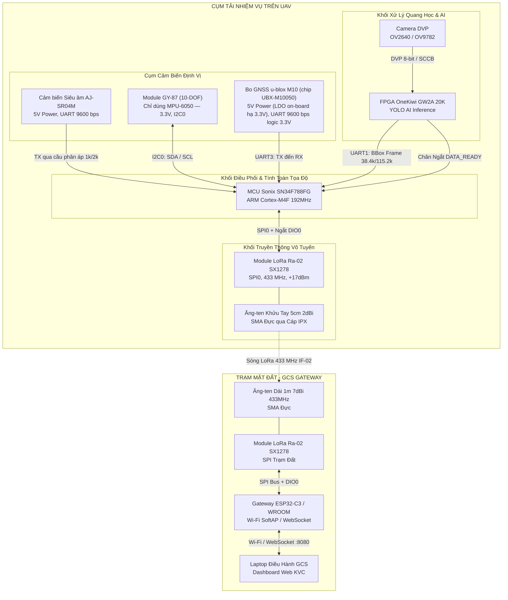

# KVC — Bản Đồ Phân Bổ Chân & Sơ Đồ Đấu Nối Toàn Hệ Thống (Master Pinout & Wiring Specification)

- **Mã tài liệu:** `KVC-HW-PINOUT-01`
- **Trạng thái:** `DRAFT HARDWARE SPECIFICATION (DESIGN BASELINE - SOURCE-VERIFIED)`
- **Phiên bản:** `1.0.0 (DRAFT)`
- **Phạm vi:** Pinout và nguồn của Sonix SN34F780 Starter-Kit V1.1 cùng các kết nối thiết kế được liệt kê. Các module/carrier và giao diện camera, FPGA, gateway cần xác nhận đúng phiên bản trước khi đấu dây; tài liệu chưa được kiểm chứng trên phần cứng.
- **Tài liệu căn cứ:**
  - [docs/hardware/mcu/CHIP_SONIX_SN34F788_MCU.md](../mcu/CHIP_SONIX_SN34F788_MCU.md)
  - [docs/interfaces/IF_MCU_SENSORS.md](../../interfaces/IF_MCU_SENSORS.md)
  - [docs/interfaces/IF_MCU_LORA_RF.md](../../interfaces/IF_MCU_LORA_RF.md)
  - [docs/interfaces/IF_FPGA_MCU_UART.md](../../interfaces/IF_FPGA_MCU_UART.md)
  - [docs/interfaces/IF_CAMERA_FPGA.md](../../interfaces/IF_CAMERA_FPGA.md)

---

## 1. Sơ Đồ Khối Đấu Nối Toàn Hệ Thống



---

## 2. Bảng Phân Bổ Chân Cốt Lõi Trên MCU Sonix SN34F788FG (LQFP64)

Vi điều khiển **Sonix SN34F788FG** (gói LQFP 64 chân) bố trí các cổng ngoại vi phần cứng thành các nhóm chức năng không bị trùng lặp tài nguyên (Zero Resource Conflict).

> ℹ️ **Quy ước Header trên Bo mạch SN34F780 Starter-Kit V1.1:**
> - Các đầu cắm `JP1`, `JP2`, `JP3`, `JP4` là loại **hàng đôi (2×N pins, khoảng cách 2.54 mm)**.
> - **Cặp chân cùng một hàng (Pin Lẻ và Pin Chẵn liền kề) được nối thông mạch trực tiếp với nhau** trên mạch in (ví dụ: Pin 1 và Pin 2 cùng nối vào một chân GPIO của chip). Bạn có thể cắm dây jumper vào bất kỳ chân lẻ hoặc chẵn nào trong cặp!
> - **Cổng cấp nguồn & mass trên bo:**
>   - **`J5` (4 chân):** Toàn bộ 4 chân đều là **GND (VSS)** — dùng để cắm mass cho các cảm biến và LoRa.
>   - **`J6` (4 chân):** Chân 1–3 là **VDD (3.3V) ngõ ra**; chân 4 là **`3V3_EXT` ngõ vào 3.3V đã ổn áp**. Cấp nguồn ngoài vào chân 4 và đóng `J4` 2–3 để đưa nguồn đó lên VDD; không dùng chân 4 làm ngõ ra.
>   - **`J4` (3 chân):** Đóng 1–2 chọn `3V3_LINK` từ LDO SN-Link; đóng 2–3 chọn nguồn ngoài `3V3_EXT`. Không cấp pin LiPo thô vào `3V3_EXT`.

| Nhóm chức năng | Tên tín hiệu | Chân Chip (Pin) | Cổng GPIO | Header trên Kit Sonix | Chức năng phụ (AFIO) | Kết nối với linh kiện ngoại vi |
| :--- | :--- | :---: | :---: | :---: | :--- | :--- |
| **LoRa Ra-02 (SPI0)** | `SPI0_NSS` | **Pin 20** | `P2.4` | `JP3` Pin 9 hoặc 10 | `SEL0` | Chân `NSS` (CS) trên Ra-02 |
| | `SPI0_SCK` | **Pin 21** | `P2.5` | `JP3` Pin 11 hoặc 12 | `SCK0` | Chân `SCK` trên Ra-02 |
| | `SPI0_MISO` | **Pin 22** | `P2.6` | `JP3` Pin 13 hoặc 14 | `MI0` | Chân `MISO` trên Ra-02 |
| | `SPI0_MOSI` | **Pin 23** | `P2.7` | `JP3` Pin 15 hoặc 16 | `MO0` | Chân `MOSI` trên Ra-02 |
| | `LORA_DIO0` | **Pin 24** | `P2.8` | `JP3` Pin 17 hoặc 18 | GPIO Input (EXTI) | Chân `DIO0` (Ngắt TxDone/RxDone) |
| | `LORA_RST` | **Pin 25** | `P2.9` | `JP3` Pin 19 hoặc 20 | GPIO Output | Chân `RST` trên Ra-02 |
| **Siêu âm AJ-SR04M** | `SONIX_URXD2` | **Pin 31** | `P2.15` | `JP3` Pin 31 hoặc 32 | `URXD2` | Nhận cự ly từ chân `TX` cảm biến (qua cầu phân áp) |
| | `SONIX_UTXD2` | **Pin 30** | `P2.14` | `JP3` Pin 29 hoặc 30 | `UTXD2` | Gửi xung kích hoạt `RX/Trig` (nếu dùng chế độ xung) |
| **IMU GY-87 (I2C0)** | `I2C0_SCL` | **Pin 38** | `P0.10` | `JP1` Pin 7 hoặc 8 | `SCL0` | Pull-up `R3` = 1 kΩ đã có trên kit; kiểm tra pull-up trên module |
| | `I2C0_SDA` | **Pin 39** | `P0.11` | `JP1` Pin 9 hoặc 10 | `SDA0` | Pull-up `R4` = 1 kΩ đã có trên kit; kiểm tra pull-up trên module |
| **GNSS u-blox M10 (UART3)**| `GNSS_RXD` | **Pin 15** | `P2.1` | `JP3` Pin 3 hoặc 4 | `URXD3` | Nhận dữ liệu NMEA từ chân `TX` của NEO-M10N |
| | `GNSS_TXD` | **Pin 14** | `P2.0` | `JP3` Pin 1 hoặc 2 | `UTXD3` | Gửi cấu hình sang chân `RX` của bo GNSS |
| **FPGA BBox (UART1)** | `FPGA_URXD` | **Pin 17** | `P2.3` | `JP3` Pin 7 hoặc 8 | `URXD1` | Nhận luồng khung BBox từ `UART_TX` của FPGA (38.4k / 115.2k) |
| | `FPGA_UTXD` | **Pin 16** | `P2.2` | `JP3` Pin 5 hoặc 6 | `UTXD1` | Gửi lệnh phản hồi sang `UART_RX` của FPGA (dự phòng) |
| | `DATA_READY` | **Pin 3** | `P0.12` | `JP1` Pin 11 hoặc 12 | GPIO Input (EXTI) | Chân báo ngắt khung ảnh sẵn sàng từ FPGA |
| **Debug Console (UART5)**| `DEBUG_TX` | **Pin 6** | `P0.15` | `JP1` Pin 17 hoặc 18 | `UTXD5` | Xuất log gỡ lỗi (9.600 bps mặc định / 115.200 bps khi có PLL) |
| | `DEBUG_RX` | **Pin 5** | `P0.14` | `JP1` Pin 15 hoặc 16 | `URXD5` | Nhận lệnh điều khiển cấu hình từ máy tính |
| **KEY TEST trên Kit** | `LED1` (xanh) | **Pin 52** | `P1.12` | `JP2` Pin 25 hoặc 26; qua `JP10` | GPIO Output | LED kiểm tra 1 theo sơ đồ Starter-Kit V1.1 |
| | `LED2` (xanh) | **Pin 51** | `P1.13` | `JP2` Pin 27 hoặc 28; qua `JP11` | GPIO Output | LED kiểm tra 2 theo sơ đồ Starter-Kit V1.1 |
| | `KEY1` | **Pin 50** | `P1.14` | `JP2` Pin 29 hoặc 30; qua `JP12` | GPIO Input | Phím kiểm tra theo sơ đồ Starter-Kit V1.1 |
| **Giao diện Nạp & Reset**| `SWDIO` | **Pin 45** | `P3.5` | `JP4` Pin 11 hoặc 12 | `SWDIO` | Đường dữ liệu SWD (nối sẵn mạch nạp SN-Link Lite) |
| | `SWCLK` | **Pin 46** | `P3.6` | `JP4` Pin 13 hoặc 14 | `SWCLK` | Đường xung nhịp SWD (nối sẵn mạch nạp SN-Link Lite) |
| | `RESET` | **Pin 7** | `P3.7` | `JP4` Pin 15 hoặc 16 | Hardware Reset | Nối nút bấm `SW1` trên bo |
| | `BOOT_PIN` | **Pin 58** | `P1.3` | `JP2` Pin 7 hoặc 8 | ROM Bootloader | Mặc định mở JP9; nối tắt xuống GND khi cần ISP |
| **Chân Nguồn & Mass** | `GND (Mass)` | - | `VSS` | **`J5` Pin 1, 2, 3, 4** | Ground | Chân cắm mass chung cho toàn bộ cảm biến/module |
| | `VDD (3.3V)` | - | `VDD` | **`J6` Pin 1, 2, 3** | 3.3V output | Ngõ ra VDD cấp module khi J4 chọn nguồn phù hợp |
| | `3V3_EXT` | - | `3V3_EXT` | **`J6` Pin 4** | 3.3V input | Ngõ vào từ nguồn ngoài đã ổn áp; chọn bằng J4 2–3 |

---

## 3. Sơ Đồ Đấu Nối Chi Tiết Từng Module Ngoại Vi

### 3.1. Module LoRa Ra-02 (SX1278 433 MHz) ↔ Sonix MCU

> ⚠️ **QUY TẮC AN TOÀN SỐNG CÒN:**
> Phải cắm dây cáp chuyển đổi SMA-IPX vào module Ra-02 và vặn chặt **Ăng-ten khuỷu tay 5cm** trước khi cấp điện hoặc chạy mã nguồn phát LoRa. Không có ăng-ten, công suất phản xạ cao sẽ làm **cháy tầng công suất RF** của chip SX1278!

| Chân trên Module Ra-02 | Chân trên MCU Sonix | Tên chân Kit Sonix | Mức điện áp | Ghi chú kỹ thuật |
| :--- | :--- | :--- | :---: | :--- |
| **VCC (3.3V)** | `VDD` (3.3V) | **`J6`** Pin 1, 2 hoặc 3 | 3.3 V | Cần tụ gốm 100nF + tụ hóa 100µF lọc nguồn chống sụt áp khi phát sóng |
| **GND** | `VSS` (GND) | **`J5`** Pin 1, 2, 3 hoặc 4 | 0 V | **Bắt buộc nối chung GND** |
| **NSS / CS** | `P2.4` (Pin 20) | `JP3` Pin 9 hoặc 10 | 3.3 V | SPI Chip Select (Active-LOW) |
| **MOSI** | `P2.7` (Pin 23) | `JP3` Pin 15 hoặc 16 | 3.3 V | Dữ liệu Master Out Slave In |
| **MISO** | `P2.6` (Pin 22) | `JP3` Pin 13 hoặc 14 | 3.3 V | Dữ liệu Master In Slave Out |
| **SCK** | `P2.5` (Pin 21) | `JP3` Pin 11 hoặc 12 | 3.3 V | Xung nhịp SPI Clock (1 – 4 MHz) |
| **DIO0** | `P2.8` (Pin 24) | `JP3` Pin 17 hoặc 18 | 3.3 V | Ngắt phần cứng kích hoạt khi `TxDone` hoặc `RxDone` |
| **RST** | `P2.9` (Pin 25) | `JP3` Pin 19 hoặc 20 | 3.3 V | Reset chip SX1278 (Active-LOW) |

---

### 3.2. Cảm Biến Siêu Âm Chống Nước AJ-SR04M ↔ Sonix MCU

> [!IMPORTANT]
> **Board đang dùng là AJ-SR04M** (board xanh có pad chọn mode `R19`), **không phải
> JSN-SR04T-2.0**. Hai board dùng chung định dạng khung 4 byte nhưng **khác pad và
> khác ý nghĩa điện trở** — xem bảng so sánh ở cuối mục này trước khi hàn.

Cảm biến cần nguồn **5.0 V** để mạch dao động áp cao tạo sóng siêu âm 40 kHz phản xạ tốt trên bề mặt nước lũ. Do chân GPIO của vi điều khiển Sonix **chỉ chịu được 3.3 V**, chân TX của cảm biến phải đi qua **cầu phân áp điện trở**.

#### Sơ đồ mạch cầu phân áp (giá trị đã hàn thực tế: 1 kΩ / 2 kΩ):
```text
Chân TX (AJ-SR04M, mức 5V) ────[ Điện trở R1: 1.0 kΩ ]────┬──── Nối vào chân P2.15 (Sonix URXD2, mức ~3.3V)
                                                           │
                                                  [ Điện trở R2: 2.0 kΩ ]
                                                           │
                                                          GND (J5)
```
*Điện áp ngõ ra tại điểm phân áp:* `V_out = 5.0 V × 2.0 kΩ / (1.0 kΩ + 2.0 kΩ) ≈ 3.33 V`
(an toàn cho chân MCU 3.3 V). Dòng tiêu thụ qua cầu phân áp ~1,67 mA khi TX ở mức cao —
chấp nhận được với nguồn 5 V của hệ thống.

#### Bảng đấu dây AJ-SR04M:
| Chân Module AJ-SR04M | Chân trên MCU Sonix | Tên chân Kit Sonix | Mức điện áp | Ghi chú cấu hình |
| :--- | :--- | :--- | :---: | :--- |
| **5V / VCC** | Ngõ ra 5V Buck DC-DC | - | 5.0 V | **Không cắm vào chân 3.3 V** của Sonix (thiếu áp, cảm biến không đo được) |
| **GND** | `VSS` (GND) | **`J5`** Pin 1, 2, 3 hoặc 4 | 0 V | Nối chung đất toàn hệ thống |
| **TX** | `P2.15` (URXD2, Pin 31) | `JP3` Pin 31 hoặc 32 | **3.3 V (sau phân áp 1k/2k)** | Phát khung 4 byte `0xFF H L SUM` @ 9600 8N1 |
| **RX** | `P2.14` (UTXD2, Pin 30) | `JP3` Pin 29 hoặc 30 | 3.3 V | Firmware gửi **`0x01`** để kích hoạt mỗi lần đo (Mode 4) |

#### Chọn chế độ bằng pad `R19` (chỉ áp dụng cho AJ-SR04M):
| Mode | `R19` | Hành vi | Firmware có gửi lệnh? |
| :--- | :--- | :--- | :--- |
| 1 | Hở | HC-SR04: xung Trig 10 µs, đọc Echo | Không (driver này không hỗ trợ) |
| 2 | 300 kΩ | Low-power, xung Trig/Echo | Không |
| 3 | 120 kΩ | **Tự phát** 100 ms/lần | Không cần |
| **4** | **47 kΩ** | **Ngủ; đo khi nhận `0x01`, phát 1 khung rồi ngủ** | **Có — cấu hình đang dùng** |
| 5 | 0 Ω | In ASCII liên tục | Không |

> [!WARNING]
> **Không nhầm với JSN-SR04T-2.0.** Board đó dùng pad `R27`, và ở đó:
> `47 kΩ` = Mode 2 (tự phát 100 ms), `120 kΩ` = Mode 3 (chờ lệnh **`0x55`**, không phải `0x01`).
> Hàn 47 kΩ vào `R27` của JSN-SR04T **không** cho hành vi Mode 4.


---

### 3.3. Cụm Cảm Biến Tư Thế GY-87 (10-DOF) ↔ Sonix MCU

Module GY-87 tích hợp 3 chip: **MPU-6050** (Gia tốc + Con quay hồi chuyển), **HMC5883L/QMC5883L** (La bàn số 3 trục), và **BMP180** (Áp suất khí quyển). Toàn bộ giao tiếp qua cùng 1 đường truyền I2C0.

> [!IMPORTANT]
> **Firmware hiện chỉ dùng MPU-6050.** HMC5883L **hoãn** (cần hiệu chuẩn trên kit) và BMP180 **đã loại khỏi thiết kế**. Việc đấu dây I2C0 vẫn giữ nguyên vì cả 3 chip nằm sẵn trên module GY-87 — không cần thay đổi phần cứng khi bật lại sau này. Chi tiết và lý do: [IF_MCU_SENSORS.md §3.2 B–C](../../interfaces/IF_MCU_SENSORS.md).

> ⚠️ Starter-Kit V1.1 đã có `R3` và `R4` = **1 kΩ** kéo lên cho I2C0. **Không lắp thêm điện trở kéo ngoài.** Nếu module GY-87 thực tế cũng có pull-up, kiểm tra cấu hình/điện trở tương đương và cô lập một bộ khi cần; không giả định mọi biến thể GY-87 giống nhau.

| Chân Module GY-87 | Chân trên MCU Sonix | Tên chân Kit Sonix | Ghi chú kỹ thuật |
| :--- | :--- | :--- | :--- |
| **3.3V** (hoặc `VCC_IN`) | `VDD` (3.3V) | **`J6`** Pin 1, 2 hoặc 3 | Cấp nguồn 3.3V trực tiếp vào chân `3.3V` trên module (tránh sụt áp qua LDO) |
| **GND** | `VSS` (GND) | **`J5`** Pin 1, 2, 3 hoặc 4 | Nối chung GND |
| **SCL** | `P0.10` (Pin 38) | `JP1` Pin 7 hoặc 8 | I2C Clock 100 kHz; SCL Push-Pull |
| **SDA** | `P0.11` (Pin 39) | `JP1` Pin 9 hoặc 10 | I2C Data; SDA Open-Drain có pull-up nội |
| *(AD0 - Không có trên header)* | *(Đã nối ngầm trên bo GY-87)* | — | Module GY-87 đã tự động hàn chân AD0 xuống GND trên mạch in, địa chỉ mặc định luôn là `0x68` (Không cần cắm dây này) |

---

### 3.4. Module Định Vị Vệ Tinh u-blox M10 (bo breakout, chip UBX-M10050) ↔ Sonix MCU

> [!CAUTION]
> **Tên gọi:** u-blox **không** có sản phẩm `NEO-M10` hay `NEO-M10N`. Kiểm ngày
> 26/10/2026: `u-blox.com/en/product/neo-m10-series` trả **404**. Dòng M10 chỉ có
> `MAX-M10M`, `MAX-M10S`, `MAX-M10N` (đã ngừng kinh doanh) và chip `UBX-M10050`.
>
> Bo đang dùng là **bo breakout thương mại** gắn chip `UBX-M10050` (nhãn in trên
> bo: "Ublox-10th generation"; chân `5V GND TX RX`, kèm header I2C). Bo này
> **không có datasheet chính thức**; thông số dưới đây lấy từ datasheet chip
> `MAX-M10N-10B` (cùng silicon M10), lưu tại
> [`docs/hardware/sensors/ublox_m10/`](../sensors/SENSOR_PACKAGES.md).

Bo tích hợp sẵn IC hạ áp LDO và diode bảo vệ, chân nguồn in rõ nhãn **`5V`**. Cấp
**5.0 V DC** vào chân `5V` (không cấp 3.3 V trực tiếp vì sụt áp qua LDO sẽ khiến chip
chập chờn). Tín hiệu `TX`/`RX` ở mức logic **3.3 V LVTTL**, đấu trực tiếp an toàn vào
GPIO Sonix SN34F788 — **không cần cầu phân áp**.

| Chân bo GNSS | Chân trên MCU Sonix | Tên chân Kit Sonix | Ghi chú kỹ thuật |
| :--- | :--- | :--- | :--- |
| **5V** | Nguồn 5 V DC | Mạch Buck 5 V hoặc chân 5 V Kit | Cấp 5.0 V DC (LDO trên bo hạ xuống 3.3 V nuôi chip) |
| **GND** | `VSS` (GND) | **`J5`** Pin 1, 2, 3 hoặc 4 | Nối chung GND toàn hệ thống |
| **TX (Module)** | `P2.1` (URXD3, Pin 15) | `JP3` Pin 3 hoặc 4 | NMEA về MCU. **Mặc định 9600 8N1, không flow control** (datasheet MAX-M10N). Firmware đặt `KVC_GNSS_BAUD_RATE = 9600`. |
| **RX (Module)** | `P2.0` (UTXD3, Pin 14) | `JP3` Pin 1 hoặc 2 | Gửi cấu hình UBX sang module (hiện firmware chưa dùng) |

> [!NOTE]
> Nếu module đã bị đổi tốc độ bằng u-center trước đó, firmware 9600 sẽ **không nhận
> được gì**. Dấu hiệu: `[RING] GNSS isr=` giữ nguyên 0 sau 10 giây. Khi đó dùng
> u-center đọc lại `CFG-UART1` rồi đặt về 9600. Chỉ xác minh được khi có kit.


---

### 3.5. Kết Nối FPGA OneKiwi GW2A ↔ MCU Sonix (Giao Diện BBox IF-01)

| Tín hiệu kết nối | Chân trên FPGA OneKiwi (Header J2) | Chân trên MCU Sonix (LQFP64) | Chân trên Kit Sonix | Mức logic | Ý nghĩa chức năng |
| :--- | :--- | :--- | :--- | :---: | :--- |
| **UART_TX (FPGA) ➔ URXD1** | **`R13`** (J2 Pin 11, Bank 2) | **`P2.3`** (`URXD1`, Pin 17) | `JP3` Pin 7 hoặc 8 | 3.3 V CMOS | Luồng dữ liệu khung BBox (38.400 bps mặc định / 115.200 bps khi có PLL, Header `0x5A 0xA5`) |
| **DATA_READY ➔ EXTI** | **`R12`** (J2 Pin 13, Bank 2) | **`P0.12`** (Pin 3) | `JP1` Pin 11 hoặc 12 | 3.3 V CMOS | Xung báo ngắt khung ảnh mới sẵn sàng (độ rộng 1–5 µs) |
| **UART_RX (FPGA) ◄ UTXD1** | **`T13`** (J2 Pin 12, Bank 2) | **`P2.2`** (`UTXD1`, Pin 16) | `JP3` Pin 5 hoặc 6 | 3.3 V CMOS | Tín hiệu phản hồi điều khiển / ACK (dự phòng) |
| **GND CHUNG** | **`GND`** (J2 Pin 14) | `VSS` (GND) | **`J5`** Pin 1, 2, 3 hoặc 4 | 0 V | **Nối chung đất bắt buộc** giữa bo OneKiwi và kit Sonix |

> [!TIP]
> **Ưu điểm cắm dây thực tế:** Các chân `11`, `12`, `13`, `14` trên Header J2 của bo OneKiwi nằm liên tiếp nhau thành một cụm 4 chân thẳng hàng. Có thể dùng ngay một dải cáp bus cái-cái 4 sợi (Dupont 4-pin ribbon cable) cắm trực tiếp mà không cần bấm dây rời rạc!

---

### 3.6. Cổng Gỡ Lỗi UART Debug Console Ra Máy Tính (PC Monitor)

Để quan sát log trạng thái hệ thống, cự ly đo, tọa độ GPS và log phát LoRa trên màn hình PC qua cáp chuyển đổi USB-to-TTL (CP2102 / CH340):

| Chân cáp USB-to-TTL | Chân trên MCU Sonix | Tên chân Kit Sonix | Cấu hình cổng nối tiếp |
| :--- | :--- | :--- | :--- |
| **RXD (Cáp USB)** | `P0.15` (UTXD5, Pin 6) | `JP1` Pin 17 hoặc 18 | Baudrate: **9.600 bps mặc định** (sai số +0,16% trên UCLK 12 MHz; 115.200 bps khi có PLL), 8N1 |
| **TXD (Cáp USB)** | `P0.14` (URXD5, Pin 5) | `JP1` Pin 15 hoặc 16 | Nhận lệnh điều khiển từ bàn phím PC |
| **GND (Cáp USB)** | `VSS` (GND) | **`J5`** Pin 1, 2, 3 hoặc 4 | Nối chung GND máy tính và bo mạch |

---

## 4. Bảng Phân Bổ Chân Gateway ESP32 Trạm Mặt Đất (LoRa Ground Station)

Tại trạm mặt đất, module LoRa Ra-02 thứ hai kết nối với chip vi điều khiển ESP32 và gắn **Ăng-ten dây dài 1m 7dBi**.

### 4.1. Cấu hình cho bo mạch ESP32-C3 (Khuyến nghị hiện tại của dự án):
| Chân Module LoRa Ra-02 | Chân trên ESP32-C3 | Mức điện áp | Chức năng phần cứng |
| :--- | :--- | :---: | :--- |
| **VCC (3.3V)** | Chân `3V3` ESP32-C3 | 3.3 V | Cấp nguồn (khuyến nghị tụ 100µF kẹp chân nguồn) |
| **GND** | Chân `GND` | 0 V | Chung đất |
| **NSS / CS** | **`GPIO 7`** | 3.3 V | SPI Chip Select |
| **SCK** | **`GPIO 4`** | 3.3 V | SPI Clock |
| **MOSI** | **`GPIO 6`** | 3.3 V | SPI Master Out Slave In |
| **MISO** | **`GPIO 5`** | 3.3 V | SPI Master In Slave Out |
| **DIO0** | **`GPIO 3`** | 3.3 V | Ngắt nhận gói tin `RxDone` |
| **RST** | **`GPIO 1`** | 3.3 V | Reset phần cứng LoRa |

### 4.2. Cấu hình dự phòng nếu dùng bo ESP32-WROOM-32 (NodeMCU 30/38 pins):
| Chân Module LoRa Ra-02 | Chân trên ESP32-WROOM | Mức điện áp | Chức năng phần cứng |
| :--- | :--- | :---: | :--- |
| **VCC (3.3V)** | Chân `3V3` | 3.3 V | Cấp nguồn 3.3V ổn định |
| **GND** | Chân `GND` | 0 V | Chung đất |
| **NSS / CS** | **`GPIO 5`** | 3.3 V | VSPI SS |
| **SCK** | **`GPIO 18`** | 3.3 V | VSPI SCK |
| **MOSI** | **`GPIO 23`** | 3.3 V | VSPI MOSI |
| **MISO** | **`GPIO 19`** | 3.3 V | VSPI MISO |
| **DIO0** | **`GPIO 2`** | 3.3 V | Ngắt ngoài `RxDone` |
| **RST** | **`GPIO 14`** | 3.3 V | Reset LoRa |

---

## 5. Sơ Đồ Phân Phối Nguồn (Power Distribution) & Quy Tắc Nối Đất

```text
[ Pin LiPo UAV: 3S (11.1V - 12.6V) ]
         │
         ▼
[ Khối Hạ Áp Buck DC-DC 5V / 3A ]
         │
         ├───► [ 5.0V ]: Cấp cho cảm biến siêu âm AJ-SR04M và bo GNSS M10 (chân 5V) (chân 5V)
         │
         └───► [ Khối Hạ Áp LDO 3.3V / 2A ]
                   │
                   └───► [ 3.3V đã ổn áp ]: `J6` Pin 4 (`3V3_EXT`) → `J4` đóng 2–3 → `VDD`
                                                        │
                                                        └───► `J6` Pin 1–3: Kit Sonix và module 3.3 V (LoRa Ra-02, GY-87)

Nguồn USB SN-Link dùng lựa chọn khác: `J4` đóng 1–2 (`3V3_LINK`). `3V3_EXT` phải là nguồn 3.3 V đã ổn áp từ buck/LDO; tuyệt đối không đưa pin LiPo thô vào J6 Pin 4.

[ ĐƯỜNG TIẾP ĐỊA CHUNG - STAR GROUND ]:
Nối toàn bộ chân GND của Pin, Buck 5V, LDO 3.3V, Sonix, AJ-SR04M, GY-87, bo GNSS M10, OneKiwi về 1 điểm chung.
```

---

## 6. Danh Mục Kiểm Tra An Toàn Trước Khi Cấp Nguồn (Pre-Power Checklist)

- [ ] **Ăng-ten LoRa:** Đã gắn cáp IPX và vặn chặt ăng-ten vào cả 2 module Ra-02 (UAV và Trạm đất) chưa? *(Nếu chưa: DỪNG LẠI, KHÔNG CẤP NGUỒN).*
- [ ] **Mức điện áp AJ-SR04M:** Đã gắn cầu phân áp (1kΩ / 2kΩ) trên đường tín hiệu TX của cảm biến siêu âm trước khi cắm vào chân `P2.15` của Sonix chưa?
- [ ] **Nguồn và jumper trên Kit Sonix:** `J4` đóng 1–2 để chọn `3V3_LINK` từ LDO SN-Link, hoặc đóng 2–3 để chọn `3V3_EXT` 3.3 V đã ổn áp từ buck/LDO ngoài. Sơ đồ nguồn UAV ở mục 5 dùng lựa chọn 2–3; không cấp LiPo thô vào `3V3_EXT`. `JP9` mở (Open) để MCU chạy chương trình người dùng.
- [ ] **J1 / VDDIO1:** Xác nhận `J1` đóng short, nối `VDDIO1` với `VDD` (cấu hình mặc định 3.3 V); nếu jumper mở thì dừng cấp nguồn cho đến khi rail được cấp đúng thiết kế.
- [ ] **J6:** Dùng chân 1–3 làm ngõ ra `VDD`; chỉ dùng chân 4 làm ngõ vào `3V3_EXT`, với J4 đóng 2–3.
- [ ] **Tiếp địa (GND):** Đã kiểm tra thông mạch giữa tất cả các điểm GND của các bo mạch bằng đồng hồ đo VOM chưa?
- [ ] **Trở kéo I2C:** `R3`/`R4` = 1 kΩ đã có sẵn trên Starter-Kit cho I2C0; **không cắm thêm trở kéo ngoài**. Nếu GY-87 có pull-up tích hợp, xác minh và cô lập một bộ nếu điện trở song song quá thấp.
- [ ] **Cực tính nguồn:** Đã kiểm tra đúng chiều (+) và (-), đồng thời xác nhận bo GNSS M10 được cấp đúng nguồn 5.0 V DC vào chân 5V (LDO trên bo hạ về 3.3 V), các đường tín hiệu TX/RX giữ chuẩn logic 3.3 V.

---
*Trạng thái: DRAFT HARDWARE SPECIFICATION (DESIGN BASELINE - SOURCE-VERIFIED). SOURCE-VERIFIED chỉ phản ánh đối chiếu tài liệu/sơ đồ; chưa có phép đo hoặc xác minh trên bo thật. Chờ Human approval trước khi dùng làm wiring release.*
