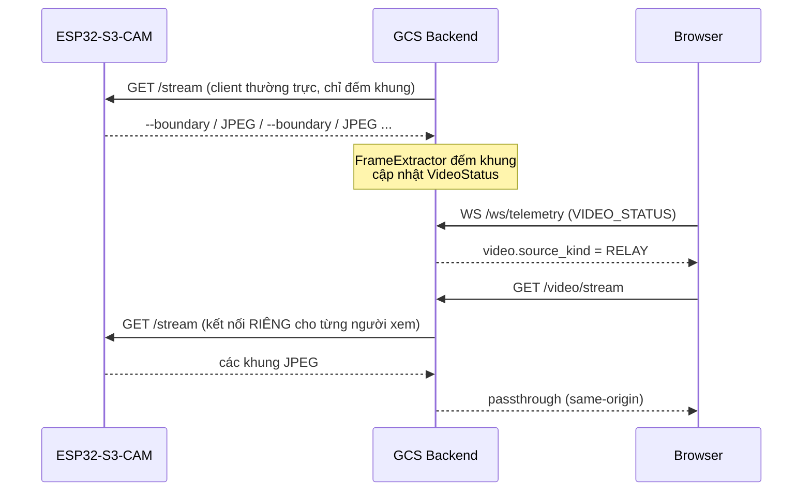

# IF-05 — ESP32-S3-CAM → GCS Backend (MJPEG relay)

- **Mã:** `KVC-IF-005`
- **Trạng thái:** `DESIGN` (route + relay đã viết; firmware S3 đã có nhưng **chưa nạp bo**)
- **Mức bằng chứng:** `SOURCE-VERIFIED` cho backend/frontend, `SIMULATED` cho
  parser MJPEG và đường relay end-to-end trên camera TCP giả. **Chưa
  `HARDWARE-VERIFIED`** — chưa chạy với module thật.
- **Owner:** Kilo
- **Ngày lập:** 01/11/2026 (cập nhật 02/11/2026: lộ trình module tạm)
- **Giao thức độc lập thiết bị:** IF-05 khoá theo *hành vi stream* (`multipart/x-mixed-replace`,
  marker SOI/EOI, boundary token), **không** khoá theo model board. Đổi module
  không đổi giao thức; xem §10.

---

## 1. Vì sao kênh này tồn tại

KVC có hai luồng **vật lý độc lập**:

| Luồng | Kênh | Nội dung | Vai trò |
| :--- | :--- | :--- | :--- |
| 1 | LoRa 433 MHz (IF-02, 32 byte) | Telemetry + toạ độ mục tiêu | **Kênh chính.** Quyết định khả năng cứu nạn |
| 2 | Wi-Fi (IF-05) | Video quang học | **Kênh phụ.** Chỉ để người vận hành nhìn |

Nguyên tắc: **mất luồng 2 không được ảnh hưởng luồng 1.** Mọi lỗi trong
`video_relay.py` chỉ cập nhật trạng thái video, không chạm telemetry.

---

## 2. Ranh giới bắt buộc

### 2.1 Trình duyệt KHÔNG nối trực tiếp ESP32

`IF_ESP32_GCS_WS.md:44` quy định trình duyệt chỉ nói chuyện với backend. IF-05
**không phá quy tắc đó**: backend là client outbound của camera, rồi phát lại
same-origin cho trình duyệt.

Ba lý do kỹ thuật đã được ghi trong
`review/KVC-GCS-TACTICAL-UI-20261101-001/ASSESSMENT.md:148-163`:

| Vấn đề | Hệ quả nếu trình duyệt gọi thẳng |
| :--- | :--- |
| Thiếu CORS header | Canvas bị taint, `toDataURL()` ném `SecurityError` |
| Trang HTTPS tải `http://` | Bị chặn (mixed content) |
| `fetch()` trên MJPEG multipart | Không bao giờ resolve — MJPEG không có điểm kết thúc |

### 2.2 Không truyền video qua LoRa

IF-02 cố định 32 byte. Video không đi qua LoRa, dưới bất kỳ hình thức nào.
Xem `KVC_ThietKeHeThong.md` §II.3.2 mục 4 và §II.5.2 (quy tắc không truyền video qua LoRa).

### 2.3 Không đồng bộ thời gian với IF-01

BBox do FPGA (OV2640, `cam_pclk` 24 MHz) sinh ra; video do ESP32-S3-CAM sinh
ra. Hai đồng hồ độc lập, không có sync marker. Chênh lệch thực tế 100–500 ms.

**Hệ quả bắt buộc:** không được vẽ bbox của FPGA lên khung video ESP32 rồi coi
là "đã đồng bộ". `VideoStatus.has_overlay` mặc định `false` và frontend chỉ vẽ
overlay khi cờ này `true`. Muốn bật phải có cơ chế ghép cặp khung riêng.

---

## 3. Đặc tả kỹ thuật

### 3.1 Luồng dữ liệu



**Hai kết nối độc lập tới camera, không phải một.** `VideoRelay._consume`
(`video_relay.py:151-167`) là client thường trực; `GET /video/stream`
(`main.py:240-270`) mở thêm một client cho mỗi người xem. Camera phải chịu
`1 + số_người_xem` kết nối. Trước 01/11/2026 comment ở `main.py` ghi "kết nối
duy nhất" và điều đó **sai**. Nếu A5 đo thấy camera quá tải (rớt khung, lỗi
`fb_get`), phải gộp upstream fan-out trong `video_relay.py` — không thêm client
thứ ba.

### 3.2 Endpoint

| Route | Chiều | Media type | Mục đích |
| :--- | :--- | :--- | :--- |
| `GET /video/stream` | Browser ← Backend ← Camera | `multipart/x-mixed-replace` | Kênh xem |
| `GET /api/video/status` | Browser ← Backend | `application/json` | Trạng thái chi tiết (debug) |
| WS `VIDEO_STATUS` | Backend → Browser | JSON event | Trạng thái theo thời gian thực |

**Không có prefix `/api` cho `/video/stream`** vì đây là route media, không
phải API. Giữ nguyên giá trị `VITE_VIDEO_STREAM_URL` cũ để không phá cấu hình
hiện có.

**Boundary trong `Content-Type` là token, không kèm `--`.** Header phát cho
trình duyệt dùng hằng `BOUNDARY = "123456789000000000000987654321"`
(`video_relay.py`) và đúng RFC 2046: `boundary=<token>`. Dấu phân cách trên
dây là `--` + token, và ta replay nguyên byte của camera nên header phải khớp
dạng đó. Backend **không parse** boundary — `FrameExtractor` tách khung bằng
SOI/EOI, nên boundary chỉ cần đúng để VLC/trình duyệt khác đọc được.


### 3.3 Cấu hình

| Biến | Mặc định | Ý nghĩa |
| :--- | :--- | :--- |
| `KVC_ENABLE_VIDEO_RELAY` | `0` (tắt) | Bật relay. Không mở kết nối mạng khi tắt |
| `KVC_VIDEO_SOURCE_URL` | rỗng | URL gốc của camera, vd `http://192.168.4.2:81/stream` |
| `video_reconnect_sec` | 2,0 s | Backoff sau mỗi lần mất kết nối |
| `video_frame_timeout_sec` | 5,0 s | Quá hạn này không có khung → `is_connected = false` |

`Settings.__post_init__` **từ chối cấu hình sai**: bật relay mà không có URL
ném `ValueError` ngay khi khởi động, thay vì chạy rồi lỗi ngầm.

**Cổng `:81` chỉ là ví dụ.** Firmware S3 chọn cổng này trong
`firmware/esp32_s3_cam/include/camera_config.h` (`KVC_HTTP_PORT`). Nếu đổi, **phải**
cập nhật `KVC_VIDEO_SOURCE_URL` và mục này trong cùng lượt. Không hardcode hai
nơi khác nhau.

**Nhịp phát `VIDEO_STATUS`:** tối đa 1 lần/giây theo **đồng hồ**, cộng thêm một
lần ngay khi kết nối thành công và một lần khi lỗi. Trước 01/11/2026 bản cũ phát
theo `frame_count % 30`, tức là phụ thuộc FPS thực tế — FPS cao thì phát dồn,
FPS thấp thì im lặng đúng lúc cần biết khung cuối đã cũ bao lâu.

### 3.4 Payload `VideoStatus`

```json
{
  "source_kind": "NONE | RELAY",
  "stream_path": "/video/stream | null",
  "is_connected": true,
  "frame_count": 1234,
  "last_frame_age_ms": 40,
  "error_message": null
}
```

Ràng buộc:

- `source_kind` **chỉ có** `NONE` và `RELAY`. Thêm `DIRECT` phải có HUMAN duyệt
  sửa kiến trúc (phá §2.1).
- `frame_count` là **số khung đếm được**, không phải FPS. Cấm chia cho thời
  gian để suy ra FPS: mẫu số không cùng đồng hồ và không được đo.
- `last_frame_age_ms` là **tuổi đo được**, không phải `None` mặc định:
  - `VideoRelay.status()` đo trên đồng hồ của chính nó từ `_last_frame_at`.
  - `MissionStore._apply` **neo ngược** giá trị đó (`now_ms() - reported_age`)
    vào `times["video"]`, nên `video_with_age()` cộng thêm thời gian trôi qua
    chứ không reset về 0.
  - Nhờ vậy `/api/video/status` và `VIDEO_STATUS`/`SNAPSHOT` cùng một con số.
  - `null` chỉ có nghĩa "chưa từng nhận khung"; `0` nghĩa là "vừa nhận khung".
- `video` **không** nằm trong `ages()` vì `ages()` được merge vào mọi event,
  còn `video` chỉ thuộc domain `VIDEO_STATUS`/`SNAPSHOT`. Muốn biết tuổi khung
  trong một event bất kỳ thì đọc `video.last_frame_age_ms` sau khi áp trạng thái.


---

## 4. Provenance: video KHÔNG thuộc `source_mode`

Theo `KVC_ThietKeHeThong.md:84`, nhãn REAL/MOCK của telemetry độc lập với
nguồn video. Một phiên `REAL` có thể không có video; một phiên `MOCK` có thể
có video thật.

| Trường | Ý nghĩa |
| :--- | :--- |
| `source_mode` | Nguồn **telemetry** (UI hiện chỉ phát MOCK/REAL; `REPLAY` chỉ xuất hiện qua API `/api/replay/*` gọi trực tiếp hoặc bản ghi cũ) |
| `video.source_kind` | Nguồn **video** (NONE/RELAY) |
| `inference_device` | Nơi suy luận (FPGA_GW2A / PC_REFERENCE / SIMULATED) |

**Không suy trường này từ trường kia.**

---

## 5. Hành vi khi lỗi

| Tình huống | `is_connected` | Telemetry | Ghi chú |
| :--- | :---: | :--- | :--- |
| Chưa cấu hình | `false` | Bình thường | `source_kind = NONE` |
| Camera tắt | `false` | Bình thường | `error_message` = lỗi kết nối |
| Camera chậm > 5 s | `false` | Bình thường | Ngưỡng `video_frame_timeout_sec` |
| Relay crash | `false` | Bình thường | Vòng backoff tự nối lại |
| Đổi session | reset `NONE` | Bình thường | `rotate_session()` |
| Camera đóng stream | `false` rồi `true` | Bình thường | `_consume` trả về, backoff nối lại |

`test_video_relay.py` kiểm trực tiếp từng dòng trên bằng camera TCP giả
(loopback), gồm cả đóng stream và nối lại.

---

## 6. Chưa làm / giới hạn

| # | Việc | Trạng thái |
| :---: | :--- | :--- |
| 1 | Firmware ESP32-S3-CAM phát MJPEG | **ĐÃ VIẾT** — `firmware/esp32_s3_cam/` (`SOURCE-VERIFIED` + `BUILT`, **chưa nạp bo**). OV3660, SVGA 800×600, q=12, cổng 81, STA |
| 2 | Chốt dải mạng | **ĐÃ CHỐT (H3, 01/11/2026)** — hotspot 2.4 GHz từ laptop/router; S3 chạy STA; C3 cắm USB Serial |
| 3 | Ghép cặp bbox FPGA ↔ khung video | **CHƯA CÓ** → `has_overlay` luôn `false` |
| 4 | Đo FPS/độ trễ thật | **NOT RUN** — cần phần cứng. Công cụ đã có: `scripts/manual/measure_mjpeg_stream.py` |
| 5 | Bảo mật: có xác thực không | **CHƯA** — MJPEG không auth; chỉ dùng mạng nội bộ |
| 6 | Gộp upstream fan-out (giảm `1 + số_người_xem` kết nối) | **CHƯA** — chỉ làm nếu A5 đo thấy camera quá tải |
| 7 | Nạp firmware lên module thật (`HARDWARE-VERIFIED`) | **NOT RUN** — chưa thao tác phần cứng |

**Không được tuyên bố** "video HARDWARE-VERIFIED", "AI FPGA qua camera ESP32",
"hai camera đồng bộ", hay bất kỳ con số FPS nào cho tới khi có phép đo thật.

---

## 7. Bằng chứng

Chạy lại ngày **01/11/2026** sau khi sửa `last_frame_age_ms`, nhịp publish và
boundary. Số dưới đây là số **thực chạy**, thay cho các con số chép lại trước đó.

| Hạng mục | Lệnh | Kết quả |
| :--- | :--- | :--- |
| `tests/test_video_relay.py` | `.venv/Scripts/python.exe -B -m pytest gcs/backend/tests/test_video_relay.py -q -p no:cacheprovider` | **20/20 PASS** (exit 0) — parser, split-chunk, isolation, 503, reset, tuổi khung, camera giả chạy dài, reconnect, timeout |
| Toàn bộ backend | `.venv/Scripts/python.exe -B -m pytest gcs/backend/tests -q -p no:cacheprovider` | **65 PASS** (exit 0) |
| `missionReducer.test.ts` IF-05 | `npx vitest run src/state/missionReducer.test.ts` | PASS — relay/NONE/telemetry độc lập/domain/tick/reset + REAL+NONE không rơi về MOCK |
| `VideoPanel.test.tsx` | `npx vitest run src/features/video/VideoPanel.test.tsx` | PASS — nhãn RELAY, `KHUNG: n`, `FPS: N/A`, không phủ BBox FPGA, banner mất video, REAL không hiện pattern |
| Toàn bộ frontend | `npm test` | **173 PASS / 27 file** (exit 0) |
| Typecheck / lint / build | `npm run typecheck`, `npm run lint`, `npm run build` | exit 0 (lint chỉ còn warning có sẵn của file khác) |
| Đo MJPEG | `scripts/manual/measure_mjpeg_stream.py --fake-camera` | **TỰ KIỂM**, không phải số đo camera thật |
| Phần cứng | — | **NOT RUN** — chưa có module ESP32-S3-CAM |

Mức bằng chứng giữ nguyên **`SOURCE-VERIFIED + SIMULATED`**. Không có
`HARDWARE-VERIFIED` vì chưa có log/capture từ thiết bị thật.

---

## 8. Lộ trình module tạm (02/11/2026)

| Ngày | Module | Việc | Ràng buộc |
| :--- | :--- | :--- | :--- |
| 02/11/2026 | ESP32-CAM AI-Thinker + OV3660 | Test luồng MJPEG cổng 81 và YOLO11n trên laptop | **Không** sinh toạ độ. Box mang `inference_device = PC_REFERENCE` |
| 03/11/2026 | ESP32-S3-CAM chính thức | Thay bo, giữ nguyên backend | Cùng IF-05; không sửa `FrameExtractor` |

### 8.1 Điều kiện tương thích khi đổi module

Backend chỉ cần ba thứ từ camera, không quan tâm chip:

1. `GET /stream` trả `multipart/x-mixed-replace` chứa JPEG (SOI `FFD8` … EOI `FFD9`);
2. Boundary token khai trong `Content-Type` khớp `--123456789000000000000987654321`,
   hoặc cấu hình `KVC_VIDEO_SOURCE_URL` + token cho đúng module;
3. Cổng khai báo trong `KVC_VIDEO_SOURCE_URL` (ví dụ `http://192.168.4.2:81/stream`).

Nếu module tạm dùng boundary khác (AI-Thinker mặc định có boundary dạng
`123456789000000000000987654321` nhưng xác nhận trên log thật trước khi demo),
**sửa phía camera**, không nới lỏng `FrameExtractor`. Lý do: nới lỏng parser để
"đọc được mọi boundary" sẽ âm thầm chấp nhận khung JPEG cắt sai.

### 8.2 Không được làm khi dùng module tạm

- Không trỏ `inference_device` của telemetry sang `PC_REFERENCE` chỉ vì đang dùng
  module tạm: telemetry vẫn do FPGA sinh. `PC_REFERENCE` chỉ dành cho `bounding_boxes`
  của kênh video.
- Không ghi kết quả module tạm là `HARDWARE-VERIFIED` cho IF-05 chính thức; ghi rõ
  "module tạm, `<ngày>`" kèm ảnh/log.
- Không dùng toạ độ suy ra từ khung module tạm (nó không có GNSS, không có `fx_px`
  hiệu chuẩn).


