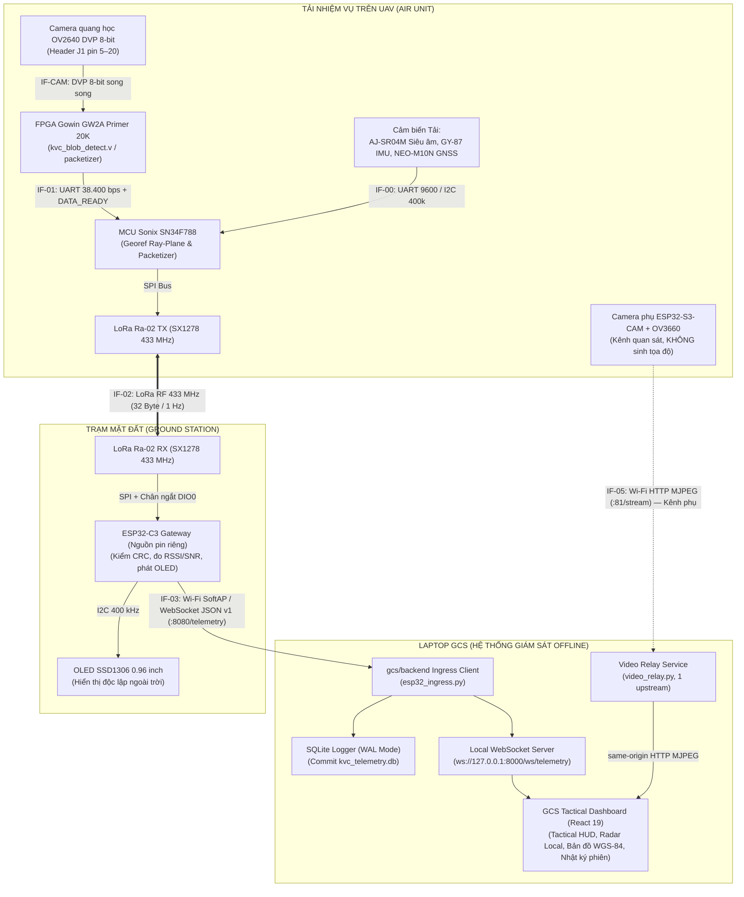
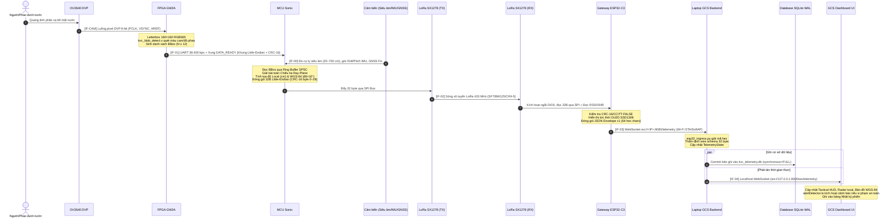

# KVC — Ma trận và Danh mục Giao diện Toàn Hệ thống (Interfaces)

Tài liệu này quản lý tập trung toàn bộ các giao diện kết nối (hợp đồng kỹ thuật / ABI) giữa các phân hệ trong hệ thống KVC. Mọi thay đổi về giao thức, cấu trúc gói tin, baudrate, pinout hoặc CRC phải được cập nhật tại thư mục này trước khi triển khai trên phần cứng.

---

## 1. Sơ Đồ Luồng Dữ Liệu Toàn Hệ Thống

Hệ thống phân tách rõ rệt thành hai đường truyền vật lý độc lập:
1. **Kênh chính: Đo xa Telemetry & Tọa độ cứu nạn qua LoRa 433 MHz** (Zero-video, 32 byte/gói, bảo đảm cự ly xa và xuyên nhiễu).
2. **Kênh phụ: Video quang học quan sát qua Wi-Fi MJPEG (IF-05)** (Dành riêng cho mắt người vận hành, không sinh tọa độ, không can thiệp luồng LoRa).

> [!IMPORTANT]
> **Quy Tắc Ranh Giới Topology Bắt Buộc:**
> 1. **Zero-Video over LoRa:** Toàn bộ dữ liệu truyền qua LoRa chỉ là **Metadata nhị phân 32 byte** (Tọa độ, BBox, Cảm biến, Trạng thái). Tuyệt đối không truyền hình ảnh hoặc video qua LoRa.
> 2. **Hai Chặng Mạng Độc Lập:** ESP32 trạm đất phát Wi-Fi SoftAP hoặc kết nối STA Wi-Fi 2.4 GHz và chạy WebSocket Server. **Backend Python trên Laptop đóng vai trò WebSocket Client kết nối vào ESP32** để thu nhận dữ liệu và ghi vào SQLite.
> 3. **Trình duyệt Web Dashboard tuyệt đối KHÔNG kết nối trực tiếp vào ESP32** để bảo vệ tài nguyên vi điều khiển đơn nhân ESP32-C3 và bảo đảm 100% dữ liệu được lưu vết bền vững vào SQLite.
> 4. **Kênh Video IF-05 là Kênh Phụ:** ESP32-S3-CAM chỉ làm nhiệm vụ phát hình ảnh quan sát cho cứu hộ viên. Kênh này **không sinh tọa độ**, **không vẽ đè BBox từ FPGA** (do khác biệt cảm biến/FOV và lệch thời gian 100–500 ms) và **không đi qua LoRa**.

---

## 2. Danh Mục Chi Tiết Các Giao Diện (Interface Catalog)

| Mã giao diện | Tên giao diện | Đầu phát (TX / Server) | Đầu nhận (RX / Client) | Kênh vật lý & Giao thức | Định dạng dữ liệu & Tần suất | Trạng thái bằng chứng | Tài liệu chi tiết |
| :---: | :--- | :--- | :--- | :--- | :--- | :---: | :--- |
| **IF-CAM** | Luồng ảnh thô quang học | Cụm camera quang học OV2640 DVP 8-bit (**Kiên**) | FPGA OneKiwi Primer 20K (**Vững**) | Bus song song DVP 8-bit trên Header J1 pin 5–20 (PCLK, VSYNC, HREF, D[7:0], SCCB); 14 `IO_LOC` tại `KVC_PR/src/KVC_FPGA.cst:58-98` | VGA 640×480 RGB565 / YUV; ~30 FPS | `SIMULATED` | [IF_CAMERA_FPGA.md](IF_CAMERA_FPGA.md) |
| **IF-00** | Cảm biến định vị tải UAV | Cụm cảm biến tải: AJ-SR04M Siêu âm, GY-87 IMU, NEO-M10N GNSS (**Cường / Kiên**) | MCU Sonix SN34F788 (**Phong**) | - AJ-SR04M: UART2 9600 bps - GY-87: I2C0 400 kHz - NEO-M10N: UART3 9600 bps | - Siêu âm: khung 4B, dải 20–700 cm - IMU: Accel/Gyro thô 6-trục - GNSS: Khung NMEA/UBX 1–10 Hz | `SIMULATED` (Test 65/65 PASS) | [IF_MCU_SENSORS.md](IF_MCU_SENSORS.md) |
| **IF-01** | Khung kết quả nhận diện BBox | FPGA OneKiwi Primer 20K (**Vững**) | MCU Sonix SN34F788 (**Phong**) | UART 3.3V CMOS (**38.400 bps**, 8N1) + Chân ngắt GPIO `DATA_READY` | Khung nhị phân Little-Endian: Sync `0x5A 0xA5`, Ver `0x01`, Count $N \le 12$, Timestamp ms, $N \times 8$ byte BBox, CRC-16; nhịp ~5–30 FPS | **`HARDWARE-VERIFIED`** (FPGA ↔ MCU: 197.844B mock / 720B blob thật, `fe=0 oe=0 crc=0`) | [IF_FPGA_MCU_UART.md](IF_FPGA_MCU_UART.md) |
| **IF-02** | Gói tin telemetry vô tuyến cứu nạn | MCU Sonix SN34F788 (**Phong**) | ESP32-C3 Gateway Trạm Đất (**Thịnh**) | Sóng vô tuyến LoRa 433 MHz (Ai-Thinker Ra-02 / Semtech SX1278, SPI) | Gói tin nhị phân cố định **đúng 32 byte** Little-Endian; CRC-16/CCITT-FALSE trên byte 0–29; tần suất 1 Hz (chuẩn) / 2–5 Hz (target) | **APPROVED ABI** (HUMAN 29/10/2026); Tx `HARDWARE-VERIFIED` (`tx=17/0`) | [IF_MCU_LORA_RF.md](IF_MCU_LORA_RF.md) |
| **IF-03** | Luồng telemetry từ Trạm đất sang Host | ESP32-C3 Gateway Trạm Đất (**Thịnh**) | Backend GCS trên Laptop (**Thịnh**) | Wi-Fi 2.4 GHz 802.11 b/g/n (Ưu tiên STA; fallback SoftAP `KVC_GROUND_STATION` 192.168.4.1) + WebSocket Server cổng 8080 | JSON UTF-8 Transport Envelope v1: `transport_version`, `gateway_session_id`, `gateway_sequence`, `rx_monotonic_ms`, `rf_payload_hex` (64 hex chars), `rssi_dbm`, `snr_db`, `rx_drop_count` | `SOURCE-VERIFIED` (PlatformIO build exit 0; host test PASS) | [IF_ESP32_GCS_WS.md](IF_ESP32_GCS_WS.md) |
| **IF-04** | Dữ liệu ứng dụng GCS Host nội bộ | Backend GCS Python FastAPI | Frontend Dashboard Web GCS | Localhost HTTP REST + WebSocket Server (`ws://127.0.0.1:8000/ws/telemetry`) | JSON payload: Snapshot khởi tạo, Patches sự kiện delta, REST CRUD session, Alert events | `SOURCE-VERIFIED` (84 tests pytest backend PASS) | [IF_GCS_DATA_CONTRACT.md](IF_GCS_DATA_CONTRACT.md) & [KVC_GCS_DATA_CONTRACT.md](KVC_GCS_DATA_CONTRACT.md) |
| **IF-05** | Video quan sát phụ (MJPEG) | Module ESP32-S3-CAM + OV3660 (**Kilo**) | Backend GCS relay trung gian ➔ Trình duyệt Web Dashboard | Wi-Fi 2.4 GHz; HTTP MJPEG `multipart/x-mixed-replace` trên cổng 81 (`/stream`); Backend fan-out same-origin | Luồng ảnh JPEG HVGA 480×320 (q22/q26), nhịp 15–20 FPS; **KHÔNG sinh tọa độ, KHÔNG overlay BBox** | `SOURCE-VERIFIED + SIMULATED + BUILT` (Firmware b1.5.2 build exit 0; 41 test relay PASS) | [IF_ESP32_CAM_GCS.md](IF_ESP32_CAM_GCS.md) |

---

## 3. Trình Tự Thực Thi End-to-End (Sequence Diagram)

Trình tự thời gian từ khi đối tượng trôi dạt xuất hiện trên mặt nước cho đến khi hiển thị cảnh báo lên màn hình GCS:

---

## 4. Quy Tắc Quản Lý & Khóa Giao Thức (Protocol Governance)

1. **Nguyên tắc "Single Source of Truth":** Thư mục `docs/interfaces/` là nơi duy nhất quy định chuẩn kỹ thuật của từng giao diện. Không tạo các bản sao đặc tả rải rác trong thư mục code.
2. **Khóa ABI trước khi ghép nối phần cứng:**
   - Trước khi cắm dây thử nghiệm giữa hai khối bất kỳ (ví dụ FPGA ↔ MCU hoặc MCU ↔ ESP32), thành viên phụ trách hai đầu phải cùng đối chiếu với file đặc tả tương ứng tại đây và xác nhận khớp cấu trúc byte, thứ tự byte (Little-Endian) và thuật toán CRC.
   - ABI RF 32 byte (IF-02) đã được **HUMAN duyệt ngày 29/10/2026**. Mọi thay đổi layout/CRC sau mốc này phải có phê duyệt HUMAN mới.
3. **Quy định thay đổi:** Nghiêm cấm đơn phương thay đổi baudrate, pinout, packet layout hoặc CRC trong code nếu chưa cập nhật và được duyệt tại tài liệu giao diện tương ứng.
4. **Đối chiếu sơ đồ chân Master:** Toàn bộ phân bổ chân, số thứ tự pin và header bo mạch của các giao diện trên phải đối chiếu với [KVC_MASTER_PINOUT_WIRING.md](../hardware/wiring/KVC_MASTER_PINOUT_WIRING.md) trước khi cấp nguồn hoặc đấu nối phần cứng.
