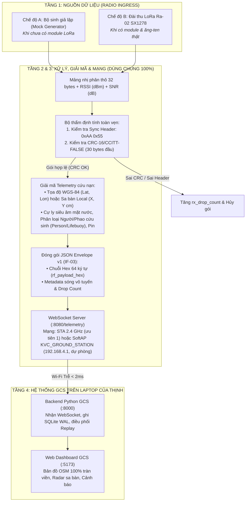

# KVC — KẾ HOẠCH PHÁT TRIỂN & CHIẾN LƯỢC KIỂM THỬ TRỰC QUAN GATEWAY ESP32
## PHÂN HỆ TRẠM THU MẶT ĐẤT (LORA RECEIVER ➔ DECODER ➔ GCS INGRESS BACKEND)

> **Người thực hiện:** Đoàn Thanh Trường Thịnh  
> **Nhiệm vụ:** Firmware Trạm Thu Mặt Đất (Gateway ESP32) & Cầu Nối Ingress GCS  
> **Phần cứng:** ESP32-C3 DevKit (hoặc ESP32 Classic) + Module LoRa Ra-02 (SX1278 433MHz)  
> **Mục tiêu cốt lõi:**  
> 1. Thiết kế đường ống xử lý đa tầng (Pipeline Architecture): Tách biệt nguồn dữ liệu với bộ giải mã & mạng. Khi chuyển từ *chưa có LoRa (Mock)* sang *có LoRa và nhận sóng thật*, **dùng lại 100% logic giải mã, CRC-16, JSON và WebSocket mà không cần viết lại code**.  
> 2. Mỗi giai đoạn đều có **quy trình kiểm thử từng bước (Actionable Steps)** và **hình ảnh thể hiện trực quan cụ thể (Visual Output Mockups)** trên Serial Monitor, Terminal Laptop và Web Dashboard.

---

## 1. SƠ ĐỒ ĐƯỜNG ỐNG DỮ LIỆU DÙNG CHUNG (REUSABLE PIPELINE)

Bất kể dữ liệu đến từ bộ sinh giả lập (Mock) hay đài thu LoRa thật, toàn bộ các tầng sau đều dùng chung một đường ống thống nhất:



---

## 2. CHI TIẾT 6 GIAI ĐOẠN KIỂM THỬ & HÌNH ẢNH TRỰC QUAN

---

### GIAI ĐOẠN 1: THIẾT LẬP MẠNG (ƯU TIÊN STA 2.4 GHz, DỰ PHÒNG SOFTAP) & MỞ WEBSOCKET SERVER TRÊN ESP32
*Mục tiêu: ESP32 tự chọn mạng đúng thứ tự ưu tiên và mở cổng WebSocket sẵn sàng nhận kết nối từ Laptop.*

#### A. Các bước thực hiện & Lệnh kiểm tra:
> **Mốc thời gian STA → SoftAP (đã thống nhất 28/10/2026):** firmware dùng `KVC_STA_BOOT_BUDGET_MS = 15000` (`firmware/gateway_esp32/src/main.cpp`), tức **15 giây** cho toàn bộ ngân sách thử STA (gồm cả thời gian thử từng SSID trong danh sách). Bản tài liệu này trước đây ghi 10 s và log mẫu ghi "That bai sau 10000 ms" — **cả hai đều sai so với code**. Khi test, lấy **15 s** làm mốc; nếu thấy ESP32 chuyển SoftAP sớm hơn đáng kể thì kiểm lại build flag. Muốn đổi mốc thì phải sửa code và tài liệu trong cùng một task.

0. **Kiểm tra thứ tự ưu tiên (bắt buộc):** nạp firmware **không** truyền `KVC_WIFI_SSID` → ESP32 phải in `[WIFI-STA] Khong co KVC_WIFI_SSID...` rồi mới phát SoftAP. Sau đó nạp lại **có** truyền SSID/mật khẩu hotspot điện thoại (2.4 GHz) → ESP32 phải in `[WIFI-STA] Ket noi STA THANH CONG` và **không** phát SoftAP. Đây là tiêu chí PASS của thứ tự ưu tiên.
0b. **Kiểm tra hotspot điện thoại (4G):** bật hotspot 2.4 GHz trên điện thoại, nạp firmware kèm SSID/mật khẩu hotspot → gateway phải bắt được và in IP do điện thoại cấp. Nếu điện thoại chỉ phát 5 GHz, ESP32-C3 **không** thấy mạng — đổi sang 2.4 GHz rồi thử lại.
0c. **Kiểm tra nhiều mạng:** nạp 2 mạng (hotspot điện thoại + Wi-Fi lab), tắt hotspot → gateway phải chuyển sang mạng thứ hai; bật lại hotspot và chờ hơn 30 s → gateway phải quay lại mạng khai báo trước.
1. Nạp code gateway lên bo ESP32 qua cáp Type-C/MicroUSB.
2. Mở Serial Monitor với tốc độ baud `115200`.
3. Nếu đang ở chế độ dự phòng (ưu tiên 2): trên Laptop bật Wi-Fi và quét danh sách mạng → Kết nối vào mạng **`KVC_GROUND_STATION`** (Mật khẩu mặc định: `kvc123456`). Nếu đang ở ưu tiên 1: laptop kết nối cùng Wi-Fi 2.4 GHz với ESP32 và dùng IP in ở dòng `[WIFI-STA] IP do Router cap`.
4. Mở PowerShell trên Laptop kiểm tra độ trễ kết nối (chỉ khi dùng SoftAP):
   ```powershell
   ping 192.168.4.1
   ```
5. Dùng công cụ test WebSocket (Python hoặc Chrome extension) kết nối tới endpoint tương ứng: `ws://192.168.4.1:8080/telemetry` (SoftAP) hoặc `ws://<IP_STA>:8080/telemetry` (STA).

#### B. Thể hiện trực quan kết quả đạt chuẩn:

* **Trực quan trên Serial Monitor (ESP32), trường hợp dự phòng SoftAP:**
  ```text
  =======================================================
     KVC GATEWAY ESP32 - PHÂN HỆ TRẠM THU MẶT ĐẤT       
  =======================================================
  [WIFI-STA] Uu tien 1: ket noi Wi-Fi 2.4 GHz "..."
  [WIFI-STA] That bai sau 15000 ms. Chuyen sang uu tien 2.
  [WIFI-AP]  Phat SoftAP du phong THANH CONG!
  [WIFI-AP]  SSID: KVC_GROUND_STATION | Password: kvc123456
  [WIFI-AP]  IP Gateway: 192.168.4.1
  [WS] Endpoint SoftAP: ws://192.168.4.1:8080/telemetry
  [WS] Laptop GCS da ket noi thanh cong tu: 192.168.4.2 (Client ID: 0)
  ```

* **Trực quan trên Serial Monitor (ESP32), trường hợp ưu tiên 1 (STA):**
  ```text
  [WIFI-STA] Uu tien 1: ket noi Wi-Fi 2.4 GHz "..."
  [WIFI-STA] Ket noi STA THANH CONG (uu tien 1).
  [WIFI-STA] IP do Router cap: 192.168.1.182 | RSSI: -61 dBm
  [WIFI-AP]  Khong phat SoftAP vi da co Wi-Fi 2.4 GHz.
  [WS] Endpoint STA   : ws://192.168.1.182:8080/telemetry
  ```

* **Trực quan trên Terminal PowerShell (Laptop):**
  ```text
  Pinging 192.168.4.1 with 32 bytes of data:
  Reply from 192.168.4.1: bytes=32 time=2ms TTL=255
  Reply from 192.168.4.1: bytes=32 time=1ms TTL=255
  Reply from 192.168.4.1: bytes=32 time=1ms TTL=255
  Reply from 192.168.4.1: bytes=32 time=2ms TTL=255

  Ping statistics for 192.168.4.1:
      Packets: Sent = 4, Received = 4, Lost = 0 (0% loss),
  Approximate round trip times in milli-seconds:
      Minimum = 1ms, Maximum = 2ms, Average = 1ms
  ```

* **Dấu hiệu nghiệm thu:** Ping ổn định $\le 2\text{ms}$, không rớt gói nào. Serial báo client laptop đã kết nối.

---

### GIAI ĐOẠN 2: THIẾT KẾ CẤU TRÚC GÓI 32-BYTE, THẨM ĐỊNH CRC-16 & ĐÓNG GÓI JSON
*Mục tiêu: Đảm bảo logic kiểm tra tính toàn vẹn dữ liệu chuẩn xác từng byte theo chuẩn IF-02 và IF-03.*

#### A. Các bước thực hiện & Lệnh kiểm tra:
1. Định nghĩa cấu trúc `RfTelemetryPacket32` (32 bytes Little-Endian).
2. Cài đặt thuật toán `CRC-16/CCITT-FALSE` (Poly `0x1021`, Init `0xFFFF`) tính trên 30 byte đầu tiên.
3. Chạy hàm tự kiểm thử (Self-Test Unit) trên ESP32:
   - Ca 1: Gói dữ liệu chuẩn $\to$ Kiểm tra hàm trả về CRC khớp $100\%$.
   - Ca 2: Cố tình thay đổi 1 bit trong payload $\to$ Hàm phát hiện sai CRC và loại bỏ.
4. Chuyển đổi 32 bytes thành chuỗi Hex 64 ký tự thường có số 0 đệm (Zero-padded lowercase Hex).

#### B. Thể hiện trực quan kết quả đạt chuẩn:

* **Trực quan trên Serial Monitor (ESP32):**
  ```text
  --- KIEM THU THUAT TOAN CRC-16 & ENVELOPE JSON ---
  [CRC-UNIT-TEST] Tinh CRC tren 30 byte mau...
  [CRC-UNIT-TEST] Computed CRC: 0xA1B2 | Expected: 0xA1B2 -> PASSED!
  [CRC-FAIL-TEST] Dao bit byte[10] -> Computed CRC: 0x47F1 != 0xA1B2 -> REJECTED (PASS)
  [HEX-CONVERT] Chuoi Hex 64 ky tu xuat ra:
  aa55012a78e10100f28292091c6e3b406400c800c800015f0f7e00000000a1b2
  [JSON-ENVELOPE] Kiem tra schema JSON IF-03:
  {"transport_version":1,"gateway_session_id":1,"gateway_sequence":1,"rx_monotonic_ms":1045,"rf_payload_hex":"aa55...a1b2","rssi_dbm":-76,"snr_db":8.5,"rx_drop_count":0}
  ```

* **Dấu hiệu nghiệm thu:** Chuỗi Hex xuất ra đúng 64 ký tự; gói tin bị nhiễu bit bị từ chối ngay lập tức, không lọt lên mạng.

---

### GIAI ĐOẠN 3: KIỂM THỬ THÔNG LUỒNG KHI CHƯA CÓ LORA (PHASE A: SELF-MOCK)
*Mục tiêu: Dùng bộ sinh giả lập trên ESP32 để kích hoạt 100% luồng hiển thị từ ESP32 ➔ Backend Python ➔ Web Dashboard.*

#### A. Các bước thực hiện & Lệnh kiểm tra:
1. ESP32 chạy chế độ Self-Mock, mỗi 1.0 giây tạo 1 bản tin cứu nạn luân phiên (Người -> Phao cứu sinh -> Sa bàn Local).
2. Khởi động Backend Python trên Laptop (từ thư mục gốc dự án):
   ```powershell
   python -m Dashboard.backend.main
   ```
3. Mở cửa sổ Terminal thứ 2, chạy Frontend Web:
   ```powershell
   cd gcs/frontend
   npm run dev -- --host 127.0.0.1 --port 5173
   ```
4. Mở trình duyệt Chrome/Edge truy cập: `http://localhost:5173`.

#### B. Thể hiện trực quan kết quả đạt chuẩn:

* **Trực quan trên Serial Monitor (ESP32):**
  ```text
  [TX-WS #001] NGUOI (Person) | Conf: 95% | Siêu âm: 250 cm | Lat: 16.073852, Lon: 108.149921 | RSSI: -76 dBm
  [TX-WS #002] NGUOI (Person) | Conf: 95% | Siêu âm: 250 cm | Lat: 16.073852, Lon: 108.149921 | RSSI: -77 dBm
  [TX-WS #003] TAU (Boat)     | Conf: 92% | Siêu âm: 230 cm | Lat: 16.075100, Lon: 108.151200 | RSSI: -75 dBm
  [TX-WS #004] SA BAN LOCAL   | Conf: 89% | X: +150 cm, Y: +320 cm | Siêu âm: 245 cm     | RSSI: -76 dBm
  ```

* **Trực quan trên Terminal Backend Python (`esp32_ingress.py`):**
  ```text
  [INGRESS_REAL] Da ket noi toi Gateway ESP32 tai ws://192.168.4.1:8080/telemetry
  [INGRESS_REAL] RX #001 | Seq=1 | Target: PERSON (95.0%) | Pos: (16.073852, 108.149921) | Siêu âm: 2.50m
  [SQLITE_WAL] Ghi ban ghi Telemetry vao SES-REAL-001.db (ID: 1, Frame: WGS84)
  [HUB] Phat tiep tuc toi Web Dashboard qua kenh Telemetry Hub
  ```

* **Trực quan trên Web Dashboard (Giao diện Bản đồ tác chiến):**
  ```text
  ┌──────────────────────────────────────────────────────────────────────────────────┐
  │ [Giám sát định vị tải nhiệm vụ] [Nguồn: REAL] • Phiên: SES-REAL-001  [ ⌃ Thu gọn ]│
  │ [🌐 GPS WGS-84]  [🎯 Radar Local]  [🪟 Song song]  [📹 Video PiP]               │
  ├──────────────────────────────────────────────────────────────────────────────────┤
  │                                                                                  │
  │    KHUNG NHÌN BẢN ĐỒ VỆ TINH TOÀN CẢNH (100% DIỆN TÍCH TRÀN VIỀN)                 │
  │                                                                                  │
  │                     📍 (16.073852° N, 108.149921° E)                             │
  │                     🔴 [MỤC TIÊU: NGƯỜI GẶP NẠN (95%)]                           │
  │                                                                                  │
  │                                                                                  │
  │ ┌────────────────────────────────────────┐         ┌───────────────────────────┐ │
  │ │ 🎯 BÀN GIAO CỨU NẠN SAR                │         │ [🎯 Đặt lại tâm UAV]      │ │
  │ │ • Tọa độ: 16.073852° N, 108.149921° E  │         │ [📍 Khóa tâm Mục tiêu]    │ │
  │ │ • Đối tượng: Người dưới nước (95%)     │         │                           │ │
  │ │ • Cự ly Siêu âm: 2.50 m (An toàn > 2.0m)│         │ ┌───────────────────────┐ │ │
  │ │ • Sóng LoRa SX1278: -76 dBm (SÓNG TỐT) │         │ │ 🗺️ Lớp Vệ tinh / 2D  │ │ │
  │ │ • Điện áp pin UAV: 12.5V (90%)         │         │ └───────────────────────┘ │ │
  │ └────────────────────────────────────────┘         └───────────────────────────┘ │
  └──────────────────────────────────────────────────────────────────────────────────┘
  ```

* **Dấu hiệu nghiệm thu:** Dashboard hiển thị mượt mà không bị giật lag, bản đồ tự động bắt tọa độ mục tiêu, thanh HUD hiển thị đầy đủ thông số sóng.

---

### GIAI ĐOẠN 4: ĐẤU NỐI PHẦN CỨNG & KIỂM TRA CHIP LORA QUA SPI (PHASE B: BRING-UP)
*Mục tiêu: Đấu dây SPI module LoRa Ra-02 với ESP32, đọc thanh ghi kiểm tra phần cứng an toàn (chưa cần phát sóng).*

> ⚠️ **QUY TẮC AN TOÀN PHẦN CỨNG:**  
> Module Ra-02 (SX1278) chỉ chạy điện áp **3.3V**. Cắm nhầm vào 5V sẽ làm cháy chip ngay lập tức!  
> Chưa cần gắn ăng-ten ở giai đoạn này vì ta **chỉ đọc thanh ghi SPI, không kích hoạt phát sóng TX**.

#### A. Các bước thực hiện & Sơ đồ đấu dây:
1. Đấu dây giữa ESP32 và Ra-02 theo bảng chuẩn:

| Chân LoRa Ra-02 | Chân ESP32-C3 | Chân ESP32 Classic (DevKit V1) | Chức năng kỹ thuật |
| :---: | :---: | :---: | :--- |
| **`VCC`** | **`3V3`** | **`3V3`** | Nguồn 3.3V ổn định (Không cắm 5V) |
| **`GND`** | **`GND`** | **`GND`** | Nối đất chung |
| **`NSS` (CS)** | **`GPIO 7`** | **`GPIO 5`** | SPI Chip Select |
| **`SCK`** | **`GPIO 4`** | **`GPIO 18`** | SPI Clock |
| **`MOSI`** | **`GPIO 6`** | **`GPIO 23`** | SPI Master Out Slave In |
| **`MISO`** | **`GPIO 5`** | **`GPIO 19`** | SPI Master In Slave Out |
| **`RST`** | **`GPIO 1`** | **`GPIO 14`** | Reset phần cứng SX1278 |
| **`DIO0`** | **`GPIO 3`** | **`GPIO 2`** | Ngắt nhận xong gói (RxDone) |

2. Nạp code đọc thanh ghi nhận diện phần cứng `RegVersion (Địa chỉ 0x42)`.

#### B. Thể hiện trực quan kết quả đạt chuẩn:

* **Trường hợp ĐẠT (Dây cắm tốt, chip hoạt động hoàn hảo):**
  ```text
  [LORA-BRINGUP] Dang khoi tao bus SPI: SCK=4, MISO=5, MOSI=6, NSS=7
  [LORA-BRINGUP] Kich xung Reset phan cung (10ms)...
  [LORA-BRINGUP] Doc thanh ghi RegVersion tai dia chi 0x42...
  >>> KET QUA: RegVersion = 0x12 (Chip SX1278 Chuan Semtech) -> PHAN CUNG OK!
  [LORA-MODE] Dat thanh ghi che do sang Sleep / Standby an toan.
  ```

* **Trường hợp THẤT BẠI (Tuột dây / Sai chân):**
  ```text
  >>> KET QUA: RegVersion = 0x00 (hoac 0xFF) -> LOI GIAO TIEP SPI!
  [HUONG DAN KHAC PHUC]:
    1. Kiem tra xem chan 3V3 va GND co bi long khong.
    2. Kiem tra cap chan MISO (GPIO 5) va MOSI (GPIO 6) co bi cam cheo khong.
    3. Kiem tra chan NSS (GPIO 7) da noi chac chan chua.
  ```

---

### GIAI ĐOẠN 5: BẮT SÓNG VÔ TUYẾN THẬT TỪ UAV (PHASE C: REAL RF INGRESS)
*Mục tiêu: Lắp ăng-ten 433MHz, đón gói sóng thật từ tải nhiệm vụ Sonix trên UAV, giải mã và đẩy lên Web.*

#### A. Các bước thực hiện & Lệnh kiểm tra:
1. Vặn chặt ăng-ten 433MHz vào đầu nối SMA của module Ra-02.
2. Cấu hình tham số vô tuyến chuẩn xác theo đặc tả `IF-02`:
   - Tần số: `433.0 MHz` | Băng thông: `125 kHz` | Spreading Factor: `SF7` | Coding Rate: `4/5` | Sync Word: `0x12`.
3. Bật ngắt ngoài `DIO0` (RxDone) hoặc kiểm tra FIFO liên tục (`OP_MODE_RX_CONTINUOUS`).
4. Bật mạch phát trên UAV (hoặc mạch phát thử nghiệm của Duy Phong) phát gói 32 byte.
5. Khi nhận được gói, ESP32 đọc 32 bytes, đọc RSSI/SNR thật từ chip và đưa vào hàm `dispatchTelemetry()` đã kiểm thử từ Pha A.

#### B. Thể hiện trực quan kết quả đạt chuẩn:

* **Trực quan trên Serial Monitor (ESP32):**
  ```text
  [LORA-RX] Phat hien song vo tuyen 433MHz tu UAV!
  [LORA-RX] Do dai goi tin: 32 bytes | CRC Phan cung LoRa: VALID
  [RF-METRICS] RSSI Do duoc: -68 dBm | SNR: +10.2 dB
  [DECODER] Sync Header: 0xAA 0x55 OK | CRC-16 Software: 0xE421 == 0xE421 (MATCH)
  [TARGET] Phat hien: Class 1 (Person) | Lat: 16.073910, Lon: 108.150040 | Siêu âm: 2.45m
  [TX-WS #045] Da dong goi JSON va ban sang Laptop qua WebSocket!
  ```

* **Trực quan trên Terminal Backend Python (`esp32_ingress.py`):**
  ```text
  [INGRESS_REAL] NHẬN GÓI TIN THẬT TỪ SÓNG VÔ TUYẾN LORA SX1278!
  [METRICS] RSSI = -68 dBm (Sóng Rất Tốt) | SNR = +10.2 dB | Gateway Seq = 45
  [PAYLOAD] 32 Bytes Hex: aa55012d98...e421
  [TARGET] Bàn giao mục tiêu cứu nạn: Vĩ độ 16.073910° N, Kinh độ 108.150040° E
  ```

* **Trực quan trên Web Dashboard (GCS):**
  - Cột sóng hiển thị màu xanh lá đậm: **`SÓNG TỐT (-68 dBm | +10.2 dB)`**.
  - Marker trên bản đồ nhảy sang tọa độ thực tế do UAV phát hiện.
  - Cảnh báo "Mất khóa vệ tinh GNSS" lập tức biến mất do nhận được gói tin có cờ `GPS Fix = 1`.

---

### GIAI ĐOẠN 6: KIỂM THỬ ĐỘ BỀN, NGHẼN MẠNG & ỨNG PHÓ SỰ CỐ
*Mục tiêu: Đảm bảo trạm mặt đất hoạt động tin cậy ngoài trời gió bão, không treo đơ khi mất kết nối.*

#### A. Các bước thực hiện & Kịch bản thử nghiệm:
1. **Kịch bản mất Wi-Fi Laptop:**
   - Đang nhận dữ liệu, thử tắt Wi-Fi trên laptop trong 15 giây.
   - ESP32 phát hiện mất kết nối client nhưng **vẫn tiếp tục thu sóng LoRa và đệm vào Ring Buffer trong RAM**.
   - Bật lại Wi-Fi laptop $\to$ WebSocket tự kết nối lại trong vòng 2 giây, dữ liệu được dồn về tức thì.
2. **Kịch bản nhiễu sóng / Sai CRC:**
   - Khi có sóng lạ cùng tần số hoặc gói tin bị méo do vật cản $\to$ ESP32 phát hiện sai CRC-16, tăng biến `rx_drop_count`, loại bỏ gói lỗi, không để dữ liệu rác làm hỏng cơ sở dữ liệu Backend.

#### B. Thể hiện trực quan kết quả đạt chuẩn:

* **Trực quan trên Web Dashboard khi mất kết nối:**
  - Thanh HUD góc trên chuyển sang màu cam/đỏ: `MẤT KẾT NỐI (ĐANG TỰ ĐỘNG THỬ LẠI...)`.
  - Bản đồ làm mờ marker để người chỉ huy biết đây là vị trí cũ được lưu tạm.
* **Trực quan trên Web Dashboard khi có mạng trở lại:**
  - Hệ thống tự động chuyển xanh `ONLINE` mà **không cần bấm F5 tải lại trang Web**.
  - Các gói tin lưu tạm được nạp bù vào nhật ký sự kiện kiểm toán.

---

---

## 3. QUY TRÌNH THAO TÁC KHỞI ĐỘNG HỆ THỐNG MỖI LẦN LÀM VIỆC (QUICK START GUIDE)

Mỗi lần Thịnh bắt đầu bật hệ thống lên để kiểm thử hoặc biểu diễn, hãy thực hiện tuần tự **4 bước trực quan** sau:

### Bước 1: Cấp nguồn cho ESP32 Gateway (Phần cứng)
1. Cắm cáp USB kết nối bo mạch ESP32 vào cổng USB Laptop (hoặc pin sạc dự phòng).
2. ESP32 tự động bật nguồn, thực hiện **ưu tiên 1**: kết nối Wi-Fi 2.4 GHz đã nạp qua build flag; nếu thất bại sau **15 s** (`KVC_STA_BOOT_BUDGET_MS = 15000` trong `main.cpp`) thì **ưu tiên 2**: phát SoftAP `KVC_GROUND_STATION` (mật khẩu `kvc123456`). Sau đó mở dịch vụ WebSocket ở cổng **`8080`** (`ws://<IP_ESP32>:8080/telemetry`).
*(Nếu cần xem IP do Router cấp, mở Serial Monitor ở tốc độ baud 115200)*.

### Bước 2: Khởi động Backend Python ở Chế độ REAL (Mở Cửa sổ Terminal 1)
Mở một tab Terminal trong VS Code (hoặc PowerShell ngoài) và chạy lệnh:
```powershell
cd "c:\Users\User\OneDrive - The University of Technology\Documents\SN34F788\Project_UAV"
.venv\Scripts\python.exe -m Dashboard.backend.main --real --esp32-url ws://<IP_ESP32>:8080/telemetry
```
*(Hoặc nếu chỉ muốn chạy Backend yên lặng không tự sinh Mock: `.venv\Scripts\python.exe -m Dashboard.backend.main --no-mock`)*
* **Dấu hiệu thành công:** Màn hình hiển thị:
  ```text
  [*] Che do Mock tu sinh : TAT (OFF - REAL MODE)
  [*] Ingress ESP32       : BAT (ON)
  [*] Dia chi ESP32       : ws://<IP_ESP32>:8080/telemetry
  INFO: Uvicorn running on http://127.0.0.1:8000 (Press CTRL+C to quit)
  ```
* **Nhiệm vụ:** Backend hoạt động ở chế độ thuần thực tế (REAL): **TẮT HOÀN TOÀN** bộ sinh dữ liệu giả ngầm, chỉ mở WebSocket nội bộ và chờ nhận gói tin thực tế từ Gateway ESP32. Khi chưa có gói tin từ ESP32, Backend giữ trạng thái trống (không có dữ liệu tự phát).

### Bước 3: Khởi động Web Dashboard Frontend (Mở Cửa sổ Terminal 2)
Bấm dấu cộng **`+`** ở góc phải thanh Terminal của VS Code để mở thêm một tab thứ 2, sau đó chạy lệnh:
```powershell
cd "D:\KVC_PRODUCT\gcs\frontend"
npm.cmd run dev -- --host 127.0.0.1 --port 5173
```
* **Dấu hiệu thành công:** Màn hình hiển thị màu xanh lá:
  `VITE ready in ... ms` | `➜ Local: http://127.0.0.1:5173/`

### Bước 4: Mở trình duyệt Web xem giao diện Dashboard
Mở trình duyệt (Chrome, Edge...) truy cập vào:
👉 **`http://127.0.0.1:5173`**

Ngay lập tức, trang Web Dashboard sẽ hiển thị:
* **Vòng quét Radar cứu nạn**
* **Bản đồ vệ tinh OpenStreetMap vị trí UAV và nạn nhân**
* **Thước đo cự ly độ cao siêu âm, mức Pin UAV, và vạch sóng LoRa (RSSI/SNR)**.

### Sơ đồ luồng dữ liệu 3 tầng khép kín:
```text
+-------------------------------------------------------------+
|                     ESP32 GATEWAY                           |
| - Thu sóng LoRa SX1278 (hoặc Self-Mock)                     |
| - WebSocket Server mở tại: ws://<IP_ESP32>:8080/telemetry   |
+------------------------------+------------------------------+
                               │ Sóng Wi-Fi (Transport Envelope v1 JSON)
                               ▼
+-------------------------------------------------------------+
|                    BACKEND PYTHON (LAPTOP)                  |
| - Chạy tại: http://127.0.0.1:8000                           |
| - Giải mã 32 byte nhị phân, kiểm tra CRC-16, ghi SQLite WAL |
| - Mở WebSocket nội bộ: ws://127.0.0.1:8000/ws/telemetry     |
+------------------------------+------------------------------+
                               │ Localhost loopback TCP nội bộ máy tính
                               ▼
+-------------------------------------------------------------+
|                 WEB DASHBOARD TRÌNH DUYỆT (GCS)             |
| - Chạy tại: http://127.0.0.1:5173 (React + Vite)            |
| - Hiển thị Radar quét, Tọa độ bản đồ, Pin UAV, Cự ly siêu âm |
+-------------------------------------------------------------+
```

> 💡 **Mẹo kiểm tra nhanh kết nối 2 chiều riêng với ESP32 (Khi cần debug riêng):**
> ```powershell
> Project_UAV\.venv\Scripts\python.exe Project_UAV\scripts\manual\check_esp32_ws.py <IP_ESP32>
> ```

---

## 4. CHECKLIST TỔNG HỢP TIẾN ĐỘ THỰC HIỆN DÀNH CHO THỊNH

Dùng bảng này để theo dõi tiến độ công việc hàng ngày:

| Giai đoạn | Nội dung công việc | Tiêu chí nghiệm thu trực quan | Trạng thái |
| :---: | :--- | :--- | :--- |
| **G1** | Wi-Fi (STA/SoftAP) & WebSocket | Laptop ping ESP32 < 2ms; Handshake WebSocket thành công | `[x]` **HOÀN TẤT** |
| **G2** | Gói 32-byte & Thẩm định CRC-16 | CRC kiểm tra khớp chuẩn; chuỗi Hex xuất ra đủ 64 ký tự; bắt lỗi nhiễu 1-bit | `[x]` **HOÀN TẤT** |
| **G3** | Thông luồng Self-Mock lên Web | Firmware ESP32 tự sinh 3 kịch bản mỗi 1.0s; Backend giải mã; Dashboard hiển thị Người/Phao cứu sinh/Siêu âm | `[x]` **HOÀN TẤT** |
| **G4** | SPI Check LoRa Ra-02 | Đọc thanh ghi `RegVersion (0x42)` qua SPI trả về đúng `0x12` | `[ ]` **TIẾP THEO** |
| **G5** | Thu sóng LoRa 433MHz thật | Bắt gói RF từ UAV, Serial in RSSI/SNR thật, Dashboard cập nhật mượt | `[ ]` CHỜ TEST |
| **G6** | Độ bền & Chống rớt mạng | Tắt/bật Wi-Fi tự phục hồi trong 2 giây; gói sai CRC tự động bị loại | `[ ]` CHỜ TEST |

---

## 5. MẪU BÁO CÁO CẬP NHẬT VÀO NHÓM KVC

Khi bạn hoàn thành kiểm thử giai đoạn nào, hãy copy mẫu này điền số liệu và gửi vào nhóm dự án:

```text
[BÁO CÁO TIẾN ĐỘ KVC - GATEWAY TRẠM THU MẶT ĐẤT]
- Người phụ trách: Đoàn Thanh Trường Thịnh
- Giai đoạn vừa hoàn thành: [Ghi G1, G2, G3, G4 hoặc G5]
- Kết quả kiểm thử trực quan:
  1. Wi-Fi & WebSocket: [Đạt ping ... ms, Client kết nối ổn định]
  2. Dữ liệu: [Gói 32 byte chuẩn IF-02, CRC-16 khớp, Hex 64 ký tự]
  3. Màn hình Dashboard: [Đã hiển thị marker Người/Phao cứu sinh, radar quét cự ly ... m]
  4. Trạng thái phần cứng LoRa: [Đã đọc RegVersion 0x12 / Đang chờ ăng-ten]
- Kế hoạch tiếp theo: [Tiến hành test giai đoạn kế tiếp]
```

